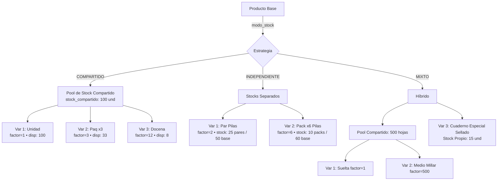
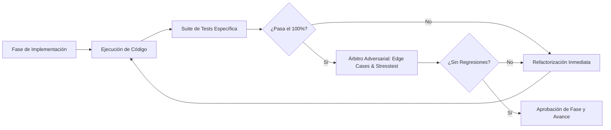

# PLAN MAESTRO: REINGENIERÍA INTEGRAL DE STOCK COMPARTIDO E INDEPENDIENTE POR VARIANTES

**Documento:** `analisis_proyecto/PLAN_REINGENIERIA_STOCK_COMPARTIDO_E_INDEPENDIENTE_VARIANTES.md`  
**Fecha:** Octubre 2026  
**Versión:** 1.0 — Arquitectura Canónica Definitiva  
**Estado:** Esperando Aprobación de Plan de Trabajo (Paso 1: Diagnóstico e Inspección)  
**Metodología:** Loop Autónomo + Árbitro Adversarial (Test-Driven, Zero-Regressions & Zero-Latency)

---

## 1. RESUMEN EJECUTIVO Y OBJETIVOS ESTRATÉGICOS

### 1.1. Contexto y Problema Crítico del Negocio Real
Durante pruebas de campo directas con dueños de negocios comerciales (librerías, ferreterías, bazares y minimarkets), se identificó un cuello de botella arquitectónico severo en el manejo de inventario de productos multivariante en MochilaLista:

Actualmente, el esquema SQLite (`presentaciones_producto`) y la capa de lógica asumen que **cada variante/presentación debe poseer obligatoriamente su propio stock separado e independiente (`stock_actual`)**. Esta limitación fuerza al comerciante a fragmentar artificialmente su stock físico real en inventarios virtuales aislados, produciendo dos anomalías comerciales graves:

1. **Caso Stock Único Compartido (Ej. Hojas A4):**  
   El comerciante compra un millar o un paquete cerrado de **100 Hojas A4** y quiere ofrecerlas al público en 3 variantes:
   * **Unidad Suelta:** 1 hoja a `S/ 0.10` (`factor = 1`).
   * **Paquete x 3:** 3 hojas a `S/ 0.20` (`factor = 3`).
   * **Docena x 12:** 12 hojas a `S/ 1.00` (`factor = 12`).  
   *Hoy el sistema lo obliga a dividir:* asignar 40 unidades sueltas, 10 paquetes de 3 (30 hojas) y 2 docenas (24 hojas). Si un cliente llega y pide 5 docenas (60 hojas), el sistema bloquea la venta por "Stock Insuficiente en Docenas", a pesar de que el comerciante tiene 100 hojas físicas en su mostrador.
2. **Caso Stock Independiente con Conversión Clara (Ej. Pilas en Pares):**  
   El comerciante adquiere una caja de **50 pilas base**, pero vienen en blisters termosellados indivisibles de **2 pilas (Par, `factor = 2`)**. No se pueden vender sueltas. El sistema debe permitirle registrar el ingreso en unidades base (`50 und`), pero la disponibilidad de venta debe expresarse con claridad quirúrgica: **`"Stock vendible: 25 Pares (50 und. base)"`**, sin generar confusiones ni errores de tipeo.
3. **Caso Mixto / Híbrido:**  
   Un mismo producto puede requerir variantes que beban del pool compartido (ej. sueltas, cuartos y docenas de cartulinas) junto a una variante especial empacada por el fabricante que cuenta con lote y stock sellado independiente.

### 1.2. Objetivos de la Reingeniería
* **Flexibilidad Operativa Total:** Soportar de forma nativa los tres modos a nivel producto: `'COMPARTIDO'`, `'INDEPENDIENTE'` y `'MIXTO'`.
* **Zero Latencia (0ms):** Mantener el stock sincronizado mediante transacciones atómicas e indexación eficiente en SQLite, sin recalculos pesados en runtime.
* **Blindaje Contable y Prevención de Duplicación (Crítico):** Garantizar que Inteligencia de Negocio (`analytics_provider.dart`), Valor de Inventario y el Motor de Abastecimiento ROP (`inventory_intelligence_service.dart`) jamás dupliquen o tripliquen el valor de stock compartido.
* **Validación Acumulada en Tiempo Real (Anti-Sobrevuelco de Stock):** Si un cliente compra en Caja Rápida o Cotización 8 Docenas (`96 hojas`) + 2 Paquetes x3 (`6 hojas`), el sistema detecta que la suma (`102 hojas`) excede el stock compartido (`100 hojas`) y bloquea la operación preventivamente en vivo.
* **Cero Regresiones:** El 100% de los flujos existentes (facturación electrónica, escáner de facturas, ventas a crédito, historial de auditoría, PDF/WhatsApp) deben seguir operando de forma transparente.

---

## 2. DIAGNÓSTICO PROFUNDO DE LA ARQUITECTURA ACTUAL (EVIDENCIAS DE CÓDIGO)

Tras la inspección del repositorio, se identificaron los puntos exactos de fricción que deben reestructurarse:

### 2.1. Base de Datos SQLite (`local_db.dart`) y Whitelists de Repositorio
* **Tabla `productos` (Línea 289):**  
  ```sql
  CREATE TABLE productos (
    id INTEGER PRIMARY KEY AUTOINCREMENT, negocio_id INTEGER, 
    categoria_id INTEGER, marca_id INTEGER, codigo_barras TEXT, 
    nombre TEXT, descripcion TEXT, imagen_url TEXT, 
    estado TEXT DEFAULT 'privado', fecha_actualizacion TEXT, ...
  )
  ```
  *Evidencia:* La tabla `productos` **no posee columnas de stock ni modo de inventario**. Todo el stock reside exclusivamente en `presentaciones_producto.stock_actual`.
* **Tabla `presentaciones_producto` (Línea 295):**  
  ```sql
  CREATE TABLE presentaciones_producto (
    id INTEGER PRIMARY KEY AUTOINCREMENT, producto_id INTEGER, 
    ...
    unidad_venta TEXT DEFAULT 'Unidad', unidades_por_venta INTEGER DEFAULT 1,
    costo_unitario_calculado REAL, factor_ganancia_venta REAL,
    precio_venta_final REAL DEFAULT 0.00, stock_actual INTEGER DEFAULT 0,
    ...
  )
  ```
  *Evidencia:* No existe flag `usa_stock_compartido`. Cada fila es un silo aislado.
* **Whitelists Estrictos en `ProductRepository` (`product_repository.dart`, Líneas 703–744):**  
  Cualquier columna nueva añadida a SQLite **debe ser registrada en `_kProductoColumns` y `_kPresentacionColumns`**; de lo contrario, el repositorio la purga silenciosamente (`removeWhere`) en `createFullProductTransaction` (línea 885) y `editFullProductTransaction` (línea 1090).

### 2.2. Guardado y Formulario (`product_form_mapper.dart` y `product_create_operations.dart`)
* **Líneas 42–46 de `product_form_mapper.dart`:**
  ```dart
  int stockVisual = int.tryParse((c['stockFinal'] as TextEditingController).text) ?? 0;
  int stockBaseGuardar = stockVisual * factorVenta;
  ...
  stockActual: stockBaseGuardar,
  ```
  *Evidencia:* El mapeador multiplica el stock visual por el factor de cada tarjeta y lo guarda como un entero independiente en cada variante. No hay concepto de "pool común".
* **Líneas 367–415 de `product_create_screen.dart`:**  
  La interfaz pasa directamente de `ProductGeneralInfo` y `ProductOptionalInfo` a `VariantSectionHeader` y la lista de tarjetas, sin permitir al usuario elegir la estrategia de stock del producto.

### 2.3. Motor de Ventas y POS (`sales_service.dart`, `quick_sale_provider.dart`, `quotation_service.dart`)
* **Deducción de Stock en `SalesService.createSale` (Líneas 116–143):**
  ```dart
  int baseUnitsToDeduct = quantity * factor;
  int newStock = currentStock - baseUnitsToDeduct;
  await txn.rawUpdate(
    'UPDATE presentaciones_producto SET stock_actual = ? WHERE id = ?',
    [newStock, presId],
  );
  ```
  *Evidencia:* Descuenta únicamente de la fila `id = presId`. Las demás variantes del mismo producto quedan intactas con su stock desfasado.
* **Anulación en `SalesService.voidSale` (Líneas 424–435):**  
  Restaura el stock únicamente en la variante de la línea de venta, dejando sin sincronizar las hermanas.
* **Caja Rápida (`quick_sale_provider.dart`, Líneas 182–184 y 291–293):**  
  `addToCart` y `updateQuantity` evalúan el límite de cantidad de forma aislada por `presentationId`:
  ```dart
  if (newQty > product.stock) {
    return "Solo hay ${product.stock} unidades disponibles en stock.";
  }
  ```
  *Evidencia:* Si la Variante A (Docena, stock disp: 8) y la Variante B (Paquete x3, stock disp: 33) están en el carrito, el usuario puede pedir 8 docenas (96 und) + 10 paquetes (30 und) = 126 und sobre un stock de 100, provocando un error en el cobro o sobreventa negativa en BD.
* **Integridad en Cotizaciones (`quotation_service.dart`, Líneas 76–123):**  
  `validateIntegrity` acumula la demanda por `presentation_id` (`totalDemandPerPres[pId]`), pero no agrupa por `producto_id` para variantes compartidas.

### 2.4. Inteligencia de Negocio y Motor ROP (`analytics_provider.dart` y `inventory_intelligence_service.dart`)
* **Cálculo de Valor de Inventario (`analytics_provider.dart`, Líneas 462–468):**
  ```sql
  SELECT SUM(pp.stock_actual * pp.precio_venta_final) as total_inv
  FROM presentaciones_producto pp
  JOIN productos p ON pp.producto_id = p.id
  WHERE p.negocio_id = ? AND pp.activo = 1
  ```
* **Capital Inmovilizado e Inventario Muerto (`analytics_provider.dart`, Líneas 471–514):**
  ```dart
  for (var row in deadStockQuery) {
    int stock = (row['stock_actual'] as num?)?.toInt() ?? 0;
    double cost = (row['costo_unitario_calculado'] as num?)?.toDouble() ?? 0.0;
    immobilizedCapital += stock * cost;
  }
  ```
  *Evidencia Crítica de Duplicación/Triplicación:* Si el comerciante tiene 100 Hojas A4 y 3 variantes con `stock_actual = 100`, la consulta suma:
  `(100 * S/ 0.10) + (100 * S/ 0.20) + (100 * S/ 1.00) = S/ 130` en lugar de S/ 10.00!  
  Y en capital inmovilizado multiplica 3 veces el costo del mismo lote físico.

---

## 3. MODELADO MATEMÁTICO Y ARQUITECTURA DE DATOS UNIFICADA

### 3.1. Definición Formal de los Modos de Stock



### 3.2. Fórmulas de Conversión y Disponibilidad

Sea un producto $P$ con pool de stock base $S_{\text{base}}$ y costo unitario base $C_{\text{base}}$.  
Para cada variante $v_i$ con factor de conversión $F_i$ ($F_i \ge 1$ unidades base por presentación de venta):

1. **Unidades Vendibles Disponibles ($U_{\text{disp}, i}$):**
   $$U_{\text{disp}, i} = \lfloor \frac{S_{\text{disponible}}}{F_i} \rfloor = S_{\text{disponible}} \mathbin{/\mkern-6mu/} F_i$$
2. **Residuo no vendible en esa presentación ($R_i$):**
   $$R_i = S_{\text{disponible}} \pmod{F_i}$$
3. **Costo Teórico de la Presentación ($C_i$):**
   $$C_i = C_{\text{base}} \times F_i$$
4. **Demanda Acumulada en Carrito/Cotización para un Producto Compartido ($D_{\text{total, base}}$):**
   $$D_{\text{total, base}} = \sum_{k \in \text{ítems del producto } P} (Q_k \times F_k)$$
   *Condición de Validez:* $D_{\text{total, base}} \le S_{\text{compartido}}$.

### 3.3. Ejemplos Numéricos Canónicos

#### Caso A: Hojas A4 (Stock Único Compartido)
* **Stock Base Inicial Comprado:** 100 hojas base. Costo base: `S/ 0.05` por hoja.
* **Variantes Configuradas:**
  * $V_1$ (Unidad): $F_1 = 1$, Precio = `S/ 0.10`. Disp = $100 \mathbin{/\mkern-6mu/} 1 = 100$ unidades.
  * $V_2$ (Paquete x3): $F_2 = 3$, Precio = `S/ 0.20`. Disp = $100 \mathbin{/\mkern-6mu/} 3 = 33$ paquetes (sobra 1 hoja).
  * $V_3$ (Docena x12): $F_3 = 12$, Precio = `S/ 1.00`. Disp = $100 \mathbin{/\mkern-6mu/} 12 = 8$ docenas (sobran 4 hojas).
* **Escenario de Venta:**
  * Cliente compra **1 Docena** ($Q=1$, consume $1 \times 12 = 12$ hojas).
  * **Nuevo Stock Base:** $100 - 12 = 88$ hojas base.
  * **Disponibilidad Inmediata Recalculada (0ms):**
    * $V_1$ (Unidad): $88 \mathbin{/\mkern-6mu/} 1 = \mathbf{88\text{ und}}$.
    * $V_2$ (Paquete x3): $88 \mathbin{/\mkern-6mu/} 3 = \mathbf{29\text{ paq}}$ (sobra 1).
    * $V_3$ (Docena x12): $88 \mathbin{/\mkern-6mu/} 12 = \mathbf{7\text{ doc}}$ (sobran 4).

#### Caso B: Pilas Selladas (Stock Independiente con Conversión Clara)
* **Ingreso:** Factura de compra con caja de 50 pilas base.
* **Variante:** $V_{\text{par}}$ (Par de pilas, blister indivisible sellado, $F = 2$).
* **Entrada del Comerciante:** Ingresa 50 unidades base recibidas (o 25 pares).
* **Stock Persistido en SQLite:** `stock_actual = 50` (unidades base).
* **Presentación en UI:** `"Stock para la venta: 25 Pares (50 und. base)"`.
* **Venta:** Si vende 2 pares, consume $2 \times 2 = 4$ pilas base $\to$ Restan 46 pilas base $\to$ Disponibles: 23 pares.

---

## 4. FASE 1: EVOLUCIÓN DEL ESQUEMA SQLITE Y MODELOS DE DATOS

### 4.1. Migración V25 en `local_db.dart`
* **Versión de Base de Datos:** Incrementar de `version: 24` a `version: 25`.
* **Alteración de Tablas (Idempotente y Retrocompatible):**
  ```dart
  // Migración V24 -> V25: Soporte para Stock Compartido e Independiente
  if (oldVersion < 25) {
    try {
      final pCols = await db.rawQuery("PRAGMA table_info(productos)");
      if (!pCols.any((c) => c['name'] == 'modo_stock')) {
        await db.execute("ALTER TABLE productos ADD COLUMN modo_stock TEXT DEFAULT 'INDEPENDIENTE'");
      }
      if (!pCols.any((c) => c['name'] == 'stock_compartido')) {
        await db.execute("ALTER TABLE productos ADD COLUMN stock_compartido INTEGER DEFAULT 0");
      }
      if (!pCols.any((c) => c['name'] == 'costo_base')) {
        await db.execute("ALTER TABLE productos ADD COLUMN costo_base REAL DEFAULT 0.0");
      }
      
      final prCols = await db.rawQuery("PRAGMA table_info(presentaciones_producto)");
      if (!prCols.any((c) => c['name'] == 'usa_stock_compartido')) {
        await db.execute("ALTER TABLE presentaciones_producto ADD COLUMN usa_stock_compartido INTEGER DEFAULT 0");
      }
      
      debugPrint("✅ Migración V25 completada: modo_stock y usa_stock_compartido asegurados");
    } catch (e) {
      debugPrint("Error en migración V25: $e");
    }
  }
  ```
* **Creación Canónica (`_createDB`):**
  * En `productos`: añadir `modo_stock TEXT DEFAULT 'INDEPENDIENTE'`, `stock_compartido INTEGER DEFAULT 0`, `costo_base REAL DEFAULT 0.0`.
  * En `presentaciones_producto`: añadir `usa_stock_compartido INTEGER DEFAULT 0`.
* **Índice Estratégico:**
  ```sql
  CREATE INDEX IF NOT EXISTS idx_presentaciones_compartido 
  ON presentaciones_producto(producto_id, usa_stock_compartido, activo);
  ```

### 4.2. Actualización de Whitelists en `product_repository.dart`
* Agregar a `_kProductoColumns`: `'modo_stock'`, `'stock_compartido'`, `'costo_base'`.
* Agregar a `_kPresentacionColumns`: `'usa_stock_compartido'`.

### 4.3. Modelos de Dominio (`product_model.dart`)
* **`ProductPresentation`:**
  * Nuevo campo `final bool usaStockCompartido;` (default `false`).
  * En `fromJson`: `usaStockCompartido: json['usa_stock_compartido'] == 1 || json['usa_stock_compartido'] == true`.
  * En `toSqlite`: `'usa_stock_compartido': usaStockCompartido ? 1 : 0`.
  * Getter de conveniencia:
    ```dart
    int get unidadesVendiblesDisponibles => 
        stockActual ~/ (unidadesPorVenta > 0 ? unidadesPorVenta : 1);
    ```
* **`Product`:**
  * Nuevos campos: `final String modoStock;` (default `'INDEPENDIENTE'`), `final int stockCompartido;`, `final double costoBase;`.
  * En `fromJson`, `toJson`, `toSqlite` y `copyWith`.
  * Métodos de utilidad:
    ```dart
    bool get isStockCompartido => modoStock == 'COMPARTIDO';
    bool get isStockMixto => modoStock == 'MIXTO';
    bool get isStockIndependiente => modoStock == 'INDEPENDIENTE';
    ```

### 4.4. Mecanismo de Sincronización Atómica en SQLite (0ms Latency)
Para garantizar latencia de 0ms sin obligar a lecturas cruzadas costosas en cada consulta del catálogo:
* Cuando `modo_stock` sea `'COMPARTIDO'` o en variantes donde `usa_stock_compartido = 1`, la base de datos mantendrá `productos.stock_compartido` como el maestro del pool base.
* Toda transacción de actualización o venta ejecuta la sincronización en bloque dentro del mismo `db.transaction`:
  ```sql
  UPDATE productos SET stock_compartido = ? WHERE id = ?;
  UPDATE presentaciones_producto 
  SET stock_actual = ? 
  WHERE producto_id = ? AND usa_stock_compartido = 1;
  ```
* De este modo, cualquier `SELECT` estándar del catálogo que lea `pp.stock_actual` obtiene el dato actualizado de inmediato, permitiendo ordenamientos, filtros de stock bajo y renderizado reactivo a velocidad nativa SQLite.

---

## 5. FASE 2: REDISEÑO DE CREAR Y EDITAR PRODUCTO

### 5.1. Selector Maestro de Estrategia de Stock (`ProductStockStrategySelector`)
* **Ubicación:** Inmediatamente debajo de `ProductOptionalInfo` y antes de `VariantSectionHeader` en `product_create_screen.dart` y `product_edit_screen.dart`.
* **Diseño Visual:** Tarjeta elevada moderna con 3 pestañas/segmentos interactivos con respuesta háptica:
  1. `🔗 Un solo Stock Compartido para todas las variantes` (Color de realce: Teal/Cyan).
  2. `📦 Cada variante con su propio Stock Independiente` (Color de realce: Indigo/Blue).
  3. `⚡ Modo Mixto (Compartido + Independiente)` (Color de realce: Amber/Orange).

### 5.2. Panel Maestro de Stock Compartido (Modo 1)
* Cuando el usuario selecciona `🔗 Stock Compartido`:
  * Se despliega un panel superior destacado con bordes redondeados y fondo suave:
    * **Input Principal:** **Stock Total Físico del Producto** (ej. `100` unidades base sueltas).
    * **Input de Costo Base:** Costo unitario por unidad suelta (ej. `S/ 0.05`).
  * En las tarjetas de variantes inferiores (`ProductPresentationCard`):
    * Se ocultan los campos redundantes de stock inicial e ingreso manual por variante.
    * En su lugar, se muestra una **Píldora Viva de Disponibilidad**:
      * Para "Unidad" ($F=1$): `"🔗 Usa stock compartido: = 100 unidades disponibles"`.
      * Para "Paquete x3" ($F=3$): `"🔗 Usa stock compartido: = 33 paquetes disponibles (sobra 1)"`.
      * Para "Docena" ($F=12$): `"🔗 Usa stock compartido: = 8 docenas disponibles (sobran 4)"`.
    * El costo sugerido de cada variante se calcula automáticamente: $C_{\text{variante}} = C_{\text{base}} \times F_i$, permitiendo al usuario definir directamente su margen y precio de venta.

### 5.3. Calculadora de Stock Independiente Mejorada (Modo 2)
* Cuando se selecciona `📦 Stock Independiente`:
  * Cada tarjeta conserva sus controles individuales de inventario, pero enriquecidos con la **Calculadora de Cajas/Paquetes Indivisibles**:
  * Si el factor es mayor a 1 (ej. Par de Pilas, $F=2$):
    * Permite ingresar tanto en "Unidades Base" (ej. 50 pilas) como en "Presentaciones Finales" (ej. 25 pares) mediante un toggle de entrada intuitivo.
    * Muestra con tipografía destacada: **`"Stock para la venta: 25 Pares (50 und. base)"`**.

### 5.4. Modo Mixto (Modo 3)
* Muestra el panel del pool de stock compartido superior para el producto.
* En cada tarjeta de variante, incorpora un switch visual didáctico en la cabecera:
  * `"🔗 Compartido"` $\longleftrightarrow$ `"📦 Propio"`.
  * Si activa "Compartido", se enlaza al pool común. Si activa "Propio", despliega sus propios campos de inventario independiente.

### 5.5. Persistencia y Mapeo en Edición (`ProductEditOperations`)
* Al abrir `ProductEditScreen`, detecta automáticamente el `modo_stock` actual del producto.
* Si el producto proviene de una versión anterior (`modo_stock` no definido), analiza sus variantes:
  * Si todas comparten el mismo stock base y factores escalonados, sugiere con un banner no invasivo: *"¿Deseas activar el Stock Compartido para este producto?"*.
* Permite modificar stocks, alternar modos y previsualizar en tiempo real el impacto en el inventario antes de guardar mediante el sistema de instantáneas (`ProductEditSnapshot`).

---

## 6. FASE 3: CATÁLOGO, DETALLE DE PRODUCTO Y AJUSTE RÁPIDO DE STOCK

### 6.1. Tarjetas del Catálogo (`CatalogItemCard`) y Modales de Búsqueda
* **Badge Distintivo de Estrategia de Stock:**
  * Si el producto usa **`🔗 Stock Compartido`**:
    * Muestra un badge compacto: `🔗 Stock Compartido: 100 und base`.
    * En la píldora de la variante seleccionada: `Disp: 8 Docenas (de 100 und)`.
  * Si usa **`📦 Stock por Variante`**:
    * Muestra: `Disp: 25 Pares`.
* **Modal de Variantes (`VariantSelectionModal`):**
  * Presenta una vista clara del stock compartido restante para que el vendedor entienda que vender una presentación consume unidades de las demás.

### 6.2. Ventana de Detalle de Producto (`ProductDetailScreen`)
* Dashboard financiero actualizado:
  * Muestra el **Stock Físico Total del Pool** y la tabla de equivalencias de todas las variantes activas en una sola vista.
* Sincronización 360° en caliente:
  * Al editar el stock en detalle, propaga la actualización no solo a la presentación activa sino a todas las hermanas vinculadas en los providers (`CatalogProvider`, `QuickSearchProvider`, `ManualQuoteProvider`).

### 6.3. Modal de Ajuste Rápido de Stock (`StockUpdateModal`)
* Cuando se abre para una variante con **Stock Compartido**:
  * Detecta que pertenece a un pool compartido.
  * Informa al usuario: *"Este producto comparte inventario con otras 2 variantes (Unidad, Paquete x3). El ajuste afectará el stock total disponible."*
  * Al confirmar el ingreso o ajuste (sea en unidades base o en paquetes/docenas ingresadas), la transacción actualiza el pool compartido del producto y recalcula todas las variantes asociadas instantáneamente.

---

## 7. FASE 4: ESCÁNER DE FACTURAS IA (CONCILIACIÓN Y REABASTECIMIENTO)

### 7.1. Análisis del Flujo de Facturas (`scanner_batch_saver.dart`)
Actualmente, el escáner asocia cada ítem extraído de la factura a una presentación mediante `idPres` y suma `stockIngresanteBase` únicamente a esa presentación.

### 7.2. Adaptación para Stock Compartido
* En `ScannerBatchSaver.executeBatchSave`:
  * Al conciliar un producto marcado con `modo_stock == 'COMPARTIDO'` o variantes con `usa_stock_compartido == 1`:
    1. Suma `v.stockIngresanteBase` directamente a `productos.stock_compartido`.
    2. Actualiza `presentaciones_producto.stock_actual` para **todas las variantes** del producto que tengan `usa_stock_compartido == 1`.
    3. Si la factura actualiza el costo (`updateCosto`), actualiza el costo base del producto y redistribuye proporcionalmente el costo calculado de cada variante ($C_i = C_{\text{nuevo}} \times F_i$).
    4. Registra un único asiento principal en `stock_ledger` con `tipo_transaccion: 'COMPRA_FACTURA'` vinculado al producto o a la variante default para evitar duplicidad de movimientos contables.

### 7.3. Adaptación para Stock Independiente
* Mantiene el comportamiento actual: suma exclusivamente al stock de la variante específica y registra su propio movimiento en `stock_ledger`.

---

## 8. FASE 5: REESTRUCTURACIÓN DEL MOTOR DE VENTAS (POS Y COTIZACIONES)

### 8.1. Validación Acumulada en Tiempo Real en Caja Rápida (`quick_sale_provider.dart`)
* **Estructura de Agrupación en Carrito:**
  * Crear un mapa reactivo en memoria: `Map<int, int> _sharedDemandPerProduct;`
* **Algoritmo de Validación en `addToCart` y `updateQuantity`:**
  ```dart
  // 1. Verificar si la presentación usa stock compartido
  if (itemWrapper.presentation.usaStockCompartido) {
    final int prodId = itemWrapper.product.id;
    final int factor = itemWrapper.presentation.unidadesPorVenta;
    
    // Calcular demanda actual de todas las variantes hermanas en el carrito
    int currentDemand = 0;
    for (var item in _currentState.cart) {
      if (item.productId == prodId && item.presentationId != presId) {
        int qty = _currentState.quantities[item.presentationId] ?? 0;
        currentDemand += qty * item.conversionFactor;
      }
    }
    
    int newDemandForThisItem = targetQty * factor;
    int totalDemand = currentDemand + newDemandForThisItem;
    int sharedPool = itemWrapper.product.stockCompartido;
    
    if (totalDemand > sharedPool) {
      int remainingUnits = sharedPool - currentDemand;
      int maxAvailableForThis = remainingUnits > 0 ? (remainingUnits ~/ factor) : 0;
      return "Stock compartido insuficiente. Quedan $remainingUnits und. base disponibles (= $maxAvailableForThis ${itemWrapper.presentation.unidadVenta}).";
    }
  }
  ```
* **UX en Vivo en el Carrito:**
  * Al agregar ítems que comparten stock, el carrito muestra un pill informativo:  
    `"🔗 Stock restante del producto: 4 hojas base"`.

### 8.2. Blindaje en Cotizaciones (`quotation_service.dart`)
* **Reingeniería de `validateIntegrity`:**
  * Modificar las líneas 75–123 para acumular en dos niveles:
    1. `Map<int, int> totalDemandPerPres` (para variantes independientes).
    2. `Map<int, int> totalDemandPerSharedProduct` (para todas las variantes donde `usa_stock_compartido == 1`).
  * Si la suma acumulada de ítems de una cotización excede el stock compartido, emite un `StockWarning` consolidado y bloquea la venta preventivamente (`canSell = false`).

### 8.3. Ejecución Atómica de Venta y Anulación (`sales_service.dart`)
* **En `createSale`:**
  * Si la variante vendida tiene `usa_stock_compartido == 1`:
    * Descuenta `baseUnitsToDeduct` de `productos.stock_compartido`.
    * Actualiza `stock_actual = stock_actual - baseUnitsToDeduct` para todas las variantes con `usa_stock_compartido == 1` del mismo `producto_id`.
    * Inserta en `stock_ledger` especificando la presentación vendida y las unidades base consumidas.
* **En `voidSale` (Anulación):**
  * Si el ítem anulado tiene `usa_stock_compartido == 1`:
    * Devuelve `baseUnitsToRestore` a `productos.stock_compartido`.
    * Actualiza `stock_actual = stock_actual + baseUnitsToRestore` en todas las presentaciones compartidas del producto.
    * Inserta en `stock_ledger` el asiento de anulación.

---

## 9. FASE 6: TRAZABILIDAD (KARDEX DIGITAL) POR PRODUCTO Y VARIANTE

### 9.1. Adaptación de `AuditTrailScreen` (`audit_trail_screen.dart`)
* **Vista Consolidada del Pool Compartido:**
  * Cuando el usuario abre la trazabilidad de un producto con stock compartido, incorpora en el selector superior la opción:  
    **`"🔗 Ver Movimientos del Pool Compartido (Todas las Variantes)"`**.
* **Formato de la Línea de Tiempo:**
  * Cada movimiento detalla con precisión quirúrgica la variante que originó el cambio y el equivalente en unidades base:
    * *"Venta en Caja (Docena x12): -1 doc. (-12 und. base) • Stock restante: 88 und."*
    * *"Venta en Caja (Paquete x3): -2 paq. (-6 und. base) • Stock restante: 82 und."*
    * *"Ingreso por Factura (Millar): +1,000 und. base • Stock restante: 1,082 und."*

### 9.2. Auditoría de Modificaciones de Modo de Stock
* Cuando el usuario cambia en `ProductEditScreen` el modo de un producto (ej. de `Independiente` a `Compartido`):
  * Se inserta un evento en `product_history`:
    * `entidad_tipo: 'PRODUCTO'`
    * `entidad_id: productoId`
    * `campo_modificado: 'modo_stock'`
    * `valor_anterior: 'INDEPENDIENTE'`
    * `valor_nuevo: 'COMPARTIDO'`
    * `fecha_cambio: DateTime.now().toIso8601String()`

---

## 10. FASE 7: BLINDAJE CONTABLE EN INTELIGENCIA DE NEGOCIO Y MOTOR ROP

### 10.1. Prevención de Duplicación/Triplicación en `analytics_provider.dart`
* **Consulta Reestructurada de Valor de Inventario (Línea 462):**
  Para evitar sumar múltiples veces el mismo inventario físico:
  ```sql
  -- 1. Valor de productos con stock compartido (se contabiliza 1 sola vez por producto usando el precio de la variante principal o costo base)
  SELECT 
    IFNULL(SUM(p.stock_compartido * (
      SELECT pr_def.precio_venta_final / CASE WHEN pr_def.unidades_por_venta > 0 THEN pr_def.unidades_por_venta ELSE 1 END
      FROM presentaciones_producto pr_def 
      WHERE pr_def.producto_id = p.id AND pr_def.activo = 1 
      ORDER BY pr_def.es_default DESC, pr_def.orden ASC LIMIT 1
    )), 0.0) as valor_compartido
  FROM productos p
  WHERE p.negocio_id = ? AND p.modo_stock = 'COMPARTIDO' AND p.stock_compartido > 0;

  -- 2. Valor de variantes con stock independiente
  SELECT 
    IFNULL(SUM((pp.stock_actual / CASE WHEN pp.unidades_por_venta > 0 THEN pp.unidades_por_venta ELSE 1 END) * pp.precio_venta_final), 0.0) as valor_independiente
  FROM presentaciones_producto pp
  JOIN productos p ON pp.producto_id = p.id
  WHERE p.negocio_id = ? AND pp.activo = 1 AND (pp.usa_stock_compartido = 0 OR p.modo_stock = 'INDEPENDIENTE') AND pp.stock_actual > 0;
  ```
* **Suma Total del Valor de Inventario:**
  $$\text{Valor Total} = \text{valor\_compartido} + \text{valor\_independiente}$$
* **Capital Inmovilizado e Inventario Muerto (Líneas 471–514):**
  * Agrupar por `producto_id` para variantes compartidas, calculando el capital inmovilizado una única vez:
    $$\text{Capital Inmovilizado} = S_{\text{compartido}} \times C_{\text{base}}$$

### 10.2. Motor Inteligente de Abastecimiento (ROP) (`inventory_intelligence_service.dart`)
* Para productos con **Stock Compartido**:
  * La velocidad de venta se consolida a nivel del producto base:
    $$\text{Velocidad Base} = \sum (\text{Ventas de cada variante} \times F_{\text{variante}})$$
  * La alerta de quiebre (ROP) y sugerencia de compra se calculan sobre el pool total de unidades base, no sobre variantes aisladas. Esto evita emitir falsas alertas de "Docena Agotada" cuando aún existen 80 unidades base en el mostrador.

---

## 11. METODOLOGÍA DE EJECUCIÓN: LOOP AUTÓNOMO Y ÁRBITRO ADVERSARIAL

Seguiremos nuestra metodología rigurosa de 5 Fases de implementación, con verificación continua mediante **Tests Automatizados y Árbitro Adversarial**:



### Plan de Fases de Ejecución:
1. **Fase 1: SQLite V25, Modelos y Whitelist del Repositorio**
   * *Entregable:* Migración de base de datos, actualización de `ProductPresentation` y `Product`, adición a whitelists de `ProductRepository`.
   * *Test Árbitro:* `test/stock_compartido_sqlite_v25_migration_test.dart`.
2. **Fase 2: UI Crear y Editar Producto (Selector Maestro y Tarjetas)**
   * *Entregable:* Selector de estrategia, panel de stock compartido, calculadora independiente, mapeo reactivo.
   * *Test Árbitro:* `test/stock_compartido_create_edit_ui_test.dart`.
3. **Fase 3: Catálogo, Detalle y Ajuste Rápido de Stock**
   * *Entregable:* Badges en tarjetas de catálogo, visualización en detalle, modal de ajuste rápido conectado al pool común.
   * *Test Árbitro:* `test/stock_compartido_catalog_and_modal_test.dart`.
4. **Fase 4: Motor de Ventas (Caja Rápida POS, Cotizaciones y Ventas)**
   * *Entregable:* Validación acumulada en tiempo real en carrito, soporte en cotizaciones, deducción y anulación atómica en `SalesService`.
   * *Test Árbitro:* `test/stock_compartido_pos_and_sales_engine_test.dart`.
5. **Fase 5: Blindaje Contable BI, ROP, Trazabilidad y Escáner IA**
   * *Entregable:* Corrección en `analytics_provider.dart`, kardex digital consolidado, integración en `scanner_batch_saver.dart`.
   * *Test Árbitro:* `test/stock_compartido_bi_kardex_scanner_test.dart`.

---

## 12. MATRIZ DE RIESGOS, MITIGACIONES Y RESUMEN DE ARCHIVOS

### 12.1. Matriza de Riesgos y Mitigaciones
| Riesgo Técnico Identificado | Nivel de Severidad | Estrategia de Mitigación Inmune |
| :--- | :---: | :--- |
| **Purga de nuevas columnas por Whitelist SQLite** | **Crítico** | Actualizar `_kProductoColumns` y `_kPresentacionColumns` en `product_repository.dart` antes de cualquier operación en base de datos. |
| **Duplicación de inventario en reportes contables** | **Crítico** | Separar consultas SQL de stock compartido (agrupado por producto) y stock independiente en `analytics_provider.dart`. |
| **Sobrevuelo de stock compartido por concurrencia en carrito** | **Alto** | Validación acumulada en memoria en `QuickSaleProvider` sumando $Q_i \times F_i$ y validación final atómica en `SalesService.createSale`. |
| **Pérdida de datos en productos existentes** | **Crítico** | Migración V25 con valores `DEFAULT` que preserva el 100% de productos existentes en modo `'INDEPENDIENTE'`. |
| **Desfase de stock en pantalla al ajustar una variante** | **Medio** | Sincronización bidireccional en caliente a `InventoryProvider`, `CatalogProvider` y `QuickSearchProvider`. |

### 12.2. Mapa Completo de Archivos Involucrados

| Módulo / Capa | Ruta Exacta del Archivo |
| :--- | :--- |
| **Base de Datos** | `app_movil/lib/core/database/local_db.dart`<br/>`app_movil/lib/core/database/product_queries.dart` |
| **Modelos** | `app_movil/lib/features/catalog/models/product_model.dart`<br/>`app_movil/lib/features/catalog/models/inventory_wrapper.dart`<br/>`app_movil/lib/features/catalog/models/product_create_draft.dart` |
| **Repositorio** | `app_movil/lib/features/catalog/repositories/product_repository.dart` |
| **Crear / Editar Producto** | `app_movil/lib/features/catalog/screens/product_create_screen.dart`<br/>`app_movil/lib/features/catalog/screens/product_edit_screen.dart`<br/>`app_movil/lib/features/catalog/widgets/form/product_create_operations.dart`<br/>`app_movil/lib/features/catalog/widgets/form/product_form_mapper.dart`<br/>`app_movil/lib/features/catalog/widgets/form/product_controller_factory.dart`<br/>`app_movil/lib/features/catalog/widgets/edit/product_edit/product_edit_operations.dart` |
| **Tarjetas y Presentaciones** | `app_movil/lib/core/widgets/product_presentation_card.dart`<br/>`app_movil/lib/core/widgets/presentation_card/presentation_stock_section.dart`<br/>`app_movil/lib/core/widgets/presentation_card/presentation_math_engine.dart` |
| **Catálogo y Detalle** | `app_movil/lib/core/widgets/catalog_item_card.dart`<br/>`app_movil/lib/features/catalog/screens/product_detail_screen.dart`<br/>`app_movil/lib/core/widgets/stock_update_modal.dart`<br/>`app_movil/lib/features/catalog/providers/inventory_provider.dart` |
| **Caja Rápida y Cotizaciones** | `app_movil/lib/features/smart_quotation/providers/quick_sale_provider.dart`<br/>`app_movil/lib/features/smart_quotation/services/sales_service.dart`<br/>`app_movil/lib/features/smart_quotation/services/quotation_service.dart`<br/>`app_movil/lib/features/smart_quotation/screens/quick_sale_screen.dart` |
| **Trazabilidad y Kardex** | `app_movil/lib/features/analytics/screens/audit_trail_screen.dart` |
| **Estadísticas y BI (ROP)** | `app_movil/lib/features/analytics/providers/analytics_provider.dart`<br/>`app_movil/lib/features/analytics/services/inventory_intelligence_service.dart` |
| **Escáner de Facturas IA** | `app_movil/lib/features/scanner/services/scanner_batch_saver.dart` |
| **Suites de Tests (Árbitro)** | `app_movil/test/stock_compartido_*.dart` (5 suites dedicadas) |

---
**Fin del Documento de Planificación Maestra.**  
*Esperando revisión y aprobación del usuario para proceder con la ejecución de la Fase 1.*
