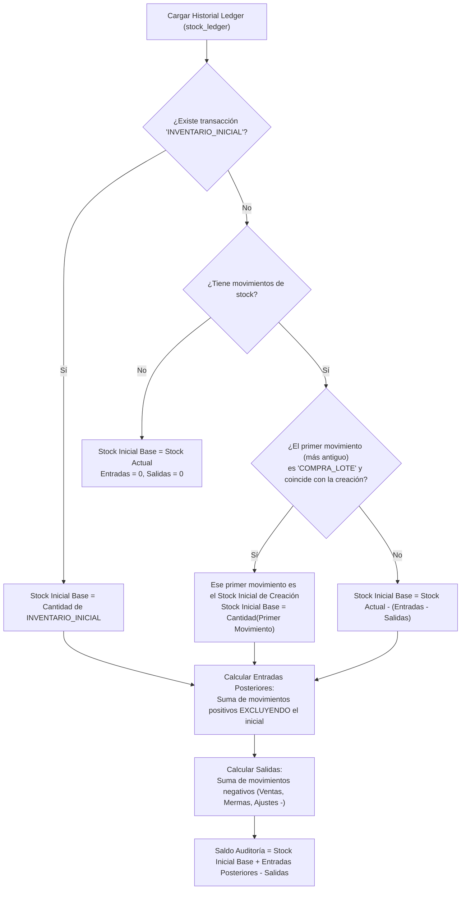
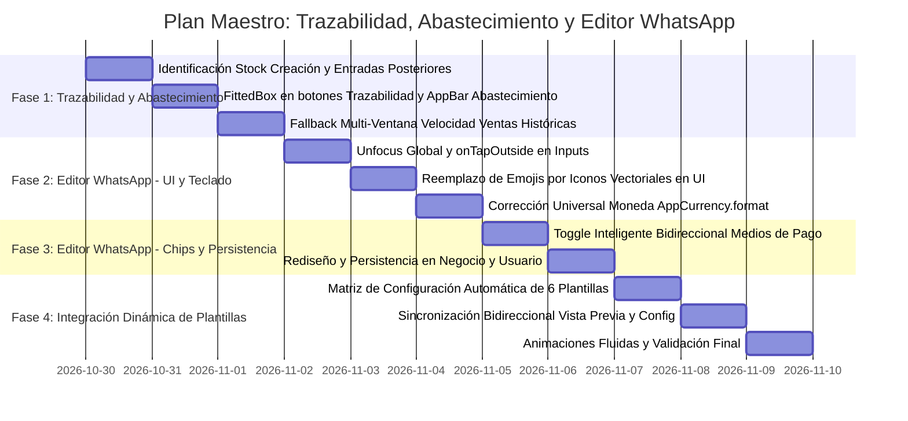

# PLAN MAESTRO: TRAZABILIDAD (STOCK INICIAL DE CREACIÓN Y BALANCE HISTÓRICO), VELOCIDAD COHERENTE EN ABASTECIMIENTO Y REINGENIERÍA INTEGRAL DEL EDITOR WHATSAPP

**Documento:** `analisis_proyecto/PLAN_TRAZABILIDAD_STOCK_INICIAL_Y_REINGENIERIA_EDITOR_WHATSAPP.md`  
**Fecha:** 30 de Octubre de 2026  
**Versión:** 1.0 — Especificación Técnica Definitiva (Mobile Awards Quality)  
**Estado:** Esperando Aprobación de Plan de Trabajo (Paso 1: Diagnóstico Forense y Arquitectura de Solución)  
**Metodología:** Loop Autónomo + Árbitro Interno Adversarial (Zero-Regressions, Zero-Unicode-Emojis-In-UI, Zero-Cutoff-Texts & Real-Stock-Parity)

---

## 1. RESUMEN EJECUTIVO Y OBJETIVOS ESTRATÉGICOS

### 1.1. Contexto y Diagnóstico de Problemas Detectados
Tras la auditoría funcional y de experiencia de usuario sobre las ventanas de **`Trazabilidad`**, **`Motor Inteligente de Abastecimiento`** y **`Editor WhatsApp`**, contrastada detalladamente con las **5 capturas de pantalla reales en vivo**, se han identificado fallas de lógica contable, incoherencias de cálculo y deficiencias de interacción que confunden al comerciante y degradan la calidad del producto:

1. **Paradoja de Stock Inicial Base en `Trazabilidad` (`Imágenes 1 y 2`):**
   * En `Quitaesmalte • Fresa 35ml` (`Imagen 1`), la pantalla muestra: `Stock Inicial Base: 0 und. base`, `Entradas: +6`, `Salidas: -0` $\rightarrow$ `Saldo Auditoría: 0 + 6 - 0 = 6 und. base`.
   * En `Aceite • 900ml` (`Imagen 2`), muestra: `Stock Inicial Base: 0 und. base`, `Entradas: +3`, `Salidas: -2` $\rightarrow$ `Saldo Auditoría: 0 + 3 - 2 = 1 und. base`.
   * **Causa Raíz Forense:** El producto nació con ese stock inicial (ya sea creado manualmente con existencias o ingresado por primera vez desde el escáner de facturas). Sin embargo, `audit_trail_screen.dart` acumula ciegamente todo registro positivo de `stock_ledger` dentro de `_totalEntradas`. Al aplicar la fórmula reversa `stockActual - (totalEntradas - totalSalidas)`, el stock inicial da **matemáticamente `0` siempre**, dando la falsa impresión de que el producto nació vacío.
   * **Objetivo:** Diferenciar el **Stock Inicial de Creación** (punto de partida con el que nace el producto o variante) de las **Entradas Posteriores de Reabastecimiento**. Si el producto se creó con 6 unidades y no ha tenido nuevas compras ni ventas, debe mostrar: **`Stock Inicial Base: 6 und. base`**, **`Entradas: +0 und. base`**, **`Salidas: -0 und. base`** $\rightarrow$ **`Saldo Auditoría: 6 + 0 - 0 = 6 und. base`**.

2. **Cortes de Texto en Botones y AppBar + Discrepancia en Velocidad de Ventas (`Imágenes 1 y 2`):**
   * En `audit_trail_screen.dart`, los botones sobre la conciliación sufren truncamiento elíptico en pantallas de 320dp a 360dp: **`↓ Entradas: +6 und. ...`** y **`↑ Salidas: -0 und. b...`**.
   * En `smart_restock_screen.dart`, el título del AppBar se trunca como **`Motor Inteligente de Ab...`** debido a que los botones de acción restringen el ancho disponible.
   * En `smart_restock_screen.dart`, para productos como `Aceite PRIMOR • 900ml` que cuentan con ventas registradas en kardex (`Venta en Caja: -2 und.`), la tarjeta muestra **`Velocidad: Sin ventas`** debido a un límite rígido de 30 días que no contempla la rotación histórica real.

3. **Inconsistencias y Multiplicación de Texto en Chips de Pago de `Editor WhatsApp` (`Imagen 5`):**
   * En `Mi Negocio & Pagos`, al tocar un chip (`+ Yape`, `+ Plin`, `+ BCP`, etc.), se inserta texto en el campo. Pero si el usuario vuelve a presionar el chip, en vez de desmarcarse y borrar la línea, vuelve a insertar el texto una y otra vez de forma desordenada y pegada (`Yape: 976644890 Yape: 976644890 ... BCP Soles: BCP Soles:`).
   * **Objetivo:** Convertir los chips en **selectores inteligentes con estado activo/inactivo (toggle real)**, sincronización bidireccional en tiempo real con el campo de texto, inserción ordenada en líneas separadas y micro-animaciones fluidas.

4. **Ambigüedad y Persistencia Incompleta del Marcador "Actualizar mis datos por defecto" (`Imagen 5`):**
   * El texto `"Actualizar mis datos por defecto"` es ambiguo para el comerciante.
   * La persistencia en `whatsapp_preview_screen.dart` solo guardaba datos del negocio (`negocios`), omitiendo actualizar el teléfono de contacto modificado en la tabla `usuarios` y en `AuthProvider`.
   * **Objetivo:** Rediseñar la sección con un título y subtítulo claros (**`Guardar estos cambios en el perfil de mi negocio`** / *"Actualiza tu teléfono, RUC, dirección y cuentas de pago como predeterminados para futuras cotizaciones"*), garantizando persistencia integral atómica en SQLite y en memoria.

5. **Teclado Persistente sin Desactivación al Tocar Fuera:**
   * Al interactuar con los campos de texto (`Vista Previa Editable`, `Teléfono`, `RUC`, `Dirección`, `Cuentas`), el teclado permanece abierto aunque el usuario toque fuera o se desplace por la pantalla.
   * **Objetivo:** Integrar desenfoque suave automático (`FocusManager.instance.primaryFocus?.unfocus()`) mediante `onTapOutside` en todos los inputs y detección global táctil.

6. **Desconexión entre `ESTILO DE PLANTILLA`, `Personalizar Mensaje`, `Mi Negocio & Pagos` y `VISTA PREVIA` (`Imágenes 3, 4 y 5`):**
   * Seleccionar un estilo de plantilla (`Comercial Detallado`, `Resumen Directo`, `Cierre de Oferta`, etc.) solo cambiaba la frase introductoria, sin configurar los toggles de `Personalizar Mensaje` ni los chips de `VISTA PREVIA`.
   * **Objetivo:** Implementar una integración dinámica y unificada donde cada una de las 6 plantillas configure inteligentemente las opciones de mensaje y chips de previsualización con transiciones animadas, manteniendo el 100% de libertad para que el comerciante pueda ajustar cualquier opción manualmente sin quedar atado a la plantilla.

7. **Moneda No Estándar (`*5,05 S/*`) y Emojis Unicode en Controles de UI (`Imagen 3`):**
   * La vista previa redacta montos invertidos con coma (`*5,05 S/*`) en lugar del estándar nacional peruano `*S/ 5.05*` respaldado por `AppCurrency.format(...)`.
   * Los widgets y chips de la interfaz contienen emojis Unicode hardcodeados (`✨`, `⚡`, `🔥`, `🔔`, `🤝`, `📦`, `⏳`, `🚚`, `🙏`, `📱`, `🏦`, `🏛️`), lo que genera inconsistencias visuales según la versión de Android.
   * **Objetivo:** Cero emojis Unicode en los widgets de la app (sustituidos por elegantes iconos vectoriales `Icons.*`), unificando el formato de moneda a través de `AppCurrency.format(...)`.

---

### 1.2. Principios y Metodología: Loop Autónomo + Árbitro Interno Adversarial
* **Fase de Análisis y Diseño (Actual):** Diagnóstico forense en código (archivos y líneas exactas), tabla de verdad contable de stock, matriz interactiva de las 6 plantillas y arquitectura de persistencia. **Cero modificaciones de código hasta la aprobación del usuario.**
* **Fase de Ejecución:** Implementación modular y atómica guiada por pruebas estáticas y verificación de no-regresión.
* **Árbitro Interno Adversarial (Criterios de Aceptación Inflexibles):**
  1. *Regla de Oro Contable:* En productos recién creados sin movimientos posteriores, `Stock Inicial Base == Stock Actual`, `Entradas == 0`, `Salidas == 0`, `Saldo == Stock Actual`.
  2. *Cero Overflows & Cero Truncamientos:* Cero textos cortados con `...` en botones de Trazabilidad y en el AppBar de Abastecimiento en pantallas desde `320dp` hasta `420dp`.
  3. *Toggle Limpio en Medios de Pago:* Al desmarcar un chip activo, su línea desaparece inmediatamente del campo de texto sin duplicaciones ni saltos de línea huérfanos.
  4. *Cero Emojis en Controles UI:* Ni un solo emoji Unicode en chips, botones ni tarjetas de configuración de la interfaz. Los emojis opcionales solo existen en el cuerpo del mensaje de WhatsApp enviado al cliente.
  5. *Persistencia Real Blindada:* Al marcar *"Guardar estos cambios en el perfil de mi negocio"*, los cambios en teléfono, RUC, dirección y cuentas se persisten en `usuarios`, `negocios` y `AuthProvider`.

---

## 2. DIAGNÓSTICO FORENSE EN CÓDIGO (ARCHIVOS Y LÍNEAS EXACTAS)

### 2.1. Trazabilidad: Cálculo de Stock Inicial Base y Entradas
* **Archivo:** `app_movil/lib/features/analytics/screens/audit_trail_screen.dart`
* **Líneas exactas:**
  * **L160 – L171:**
    ```dart
    int entradas = 0;
    int salidas = 0;
    for (var item in data) {
      if (item['source_type'] == 'STOCK_OP') {
        int q = (item['cantidad'] as num?)?.toInt() ?? 0;
        if (q > 0) {
          entradas += q; // ⚠️ Suma todo: creación inicial + compras posteriores
        } else {
          salidas += q.abs();
        }
      }
    }
    ```
  * **L558:**
    ```dart
    "Stock Inicial Base: ${_currentStock - (_totalEntradas - _totalSalidas)} und. base"
    // ⚠️ Como _totalEntradas ya incluye el ingreso inicial, la resta siempre arroja 0
    ```
  * **L579:**
    ```dart
    "Saldo Auditoría: ${_currentStock - (_totalEntradas - _totalSalidas)} + $_totalEntradas - $_totalSalidas = $_currentStock und. base"
    // ⚠️ Redacta: 0 + 6 - 0 = 6 und. base (falso origen en 0)
    ```

* **Archivo:** `app_movil/lib/features/catalog/repositories/product_repository.dart`
  * **L462 – L471 / L932 – L941:** Al crear un producto/variante con stock $> 0$, se inserta un registro en `stock_ledger` con `tipo_transaccion: 'INVENTARIO_INICIAL'`. Sin embargo, si se crea con stock $= 0$, no se registra evento inicial en el ledger.

* **Archivo:** `app_movil/lib/features/scanner/services/scanner_batch_saver.dart`
  * **L382 – L392:** Al registrar por primera vez un producto/presentación extraído de una factura, se inserta en `stock_ledger` con `tipo_transaccion: 'COMPRA_LOTE'`. Al no tener bandera de creación, el sistema de auditoría lo confunde con un reabastecimiento posterior.

---

### 2.2. Botones de Trazabilidad y AppBar de Abastecimiento Truncados
* **Archivo:** `app_movil/lib/features/analytics/screens/audit_trail_screen.dart`
  * **L484 – L536:** Los botones de resumen usan `Flexible` con `TextOverflow.ellipsis` sin contenedor escalable:
    ```dart
    Flexible(
      child: Text(
        "Entradas: +$_totalEntradas und. base",
        style: const TextStyle(fontSize: 11, fontWeight: FontWeight.bold, color: Colors.white),
        overflow: TextOverflow.ellipsis, // ⚠️ Produce "Entradas: +6 und. ..."
      ),
    ),
    ```
* **Archivo:** `app_movil/lib/features/analytics/screens/smart_restock_screen.dart`
  * **L615 – L620:**
    ```dart
    title: const Text(
      'Motor Inteligente de Abastecimiento', 
      style: TextStyle(fontSize: 16, fontWeight: FontWeight.bold),
      maxLines: 1,
      overflow: TextOverflow.ellipsis, // ⚠️ Produce "Motor Inteligente de Ab..."
    ),
    ```

---

### 2.3. Incoherencia en Velocidad de Ventas de Abastecimiento
* **Archivo:** `app_movil/lib/features/analytics/services/inventory_intelligence_service.dart`
  * **L57 – L66 & L220 – L230:**
    ```dart
    final dateThreshold = DateTime.now().subtract(Duration(days: daysWindow)).toIso8601String();
    final result = await db.rawQuery('''
      SELECT ...
      FROM stock_ledger
      WHERE presentation_id = ? AND tipo_transaccion IN ('VENTA', 'ANULACION') AND fecha_registro >= ?
    ''', [presentationId, dateThreshold]);
    ```
  * **L88 – L92 & L183 – L185:** Si `totalSold30 == 0`, retorna `0.0`, produciendo rígidamente `"Sin ventas"` a pesar de que la variante o pool tiene ventas registradas en meses previos o en su historial global.

---

### 2.4. Editor WhatsApp: Chips de Pago, Checkbox de Perfil y Formato Moneda
* **Archivo:** `app_movil/lib/features/smart_quotation/widgets/whatsapp/wa_business_section.dart`
  * **L28 – L46:** `_insertPaymentSnippet` concatena texto sin validar si el método ya está presente:
    ```dart
    paymentCtrl.text = "$text\n$snippet"; // ⚠️ Duplica sin desmarcar
    ```
  * **L113 – L151:** Chips con emojis hardcodeados (`+ 📱 Yape`, `+ 🏦 BCP`, etc.) sin estado reactivo activo/inactivo.
  * **L172 – L181:** Checkbox con texto poco intuitivo (`"Actualizar mis datos por defecto"`) y sin subtítulo explicativo.

* **Archivo:** `app_movil/lib/features/smart_quotation/screens/whatsapp_preview_screen.dart`
  * **L316:** `final currency = NumberFormat.currency(locale: 'es_PE', symbol: 'S/ ');` (produce `5,05 S/` en `intl`).
  * **L481, L488, L508:** Inserción de precios con formato invertido (`*5,05 S/*`).
  * **L782 – L789:** Al cambiar de plantilla (`onStyleChanged`), únicamente se altera `_config.style`, dejando los 8 interruptores de `WaConfigSection` y los chips de previsualización totalmente estáticos y desincronizados.
  * **L936 – L963:** `_persistPendingDataIfRequested()` solo actualiza `authProv.updateBusinessProfile()`, dejando sin actualizar el teléfono en la tabla `usuarios` y en el objeto `_activeUser`.

---

## 3. ARQUITECTURA DE SOLUCIÓN Y DISEÑO TÉCNICO

### 3.1. Algoritmo de Conciliación de Trazabilidad: Stock Inicial vs. Reabastecimientos

Para calcular de manera exacta el historial de cualquier producto/variante (tanto con datos legados existentes como con nuevos productos), se implementará la siguiente lógica algorítmica:



#### Ecuación de Balance Contable en Pantalla
$$\text{Saldo Auditoría} = \text{Stock Inicial Base} + \text{Entradas Posteriores} - \text{Salidas} \equiv \text{Stock Actual}$$

* **Caso `Quitaesmalte • Fresa 35ml` (`Imagen 1`):**
  * Nació con: $6\text{ und.}$ por factura de carga inicial.
  * Reabastecimientos posteriores: $0\text{ und.}$
  * Salidas: $0\text{ und.}$
  * Resultado en pantalla:
    * Botón Entradas: `↓ Entradas: +0 und. base`
    * Botón Salidas: `↑ Salidas: -0 und. base`
    * `🏁 Stock Inicial Base: 6 und. base`
    * `🧮 Saldo Auditoría: 6 + 0 - 0 = 6 und. base`

* **Caso `Aceite • 900ml` (`Imagen 2`):**
  * Nació con: $3\text{ und.}$ iniciales.
  * Reabastecimientos posteriores: $0\text{ und.}$
  * Salidas: $2\text{ und.}$ (Venta en caja).
  * Resultado en pantalla:
    * Botón Entradas: `↓ Entradas: +0 und. base`
    * Botón Salidas: `↑ Salidas: -2 und. base`
    * `🏁 Stock Inicial Base: 3 und. base`
    * `🧮 Saldo Auditoría: 3 + 0 - 2 = 1 und. base`

---

### 3.2. Responsividad en Botones y AppBar + Resiliencia en Velocidad de Ventas

1. **Botones de Entradas y Salidas (`audit_trail_screen.dart`):**
   * Reemplazar la combinación rígida `Flexible` + `TextOverflow.ellipsis` por:
     ```dart
     FittedBox(
       fit: BoxFit.scaleDown,
       child: Text("Entradas: +$_totalEntradasPosteriores und. base", ...),
     )
     ```
   * Garantiza legibilidad completa sin cortes con puntos suspensivos en anchos desde `320dp` hasta `420dp`.

2. **AppBar Adaptativo en Motor de Abastecimiento (`smart_restock_screen.dart`):**
   * Envolver el título con `FittedBox(fit: BoxFit.scaleDown, alignment: Alignment.centerLeft)` con tamaño de fuente ajustado a 15sp para coexistir armoniosamente con los botones de ayuda `(?)` y refresco.

3. **Velocidad de Ventas Multi-Ventana con Fallback Histórico Coherente:**
   * En `inventory_intelligence_service.dart`, si en la ventana de 30 días no hay ventas registradas (`totalSold30 == 0`), consultar si existen ventas en todo el historial (`sl.tipo_transaccion == 'VENTA'`).
   * Si existen ventas históricas:
     * Calcular los días activos desde la primera venta registrada hasta la fecha actual:
       $$\text{díasActivos} = \max(1, \text{now} - \text{fechaPrimeraVenta})$$
       $$\text{velocidadHistorica} = \frac{\text{totalVendidoHistorico}}{\text{díasActivos}}$$
     * Formateo semántico adaptativo: si $\text{velocidadHistorica} \times 30 \ge 0.5$, mostrar `${(\text{velocidadHistorica} * 30).toStringAsFixed(1)}/mes (histórico)`; si es menor, mostrar `Baja rotación`.
     * **Resultado:** `Aceite PRIMOR • 900ml` mostrará su rotación real acorde a las ventas visualizadas en el kardex, erradicando el falso mensaje de *"Sin ventas"*.

---

### 3.3. Reingeniería de Chips de Medios de Pago (`WaBusinessSection`)

1. **Arquitectura Toggle Inteligente con Detección Bidireccional:**
   * Se crea un controlador de estado para cada chip (`Yape`, `Plin`, `BCP`, `BBVA`, `CCI`):
     ```dart
     bool isYapeActive = paymentCtrl.text.contains(RegExp(r'\bYape\b', caseSensitive: false));
     bool isPlinActive = paymentCtrl.text.contains(RegExp(r'\bPlin\b', caseSensitive: false));
     bool isBcpActive = paymentCtrl.text.contains(RegExp(r'\bBCP\b', caseSensitive: false));
     bool isBbvaActive = paymentCtrl.text.contains(RegExp(r'\bBBVA\b', caseSensitive: false));
     bool isCciActive = paymentCtrl.text.contains(RegExp(r'\bCCI\b', caseSensitive: false));
     ```
   * Al tocar un chip:
     * Si está **inactivo**: Inserta la línea formateada en una nueva línea limpia (ej. `Yape: 976644890`). Si es banco, inserta `BCP Soles: ` y posiciona el cursor inmediatamente después de los dos puntos para que el comerciante escriba el número de cuenta.
     * Si está **activo**: Remueve con precisión mediante expresión regular la línea correspondiente completa (incluyendo su saldo o número de cuenta), limpiando saltos de línea sobrantes.
   * Si el comerciante borra manualmente el texto en el `TextField`, el chip se desmarca automáticamente en 0ms.

2. **Micro-Animaciones e Iconografía Vectorial Limpia:**
   * Cada chip se implementará con `AnimatedContainer` y `AnimatedScale` para proporcionar feedback háptico y visual inmediato.
   * Cero emojis Unicode en los widgets:
     * `Yape`: `Icons.phone_android_rounded` (Color distintivo: `#732282`)
     * `Plin`: `Icons.smartphone_rounded` (Color distintivo: `#00A3E0`)
     * `BCP`: `Icons.account_balance_rounded` (Color distintivo: `#002A64`)
     * `BBVA`: `Icons.account_balance_rounded` (Color distintivo: `#004481`)
     * `CCI`: `Icons.assured_workload_rounded` (Color distintivo: `Colors.teal`)

---

### 3.4. Rediseño y Blindaje de Persistencia del Marcador de Perfil

1. **Nuevo Componente Visual en `WaBusinessSection`:**
   * **Título:** `Guardar estos cambios en el perfil de mi negocio`
   * **Subtítulo:** `Actualiza tu teléfono, RUC, dirección y cuentas de pago como predeterminados para futuras cotizaciones`
   * **Indicador Visual de Cambios:** Un sutil badge `Modificado` (color ámbar o verde) cuando los valores actuales de los inputs difieran de los datos registrados en el perfil activo.

2. **Blindaje de Persistencia en `whatsapp_preview_screen.dart` (`_persistPendingDataIfRequested`):**
   * Persistencia en `negocios` vía `authProv.updateBusinessProfile(...)` (RUC, dirección, GPS, cuentas de pago).
   * Persistencia en `usuarios` vía `authProv.updateUserProfile(...)` para asegurar que el **teléfono de contacto modificado** quede guardado de forma permanente en la base de datos local y reflejado inmediatamente en el estado global.

---

### 3.5. Cierre Automático del Teclado (Unfocus Global)

1. En cada input (`phoneCtrl`, `rucCtrl`, `addressCtrl`, `paymentCtrl`, `messageCtrl`), agregar la propiedad:
   ```dart
   onTapOutside: (_) => FocusManager.instance.primaryFocus?.unfocus(),
   ```
2. Envolver el cuerpo del `Scaffold` de `whatsapp_preview_screen.dart` con:
   ```dart
   GestureDetector(
     behavior: HitTestBehavior.translucent,
     onTap: () => FocusManager.instance.primaryFocus?.unfocus(),
     child: ...
   )
   ```
   Garantizando que cualquier toque fuera de los campos o interacción con chips y botones cierre suavemente el teclado.

---

### 3.6. Matriz de Integración Unificada: 6 Estilos de Plantilla $\leftrightarrow$ Personalizar Mensaje $\leftrightarrow$ Vista Previa

Al seleccionar cualquiera de los 6 estilos de plantilla en `ESTILO DE PLANTILLA`, el sistema aplicará con transiciones animadas fluidas (`AnimatedContainer`, `AnimatedSwitcher`) la siguiente matriz de configuración predeterminada sobre las 8 opciones de `WaConfigSection` y los chips de `VISTA PREVIA`.

El usuario **conserva siempre el 100% de libertad** para encender o apagar manualmente cualquier opción posterior a la selección de la plantilla:

| Opción de Configuración (`WaConfigSection`) | 1. Comercial Detallado | 2. Resumen Directo | 3. Cierre de Oferta | 4. Estado de Cuenta | 5. Seguimiento Amable | 6. Pedido Listo / Envío |
| :--- | :---: | :---: | :---: | :---: | :---: | :---: |
| **Precios y Subtotales** (`showSubtotals`) | **ACTIVADO** | **ACTIVADO** | **ACTIVADO** | **ACTIVADO** | **ACTIVADO** | DESACTIVADO |
| **Sección de Ahorro** (`showSavingsSection`) | **ACTIVADO** | DESACTIVADO | **ACTIVADO** *(Hero)* | DESACTIVADO | DESACTIVADO | DESACTIVADO |
| **Detalle Descuento** (`showDiscountDetail`) | **ACTIVADO** | DESACTIVADO | **ACTIVADO** *(Tachado)*| DESACTIVADO | DESACTIVADO | DESACTIVADO |
| **Monto Total S/** (`showTotalGlobal`) | **ACTIVADO** | **ACTIVADO** | **ACTIVADO** | **ACTIVADO** | **ACTIVADO** | **ACTIVADO** |
| **Info del Negocio** (`showBusinessInfo`) | **ACTIVADO** | DESACTIVADO | DESACTIVADO | **ACTIVADO** | **ACTIVADO** | **ACTIVADO** *(GPS)* |
| **Medios de Pago** (`showPaymentInfo`) | **ACTIVADO** | **ACTIVADO** | **ACTIVADO** | **ACTIVADO** | DESACTIVADO | **ACTIVADO** |
| **Validez Oferta** (`includeValidity`) | **ACTIVADO** | DESACTIVADO | **ACTIVADO** *(Urgencia)*| DESACTIVADO | **ACTIVADO** | DESACTIVADO |
| **Datos Entrega** (`includeDelivery`) | **ACTIVADO** | DESACTIVADO | DESACTIVADO | DESACTIVADO | DESACTIVADO | **ACTIVADO** *(Hero)* |
| **Saldo / Cuotas (en Ventas/Créditos)** | **ACTIVADO** | **ACTIVADO** | DESACTIVADO | **ACTIVADO** *(Prioridad)*| DESACTIVADO | **ACTIVADO** |

#### Sincronización Bidireccional de Chips en `VISTA PREVIA`:
* Chip `Validez 7 días` $\longleftrightarrow$ Switch `Validez Oferta` (`includeValidity`)
* Chip `Envío / Entrega` $\longleftrightarrow$ Switch `Datos Entrega` (`includeDelivery`)
* Chip `Mis Cuentas` $\longleftrightarrow$ Switch `Medios de Pago` (`showPaymentInfo`)
* Chip `Saludo`: Encendido por defecto en *Comercial*, *Resumen*, *Seguimiento* y *Pedido Listo*.
* Chip `Agradecimiento`: Encendido por defecto en *Comercial*, *Seguimiento* y *Pedido Listo*.

---

### 3.7. Unificación de Formato de Moneda Oficial y Cero Emojis en Controles de UI

1. **Moneda Oficial Peruana:**
   * Reemplazar todas las apariciones de `currency.format(...)` provenientes de `NumberFormat.currency(locale: 'es_PE', symbol: 'S/ ')` en `whatsapp_preview_screen.dart` por **`AppCurrency.format(valor)`**.
   * Resultado visual universal: **`*S/ 5.05*`** (sin comas ni símbolos invertidos).

2. **Iconografía Vectorial en Toda la UI (Cero Emojis Unicode en Controles):**
   * **Estilos de Plantilla:**
     * `Comercial Detallado`: `Icons.receipt_long_rounded`
     * `Resumen Directo`: `Icons.bolt_rounded`
     * `Cierre de Oferta`: `Icons.local_offer_rounded`
     * `Estado de Cuenta`: `Icons.account_balance_wallet_rounded`
     * `Seguimiento Amable`: `Icons.handshake_rounded`
     * `Pedido Listo / Envío`: `Icons.local_shipping_rounded`
   * **Chips de Vista Previa:**
     * `Validez 7 días`: `Icons.timer_outlined`
     * `Envío / Entrega`: `Icons.local_shipping_outlined`
     * `Mis Cuentas`: `Icons.payment_outlined`
     * `Saludo`: `Icons.waving_hand_outlined`
     * `Agradecimiento`: `Icons.thumb_up_alt_outlined`
   * **Chips de Medios de Pago:**
     * `Yape`: `Icons.phone_android_rounded`
     * `Plin`: `Icons.smartphone_rounded`
     * `BCP`: `Icons.account_balance_rounded`
     * `BBVA`: `Icons.account_balance_rounded`
     * `CCI`: `Icons.assured_workload_rounded`

---

## 4. PLAN DE TRABAJO PASO A PASO POR FASES



### FASE 1: Trazabilidad, Stock Inicial Base y Consistencia en Abastecimiento
* **Archivos a intervenir:**
  * `app_movil/lib/features/analytics/screens/audit_trail_screen.dart`
  * `app_movil/lib/features/analytics/services/inventory_intelligence_service.dart`
  * `app_movil/lib/features/analytics/screens/smart_restock_screen.dart`
  * `app_movil/lib/features/catalog/repositories/product_repository.dart`
  * `app_movil/lib/features/scanner/services/scanner_batch_saver.dart`
* **Acciones específicas:**
  1. Refactorizar el cálculo de `_loadAuditTrail` en `audit_trail_screen.dart` para discriminar el movimiento de creación inicial (ya sea `INVENTARIO_INICIAL` o el primer registro de compra `COMPRA_LOTE` al nacer el producto) de los reabastecimientos posteriores.
  2. Implementar la fórmula de auditoría exacta: `Stock Inicial Base: S0 und. base`, `Entradas: +E und. base`, `Salidas: -S und. base` $\rightarrow$ `Saldo Auditoría: S0 + E - S = StockActual und. base`.
  3. Envolver los botones de `Entradas` y `Salidas` con `FittedBox(fit: BoxFit.scaleDown)` eliminando el truncamiento elíptico en pantallas angostas.
  4. En `smart_restock_screen.dart`, ajustar el título del AppBar con `FittedBox(fit: BoxFit.scaleDown, alignment: Alignment.centerLeft)` a 15sp.
  5. En `inventory_intelligence_service.dart`, actualizar `calculateSalesVelocity` y `calculateSharedPoolSalesVelocity` con lógica de fallback histórico para productos con ventas previas fuera de los 30 días, garantizando coherencia absoluta con el kardex.

---

### FASE 2: Ergonomía de Teclado, Formato de Moneda e Iconografía Vectorial
* **Archivos a intervenir:**
  * `app_movil/lib/features/smart_quotation/screens/whatsapp_preview_screen.dart`
  * `app_movil/lib/features/smart_quotation/widgets/whatsapp/wa_business_section.dart`
  * `app_movil/lib/features/smart_quotation/widgets/whatsapp/wa_client_section.dart`
  * `app_movil/lib/features/smart_quotation/widgets/whatsapp/wa_message_editor.dart`
  * `app_movil/lib/features/smart_quotation/models/whatsapp_config_model.dart`
* **Acciones específicas:**
  1. Incorporar `onTapOutside: (_) => FocusManager.instance.primaryFocus?.unfocus()` en todos los campos de texto y envolver la vista principal con `GestureDetector(behavior: HitTestBehavior.translucent, onTap: ...)`.
  2. Sustituir en `whatsapp_preview_screen.dart` todas las llamadas a `currency.format(...)` por `AppCurrency.format(...)` para asegurar la redacción estándar `*S/ 5.05*`.
  3. Limpiar los emojis Unicode de `WhatsAppMessageStyle.label` y de los chips en `wa_message_editor.dart` y `wa_business_section.dart`, sustituyéndolos por elegantes componentes vectoriales `Icons.*`.

---

### FASE 3: Chips Inteligentes de Pago y Persistencia Blindada de Perfil
* **Archivos a intervenir:**
  * `app_movil/lib/features/smart_quotation/widgets/whatsapp/wa_business_section.dart`
  * `app_movil/lib/features/smart_quotation/screens/whatsapp_preview_screen.dart`
  * `app_movil/lib/core/providers/auth_provider.dart`
* **Acciones específicas:**
  1. Implementar la lógica toggle con estado activo/inactivo y detección bidireccional por regex en los chips de `Yape`, `Plin`, `BCP`, `BBVA`, `CCI`.
  2. Al activar un chip, insertar su texto en una nueva línea; al desactivarlo, purgar limpiamente su contenido sin alterar el resto del mensaje.
  3. Rediseñar el componente del checkbox a **`Guardar estos cambios en el perfil de mi negocio`** con subtítulo pedagógico y badge de cambios detectados.
  4. En `_persistPendingDataIfRequested()`, ejecutar la actualización simultánea de `authProv.updateBusinessProfile(...)` y `authProv.updateUserProfile(...)` para asegurar que el teléfono de contacto modificado se guarde permanentemente en SQLite y en memoria.

---

### FASE 4: Integración Dinámica de las 6 Plantillas y Sincronización Animada
* **Archivos a intervenir:**
  * `app_movil/lib/features/smart_quotation/screens/whatsapp_preview_screen.dart`
  * `app_movil/lib/features/smart_quotation/widgets/whatsapp/wa_config_section.dart`
  * `app_movil/lib/features/smart_quotation/widgets/whatsapp/wa_message_editor.dart`
* **Acciones específicas:**
  1. Implementar el despachador de configuraciones automáticas al pulsar un estilo de plantilla en `wa_message_editor.dart`, aplicando la matriz de la Sección 3.6 sobre `_config`.
  2. Dotar a las tarjetas de `wa_config_section.dart` de transiciones reactivas (`AnimatedContainer`, bordes iluminados) para reflejar los cambios inducidos por la plantilla.
  3. Implementar la sincronización bidireccional entre los chips de `VISTA PREVIA` (`Validez 7 días`, `Envío / Entrega`, `Mis Cuentas`) y las opciones correspondientes de `WaConfigSection`.
  4. Preservar la total libertad del usuario para re-personalizar cualquier switch tras seleccionar una plantilla, recalculando la vista previa en 0ms.

---

## 5. PROTOCOLO DEL ÁRBITRO INTERNO ADVERSARIAL Y VALIDACIÓN

Antes de dar por concluida la implementación en las fases subsiguientes, el árbitro interno ejecutará las siguientes verificaciones obligatorias:

1. **Auditoría Contable de Kardex:**
   * Verificar en emulador/dispositivo que un producto recién creado (`Stock: 6`) muestre:
     * `Stock Inicial Base: 6 und. base`
     * `Entradas: +0 und. base`
     * `Salidas: -0 und. base`
     * `Saldo Auditoría: 6 + 0 - 0 = 6 und. base`
   * Verificar que tras una venta de 2 unidades muestre:
     * `Stock Inicial Base: 6 und. base`
     * `Entradas: +0 und. base`
     * `Salidas: -2 und. base`
     * `Saldo Auditoría: 6 + 0 - 2 = 4 und. base`

2. **Inspección de Layout Multi-Resolución (320dp – 420dp):**
   * Verificar que los botones de `Entradas` y `Salidas` en `audit_trail_screen.dart` muestren el texto completo sin `...`.
   * Verificar que el AppBar de `smart_restock_screen.dart` no se corte.

3. **Prueba de Estrés de Chips de Pago en `Editor WhatsApp`:**
   * Tocar repetidamente `Yape` $\rightarrow$ Alterna entre activo y borrado limpio sin duplicar.
   * Seleccionar `Yape`, `Plin` y `BCP` consecutivamente $\rightarrow$ Las tres opciones aparecen ordenadas en tres líneas distintas.
   * Escribir un número en `BCP Soles: 191-xxxx` $\rightarrow$ Al desmarcar el chip `BCP`, se retira la línea completa limpiamente.

4. **Prueba de Persistencia de Perfil:**
   * Modificar el teléfono de contacto y activar *"Guardar estos cambios en el perfil de mi negocio"*.
   * Enviar o guardar $\rightarrow$ Cerrar sesión o reiniciar app $\rightarrow$ El nuevo teléfono permanece en el perfil del negocio y del usuario.

5. **Prueba de Dinamismo de Plantillas:**
   * Cambiar entre `Comercial Detallado` y `Resumen Directo` $\rightarrow$ Los toggles de `Personalizar Mensaje` cambian automáticamente acorde a la matriz.
   * Modificar manualmente un toggle tras seleccionar una plantilla $\rightarrow$ El cambio se respeta y se actualiza el mensaje en tiempo real.

6. **Certificación de Código:**
   * Ejecutar `flutter analyze` o `dart analyze` garantizando 0 errores y 0 advertencias en todos los archivos modificados.
