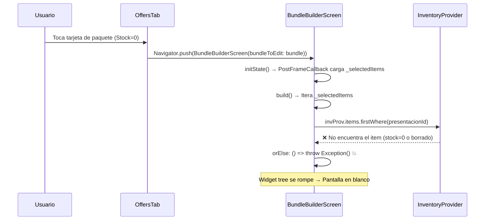

# Plan de Trabajo: Corrección de Crash Crítico y Refactorización del Módulo de Promociones

## Diagnóstico General

Tras un análisis exhaustivo de los archivos clave del módulo de Promociones, he identificado la **causa raíz exacta** del crash de pantalla en blanco, además de múltiples puntos frágiles en la lógica y oportunidades de mejora significativas en la UI/UX.

---

## Fase 1: Diagnóstico y Corrección del Crash Crítico (Pantalla en Blanco)

### 🔴 CAUSA RAÍZ IDENTIFICADA

**Archivo:** [`bundle_builder_screen.dart`](file:///c:/Users/vjuli/Documents/mochilalista-app/app_movil/lib/features/promotions/screens/bundle_builder_screen.dart#L1008-L1011)

**Línea exacta:** `1011`

```dart
final prodWrap = invProv.items.firstWhere(
  (p) => p.presentation.id == item.presentacionId,
  orElse: () => throw Exception() // ← 💥 AQUÍ ESTÁ EL CRASH
);
```

#### Explicación Técnica

Cuando un paquete contiene un producto cuyo stock llega a `0`, ese producto **puede ser filtrado o no encontrarse** en la lista `invProv.items` dependiendo de cómo el `InventoryProvider` gestiona su caché. El `orElse: () => throw Exception()` lanza una excepción **no capturada** dentro del método `build()`.

En Flutter, una excepción no manejada dentro de `build()` provoca que **todo el widget tree se rompa**, mostrando la pantalla gris/blanca que se observa en la captura. Flutter no puede renderizar el `Scaffold` porque la excepción ocurre durante la iteración `..._selectedItems.asMap().entries.map(...)` en la línea 1008, que está inline en el `ListView`.

#### Secuencia del Crash



#### Otros `firstWhere` sin protección en el mismo archivo

| Línea | Contexto | ¿Protegido? |
|-------|----------|-------------|
| `128` | `_totalBaseCost` getter | ✅ `try-catch` |
| `142` | `_totalOriginalPrice` getter | ✅ `try-catch` |
| `220` | `_autoSuggestNameAndPrice` (nombre) | ✅ `try-catch` |
| `245` | `_autoSuggestNameAndPrice` (desc) | ✅ `try-catch` |
| `272` | `_autoSuggestNameAndPrice` (2x1 precio) | ✅ `try-catch` |
| **`1011`** | **`build()` renderizado de items** | **❌ SIN PROTECCIÓN** |

### Plan de Corrección

1. **Reemplazar** `orElse: () => throw Exception()` por `orElse: () => null` y convertir `prodWrap` en `InventoryWrapper?`.
2. **Renderizar un widget de "Producto No Disponible"** cuando `prodWrap == null`, mostrando una tarjeta con advertencia roja en lugar de crashear.
3. **Auditar** las demás llamadas `firstWhere` que usan `try-catch` y unificar la estrategia de manejo.

---

## Fase 2: Auditoría y Refactorización de la Lógica de Bundles

### Problemas Detectados

#### 2.1 Carga Asíncrona Frágil en `initState` (Líneas 60-65)

```dart
WidgetsBinding.instance.addPostFrameCallback((_) {
  final prov = Provider.of<PromotionProvider>(context, listen: false);
  setState(() {
    _selectedItems = List.from(prov.getItemsForBundle(widget.bundleToEdit!.id));
  });
});
```

**Problema:** Se usa `addPostFrameCallback` para cargar los items. Esto introduce un frame donde `_selectedItems` está vacío pero `build()` ya se ejecutó con el precio y nombre del bundle pero sin items. El estado es inconsistente durante 1 frame.

**Solución:** Cargar los items directamente en `initState()` de forma síncrona (ya que `getItemsForBundle` lee del caché en memoria, no de la DB).

#### 2.2 Flag `_userEditedPrice` Inconsistente

En `initState`, cuando se edita un bundle existente, `_userEditedPrice` NO se establece en `true` (línea 58: `// NO bloqueamos _userEditedPrice para que al cambiar tipo se recalcule`). Esto significa que al abrir un paquete existente y cambiar a un tipo de promoción diferente, **el precio guardado se sobrescribe** por el cálculo automático sin que el usuario lo pida explícitamente.

**Solución:** Establecer `_userEditedPrice = true` al cargar un bundle existente, y solo resetearlo cuando el usuario presione explícitamente "Recalcular sugerido".

#### 2.3 `calculateBundleMaxStock` en `PromotionProvider` (Línea 116)

```dart
final productWrap = _inventoryProvider!.items.firstWhere(
  (p) => p.presentation.id == item.presentacionId,
);
```

**Problema:** Este `firstWhere` NO tiene `orElse`. Si un producto fue eliminado del inventario, lanzará `StateError` (Bad state: No element). Está dentro de `try-catch`, pero si falla retorna `0` directamente, lo cual es correcto en comportamiento pero ineficiente (podría loguearse como warning).

**Solución:** Añadir `orElse` explícito en lugar de depender del `catch`.

#### 2.4 Items Huérfanos

No hay mecanismo para detectar y limpiar items de paquetes cuyo producto fue eliminado del inventario. Un paquete podría tener 3 items pero uno de ellos ya no existe, causando inconsistencias silenciosas.

**Solución:** Añadir un método `cleanOrphanedBundleItems()` en el provider que se ejecute al cargar promociones.

### Plan de Corrección

1. Cargar items del bundle de forma síncrona en `initState`.
2. Establecer `_userEditedPrice = true` cuando se edita un bundle existente.
3. Añadir `orElse` a todos los `firstWhere` sin protección.
4. Implementar detección de items huérfanos.

---

## Fase 3: Rediseño UI/UX y Modales Dinámicos

### 3.1 Manejo Visual de Paquetes "Agotados" en `offers_tab.dart`

**Estado Actual:** La tarjeta muestra "0 uds" en rojo pero sigue siendo clickeable sin ninguna advertencia.

**Propuesta:**
- Añadir un **banner visual "AGOTADO"** superpuesto en la tarjeta cuando `maxStock == 0`.
- Mostrar la tarjeta con **opacidad reducida** (0.6) para indicar visualmente que no hay disponibilidad.
- Al presionar, permitir abrir el editor pero mostrar un **SnackBar informativo**: "Este paquete está agotado. Puedes editarlo para reactivarlo cuando haya stock."

### 3.2 Mejoras en `bundle_builder_screen.dart`

**Estado Actual:** El formulario es funcional pero la sección de "Contenido del Paquete" (lista de items) usa `Card` genéricas estáticas.

**Propuesta:**
- Añadir **indicador de stock** en cada item del paquete (tag "Agotado" / "Stock: N").
- Implementar **reordenamiento** de items con `ReorderableListView`.
- Mejorar el **modal de agregar producto** con chips de categorías para filtrado rápido.

### 3.3 Tarjetas de Paquete en `offers_tab.dart`

**Estado Actual:** Las tarjetas muestran la información básica pero son planas.

**Propuesta:**
- Añadir un **icono/emoji del tipo de promoción** (⚡ Flash, 💧 Liquidez, 2x1, etc.) en la tarjeta.
- Mostrar las **fechas de campaña** si existen (ej. "Vigente hasta 20/08").
- Añadir una **barra de progreso de stock** sutil en la parte inferior de la tarjeta.

### Plan de Implementación

1. Rediseñar tarjetas de paquete con badge de tipo, indicador de agotado y barra de stock.
2. Proteger la apertura de bundles agotados con advertencia visual.
3. Mejorar la sección de items del builder con indicadores de stock y widget para producto no encontrado.
4. Refinar el modal de agregar producto.

---

## Resumen de Archivos a Modificar

| Archivo | Fase | Cambio |
|---------|------|--------|
| [`bundle_builder_screen.dart`](file:///c:/Users/vjuli/Documents/mochilalista-app/app_movil/lib/features/promotions/screens/bundle_builder_screen.dart) | 1, 2, 3 | Fix crash, refactor initState, mejorar UI items |
| [`offers_tab.dart`](file:///c:/Users/vjuli/Documents/mochilalista-app/app_movil/lib/features/promotions/screens/offers_tab.dart) | 3 | Rediseñar tarjetas, badge agotado, tipo promo |
| [`promotion_provider.dart`](file:///c:/Users/vjuli/Documents/mochilalista-app/app_movil/lib/features/promotions/providers/promotion_provider.dart) | 2 | Fix firstWhere, limpieza de huérfanos |
| [`bundle_model.dart`](file:///c:/Users/vjuli/Documents/mochilalista-app/app_movil/lib/features/promotions/models/bundle_model.dart) | — | Sin cambios necesarios |
| [`bundle_item_model.dart`](file:///c:/Users/vjuli/Documents/mochilalista-app/app_movil/lib/features/promotions/models/bundle_item_model.dart) | — | Sin cambios necesarios |

## Verificación

### Escenarios de Test Manual
1. Crear un paquete con un producto que tiene stock > 0 → Debe funcionar normalmente.
2. Reducir el stock de ese producto a 0 → La tarjeta debe mostrar "AGOTADO" y al abrirla debe cargar sin crash.
3. Eliminar un producto del inventario que pertenece a un paquete → El paquete debe mostrar "Producto no disponible" en lugar de crashear.
4. Editar un bundle existente y cambiar tipo de promoción → El precio NO debe cambiar a menos que el usuario presione "Recalcular".

### Build Check
```bash
cd app_movil && flutter analyze --no-pub
```
