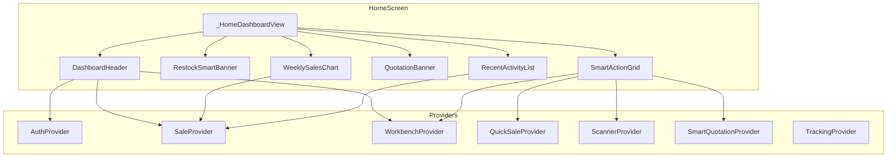

# Plan de Trabajo: Reestructuración Inteligente del Home

## Análisis Arquitectónico Completado

Tras analizar en profundidad los 10+ archivos clave del módulo Home, el dashboard y sus providers asociados, presento el siguiente mapa de dependencias y plan de acción.

### Mapa de Componentes del Home



### Flujo de Datos Actual para Contadores

| Tarjeta | Provider Actual | Dato mostrado | Problema |
|---------|----------------|---------------|----------|
| Cotizar Manual | `WorkbenchProvider` | `inProcessList.length` | ❌ Muestra listas en preparación, NO productos en el carrito manual. No hay un provider dedicado para el carrito manual — los items viven en el estado local de `ManualQuotationScreen._items`. Sin embargo, `SmartQuotationProvider` guarda un borrador (`draftManualItems`) al salir. |
| Venta Rápida | `QuickSaleProvider` | `cartItems.length` | ✅ Correcto |
| Cargar Factura | `ScannerProvider` | Pulsing dot si `aiRawData != null` | ⚠️ Usa un punto pulsante genérico, no un número. Funciona pero no comunica urgencia. |
| Cotizar Lista (IA) | — | Sin badge | ❌ No tiene badge. Pero `SmartQuotationProvider.items` contiene items pendientes. |
| Clientes | — | Sin badge | ❌ No muestra nada. `TrackingProvider._allClients` tiene el conteo pero no se carga desde Home. |
| Actividad | — | Sin badge | ❌ No muestra nada. `SaleProvider.salesHistory` tiene ventas del día. |
| Estadísticas | — | Sin badge | ❌ No muestra nada. |

---

## Fase 1: Refactor del Gráfico (Retráctil y Dinámico)

### Archivo: [`weekly_sales_chart.dart`](file:///c:/Users/vjuli/Documents/mochilalista-app/app_movil/lib/core/widgets/home/weekly_sales_chart.dart)

#### Estado Actual
- Widget `StatelessWidget` de 112 líneas.
- Siempre visible, ocupa ~180px de alto (padding + header + 120px chart + labels).
- Tooltips: Solo muestra valores estáticos encima de cada barra como texto. No hay interacción tap/toggle.
- Sin Empty State: Si no hay ventas, muestra barras grises vacías que no comunican nada.

#### Cambios Propuestos

##### 1.1 Convertir a `StatefulWidget` con toggle retráctil

- Añadir un estado `_isExpanded` (default: `false` — colapsado).
- En estado **colapsado**: Mostrar un mini-resumen horizontal de 1 línea:
  ```
  [📊 Ventas Semana] [S/ 1,234 esta semana] [▼ Expandir]
  ```
  Altura: ~48px (mínimo impacto).
  
- En estado **expandido**: Revelar el gráfico completo con animación suave (`AnimatedCrossFade` o `AnimatedContainer`).

##### 1.2 Empty State elegante

Si `salesHistory` está vacía o todas las ventas de la semana suman 0:
```
┌──────────────────────────────────────────┐
│ 📊  Sin ventas esta semana               │
│ Realiza tu primera venta para ver el     │
│ rendimiento semanal aquí.                │
│                      [Ir a Venta Rápida] │
└──────────────────────────────────────────┘
```
Ocupa ~80px, con un botón de acción para guiar al usuario.

##### 1.3 Interacción Tap/Toggle en barras

Al tocar una barra del gráfico:
- Se fija un **tooltip personalizado y dinámico** que permanece visible hasta que se toque otra barra (pattern ya implementado en Estadísticas con `_selectedIndex`).
- Texto del tooltip personalizado, ejemplo:
  - Si la barra tiene ventas: `"Lunes - S/ 350 (3 ventas)"`
  - Si es el día con más ventas de la semana: `"🔥 ¡Mejor día! Lunes - S/ 350 (3 ventas)"`
  - Si la barra está vacía: `"Martes - Sin ventas"`

**Datos necesarios:** Para contar ventas por día, necesitamos iterar `salesProv.salesHistory` y contar el `length` además del `sum` por día. Ya se itera para calcular totales, solo falta agregar el conteo.

---

## Fase 2: Mapeo de Estados para Contadores de Tarjetas

### Archivo: [`smart_action_grid.dart`](file:///c:/Users/vjuli/Documents/mochilalista-app/app_movil/lib/core/widgets/home/smart_action_grid.dart)

#### 2.1 Cotizar Manual — Badge: Productos en borrador

**Fuente de datos:** `SmartQuotationProvider.draftManualItems`

```dart
// SmartActionGrid ya importa SmartQuotationProvider
final quotationScanner = Provider.of<SmartQuotationProvider>(context);
// Badge:
badge: quotationScanner.hasManualDraft 
    ? _buildBadge("${quotationScanner.draftManualItems!.length}", Colors.blue)
    : null,
```

> [!NOTE]
> `SmartQuotationProvider.draftManualItems` se llena cuando el usuario sale de `ManualQuotationScreen` y tiene items sin guardar (`saveManualDraft()`). Esto refleja exactamente los productos que el usuario ha añadido a su cotización en curso pero aún no ha guardado.

#### 2.2 Venta Rápida — Sin cambios
Se mantiene `QuickSaleProvider.cartItems.length` con badge rojo. ✅

#### 2.3 Cargar Factura — Badge numérico de items pendientes

**Fuente de datos:** `ScannerProvider.aiRawData`

```dart
badge: inventoryScanner.aiRawData != null 
    ? _buildBadge("${inventoryScanner.aiRawData!.items.length}", Colors.teal)
    : null,
```

Cambiamos el punto pulsante genérico por un badge numérico que muestre cuántos items tiene la factura escaneada pendiente de confirmar. Esto comunica claramente al usuario "Tienes 12 productos esperando revisión".

#### 2.4 Cotizar Lista (IA) — Badge de items escaneados pendientes

**Fuente de datos:** `SmartQuotationProvider.items`

```dart
badge: quotationScanner.items.isNotEmpty 
    ? _buildBadge("${quotationScanner.items.length}", Colors.orange)
    : null,
```

Si el usuario escaneó una lista pero no la confirmó/guardó, el badge mostrará cuántos items fueron detectados.

#### 2.5 Clientes — Total de clientes registrados

**Problema:** `TrackingProvider` no se carga en el Home actualmente. Cargar `loadClients()` desde el Home solo para contar sería costoso (hace queries pesadas con ventas y pagos por cada cliente).

**Solución propuesta:** Agregar un getter ligero `clientCount` al `TrackingProvider` y un método eficiente `loadClientCount()` que haga solo `SELECT COUNT(*) FROM clientes WHERE negocio_id = ?`.

```dart
// En TrackingProvider:
int _clientCount = 0;
int get clientCount => _clientCount;

Future<void> loadClientCount() async {
  if (_negocioId == null) return;
  final db = await LocalDatabase.instance.database;
  final result = await db.rawQuery('SELECT COUNT(*) as cnt FROM clientes WHERE negocio_id = ?', [_negocioId]);
  _clientCount = (result.first['cnt'] as int?) ?? 0;
  notifyListeners();
}
```

Esto se invoca desde `DashboardHeader._loadData()` junto con los demás providers, sin impacto de performance.

#### 2.6 Actividad — Ventas del día

**Fuente de datos:** `SaleProvider.salesHistory`

Necesitamos un nuevo getter `todaySalesCount`:

```dart
// En SaleProvider:
int get todaySalesCount {
  if (_salesHistory.isEmpty) return 0;
  final today = DateTime.now();
  return _salesHistory.where((sale) {
    try {
      final saleDate = DateTime.parse(sale.saleDate);
      return saleDate.year == today.year && saleDate.month == today.month && saleDate.day == today.day;
    } catch (e) { return false; }
  }).length;
}
```

En el badge, mostrar:
```dart
badge: salesProv.todaySalesCount > 0 
    ? _buildBadge("${salesProv.todaySalesCount}", Colors.indigo)
    : null,
```

Además, cambiar el `subtitle` dinámicamente:
```dart
subtitle: salesProv.todaySalesCount > 0 
    ? "${salesProv.todaySalesCount} ventas hoy" 
    : "Historial Ventas",
```

#### 2.7 Estadísticas — Propuesta de Métrica

> [!IMPORTANT]
> **Mi propuesta para Estadísticas:** Mostrar el **margen de ganancia promedio del mes actual** como porcentaje.
>
> **Justificación:** Es la métrica más *accionable*. Si el margen baja, el usuario sabe que debe revisar precios o costos. Las ventas totales ya se ven en el header KPI, y el conteo de ventas del día ya lo tiene "Actividad". El margen es información que NO está visible en ningún otro lugar del Home y motiva al usuario a entrar a Estadísticas para profundizar.
>
> **Alternativa:** Si prefieres algo más simple, podríamos mostrar el número total de ventas del mes (disponible en `SalesStatsModel.totalSales`).
>
> Para implementar el margen, necesitamos que `SaleProvider` exponga `currentStats?.averageMargin` o similar, que ya se calcula en `_loadDynamicStats()`.

---

## Fase 3: Ajustes de Responsividad

### Archivo: [`smart_action_grid.dart`](file:///c:/Users/vjuli/Documents/mochilalista-app/app_movil/lib/core/widgets/home/smart_action_grid.dart)

#### Estado Actual
```dart
final int crossAxisCount = screenWidth > 600 ? 3 : 2;
// childAspectRatio: 1.05
```

Esto funciona razonablemente, pero con 2 columnas + badges, en pantallas de ~320px de ancho los textos pueden desbordar.

#### Cambios Propuestos

##### 3.1 Aspect ratio dinámico
```dart
final double aspectRatio = screenWidth > 600 ? 1.1 : (screenWidth > 400 ? 1.05 : 0.95);
```
En pantallas muy pequeñas (< 400px), las tarjetas serán un poco más altas para dar espacio al texto.

##### 3.2 Padding condicional en tarjetas
```dart
padding: EdgeInsets.symmetric(
  horizontal: screenWidth > 400 ? 16 : 10, 
  vertical: screenWidth > 400 ? 12 : 8
),
```

##### 3.3 Font sizes escalables
```dart
// En _buildCard:
fontSize: screenWidth > 400 ? 16 : 14, // para título
fontSize: screenWidth > 400 ? 13 : 11, // para subtítulo
```

##### 3.4 `WeeklySalesChart` responsivo
El gráfico de barras usa `width: 20` fijo. En pantallas estrechas, las barras podrían solaparse. Cambiar a:
```dart
width: screenWidth > 400 ? 20 : 14,
```

---

## Resumen de Archivos a Modificar

| Archivo | Fase | Tipo de Cambio |
|---------|------|---------------|
| [`weekly_sales_chart.dart`](file:///c:/Users/vjuli/Documents/mochilalista-app/app_movil/lib/core/widgets/home/weekly_sales_chart.dart) | 1, 3 | Refactor completo: retráctil, empty state, tooltip tap, responsividad |
| [`smart_action_grid.dart`](file:///c:/Users/vjuli/Documents/mochilalista-app/app_movil/lib/core/widgets/home/smart_action_grid.dart) | 2, 3 | Actualizar badges de todas las tarjetas, ajustar responsividad |
| [`sale_provider.dart`](file:///c:/Users/vjuli/Documents/mochilalista-app/app_movil/lib/features/smart_quotation/providers/sale_provider.dart) | 2 | Añadir getter `todaySalesCount` |
| [`tracking_provider.dart`](file:///c:/Users/vjuli/Documents/mochilalista-app/app_movil/lib/features/smart_quotation/providers/tracking_provider.dart) | 2 | Añadir `clientCount` + `loadClientCount()` |
| [`dashboard_header.dart`](file:///c:/Users/vjuli/Documents/mochilalista-app/app_movil/lib/core/widgets/home/dashboard_header.dart) | 2 | Invocar `loadClientCount()` en `_loadData()` |

## Preguntas Abiertas

> [!IMPORTANT]
> 1. **Estadísticas badge:** ¿Prefieres la propuesta del **margen de ganancia %** o el **total de ventas del mes**?
> 2. **Gráfico colapsado por defecto:** ¿Estás de acuerdo en que el gráfico arranque colapsado (mini-resumen) para priorizar los accesos rápidos? ¿O prefieres que arranque expandido pero que sea colapsable?

## Verificación

### Build Check
```bash
cd app_movil && flutter analyze --no-pub
```

### Test Manual
1. Abrir Home con datos → Gráfico debe estar colapsado, mostrar mini-resumen.
2. Expandir gráfico → Animación suave, tap en barra fija tooltip dinámico.
3. Abrir Home sin datos → Empty state elegante, sin barras vacías.
4. Verificar que cada tarjeta muestre su badge correcto con datos reales.
5. Probar en pantalla estrecha (320px) → Sin desbordes.
