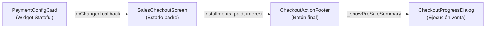

# Refactorización del Sistema de Cronogramas de Crédito

Corrección integral del flujo de ventas a crédito en "Caja y Cierre" para garantizar integridad financiera, consistencia entre UI y estado, y prevención de datos corruptos en la BD.

---

## Diagnóstico de la Arquitectura Actual

Tras analizar los archivos involucrados, los problemas detectados son los siguientes:

### Flujo de datos actual


> [!CAUTION]
> **Toda la lógica de cronogramas vive dentro del widget** [`payment_config_card.dart`](file:///c:/Users/vjuli/Documents/mochilalista-app/app_movil/lib/features/smart_quotation/widgets/checkout/payment_config_card.dart). No hay Provider dedicado al crédito. Los parámetros (`_frecuencia`, `_numCuotasCtrl`, `_interestCtrl`) son estado local del widget y **no se propagan al padre** cuando cambian individualmente — solo se propagan al generar o editar cuotas.

### Bugs confirmados por análisis de código

| # | Bug | Archivo | Línea(s) | Impacto |
|---|-----|---------|----------|---------|
| 1 | **Frecuencia no invalida cronograma.** El `onChanged` del `DropdownButtonFormField` (línea 373) solo hace `setState`, no limpia `_installments` ni notifica al padre. El cronograma queda "sucio" con las fechas de la frecuencia anterior. | [`payment_config_card.dart`](file:///c:/Users/vjuli/Documents/mochilalista-app/app_movil/lib/features/smart_quotation/widgets/checkout/payment_config_card.dart#L373) | 373 | **Crítico** |
| 2 | **N° Cuotas no invalida cronograma.** Si el usuario cambia de 3 a 5 cuotas manualmente, las 3 cuotas generadas previamente persisten intactas. | [`payment_config_card.dart`](file:///c:/Users/vjuli/Documents/mochilalista-app/app_movil/lib/features/smart_quotation/widgets/checkout/payment_config_card.dart#L357) | 357 | **Crítico** |
| 3 | **Edición de fecha sin cascada.** `_editInstallmentDate` (línea 167) solo modifica la cuota `index`, nunca recalcula las subsecuentes. | [`payment_config_card.dart`](file:///c:/Users/vjuli/Documents/mochilalista-app/app_movil/lib/features/smart_quotation/widgets/checkout/payment_config_card.dart#L167-L189) | 167-189 | **Alto** |
| 4 | **Sin validación cronológica.** El `showDatePicker` usa `firstDate: DateTime.now()` como piso (línea 170), pero no verifica contra la cuota `index - 1`. | [`payment_config_card.dart`](file:///c:/Users/vjuli/Documents/mochilalista-app/app_movil/lib/features/smart_quotation/widgets/checkout/payment_config_card.dart#L170) | 170 | **Alto** |
| 5 | **Checkout no valida coherencia de fechas.** `_showPreSaleSummary` (línea 86-93 del footer) solo verifica la suma de montos vs deuda. Nunca audita que las fechas del cronograma no estén invertidas. | [`checkout_action_footer.dart`](file:///c:/Users/vjuli/Documents/mochilalista-app/app_movil/lib/features/smart_quotation/widgets/checkout/checkout_action_footer.dart#L86-L93) | 86-93 | **Medio** |

---

## Propuesta de Cambios

### Fase 1: Sincronización Reactiva (Auto-Invalidación del Cronograma)

#### [MODIFY] [`payment_config_card.dart`](file:///c:/Users/vjuli/Documents/mochilalista-app/app_movil/lib/features/smart_quotation/widgets/checkout/payment_config_card.dart)

**Problema:** Cambiar `Frecuencia` o `N° Cuotas` no invalida el cronograma existente.

**Solución:**
1. En el `onChanged` del `DropdownButtonFormField` de frecuencia (línea 373), agregar lógica para **limpiar automáticamente** `_installments` y notificar al padre (`_notifyParent()`), lo que hará que el botón de "Vender" muestre "FALTA CRONOGRAMA" y se deshabilite.
2. Agregar un `listener` al `_numCuotasCtrl` para que, al cambiar el valor del campo, también invalide el cronograma.
3. Mostrar un **badge visual de advertencia** sobre el botón "Generar Cronograma" cuando el cronograma está invalidado (ej. ícono de `⚠️ Regenerar` con color rojo), para que el usuario sepa que debe volver a presionarlo.
4. También agregar un `_isScheduleDirty` flag booleano que se active al cambiar Frecuencia/Cuotas/Interés y se desactive al presionar "Generar Cronograma".

**Resultado esperado:** El usuario cambia la frecuencia de Mensual a Semanal → el cronograma anterior desaparece → el botón final dice "FALTA CRONOGRAMA" en gris → el usuario presiona "Generar Cronograma" → las fechas se regeneran correctamente con intervalos de 7 días → el botón final se habilita.

---

### Fase 2: Algoritmo de Cascada (Smart Recalculation de Fechas)

#### [MODIFY] [`payment_config_card.dart`](file:///c:/Users/vjuli/Documents/mochilalista-app/app_movil/lib/features/smart_quotation/widgets/checkout/payment_config_card.dart)

**Problema:** `_editInstallmentDate` modifica solo la cuota tocada, dejando las siguientes con sus fechas originales (como se ve en las capturas: Cuota 1 = Sep 25, Cuota 3 = Sep 12, una fecha *anterior*).

**Solución:**
1. Refactorizar `_editInstallmentDate(int index)` para que, después de asignar la nueva fecha a la cuota `index`, itere sobre `index + 1` hasta `_installments.length - 1` y recalcule cada fecha sumando la frecuencia seleccionada (`_frecuencia`) a partir de la fecha de la cuota anterior.
2. Extraer la lógica de "sumar frecuencia" en un helper privado `_addFrequency(DateTime date)` que retorne la fecha sumada (para reutilizar en `_generateInstallments` y en `_editInstallmentDate`).

**Algoritmo esperado:**
```
updateInstallmentDate(index, newDate):
  installments[index].dueDate = newDate
  for i = index + 1 to installments.length - 1:
    previousDate = parseDate(installments[i - 1].dueDate)
    installments[i].dueDate = formatDate(addFrequency(previousDate))
  notifyParent()
```

---

### Fase 3: Validación Cronológica Estricta (Guard Clause)

#### [MODIFY] [`payment_config_card.dart`](file:///c:/Users/vjuli/Documents/mochilalista-app/app_movil/lib/features/smart_quotation/widgets/checkout/payment_config_card.dart)

**Problema:** El `showDatePicker` permite seleccionar cualquier fecha desde hoy, incluso si resulta anterior a la cuota previa.

**Solución:**
1. En `_editInstallmentDate`, calcular dinámicamente el `firstDate` del `showDatePicker`:
   - Para `index == 0`: `firstDate` = mañana (la cuota 1 no puede vencer hoy, que es la fecha de la venta).
   - Para `index > 0`: `firstDate` = fecha de la cuota `index - 1` + 1 día (siempre posterior a la anterior).
2. Si por alguna razón el `picked` viola la restricción (edge case), rechazar el cambio con un `CustomSnackBar` de error y no modificar nada.
3. Mostrar feedback visual: un SnackBar informativo indicando que las cuotas siguientes fueron recalculadas tras la edición.

---

### Fase 4: Auditoría de Checkout (Integrity Guard)

#### [MODIFY] [`checkout_action_footer.dart`](file:///c:/Users/vjuli/Documents/mochilalista-app/app_movil/lib/features/smart_quotation/widgets/checkout/checkout_action_footer.dart)

**Problema:** `_showPreSaleSummary` solo verifica `sumaCuotas vs deudaExacta`. No audita que las fechas sean coherentes (orden cronológico).

**Solución:**
1. En `_showPreSaleSummary`, después de la validación de montos (línea 90), agregar un **loop de auditoría de fechas**:
   ```
   for i = 1 to installments.length - 1:
     if parseDate(installments[i].dueDate) <= parseDate(installments[i-1].dueDate):
       ABORT con SnackBar("Cronograma inválido: la cuota {i+1} vence antes que la cuota {i}")
   ```
2. Validar también que la primera cuota no tenga fecha anterior a hoy.

#### [MODIFY] [`sales_checkout_screen.dart`](file:///c:/Users/vjuli/Documents/mochilalista-app/app_movil/lib/features/smart_quotation/screens/sales_checkout_screen.dart)

**Problema:** `isMathValid` (línea 371) solo evalúa montos. Debe también considerar el flag de "cronograma sucio".

**Solución:**
1. El `onChanged` callback de `PaymentConfigCard` debe ampliarse para recibir un flag booleano `isScheduleDirty`.
2. El `isMathValid` debe ser `false` si `isScheduleDirty == true`, deshabilitando el botón y mostrando un texto tipo "CRONOGRAMA DESACTUALIZADO".

---

## Verificación

### Pruebas Manuales
1. **Test de Sincronización:** Generar cronograma con 3 cuotas mensuales → cambiar frecuencia a Semanal → verificar que el cronograma se borra y el botón final se deshabilita → presionar "Generar Cronograma" → verificar que las 3 cuotas nuevas estén separadas por 7 días.
2. **Test de Cascada:** Generar 3 cuotas semanales → editar la Cuota 1 moviendo su fecha 5 días al futuro → verificar que las Cuotas 2 y 3 se recalcularon automáticamente (+7 días cada una desde la nueva Cuota 1).
3. **Test de Validación:** Intentar editar Cuota 2 poniendo una fecha anterior a Cuota 1 → verificar que el DatePicker no lo permite (el `firstDate` lo bloquea).
4. **Test de Checkout:** Verificar que al intentar cerrar una venta a crédito, el sistema valide la integridad de fechas y montos antes de proceder.

### Compilación
- `flutter build apk` para confirmar que no hay errores de compilación.
