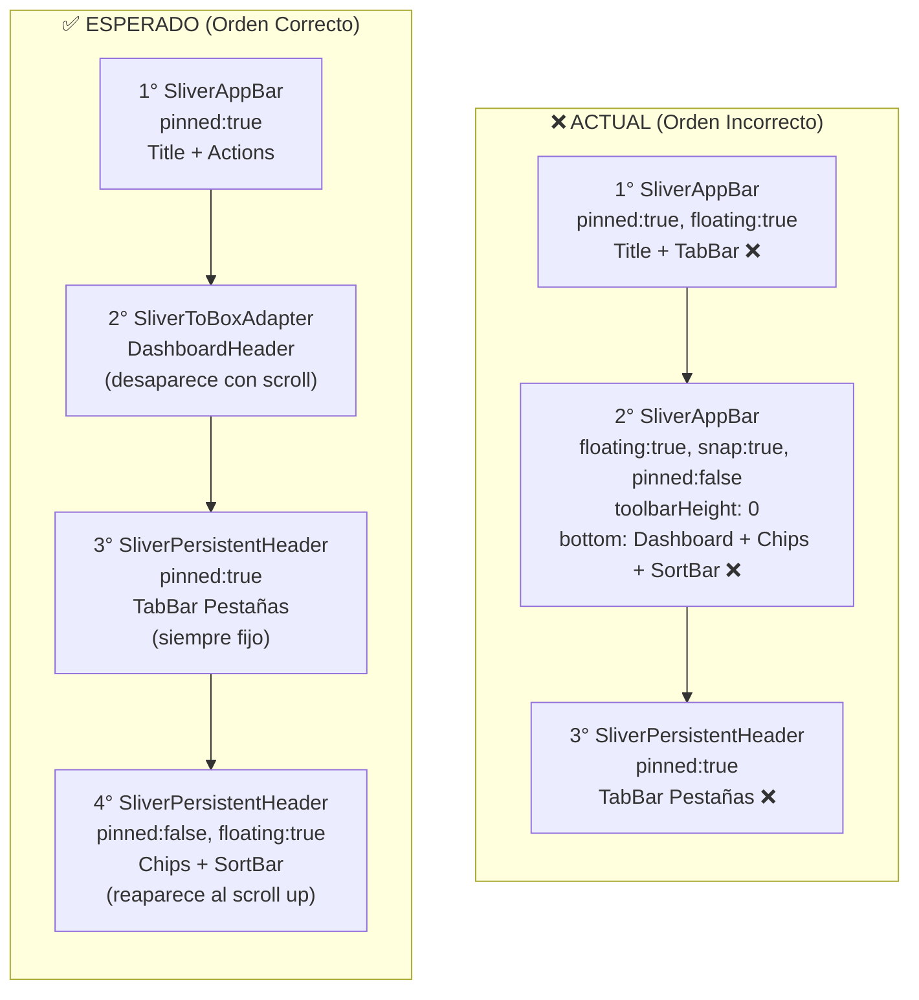

# Reingeniería de la Mesa de Trabajo: Slivers, Gestos y UX Educativo

---

## Diagnóstico Técnico del Estado Actual

### Arquitectura de Slivers (Actual vs. Esperada)



### Tabla de Problemas Confirmados con Evidencia

| # | Bug | Causa Raíz | Archivo | Líneas |
|---|---|---|---|---|
| 1 | **Slivers superpuestos** | Todo el Dashboard, chips y sort están empaquetados en un único `SliverAppBar` con `floating:true, snap:true, pinned:false` y `toolbarHeight: 0`, usando `bottom: PreferredSize(height: 275)`. Esto crea un "bloque fantasma" de 275px que aparece/desaparece como unidad monolítica. Al tener snap, puede superponerse con el `SliverPersistentHeader` de las pestañas que está debajo con `pinned:true`. | [`workbench_screen.dart`](file:///c:/Users/vjuli/Documents/mochilalista-app/app_movil/lib/features/smart_quotation/screens/workbench_screen.dart#L136-L162) | 136-162 |
| 2 | **Orden invertido Tabs↔Filtros** | Las pestañas (`TabBar` "En Preparación / Listas & Packs / Vendidas") están en el **3er** sliver (`SliverPersistentHeader` con `pinned:true`), DEBAJO del bloque monolítico. Esto significa que al hacer scroll, las pestañas sí se quedan fijas pero los filtros (que son el 2do sliver) desaparecen ENCIMA de las pestañas, no debajo. El usuario espera: Dashboard → Tabs fijos → Filtros flotantes. | [`workbench_screen.dart`](file:///c:/Users/vjuli/Documents/mochilalista-app/app_movil/lib/features/smart_quotation/screens/workbench_screen.dart#L164-L173) | 164-173 |
| 3 | **Conflicto Dismissible vs TabBarView** | Cada tarjeta no-vendida se envuelve en un `Dismissible` con `direction: DismissDirection.horizontal`. Esto captura TODOS los swipes horizontales, robándole el gesto al `TabBarView` que necesita swipes horizontales para cambiar de pestaña. El "Gesture Arena" de Flutter resuelve a favor del `Dismissible` porque es el widget más interno. | [`workbench_screen.dart`](file:///c:/Users/vjuli/Documents/mochilalista-app/app_movil/lib/features/smart_quotation/screens/workbench_screen.dart#L404-L448) | 404-448 |
| 4 | **LongPress sin indicador visual** | La tarjeta `QuotationCard` ya soporta `onLongPress` (línea 115), pero no hay NINGÚN indicador visual (icono, texto, tooltip) que le diga al usuario que esta acción existe. Es un "hidden feature". | [`quotation_card.dart`](file:///c:/Users/vjuli/Documents/mochilalista-app/app_movil/lib/features/smart_quotation/widgets/quotation_card.dart#L113-L115) | 113-115 |
| 5 | **Archivadas sin contexto educativo** | El modal `ArchivedListsModal` solo muestra un título "Listas Archivadas" y las tarjetas directamente. Si está vacío, solo dice "No tienes listas archivadas". No hay explicación de qué es archivar, para qué sirve, ni cómo se envían listas aquí. | [`archived_lists_modal.dart`](file:///c:/Users/vjuli/Documents/mochilalista-app/app_movil/lib/features/smart_quotation/widgets/workbench/archived_lists_modal.dart#L21-L42) | 21-42 |

> [!IMPORTANT]
> **Hallazgo crítico sobre el `TabController` listener:** En la línea 33-36, el listener del `_tabController` invoca `setState(() {})` en cada cambio de tab. Esto fuerza un rebuild innecesario de TODO el `build()` (incluidos los Slivers). El `TabBarView` ya se encarga de animar el cambio de contenido. Este `setState` es redundante y puede causar parpadeos. Lo eliminaremos como parte de la limpieza.

---

## Propuesta de Cambios

### Fase 1: Reingeniería de Slivers (Layout Perfecto)

#### [MODIFY] [`workbench_screen.dart`](file:///c:/Users/vjuli/Documents/mochilalista-app/app_movil/lib/features/smart_quotation/screens/workbench_screen.dart) (líneas 88-174)

**Reestructuración completa del `headerSliverBuilder`** para respetar el orden estricto:

```dart
// ═══════════════════════════════════════════════════
// SLIVER 1: AppBar principal (SIEMPRE pinned)
// ═══════════════════════════════════════════════════
SliverAppBar(
  title: "Mesa de Trabajo",
  pinned: true,
  floating: false,  // ← Cambio: ya NO floating
  // actions: [archive, pdf]
),

// ═══════════════════════════════════════════════════
// SLIVER 2: Dashboard KPIs (desaparece con scroll)
// ═══════════════════════════════════════════════════
SliverToBoxAdapter(
  child: DashboardHeader(provider: provider, isDark: isDark),
),

// ═══════════════════════════════════════════════════
// SLIVER 3: TabBar Pestañas (SIEMPRE pinned)
// Se usa SliverPersistentHeader con pinned: true
// Delegate: _WorkbenchFixedHeaderDelegate (ya existe)
// ═══════════════════════════════════════════════════
SliverPersistentHeader(
  pinned: true,
  delegate: _WorkbenchFixedHeaderDelegate(
    height: 74.0,
    child: Container(
      color: bgColor, // ← Fondo opaco para no transparentar
      child: _buildTabBarSection(isDark, surfaceColor),
    ),
  ),
),

// ═══════════════════════════════════════════════════
// SLIVER 4: Chips Filtro + Barra de Ordenamiento (floating)
// Se usa SliverPersistentHeader con pinned: false
// Delegate: _FloatingFilterDelegate (NUEVO)
// Se oculta al bajar, reaparece inmediatamente al subir
// ═══════════════════════════════════════════════════
SliverPersistentHeader(
  pinned: false,
  floating: true,  // ← reaparece al scroll-up
  delegate: _FloatingFilterDelegate(
    maxHeight: 110.0,
    minHeight: 0.0,
    isDark: isDark,
    child: Container(
      color: surfaceColor, // ← Fondo opaco
      child: Column(
        children: [
          _buildFilterChips(provider, isDark),
          _buildCounterAndSortBar(provider, isDark),
        ],
      ),
    ),
  ),
),
```

**Nuevo Delegate para los filtros flotantes:**
```dart
class _FloatingFilterDelegate extends SliverPersistentHeaderDelegate {
  final Widget child;
  final double maxHeight;
  final double minHeight;
  final bool isDark;
  
  // minExtent = 0 → se colapsa completamente al bajar
  // maxExtent = 110 → se expande al subir
  // El framework maneja la animación automáticamente
}
```

> [!NOTE]
> **¿Por qué `SliverPersistentHeader` para los filtros y no un segundo `SliverAppBar`?**
> Usar un `SliverAppBar` dentro de `headerSliverBuilder` cuando ya hay otro `SliverAppBar` principal genera conflictos de `flexibleSpace` y `elevation`. Un `SliverPersistentHeader` con delegate personalizado nos da control total sin efectos secundarios.

**Limpieza adicional:**
- Eliminar el listener redundante de `_tabController` (líneas 33-36) que forzaba `setState(() {})`.
- Cambiar el `SliverAppBar` principal a `floating: false` para que no "brinque" al hacer scroll rápido.

---

### Fase 2: Limpieza de Gestos y Hint Visual en Tarjetas

#### [MODIFY] [`workbench_screen.dart`](file:///c:/Users/vjuli/Documents/mochilalista-app/app_movil/lib/features/smart_quotation/screens/workbench_screen.dart) (líneas 402-448)

**Eliminación completa del `Dismissible`:**

```dart
// ANTES (líneas 402-448)
if (quotation.status == 'SOLD') return card;
return Dismissible( ... child: card ); // ← 47 líneas de swipe

// DESPUÉS
return card; // La tarjeta ya tiene onTap + onLongPress internamente
```

> [!TIP]
> Al eliminar el `Dismissible`, el `TabBarView` recupera el control total del gesto horizontal. El usuario podrá deslizar entre pestañas "En Preparación ↔ Listas & Packs ↔ Vendidas" sin interferencia.

#### [MODIFY] [`quotation_card.dart`](file:///c:/Users/vjuli/Documents/mochilalista-app/app_movil/lib/features/smart_quotation/widgets/quotation_card.dart) (línea 159)

**Añadir indicador visual de "más opciones":**

Se agregará un icono sutil `more_vert` (tres puntos verticales) en la esquina superior derecha de la tarjeta, al lado del badge de estado. Este icono:
- Solo aparece si `quotation.status != 'SOLD'` (las vendidas no tienen acciones rápidas).
- Al ser tocado (`onTap`), invoca directamente `onLongPress()` como atajo.
- Tiene un `Tooltip` con el texto "Mantener presionado para opciones".

```dart
// Estructura del header de la tarjeta:
Row(
  children: [
    CircleAvatar(...),     // Inicial del cliente
    Expanded(Text(...)),   // Nombre del cliente
    _buildStatusBadge(...), // Badge de estado
    if (quotation.status != 'SOLD') ...[
      const SizedBox(width: 4),
      Tooltip(
        message: "Mantener presionado para opciones",
        child: InkWell(
          onTap: onLongPress,
          borderRadius: BorderRadius.circular(20),
          child: Padding(
            padding: EdgeInsets.all(4),
            child: Icon(Icons.more_vert, size: 20, color: isDark ? Colors.grey[500] : Colors.grey[600]),
          ),
        ),
      ),
    ],
  ],
)
```

---

### Fase 3: UX Educativo en Listas Archivadas

#### [MODIFY] [`archived_lists_modal.dart`](file:///c:/Users/vjuli/Documents/mochilalista-app/app_movil/lib/features/smart_quotation/widgets/workbench/archived_lists_modal.dart) (líneas 23-42)

**Añadir Banner Educativo** entre el título y la lista de tarjetas:

```dart
// Después del título "Listas Archivadas", antes del ListView:
Container(
  margin: EdgeInsets.symmetric(horizontal: 20, vertical: 8),
  padding: EdgeInsets.all(16),
  decoration: BoxDecoration(
    color: isDark ? Colors.blue.withOpacity(0.08) : Colors.blue[50],
    borderRadius: BorderRadius.circular(16),
    border: Border.all(color: isDark ? Colors.blue.withOpacity(0.2) : Colors.blue.shade200),
  ),
  child: Column(
    crossAxisAlignment: CrossAxisAlignment.start,
    children: [
      Row(children: [
        Icon(Icons.info_outline, color: isDark ? Colors.blue[300] : Colors.blue[700], size: 20),
        SizedBox(width: 8),
        Text("¿Qué son las Listas Archivadas?", style: TextStyle(fontWeight: FontWeight.bold, ...)),
      ]),
      SizedBox(height: 8),
      Text("Aquí se guardan las listas que has inhabilitado temporalmente. "
           "No afectan tus estadísticas ni aparecen en tu Mesa de Trabajo activa.", ...),
      SizedBox(height: 8),
      Text("💡 Puedes archivar una lista manteniendo presionada su tarjeta "
           "en la Mesa de Trabajo, o desde su pantalla de detalles.", ...),
    ],
  ),
)
```

Este banner es **siempre visible** (no se oculta). Si la lista está vacía, se muestra el banner + el mensaje "No tienes listas archivadas" debajo.

---

## Verificación

### Pruebas Manuales
1. **Scroll Behavior:** Hacer scroll rápido en la Mesa de Trabajo:
   - El Dashboard KPI debe desaparecer hacia arriba.
   - Las pestañas "En Preparación / Listas & Packs / Vendidas" deben quedar fijas en el techo.
   - Los chips de filtro deben desaparecer al bajar, pero reaparecer al hacer un ligero scroll hacia arriba (debajo de las pestañas).
2. **Swipe entre pestañas:** Deslizar horizontalmente sobre una tarjeta debe cambiar de pestaña, NO intentar archivar/editar.
3. **Indicador de 3 puntos:** El icono `more_vert` debe estar visible en las tarjetas no-vendidas. Tocarlo debe abrir el Modal de Acciones Rápidas.
4. **Banner educativo:** Abrir "Listas Archivadas" (icono 📦 en el AppBar) debe mostrar el banner informativo arriba, tanto con listas como sin listas.

### Compilación
- `flutter analyze` para confirmar ausencia de errores.
