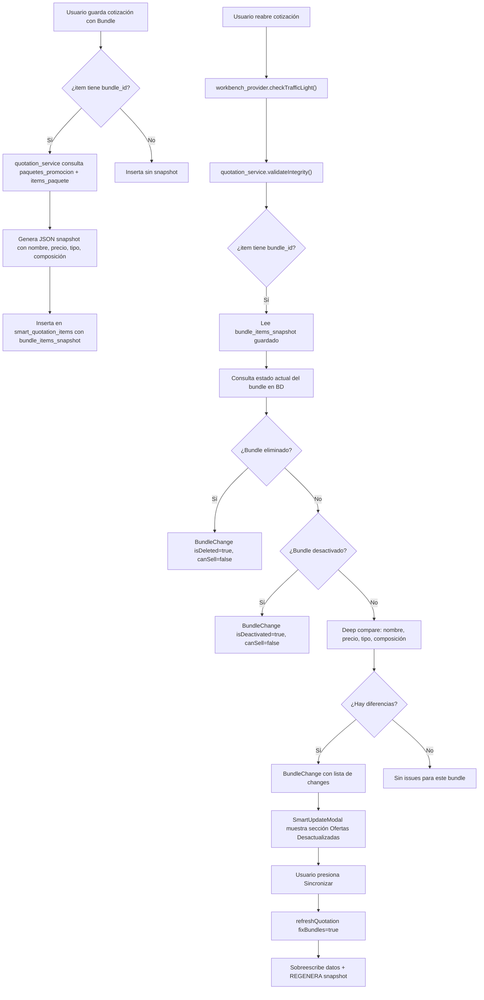

# 🔧 Sincronización Profunda de Ofertas y Corrección de Falsos Positivos

## Contexto del Problema

Al editar una Cotización Manual que contiene una **Oferta/Paquete (Bundle)**, se activa erróneamente la etiqueta amarilla de advertencia de cambio de nombre. Además, la validación actual es superficial (solo compara nombres), lo que crea riesgo de incongruencia de datos financieros e inventario al vender.

---

## Diagnóstico Técnico (Hallazgos del Análisis)

### 🐛 Causa Raíz del Falso Positivo

La etiqueta amarilla se activa en dos lugares:
- [manual_quote_item_card.dart](file:///c:/Users/vjuli/Documents/mochilalista-app/app_movil/lib/features/smart_quotation/widgets/manual/manual_quote_item_card.dart#L49-L58) (líneas 49-58)
- [manual_quote_detail_modal.dart](file:///c:/Users/vjuli/Documents/mochilalista-app/app_movil/lib/features/smart_quotation/widgets/manual/manual_quote_detail_modal.dart#L254-L267) (líneas 254-267)

La lógica de comparación:
```dart
String originalName = item.fullName.trim();          // ← Snapshot del momento de guardar
String currentBuiltName = item.displayNameClean.trim(); // ← Nombre reconstruido dinámicamente
bool isNameChanged = ... currentBuiltName.toLowerCase() != originalName.toLowerCase() ...
```

El getter [`displayNameClean`](file:///c:/Users/vjuli/Documents/mochilalista-app/app_movil/lib/features/smart_quotation/models/matching_model.dart#L72-L78) concatena `productName + brand + specificName`:

```dart
String get displayNameClean {
  buffer.write(productName);
  if (brand != null ...) buffer.write(" $brand");
  if (specificName != null ...) buffer.write(" $specificName");
  return buffer.toString().trim();
}
```

**El problema**: cuando se carga un bundle en [`manual_quote_data_ext.dart`](file:///c:/Users/vjuli/Documents/mochilalista-app/app_movil/lib/features/smart_quotation/screens/manual/manual_quote_data_ext.dart#L109-L121):

```dart
realProductName = bundle.nombrePaquete;     // ej: "Combo Escolar"
realBrandName = "OFERTA";                   // ← HARDCODEADO
realSpecificName = bundle.descripcion ?? ""; // ej: "2 cuadernos + 1 lápiz"
```

Y el `fullName` se construye como (línea 160):
```dart
fullName: qItem.bundleId != null ? realProductName : qItem.displayName
// → fullName = "Combo Escolar" (solo el nombre)
```

Entonces:
- **`fullName`** = `"Combo Escolar"`
- **`displayNameClean`** = `"Combo Escolar OFERTA 2 cuadernos + 1 lápiz"`

**`"Combo Escolar" != "Combo Escolar OFERTA 2 cuadernos + 1 lápiz"`** → siempre `true` → **falso positivo permanente**.

### 🏗️ Deficiencias Estructurales Encontradas

| Problema | Archivo | Impacto |
|---|---|---|
| `displayNameClean` incluye marca `"OFERTA"` y descripción para bundles, inflando el nombre | [matching_model.dart:72](file:///c:/Users/vjuli/Documents/mochilalista-app/app_movil/lib/features/smart_quotation/models/matching_model.dart#L72) | Causa directa del falso positivo |
| `fullName` para bundles solo toma `realProductName` (sin marca ni descripción) | [manual_quote_data_ext.dart:160](file:///c:/Users/vjuli/Documents/mochilalista-app/app_movil/lib/features/smart_quotation/screens/manual/manual_quote_data_ext.dart#L160) | Asimetría en la comparación |
| Validación en `validateIntegrity()` solo compara nombre y precio del bundle | [quotation_service.dart:99-144](file:///c:/Users/vjuli/Documents/mochilalista-app/app_movil/lib/features/smart_quotation/services/quotation_service.dart#L99-L144) | No detecta cambios en composición interna |
| `refreshQuotation()` solo actualiza nombre/precio del bundle, NO sus ítems | [quotation_service.dart:300-346](file:///c:/Users/vjuli/Documents/mochilalista-app/app_movil/lib/features/smart_quotation/services/quotation_service.dart#L300-L346) | Sincronización incompleta |
| No existe snapshot de la composición del bundle al momento de guardar | Todos los flujos de guardado | Imposible hacer deep compare |
| No existe botón de "Sincronizar Oferta" en la UI | Card/Modal | UX incompleta |

---

## Decisiones de Diseño Resueltas

### ✅ Snapshot de composición del bundle → **SÍ, se implementará**

Se almacenará un JSON con la composición del bundle en una nueva columna `bundle_items_snapshot` en `smart_quotation_items`. Esto permite un deep compare preciso al comparar el estado actual del bundle contra el snapshot guardado.

**Análisis de integración del snapshot en todos los sistemas:**

#### Flujo 1: Escritura del snapshot (al GUARDAR la cotización)

Existen **2 puntos de guardado** que deben escribir el snapshot:

| Punto de escritura | Archivo | Líneas |
|---|---|---|
| **Flujo Manual**: El payload se construye en `_executeSave()` → se pasa a `wbProv.saveManualQuotation()` | [manual_quote_save_ext.dart](file:///c:/Users/vjuli/Documents/mochilalista-app/app_movil/lib/features/smart_quotation/screens/manual/manual_quote_save_ext.dart#L155-L173) | L155-173 |
| **Flujo IA/Matching**: El payload se construye en `toQuotationItemJson()` → se pasa a `_service.saveQuotation()` | [matching_model.dart](file:///c:/Users/vjuli/Documents/mochilalista-app/app_movil/lib/features/smart_quotation/models/matching_model.dart#L175-L196) | L175-196 |

Ambos flujos convergen en el service que escribe a SQLite:
- [quotation_service.dart](file:///c:/Users/vjuli/Documents/mochilalista-app/app_movil/lib/features/smart_quotation/services/quotation_service.dart#L262-L279) → `saveManualQuotation()` (línea 262-279)
- [matching_service.dart](file:///c:/Users/vjuli/Documents/mochilalista-app/app_movil/lib/features/smart_quotation/services/matching_service.dart) → `saveQuotation()` (flujo IA)

**Estrategia**: El snapshot se generará en el **service** (`quotation_service.dart`), NO en la UI. Cuando el service detecte que el ítem tiene `bundle_id != null`, consultará `items_paquete` del bundle y generará el JSON snapshot automáticamente antes de insertar la fila. Esto garantiza que **ambos flujos** (Manual e IA) generen el snapshot sin duplicar código.

#### Flujo 2: Lectura y comparación del snapshot (al VALIDAR la cotización)

| Punto de lectura | Archivo | Propósito |
|---|---|---|
| `validateIntegrity()` | [quotation_service.dart:49-233](file:///c:/Users/vjuli/Documents/mochilalista-app/app_movil/lib/features/smart_quotation/services/quotation_service.dart#L49-L233) | Compara snapshot guardado vs composición actual del bundle para detectar cambios |

**Lógica del Deep Compare**:
```
1. Leer bundle_items_snapshot del ítem de cotización (JSON guardado)
2. Consultar items_paquete actuales del bundle
3. Comparar:
   a. ¿Cambió la cantidad de ítems?
   b. ¿Cambiaron los presentacion_id?
   c. ¿Cambiaron las cantidad_requerida?
   d. ¿Cambió el precio_venta_total?
   e. ¿Cambió el nombre o la descripción?
   f. ¿El bundle fue desactivado (activo = 0)?
   g. ¿El bundle fue eliminado (no existe en la tabla)?
4. Si hay diferencias → generar BundleChange con detalle específico del tipo de cambio
```

#### Flujo 3: Actualización del snapshot (al SINCRONIZAR la oferta)

| Punto de actualización | Archivo | Propósito |
|---|---|---|
| `refreshQuotation()` con `fixBundles = true` | [quotation_service.dart:293-419](file:///c:/Users/vjuli/Documents/mochilalista-app/app_movil/lib/features/smart_quotation/services/quotation_service.dart#L293-L419) | Sobreescribe nombre, precio, descripción, imagen y **regenera el snapshot** con la composición actual |

#### Formato del snapshot JSON:
```json
{
  "bundle_name": "Combo Escolar",
  "bundle_price": 45.50,
  "bundle_type": "paquete",
  "bundle_active": true,
  "items": [
    {"presentacion_id": 12, "producto_id": 5, "cantidad_requerida": 2, "precio_original": 15.00},
    {"presentacion_id": 34, "producto_id": 8, "cantidad_requerida": 1, "precio_original": 20.50}
  ]
}
```

### ✅ Bundle desactivado/eliminado → **Opción 1: Bloquear venta (Recomendado)**

**Justificación**: Si un bundle fue desactivado, significa que el dueño decidió intencionalmente retirar esa oferta. Permitir venderla generaría descuadres en reportes de promociones y posiblemente precios incorrectos. Lo más seguro es:

1. Marcar el ítem como `is_available = 0`.
2. Establecer `canSell = false` en el `ValidationResult`.
3. Mostrar en el Centro de Resoluciones una alerta roja que indique que la oferta fue desactivada/eliminada, con opciones:
   - **"Eliminar de la cotización"** (quitar el ítem del bundle).
   - **"Desagrupar en productos individuales"** (convertir el bundle en sus productos componentes como ítems sueltos, solo si el bundle aún existe pero fue desactivado — no si fue eliminado).

---

## Proposed Changes

### Fase 1: Diagnóstico de Falsos Positivos y Lógica de Comparación Profunda

> Objetivo: Eliminar falsos positivos y construir la infraestructura de deep compare.

---

#### [MODIFY] [local_db.dart](file:///c:/Users/vjuli/Documents/mochilalista-app/app_movil/lib/core/database/local_db.dart)

1. **Incrementar versión** de `16` a `17` (línea 23).
2. **Agregar migración V16 → V17**: nueva columna `bundle_items_snapshot TEXT` en `smart_quotation_items`.

```dart
if (oldVersion < 17) {
  try {
    await db.execute("ALTER TABLE smart_quotation_items ADD COLUMN bundle_items_snapshot TEXT");
  } catch (e) {
    debugPrint("Error migración V17 (bundle_items_snapshot): $e");
  }
}
```

3. **Actualizar el CREATE TABLE** original (línea 398) para que instalaciones nuevas incluyan la columna `bundle_items_snapshot TEXT` desde el inicio.

---

#### [MODIFY] [matching_model.dart](file:///c:/Users/vjuli/Documents/mochilalista-app/app_movil/lib/features/smart_quotation/models/matching_model.dart)

1. **Agregar getter `displayNameForComparison`** que devuelva solo `productName` para bundles (evitando la concatenación que causa el falso positivo):

```dart
/// Nombre limpio para comparar con fullName (sin inflar con marca/descripción en bundles)
String get displayNameForComparison {
  if (bundleId != null) return productName.trim();
  return displayNameClean;
}
```

---

#### [MODIFY] [manual_quote_item_card.dart](file:///c:/Users/vjuli/Documents/mochilalista-app/app_movil/lib/features/smart_quotation/widgets/manual/manual_quote_item_card.dart)

1. **Línea 52**: Cambiar `item.displayNameClean.trim()` por `item.displayNameForComparison.trim()`.

```dart
// ANTES (L52):
String currentBuiltName = item.displayNameClean.trim();
// DESPUÉS:
String currentBuiltName = item.displayNameForComparison.trim();
```

---

#### [MODIFY] [manual_quote_detail_modal.dart](file:///c:/Users/vjuli/Documents/mochilalista-app/app_movil/lib/features/smart_quotation/widgets/manual/manual_quote_detail_modal.dart)

1. **Línea 255**: Misma corrección que en la tarjeta.

```dart
// ANTES (L255):
String currentBuiltName = _currentSelection.displayNameClean.trim();
// DESPUÉS:
String currentBuiltName = _currentSelection.displayNameForComparison.trim();
```

---

#### [MODIFY] [crm_models.dart](file:///c:/Users/vjuli/Documents/mochilalista-app/app_movil/lib/features/smart_quotation/models/crm_models.dart)

1. **Agregar nuevo modelo `BundleChange`** para representar cambios estructurales detectados en una oferta:

```dart
class BundleChange {
  final int itemId;
  final int bundleId;
  final String bundleName;
  final List<String> changes;  // Lista descriptiva: "Precio cambió de S/ 45 a S/ 50", "Se removió producto X", etc.
  final bool isDeactivated;    // El bundle fue desactivado
  final bool isDeleted;        // El bundle fue eliminado
  final double? oldPrice;
  final double? newPrice;

  BundleChange({
    required this.itemId,
    required this.bundleId,
    required this.bundleName,
    required this.changes,
    this.isDeactivated = false,
    this.isDeleted = false,
    this.oldPrice,
    this.newPrice,
  });
}
```

2. **Agregar campo `bundleChanges`** a `ValidationResult`:

```dart
class ValidationResult {
  ...
  final List<BundleChange> bundleChanges;

  ValidationResult({
    ...
    this.bundleChanges = const [],
  });
}
```

3. **Actualizar `ValidationResult.fromJson()`** para parsear el nuevo campo (si se genera desde un JSON) y ajustar la lógica de `hasNoRealIssues` en los widgets para incluir `bundleChanges.isEmpty`.

---

#### [MODIFY] [quotation_service.dart](file:///c:/Users/vjuli/Documents/mochilalista-app/app_movil/lib/features/smart_quotation/services/quotation_service.dart) — Método `validateIntegrity()`

1. **Importar** `dart:convert` para parsear JSON del snapshot.
2. **Agregar `List<BundleChange> bundleChanges = []`** junto a las otras listas de issues.
3. **Refactorizar la sección de validación de bundles** (líneas 61-145) para implementar el Deep Compare completo:

```dart
if (item['bundle_id'] != null) {
  int bId = item['bundle_id'] as int;
  String? savedSnapshotJson = item['bundle_items_snapshot'] as String?;
  
  // 1. Verificar si el bundle aún existe
  final bRows = await db.query('paquetes_promocion', where: 'id = ?', whereArgs: [bId]);
  if (bRows.isEmpty) {
    // BUNDLE ELIMINADO → bloquear venta
    hasIssues = true; canSell = false;
    bundleChanges.add(BundleChange(
      itemId: item['id'], bundleId: bId,
      bundleName: item['product_name'] ?? "Oferta",
      changes: ["La oferta fue eliminada del catálogo"],
      isDeleted: true,
    ));
    continue;
  }

  final bundle = bRows.first;
  bool bundleActive = (bundle['activo'] as int?) == 1;
  
  // 2. Verificar si fue desactivado
  if (!bundleActive) {
    hasIssues = true; canSell = false;
    bundleChanges.add(BundleChange(
      itemId: item['id'], bundleId: bId,
      bundleName: bundle['nombre_paquete'] ?? "Oferta",
      changes: ["La oferta fue desactivada por el administrador"],
      isDeactivated: true,
    ));
    continue;
  }

  // 3. Deep Compare con snapshot (si existe)
  List<String> detectedChanges = [];
  
  // 3a. Comparar nombre
  String currentName = bundle['nombre_paquete'] as String? ?? "";
  String savedName = item['product_name'] as String? ?? "";
  if (currentName.toLowerCase() != savedName.toLowerCase()) {
    detectedChanges.add("Nombre: \"$savedName\" → \"$currentName\"");
  }
  
  // 3b. Comparar precio
  double currentPrice = (bundle['precio_venta_total'] as num).toDouble();
  double appliedPrice = (item['unit_price_applied'] as num).toDouble();
  bool isManual = item['is_manual_price'] == 1;
  if (!isManual && (appliedPrice - currentPrice).abs() > 0.01) {
    detectedChanges.add("Precio: S/ ${appliedPrice.toStringAsFixed(2)} → S/ ${currentPrice.toStringAsFixed(2)}");
  }
  
  // 3c. Comparar tipo de promoción
  String currentType = bundle['tipo_promocion'] as String? ?? "paquete";
  // (se compara con el snapshot si existe)
  
  // 3d. Deep compare de composición interna (NUEVO)
  if (savedSnapshotJson != null && savedSnapshotJson.isNotEmpty) {
    try {
      final savedSnapshot = jsonDecode(savedSnapshotJson);
      final savedItems = (savedSnapshot['items'] as List?) ?? [];
      final currentBundleItems = await db.query('items_paquete', where: 'paquete_id = ?', whereArgs: [bId]);
      
      // Comparar cantidad de ítems
      if (savedItems.length != currentBundleItems.length) {
        detectedChanges.add("Composición: ${savedItems.length} productos → ${currentBundleItems.length} productos");
      } else {
        // Comparar ítem por ítem (por presentacion_id y cantidad)
        for (var savedItem in savedItems) {
          int savedPresId = savedItem['presentacion_id'];
          int savedQty = savedItem['cantidad_requerida'];
          final match = currentBundleItems.where((ci) => ci['presentacion_id'] == savedPresId).firstOrNull;
          if (match == null) {
            detectedChanges.add("Se removió un producto del paquete (ID: $savedPresId)");
          } else if ((match['cantidad_requerida'] as int? ?? 1) != savedQty) {
            detectedChanges.add("Cambió la cantidad de un componente del paquete");
          }
        }
        // Verificar si se agregaron nuevos productos
        for (var current in currentBundleItems) {
          int currentPresId = current['presentacion_id'] as int;
          if (!savedItems.any((si) => si['presentacion_id'] == currentPresId)) {
            detectedChanges.add("Se agregó un nuevo producto al paquete");
          }
        }
      }
      
      // Comparar tipo de promoción con snapshot
      String? savedType = savedSnapshot['bundle_type'];
      if (savedType != null && savedType != currentType) {
        detectedChanges.add("Tipo: \"$savedType\" → \"$currentType\"");
      }
    } catch (e) {
      debugPrint("Error parseando snapshot del bundle: $e");
    }
  }
  
  if (detectedChanges.isNotEmpty) {
    hasIssues = true;
    bundleChanges.add(BundleChange(
      itemId: item['id'], bundleId: bId,
      bundleName: currentName,
      changes: detectedChanges,
      oldPrice: appliedPrice,
      newPrice: currentPrice,
    ));
  }
  
  // 4. Validar stock de componentes (lógica existente, se mantiene)
  // ...
}
```

4. **Incluir `bundleChanges`** en el return del `ValidationResult`.

---

### Fase 2: Implementación de la Sincronización Integral de Ofertas

> Objetivo: Que al guardar una cotización se almacene el snapshot, y que al sincronizar se sobreescriban todos los datos con la versión actual.

---

#### [MODIFY] [quotation_service.dart](file:///c:/Users/vjuli/Documents/mochilalista-app/app_movil/lib/features/smart_quotation/services/quotation_service.dart) — Método `saveManualQuotation()`

1. **En la inserción de ítems** (líneas 262-279): Cuando el ítem tenga `bundle_id != null`, consultar `items_paquete` y `paquetes_promocion` para generar el snapshot JSON y guardarlo junto al ítem.

```dart
// Dentro del bucle de inserción (L262-279):
String? bundleSnapshot;
if (item['bundle_id'] != null) {
  final bundleRows = await txn.query('paquetes_promocion', where: 'id = ?', whereArgs: [item['bundle_id']]);
  final bundleItems = await txn.query('items_paquete', where: 'paquete_id = ?', whereArgs: [item['bundle_id']]);
  if (bundleRows.isNotEmpty) {
    final b = bundleRows.first;
    bundleSnapshot = jsonEncode({
      'bundle_name': b['nombre_paquete'],
      'bundle_price': b['precio_venta_total'],
      'bundle_type': b['tipo_promocion'] ?? 'paquete',
      'bundle_active': (b['activo'] as int?) == 1,
      'items': bundleItems.map((bi) => {
        'presentacion_id': bi['presentacion_id'],
        'producto_id': bi['producto_id'],
        'cantidad_requerida': bi['cantidad_requerida'],
        'precio_original': bi['precio_original_unitario'],
      }).toList(),
    });
  }
}

await txn.insert('smart_quotation_items', {
  ...existing_fields...,
  'bundle_items_snapshot': bundleSnapshot,  // ← NUEVO
});
```

> [!IMPORTANT]
> Esta lógica de generación del snapshot vive en el **service** (no en la UI), por lo que cubre automáticamente AMBOS flujos de guardado (Manual e IA). El flujo IA desde `matching_provider.dart` → `matching_service.dart` también converge en la inserción SQL, que deberá incluir la misma lógica de generación de snapshot. Se debe verificar `matching_service.dart` → `saveQuotation()` para asegurar que el snapshot también se genere ahí.

---

#### [MODIFY] [quotation_service.dart](file:///c:/Users/vjuli/Documents/mochilalista-app/app_movil/lib/features/smart_quotation/services/quotation_service.dart) — Método `refreshQuotation()`

1. **Agregar parámetro `fixBundles`** a la firma del método.
2. **Cuando `fixBundles = true`** y el ítem tiene `bundle_id`:
   - Sobreescribir `product_name`, `specific_name`, `unit_price_applied`, `original_unit_price`, `image_url` con los valores actuales del bundle.
   - **Regenerar `bundle_items_snapshot`** con la composición actual del bundle.
   - Recalcular totales (ya existente).

```dart
if (fixBundles && item['bundle_id'] != null) {
  final bRows = await txn.query('paquetes_promocion', where: 'id = ?', whereArgs: [item['bundle_id']]);
  if (bRows.isNotEmpty) {
    final bundle = bRows.first;
    final bundleItems = await txn.query('items_paquete', where: 'paquete_id = ?', whereArgs: [item['bundle_id']]);
    
    Map<String, dynamic> updates = {
      'product_name': bundle['nombre_paquete'],
      'specific_name': bundle['descripcion'],
      'unit_price_applied': (bundle['precio_venta_total'] as num).toDouble(),
      'original_unit_price': (bundle['precio_venta_total'] as num).toDouble(),
      'image_url': bundle['imagen_url'],
      'is_available': (bundle['activo'] as int?) == 1 ? 1 : 0,
      'bundle_items_snapshot': jsonEncode({
        'bundle_name': bundle['nombre_paquete'],
        'bundle_price': bundle['precio_venta_total'],
        'bundle_type': bundle['tipo_promocion'] ?? 'paquete',
        'bundle_active': (bundle['activo'] as int?) == 1,
        'items': bundleItems.map((bi) => {
          'presentacion_id': bi['presentacion_id'],
          'producto_id': bi['producto_id'],
          'cantidad_requerida': bi['cantidad_requerida'],
          'precio_original': bi['precio_original_unitario'],
        }).toList(),
      }),
    };
    await txn.update('smart_quotation_items', updates, where: 'id = ?', whereArgs: [item['id']]);
  } else {
    // Bundle eliminado → marcar como no disponible
    await txn.update('smart_quotation_items', {'is_available': 0}, where: 'id = ?', whereArgs: [item['id']]);
  }
}
```

---

#### [MODIFY] [workbench_provider.dart](file:///c:/Users/vjuli/Documents/mochilalista-app/app_movil/lib/features/smart_quotation/providers/workbench_provider.dart)

1. **Actualizar `refreshQuotation()`** (línea 317) para aceptar y pasar el nuevo parámetro `fixBundles`:

```dart
Future<bool> refreshQuotation(int id, {
  bool fixPrices = true, bool fixStock = false, bool fixNames = false, bool fixBundles = false
}) async {
  ...
  final success = await _quotationService.refreshQuotation(id, 
    fixPrices: fixPrices, fixStock: fixStock, fixNames: fixNames, fixBundles: fixBundles);
  ...
}
```

2. **Agregar método `syncBundle(int quotationId)`** que invoque la sincronización completa de todas las ofertas de esa cotización:

```dart
Future<bool> syncBundles(int quotationId) async {
  return refreshQuotation(quotationId, fixPrices: false, fixStock: false, fixNames: false, fixBundles: true);
}
```

---

#### [MODIFY] [manual_quote_data_ext.dart](file:///c:/Users/vjuli/Documents/mochilalista-app/app_movil/lib/features/smart_quotation/screens/manual/manual_quote_data_ext.dart)

1. **Corregir la construcción de `fullName` para bundles** (línea 160). Asegurar simetría con `displayNameForComparison`:

```dart
// ANTES (L160):
fullName: qItem.bundleId != null ? realProductName : qItem.displayName,

// DESPUÉS: (El fullName debe ser solo el nombre del paquete, igual que displayNameForComparison)
fullName: qItem.bundleId != null ? realProductName : qItem.displayName,
// ↑ Este ya está correcto, el fix real está en usar displayNameForComparison en las comparaciones
```

> [!NOTE]
> La línea 160 ya es correcta (`fullName = realProductName` para bundles). El fix real es que los widgets de comparación usen `displayNameForComparison` en lugar de `displayNameClean`. No se modifica `manual_quote_data_ext.dart` en esta línea.

---

#### [MODIFY] [matching_service.dart](file:///c:/Users/vjuli/Documents/mochilalista-app/app_movil/lib/features/smart_quotation/services/matching_service.dart)

1. **Verificar el método `saveQuotation()`**: Asegurar que al insertar ítems de cotización con `bundle_id`, también se genere el snapshot JSON. Este es el flujo IA paralelo al flujo manual. Si la inserción se hace directamente en este archivo (no delegada a `quotation_service`), replicar la lógica de generación del snapshot.

---

### Fase 3: Rediseño UX para Alertas Accionables

> Objetivo: Que el usuario vea alertas precisas y pueda sincronizar ofertas desactualizadas con un solo toque.

---

#### [MODIFY] [manual_quote_item_card.dart](file:///c:/Users/vjuli/Documents/mochilalista-app/app_movil/lib/features/smart_quotation/widgets/manual/manual_quote_item_card.dart)

1. **Resultado del fix de Fase 1**: Con la corrección de `displayNameForComparison`, la etiqueta amarilla desaparece cuando no hay cambios reales (falso positivo eliminado).
2. **Nuevo comportamiento visual para bundles desactualizados**: Agregar un parámetro `bool hasBundleChanges` al constructor del widget. Cuando sea `true` y el ítem sea un bundle, mostrar un badge púrpura en la parte superior de la tarjeta que diga **"Oferta desactualizada"** con un ícono de sincronización, diferenciado visualmente de la etiqueta amarilla genérica de cambio de nombre.

---

#### [MODIFY] [manual_quote_detail_modal.dart](file:///c:/Users/vjuli/Documents/mochilalista-app/app_movil/lib/features/smart_quotation/widgets/manual/manual_quote_detail_modal.dart)

1. **Agregar callback `onSyncBundle`** al constructor del widget.
2. **Agregar botón "Sincronizar Oferta"**: Visible solo cuando:
   - `presentationId < 0` (es bundle)
   - `isEditingSavedQuote == true`
   - Hay cambios detectados (pasados como parámetro o detectados in-situ)

   El botón debe ser prominente (púrpura, con ícono `Icons.sync`), ubicado debajo de la alerta de nombre cuando esta exista, o como banner independiente cuando solo haya cambios estructurales.

3. **Al presionar "Sincronizar Oferta"**: Invocar `onSyncBundle()`, que en el padre ejecutará la sincronización del provider, cerrará el modal, y mostrará un snackbar de confirmación.

---

#### [MODIFY] [smart_update_modal.dart](file:///c:/Users/vjuli/Documents/mochilalista-app/app_movil/lib/features/smart_quotation/widgets/smart_update_modal.dart)

1. **Agregar parámetro `List<BundleChange> bundleChanges`** al constructor (proveniente de `ValidationResult.bundleChanges`).
2. **Agregar callback `onSyncBundles`** y `onSyncSingleBundle(int itemId)`.
3. **Nueva sección "Ofertas Desactualizadas"** (entre el bloque de precios y el de nombres):
   - Header con ícono `Icons.local_offer` en púrpura.
   - Para cada `BundleChange`:
     - Mostrar nombre de la oferta.
     - Lista de cambios detectados (del campo `changes`).
     - Si `isDeactivated`: Alerta roja + botón "Eliminar" y botón "Desagrupar en productos individuales".
     - Si `isDeleted`: Alerta roja + solo botón "Eliminar de la cotización".
     - Si tiene cambios estructurales normales: Botón individual "Sincronizar esta Oferta".
   - Botón masivo "Sincronizar Todas las Ofertas" al final de la sección.
4. **Actualizar `hasNoRealIssues`** (línea 41) para incluir `bundleChanges`:

```dart
bool hasNoRealIssues = stockIssues.isEmpty && priceIssues.isEmpty && nameIssues.isEmpty && bundleChanges.isEmpty;
```

---

## Archivos Impactados (Resumen)

| Archivo | Fase | Tipo | Cambio Principal |
|---|---|---|---|
| [local_db.dart](file:///c:/Users/vjuli/Documents/mochilalista-app/app_movil/lib/core/database/local_db.dart) | 1 | MODIFY | Migración V17: columna `bundle_items_snapshot` |
| [matching_model.dart](file:///c:/Users/vjuli/Documents/mochilalista-app/app_movil/lib/features/smart_quotation/models/matching_model.dart) | 1 | MODIFY | Nuevo getter `displayNameForComparison` |
| [manual_quote_item_card.dart](file:///c:/Users/vjuli/Documents/mochilalista-app/app_movil/lib/features/smart_quotation/widgets/manual/manual_quote_item_card.dart) | 1, 3 | MODIFY | Fix comparación + badge púrpura para bundle desactualizado |
| [manual_quote_detail_modal.dart](file:///c:/Users/vjuli/Documents/mochilalista-app/app_movil/lib/features/smart_quotation/widgets/manual/manual_quote_detail_modal.dart) | 1, 3 | MODIFY | Fix comparación + botón "Sincronizar Oferta" |
| [crm_models.dart](file:///c:/Users/vjuli/Documents/mochilalista-app/app_movil/lib/features/smart_quotation/models/crm_models.dart) | 1 | MODIFY | Nuevo modelo `BundleChange` + ampliar `ValidationResult` |
| [quotation_service.dart](file:///c:/Users/vjuli/Documents/mochilalista-app/app_movil/lib/features/smart_quotation/services/quotation_service.dart) | 1, 2 | MODIFY | Deep compare en `validateIntegrity()` + sync profunda + snapshot en guardado |
| [matching_service.dart](file:///c:/Users/vjuli/Documents/mochilalista-app/app_movil/lib/features/smart_quotation/services/matching_service.dart) | 2 | MODIFY | Generar snapshot al guardar desde flujo IA |
| [workbench_provider.dart](file:///c:/Users/vjuli/Documents/mochilalista-app/app_movil/lib/features/smart_quotation/providers/workbench_provider.dart) | 2 | MODIFY | Exponer `fixBundles` + método `syncBundles()` |
| [smart_update_modal.dart](file:///c:/Users/vjuli/Documents/mochilalista-app/app_movil/lib/features/smart_quotation/widgets/smart_update_modal.dart) | 3 | MODIFY | Nueva sección "Ofertas Desactualizadas" con acciones |

---

## Diagrama de Flujo del Snapshot



---

## Verification Plan

### Build Check
```bash
cd app_movil && flutter analyze
```

### Manual Verification (Pruebas Paso a Paso)

1. **Test Falso Positivo (Fase 1)**:
   - Crear cotización manual con una Oferta/Paquete → guardar → reabrir.
   - ✅ Verificar que **NO** aparece la etiqueta amarilla si nada cambió.

2. **Test Snapshot se guarda (Fase 2)**:
   - Guardar cotización con bundle → inspeccionar SQLite → verificar que `bundle_items_snapshot` contiene el JSON correcto.

3. **Test Deep Compare (Fase 1-2)**:
   - Guardar cotización con bundle → desde Promociones, modificar el nombre del bundle → reabrir cotización.
   - ✅ Verificar que aparece la alerta con el detalle "Nombre: X → Y".
   - Repetir cambiando precio, agregando/removiendo un producto del bundle, y cambiando tipo de promoción.

4. **Test Sincronización (Fase 2)**:
   - Desde la alerta, presionar "Sincronizar Oferta".
   - ✅ Verificar que nombre, precio, descripción e imagen se actualizan en la cotización.
   - ✅ Verificar que los totales se recalculan correctamente.
   - ✅ Verificar que el `bundle_items_snapshot` se regenera con la nueva composición.

5. **Test Bundle Desactivado (Fase 2-3)**:
   - Guardar cotización con bundle → desactivar el bundle → reabrir cotización.
   - ✅ Verificar que aparece alerta roja bloqueante "La oferta fue desactivada".
   - ✅ Verificar que `canSell = false` y no se puede vender.

6. **Test Centro de Resoluciones (Fase 3)**:
   - En el Workbench, abrir el SmartUpdateModal de una cotización con bundle desactualizado.
   - ✅ Verificar que aparece la nueva sección "Ofertas Desactualizadas" con los cambios detallados.
