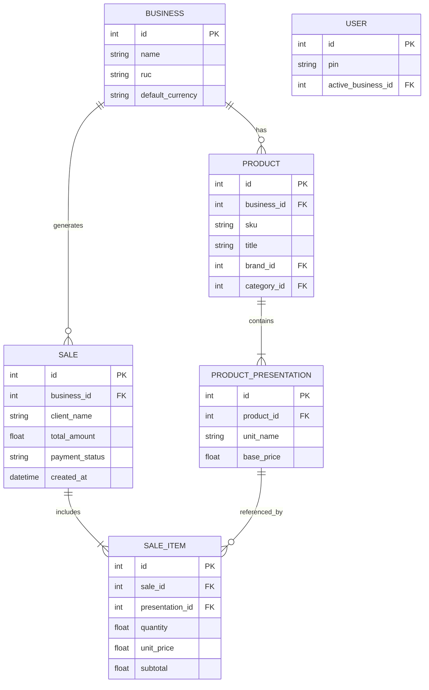
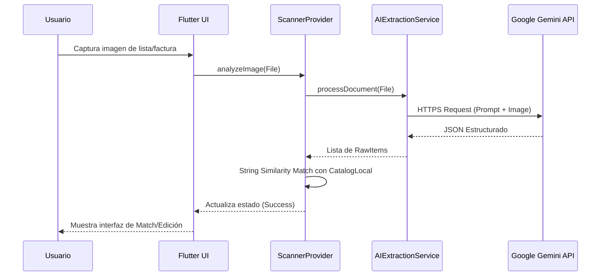

# Mochilalista App - Arquitectura del Sistema

Esta documentación describe la arquitectura de la versión 2.0 de la aplicación, diseñada con un enfoque **Offline-First**.

## 1. Visión General
La aplicación está construida en **Flutter** utilizando **Provider** para la gestión de estados y **SQLite** (a través de `sqflite`) como motor de base de datos principal. No existe dependencia estricta de un servidor en la nube (Backend), lo que permite que el sistema opere a máxima velocidad y sin conexión a internet, excepto para el módulo de Inteligencia Artificial (Google Gemini) y respaldos en la nube.

## 2. Mapa de Providers (Gestión de Estado)
La aplicación utiliza múltiples Providers distribuidos lógicamente según el módulo al que pertenecen:

- `DatabaseProvider`: Singleton para inicializar y gestionar la conexión a SQLite.
- `AuthProvider`: Maneja la autenticación local (PIN) y la selección del negocio activo.
- `CatalogProvider`: Controla el inventario de productos, categorías, marcas y manejo de stock.
- `ScannerProvider` & `SaleProvider`: Centrales del módulo de cotizaciones inteligentes y ventas CRM.
- `BackupProvider`: Encargado de la exportación/importación del `.db` a Drive o WhatsApp.

## 3. Modelo de Datos Entidad-Relación (ERD)

A continuación se muestra el esquema principal de la base de datos SQLite embebida:

## 4. Flujo de Datos: Escaneo por IA

El core de innovación de la aplicación reside en el procesamiento inteligente de documentos (boletas, facturas, listas manuscritas).

## 5. Decisiones de Diseño Clave
- **Motor AI Integrado:** El procesamiento de IA se realiza invocando a Google Gemini directamente desde el cliente. Esto requiere que la API Key resida en el dispositivo (`.env`), pero elimina costes de infraestructura de backend y la latencia introducida al transmitir imágenes hacia un servidor intermediario.
- **Transacciones Atómicas:** Se utiliza `Transaction` en `sqflite` (ej. `ScannerBatchSaver`) para asegurar que operaciones masivas (como ingestar 50 productos de un escaneo) no dejen la base de datos en estado corrupto si la app se cierra.
- **Feedback UI en Tiempo Real:** Todos los procesos largos exponen un callback `onProgress(String)` para evitar la percepción de cuelgue o "app congelada".
