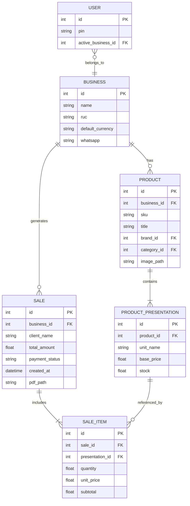
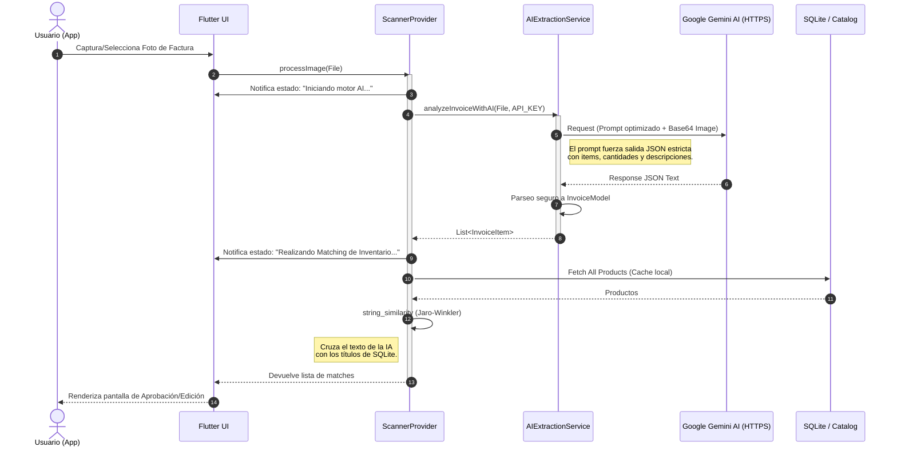
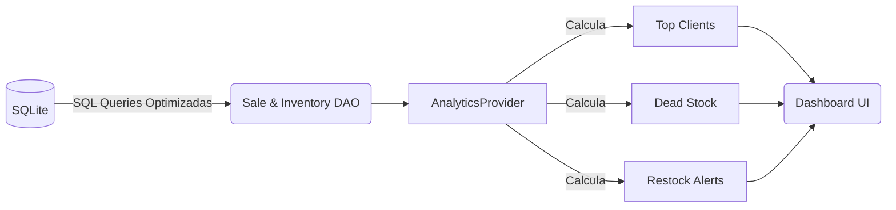

# 🏛️ Mochilalista App - Arquitectura y Documentación Técnica (v4.0)

Esta documentación describe a profundidad la arquitectura de la aplicación Mochilalista, estructurada con un diseño **Offline-First**, arquitectura por funcionalidades (*Feature-Driven*) y principios de alta cohesión.

---

## 1. Patrón Arquitectónico: Feature-Driven + Layered Architecture

El proyecto se estructura dividiendo la base de código por funcionalidades (features) en la capa de presentación y dominio, manteniendo los servicios (data) en una capa Core de apoyo.

```mermaid
graph TD
    subgraph UI Layer [Capa de Presentación (Flutter UI)]
        Widgets
        Screens
        Modals
    end

    subgraph State Layer [Capa de Estado (Provider)]
        CP[CatalogProvider]
        SP[ScannerProvider]
        SQP[SmartQuotationProvider]
        AP[AnalyticsProvider]
    end

    subgraph Service Layer [Capa Core & Servicios]
        MS[MasterDataService]
        AI[AIExtractionService]
        FS[File & PDF Service]
        Auth[AuthService]
    end

    subgraph Data Layer [Capa de Datos]
        DB[(SQLite Local DB)]
        Prefs[SharedPreferences]
        FileSystem[Local File System]
    end

    UI Layer -->|Consume y Despacha| State Layer
    State Layer -->|Delega lógica pesada| Service Layer
    Service Layer -->|Lee/Escribe| Data Layer
```

## 2. Gestión del Estado Central (Providers)

Mochilalista utiliza `provider` para la inyección de dependencias y reactividad. La jerarquía principal en `main.dart` es:

* **`DatabaseProvider`**: Inicializa la base de datos `sqflite` (instancia singleton). Bloquea la UI en un "Loading Splash" hasta que el motor de BD esté listo.
* **`AuthProvider`**: Valida perfiles, gestiona el inicio de sesión por PIN y mantiene en memoria el `business_id` (Negocio activo).
* **`CatalogProvider` & `InventoryProvider`**: Agrupan los datos masivos de productos, presentaciones, marcas y categorías. Utilizan cachés internas (`MasterDataCache`) para acelerar búsquedas y listados.
* **`SmartQuotationProvider` & `ScannerProvider`**: Módulos efímeros/especializados. El escáner mantiene el estado en progreso de la Inteligencia artificial y el `SmartQuotation` orquesta el carrito de compra y generación de la factura.

## 3. Modelo de Datos Entidad-Relación (ERD)

La base de datos (SQLite) se estructura garantizando el aislamiento por negocio (`business_id`), permitiendo múltiples negocios (multitenant) en un mismo dispositivo.



## 4. Motor de IA Inteligente: Secuencia de Extracción (Smart Scanner)

El corazón innovador de la app es su capacidad para procesar comprobantes sin necesidad de backend propio.



## 5. Diseño y Estándares de Código

* **Importaciones Absolutas:** En la v4.0, todos los archivos del directorio `lib` implementan estíctamente importaciones con sintaxis `package:app_movil/...`. Esto evita colisiones del analizador de Dart y facilita la trazabilidad.
* **Componentes UI Reutilizables:** Se emplea una carpeta `core/widgets/` para tarjetas, diálogos y botones estándar que comparten la paleta visual (vibrante, moderna) de la aplicación, garantizando una UX consistente (ej: `ProductPresentationCard`, `CustomBottomSheets`).
* **Seguridad (DotEnv):** Toda credencial sensible viaja a través del archivo `.env` que se excluye del control de versiones.

## 6. Módulo Analytics (Reporting)

Mochilalista genera métricas locales sin necesidad de telemetría remota.


