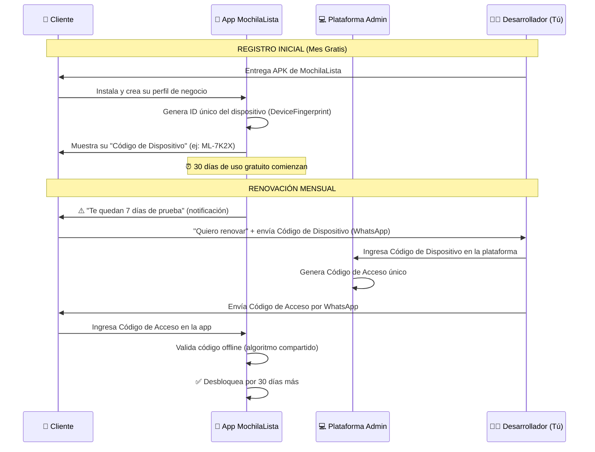
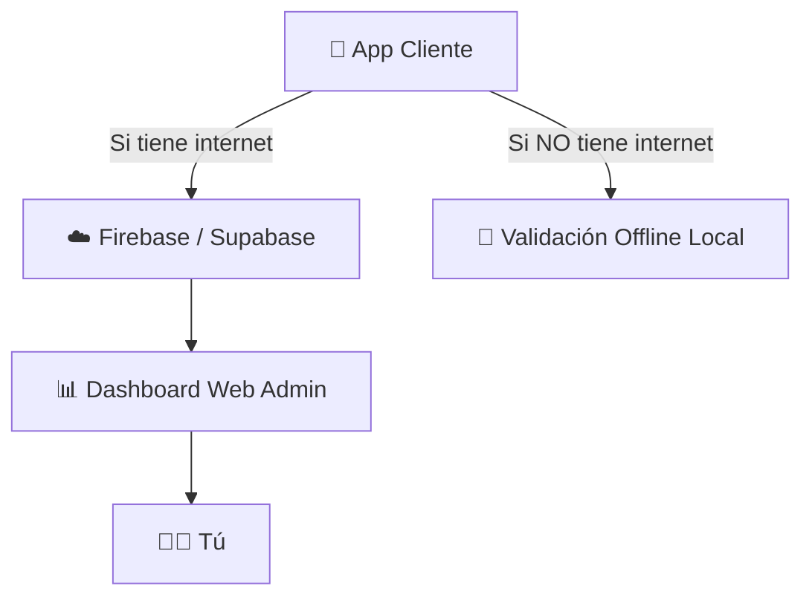

# 💰 INFORME 2: Propuestas de Modelo de Comercialización para MochilaLista

**Fecha:** 3 de Octubre de 2026  
**Versión Base:** 8.5.0+47  
**Objetivo:** Evaluar modelos de monetización viables para una app offline-first, donde el desarrollador controla directamente la distribución y el acceso.

---

## 📋 Contexto del Negocio

Antes de evaluar las propuestas, es fundamental entender las restricciones únicas de MochilaLista:

| Factor | Detalle |
|--------|---------|
| **Naturaleza de la app** | 95% offline — solo usa internet para IA (escaneo Gemini) |
| **Canal de distribución** | Directa (APK compartido), NO Google Play Store (por ahora) |
| **Base de usuarios** | Pequeña/mediana, relación directa vendedor-cliente |
| **Actualizaciones** | Manuales — el desarrollador envía APKs nuevos a los clientes |
| **Infraestructura** | Sin servidor backend — el desarrollador trabaja desde su laptop |
| **Público objetivo** | Comerciantes minoristas/mayoristas que necesitan gestionar inventario y ventas |

---

## 🏆 PROPUESTA A: Sistema de Códigos de Acceso Offline con Generador Local (⭐ RECOMENDADA)

> Esta propuesta es una evolución de tu idea original, refinada para ser segura, práctica y escalable.

### Concepto General

El sistema funciona 100% offline mediante un **algoritmo criptográfico compartido** entre la app del cliente y una plataforma de gestión en tu laptop. No necesita internet para validar códigos.

### ¿Cómo Funciona?



### Desglose Técnico del Sistema

#### 1. Identificador Único del Dispositivo (Device Fingerprint)

Cada instalación de la app genera un código corto y legible basado en:
- `androidId` del dispositivo (único por instalación).
- Un salt fijo embebido en la app.
- Resultado: Un código de 6-8 caracteres fácil de dictar por teléfono.

```
Ejemplo: ML-7K2X o ML-A9F3P2
```

**¿Por qué es importante?** — Vincula el código de acceso a un dispositivo específico. Si alguien comparte el código, **no funcionará** en otro teléfono.

#### 2. Algoritmo de Generación de Códigos de Acceso

El código de acceso se calcula así:

```
Código = HMAC-SHA256(DeviceFingerprint + PeriodoVálido, ClaveSecreta)
         → Primeros 12 caracteres → Formato: XXXX-XXXX-XXXX
```

Donde:
- **DeviceFingerprint:** El código del dispositivo del cliente (ej: `ML-7K2X`).
- **PeriodoVálido:** Año-Mes de validez (ej: `2026-11` para noviembre 2026).
- **ClaveSecreta:** Una clave maestra que solo tú conoces, embebida (ofuscada) tanto en la app como en tu plataforma.

**Propiedades de seguridad:**
- ✅ El mismo código NO funciona en otro dispositivo.
- ✅ El mismo código NO funciona en otro mes.
- ✅ No se necesita internet para validar.
- ✅ Es computacionalmente imposible adivinar el código sin la clave secreta.
- ⚠️ Si alguien descompila la app y extrae la clave secreta, puede generar códigos. Pero con ofuscación (CRIT-05), esto es extremadamente difícil.

#### 3. Períodos de Suscripción

| Plan | Códigos a Generar | Precio Sugerido | Descripción |
|------|-------------------|-----------------|-------------|
| **Trial** | 0 (automático) | Gratis | 30 días desde la instalación |
| **Mensual** | 1 código | S/ X | Válido 1 mes calendario |
| **Trimestral** | 3 códigos | S/ X×2.5 | Se entregan los 3 códigos de una vez |
| **Semestral** | 6 códigos | S/ X×4.5 | Descuento por adelanto |
| **Anual** | 12 códigos | S/ X×8 | Mejor precio por mes |

> [!TIP]
> **Para planes trimestrales, semestrales y anuales:** Generas todos los códigos por adelantado y se los envías al cliente. Cada código solo funciona en su mes correspondiente, por lo que no hay riesgo de mal uso. El cliente los ingresa cuando la app se lo pida (una semana antes de cada vencimiento).

#### 4. Flujo del Usuario en la App

```
┌─────────────────────────────────────────────┐
│  📱 PANTALLA DE ESTADO DE LICENCIA          │
│                                             │
│  ┌─────────────────────────────────────┐    │
│  │  ✅ Licencia Activa                 │    │
│  │  Válida hasta: 31 de Octubre 2026  │    │
│  │  Dispositivo: ML-7K2X              │    │
│  └─────────────────────────────────────┘    │
│                                             │
│  ⚠️ Tu licencia vence en 7 días.           │
│  Contacta al soporte para renovar.          │
│                                             │
│  ┌─────────────────────────────────────┐    │
│  │  Código de Acceso:                  │    │
│  │  [____]-[____]-[____]              │    │
│  │                                     │    │
│  │  [     Activar Licencia      ]      │    │
│  └─────────────────────────────────────┘    │
│                                             │
│  📞 Soporte: +51 999 888 777               │
│  📲 WhatsApp: wa.me/51999888777            │
└─────────────────────────────────────────────┘
```

#### 5. Sistema de Avisos Progresivos

| Días restantes | Acción |
|---------------|--------|
| 7 días | Banner discreto: "Tu licencia vence pronto. Renueva para uso continuo." |
| 3 días | Notificación al entrar: "Solo quedan 3 días. Contacta soporte." |
| 1 día | Modal prominente: "Mañana se bloquearán las funciones. Ingresa tu código." |
| 0 días (vencido) | **Bloqueo suave**: Se puede consultar datos, pero NO crear ventas/cotizaciones. |
| -7 días | **Bloqueo total**: Solo se ve la pantalla de activación y opción de backup. |

> [!IMPORTANT]
> **Nunca borrar los datos del cliente.** Incluso después del bloqueo total, el usuario puede exportar su backup. Esto genera confianza y evita perder clientes enojados.

#### 6. Plataforma de Gestión (Tu Laptop)

Una aplicación web local (ejecutable desde tu laptop) con estas funciones:

```
┌──────────────────────────────────────────────────┐
│  🏢 MochilaLista — Panel de Administración       │
├──────────────────────────────────────────────────┤
│                                                  │
│  📊 Dashboard                                    │
│  ├── Clientes activos: 24                        │
│  ├── Licencias por vencer (7 días): 5            │
│  ├── Ingresos del mes: S/ 1,200                  │
│  └── Tasa de renovación: 87%                     │
│                                                  │
│  👥 Gestión de Clientes                          │
│  ┌──────────────────────────────────────────┐    │
│  │ Nombre     │ Dispositivo │ Vence    │ Est │    │
│  │ Alejandrina│ ML-7K2X     │ 31/10/26 │ ✅  │    │
│  │ Carlos M.  │ ML-A9F3     │ 15/10/26 │ ⚠️  │    │
│  │ María P.   │ ML-R2D4     │ 02/10/26 │ 🔴  │    │
│  └──────────────────────────────────────────┘    │
│                                                  │
│  🔑 Generador de Códigos                         │
│  Dispositivo: [ML-7K2X        ]                  │
│  Período:     [Noviembre 2026  ▼]                │
│  Plan:        [Mensual ▼]                        │
│                                                  │
│  [  Generar Código  ]                            │
│                                                  │
│  Código generado: A7K2-X9F3-P2M1                 │
│  [📋 Copiar] [📱 Enviar por WhatsApp]            │
│                                                  │
└──────────────────────────────────────────────────┘
```

### Ventajas de esta Propuesta

| Ventaja | Descripción |
|---------|-------------|
| ✅ 100% Offline | No necesita internet para validar licencias |
| ✅ Vinculada al dispositivo | Los códigos no se pueden compartir |
| ✅ Fácil para el usuario | Solo copia y pega un código de 12 caracteres |
| ✅ Fácil para ti | Generar códigos toma 5 segundos |
| ✅ Planes flexibles | Mensual, trimestral, semestral, anual |
| ✅ Sin infraestructura | No necesitas servidor, hosting, ni dominio |
| ✅ Bloqueo gradual | No agresivo, permite exportar datos |
| ✅ Escalable a Premium | Se pueden agregar niveles en el futuro |

### Riesgos y Mitigaciones

| Riesgo | Mitigación |
|--------|------------|
| Descompilación para extraer clave secreta | Ofuscación + múltiples capas de verificación |
| Usuario cambia de teléfono | Le generas nuevo código con su nuevo Device ID |
| Usuario pierde su código | Lo regeneras desde tu plataforma |
| Manipulación del reloj del sistema | Guardar la última fecha válida y no permitir retroceder |

---

## 📋 PROPUESTA B: Sistema de Licencia por Archivo (License File)

### Concepto

En lugar de un código de texto, generas un **archivo de licencia** (`.mll` — MochilaLista License) que el usuario descarga y abre con la app.

### Flujo

1. El cliente te envía su Device ID.
2. Tú generas un archivo `.mll` firmado digitalmente desde tu plataforma.
3. Le envías el archivo por WhatsApp.
4. El cliente abre el archivo → la app lo detecta automáticamente y activa la licencia.

### Estructura del Archivo

```json
{
  "version": 1,
  "device_id": "ML-7K2X",
  "valid_from": "2026-10-01",
  "valid_until": "2026-10-31",
  "features": ["all"],
  "signature": "base64_encoded_hmac_signature"
}
```

### Comparación con Propuesta A

| Aspecto | Propuesta A (Código) | Propuesta B (Archivo) |
|---------|---------------------|----------------------|
| Facilidad de uso | ⭐⭐⭐⭐ Copia/pega | ⭐⭐⭐ Descargar y abrir |
| Seguridad | ⭐⭐⭐⭐ Buena | ⭐⭐⭐⭐⭐ Más datos firmados |
| Flexibilidad | ⭐⭐⭐ Limitada | ⭐⭐⭐⭐⭐ Puede incluir features, niveles, etc |
| Complejidad técnica | ⭐⭐⭐ Moderada | ⭐⭐⭐⭐ Mayor (intent filters, file handling) |
| Canal WhatsApp | ✅ Funciona bien | ⚠️ WhatsApp a veces bloquea archivos desconocidos |
| Soporte telefónico | ✅ "Dícame su código" | ❌ No se puede dictar un archivo |

> [!NOTE]
> **Recomendación:** La Propuesta B es técnicamente superior, pero la Propuesta A es más práctica para tu canal de venta actual (WhatsApp, venta directa). Se recomienda implementar A primero y evolucionar a B cuando se tenga más clientes o se publique en Play Store.

---

## 📋 PROPUESTA C: Sistema Híbrido con Validación Online Opcional

### Concepto

La licencia se valida offline por defecto (como Propuesta A), pero SI el dispositivo tiene internet, la app consulta un servidor ligero para:
- Verificar si la licencia sigue vigente.
- Desactivar remotamente licencias en caso de fraude.
- Recopilar estadísticas de uso (anónimas).
- Enviar notificaciones push sobre actualizaciones.

### Arquitectura



### Comparación con las Otras Propuestas

| Aspecto | A (Offline) | B (Archivo) | C (Híbrido) |
|---------|------------|-------------|-------------|
| Requiere internet | ❌ Nunca | ❌ Nunca | ⚡ Opcional |
| Revocación remota | ❌ | ❌ | ✅ |
| Estadísticas de uso | ❌ | ❌ | ✅ |
| Push notifications | ❌ | ❌ | ✅ |
| Costo de infraestructura | S/ 0 | S/ 0 | S/ 0-15/mes (Firebase free tier) |
| Complejidad | ⭐⭐⭐ | ⭐⭐⭐⭐ | ⭐⭐⭐⭐⭐ |
| Tiempo de implementación | 1-2 semanas | 1-2 semanas | 3-4 semanas |

> [!NOTE]
> **Recomendación:** La Propuesta C es la más completa pero requiere más trabajo y una mínima infraestructura online. Recomiendo empezar con A y migrar a C cuando la base de clientes justifique la inversión.

---

## 📋 PROPUESTA D: One-Time Purchase (Compra Única)

### Concepto

En vez de suscripción mensual, el usuario paga una sola vez y obtiene acceso permanente a la versión actual. Las actualizaciones mayores (v9, v10) requerirían un nuevo pago.

### Modelo de Precios

| Producto | Precio | Incluye |
|----------|--------|---------|
| MochilaLista v8 | S/ X×10 | Acceso permanente a todas las funciones de la v8.x |
| Actualización v9 | S/ X×5 | Upgrade a la siguiente versión mayor |
| Pack Vitalicio | S/ X×20 | Acceso a todas las versiones futuras |

### Ventajas y Desventajas

| ✅ Ventajas | ❌ Desventajas |
|------------|---------------|
| Más atractivo para clientes conservadores | Ingresos no recurrentes |
| Menos administración de licencias | Difícil de sostener a largo plazo |
| Percepción de mayor valor | No genera flujo de caja predecible |
| Menos fricción (un solo pago) | El costo de la API Key de Gemini sigue siendo tuyo |

---

## 🏅 MATRIZ DE DECISIÓN FINAL

| Criterio (Peso) | A: Código Offline | B: Archivo | C: Híbrido | D: Compra Única |
|-----------------|:-:|:-:|:-:|:-:|
| Facilidad de implementación (25%) | ⭐⭐⭐⭐⭐ | ⭐⭐⭐⭐ | ⭐⭐⭐ | ⭐⭐⭐⭐ |
| Seguridad anti-piratería (20%) | ⭐⭐⭐⭐ | ⭐⭐⭐⭐ | ⭐⭐⭐⭐⭐ | ⭐⭐⭐ |
| Facilidad para el usuario (20%) | ⭐⭐⭐⭐⭐ | ⭐⭐⭐ | ⭐⭐⭐⭐ | ⭐⭐⭐⭐⭐ |
| Ingresos recurrentes (15%) | ⭐⭐⭐⭐⭐ | ⭐⭐⭐⭐⭐ | ⭐⭐⭐⭐⭐ | ⭐⭐ |
| Escalabilidad futura (10%) | ⭐⭐⭐ | ⭐⭐⭐⭐ | ⭐⭐⭐⭐⭐ | ⭐⭐⭐ |
| Independencia de infra (10%) | ⭐⭐⭐⭐⭐ | ⭐⭐⭐⭐⭐ | ⭐⭐⭐ | ⭐⭐⭐⭐⭐ |
| **PUNTUACIÓN TOTAL** | **4.40** | **3.95** | **4.05** | **3.55** |

---

## 🎯 RECOMENDACIÓN FINAL

> [!IMPORTANT]
> ### Se recomienda implementar la **PROPUESTA A (Sistema de Códigos de Acceso Offline)** como modelo inicial.
> 
> **Razones:**
> 1. Es la más fácil de implementar y mantener sin infraestructura.
> 2. Se adapta perfecto a tu canal de venta actual (WhatsApp directo).
> 3. Genera ingresos recurrentes predecibles.
> 4. Es fácil de entender para el usuario final (copiar un código).
> 5. Se puede evolucionar hacia Propuesta C (híbrido) en el futuro sin romper nada.

### Ruta de Evolución Sugerida

```
Ahora              → 6 meses           → 1 año              → 2 años
┌──────────────┐   ┌──────────────┐    ┌──────────────┐    ┌──────────────┐
│ Propuesta A  │──▶│ A + Mejoras  │──▶│ Propuesta C  │──▶│ Google Play  │
│ Códigos      │   │ + Planes     │    │ Híbrido      │    │ + In-App     │
│ Offline      │   │   Anuales    │    │ + Firebase   │    │   Billing    │
└──────────────┘   └──────────────┘    └──────────────┘    └──────────────┘
```

---

## 📱 Sistema de Actualización de Versiones

### Proceso Propuesto para Enviar Actualizaciones

Dado que la distribución es directa (APK), el sistema de actualización debe considerar:

#### 1. Versionado Claro
- Mantener el esquema actual: `X.Y.Z+build` (ej: `8.5.0+47`)
- Incluir un **changelog** legible dentro de la app (pantalla "Novedades").

#### 2. Preservación de Licencia al Actualizar
> [!CAUTION]
> **CRÍTICO:** Al instalar una nueva versión del APK sobre la existente, la licencia activa del usuario **debe preservarse**. Esto se logra porque:
> - La base de datos SQLite persiste entre actualizaciones (misma ruta, mismo `applicationId`).
> - La licencia se almacena en la base de datos local.
> - Las `SharedPreferences` también persisten.

#### 3. Canales de Distribución de Actualizaciones

| Canal | Método | Ventaja |
|-------|--------|---------|
| WhatsApp | Enviar APK directamente | El más simple y usado |
| Google Drive | Link compartido a carpeta con APK | El cliente siempre tiene acceso a la última versión |
| Telegram | Canal privado para clientes | Notificaciones automáticas de nuevas versiones |
| Dentro de la app | Banner "Nueva versión disponible" con link | El más profesional (requiere un JSON en cloud) |

#### 4. Migración de Datos Entre Versiones
- El sistema `onUpgrade` de SQLite ya maneja migraciones automáticamente.
- Las actualizaciones NO deben requerir que el usuario pierda datos ni reingrese su licencia.

---

### 💰 Métodos de Pago Sugeridos

Para tu mercado (Perú, comerciantes locales):

| Método | Descripción | Implementación |
|--------|-------------|----------------|
| **Yape** | Pago instantáneo, el más usado en Perú | Muestra tu QR de Yape en la app |
| **Plin** | Similar a Yape | QR en la app |
| **Transferencia bancaria** | Para montos mayores | Datos en la app |
| **Efectivo** | En persona | Para clientes presenciales |
| **WhatsApp Pay** | Si está disponible en tu zona | Integración futura |

La app mostraría una pantalla de "Cómo Renovar" con instrucciones claras y los datos de pago.

---

*Continúa en → [03_PLAN_IMPLEMENTACION_FASES.md](file:///c:/Users/vjuli/Documents/mochilalista-app/informe_proyecto/03_PLAN_IMPLEMENTACION_FASES.md)*
