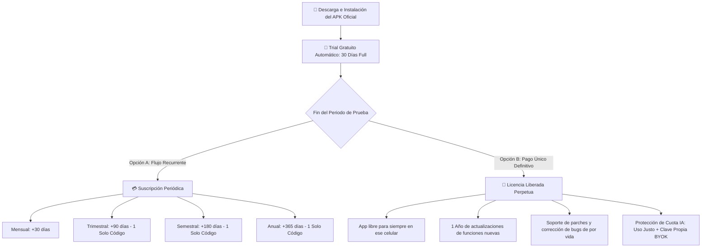
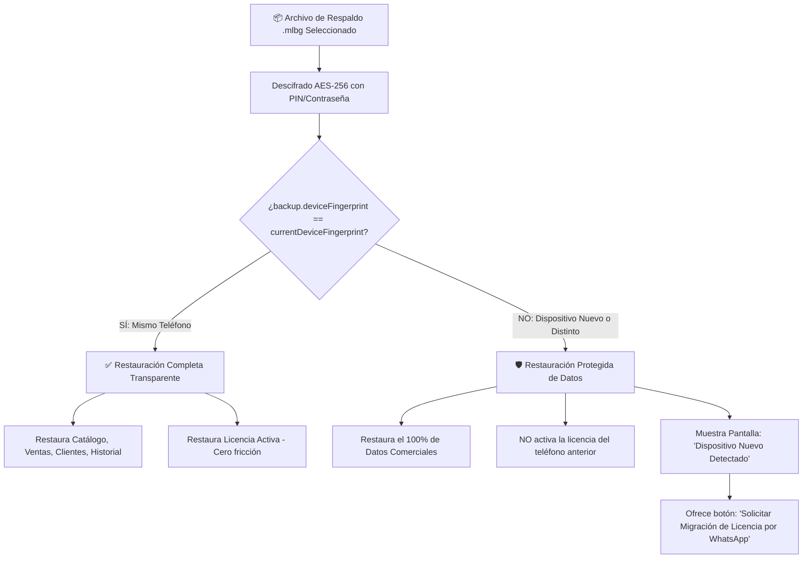
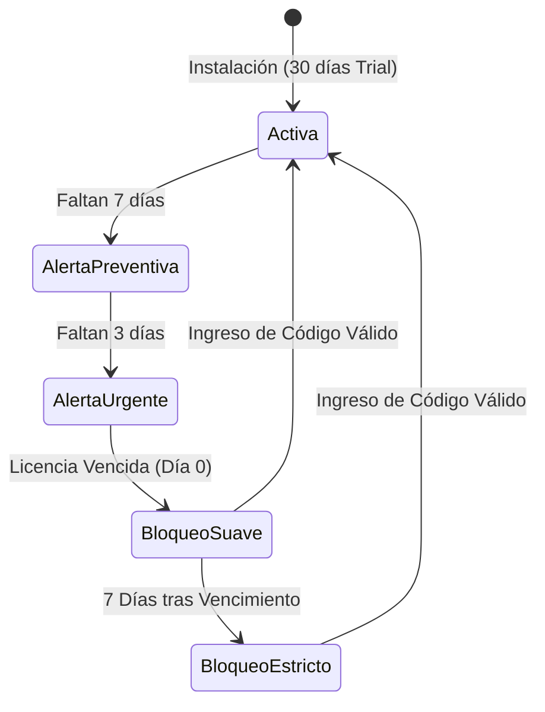

# 💰 INFORME 2: Modelo Comercial Unificado y Estrategias de Monetización para MochilaLista v9.23.0

**Fecha de Actualización:** 14 de Noviembre de 2026  
**Versión Base:** `v9.23.0+73` (Esquema DB v34)  
**Autor y Titular Legal:** Julio Angello Vasquez Navarro  
**Canal Primario de Distribución:** Venta Directa y Distribución por WhatsApp (APK Firmado Oficial)  
**Público Objetivo:** Comerciantes minoristas, mayoristas, distribuidores de útiles escolares, librerías, bazares y ferreterías en Lima y provincias del Perú.  
**Infraestructura Requerida:** Cero servidores cloud obligatorios — Gestión total autónoma desde la Laptop del Creador.

---

## 📋 1. Contexto Estratégico y Realidad Comercial

MochilaLista fue concebida para operar en el corazón del comercio tradicional peruano (Gamarra, Mesa Redonda, Unicachi, mercados zonales y comercios de barrio). Estos negocios operan en sótanos, galerías con mala cobertura celular o sin conexión de internet fija. Por tanto, el modelo comercial se cimenta sobre 6 pilares inviolables:

```
┌────────────────────────────────────────────────────────────────────────┐
│                   LOS 6 PILARES DEL MODELO COMERCIAL                  │
├────────────────────────────────────────────────────────────────────────┤
│ 1. FUNCIONAMIENTO 100% OFFLINE                                        │
│    La validación de licencias jamás depende de un servidor web.        │
│ 2. VINCULACIÓN AL DISPOSITIVO (Anti-Piratería Real)                   │
│    Un código de activación solo sirve en el teléfono del comprador.    │
│ 3. FLEXIBILIDAD: SUSCRIPCIÓN Y LICENCIA PERPETUA DE ALTO VALOR         │
│    El cliente elige pagar poco a poco o comprar la app para siempre.   │
│ 4. RESPETO AL TIEMPO PAGADO (Acumulación Sin Pérdida de Días)         │
│    Renovar con anticipación jamás recorta los días ya pagados.        │
│ 5. GESTIÓN DE ACTUALIZACIONES BLINDADA (Cero Pérdida de Datos)        │
│    Actualizar el APK nunca daña los registros ni anula la licencia.   │
│ 6. PROTECCIÓN ECONÓMICA DE LA IA (Gemini 3.8 Flash)                   │
│    Ninguna venta de pago único genera pérdidas por consumo de API.    │
└────────────────────────────────────────────────────────────────────────┘
```

---

## 🏆 2. El Modelo Comercial Unificado

En lugar de fragmentar la oferta en propuestas desconectadas, MochilaLista adopta un **Modelo Comercial Unificado de 2 Vías** respaldado por el mismo motor criptográfico asimétrico de licencias (`Ed25519`):



---

## 💎 3. Desglose de Planes y Modalidades

### 3.1. Periodo de Prueba (Trial Automático de 30 Días)
* **Activación:** Instantánea al instalar por primera vez la aplicación en el dispositivo.
* **Requisito:** Cero datos bancarios ni contacto previo requerido.
* **Alcance:** Acceso completo al 100% de las funciones operativas: Cotizador Universal IA, escaneo inteligente de facturas de proveedores, extracción y corte de variantes con stock compartido dependiente/independiente, créditos de clientes, sistema de fidelización y notificaciones.
* **Objetivo Comercial:** Que el comerciante cargue su inventario real, emita cotizaciones y compruebe el ahorro masivo de tiempo antes de pagar.

---

### 3.2. Planes de Suscripción (Recurrencia Predictiva)
Ideales para comerciantes que prefieren desembolsos pequeños y acompañamiento técnico continuo:

| Plan | Código Requerido | Días Sumados | Precio Sugerido (PEN) | Equivalente Mensual | Beneficio Comercial |
|------|:----------------:|:------------:|:--------------------:|:-------------------:|---------------------|
| **Mensual** | 1 Código / QR | +30 días | **S/ 35.00** | S/ 35.00 | Entrada accesible, bajo compromiso |
| **Trimestral** | **1 Solo Código** | +90 días | **S/ 90.00** | S/ 30.00 | Ahorro del 14% para el cliente |
| **Semestral** | **1 Solo Código** | +180 días | **S/ 160.00** | S/ 26.60 | Campaña Escolar / Navideña cubierta |
| **Anual** | **1 Solo Código** | +365 días | **S/ 280.00** | S/ 23.30 | Máximo ahorro (S/ 140 de descuento) |

> [!IMPORTANT]
> ### 1 Solo Código para Planes Largos
> A diferencia de sistemas antiguos que obligaban a entregar 3, 6 o 12 códigos mensuales separados, el nuevo formato criptográfico codifica los días exactos (`+90`, `+180` o `+365 días`). Con ingresar o escanear **1 solo código**, la app extiende automáticamente la vigencia por todo el periodo contratado.

---

### 3.3. Modalidad "App Liberada para Siempre" (Licencia Perpetua de Alto Valor)
Diseñada para dueños de negocio consolidados que rechazan los pagos mensuales y exigen comprar la herramienta de forma definitiva:

* **Precio Sugerido:** **S/ 750.00 a S/ 950.00** (Pago Único).
* **Titularidad:** Licencia de uso no exclusiva e intransferible conforme al D.L. 822 (autoría exclusiva de **Julio Angello Vasquez Navarro**).
* **Vinculación Criptográfica:** Código Maestro firmado con Ed25519 vinculado al `DeviceFingerprint` del teléfono y a los datos fiscales del negocio (RUC / Nombre Comercial).
* **Condición de Uso:** La app queda **liberada permanentemente** en ese dispositivo, sin requerir nunca más códigos de renovación ni conexión a internet para trabajar.
* **Diferenciación de Actualizaciones:**
  * **Hotfixes y Parches de Estabilidad:** Gratuitos de por vida para su versión autorizada.
  * **Ventana de Nuevas Funciones:** 12 meses de acceso a todas las nuevas versiones mayores y menores que se liberen.
  * **Vencido el año de actualizaciones:** La app instalada **sigue funcionando libre para siempre sin bloquearse jamás**. Si desea actualizar a una versión futura con nuevas funciones, puede adquirir un *Pase Anual de Actualización* (S/ 150.00).
* **Blindaje Económico de la Cuota de IA (Gemini 3.8 Flash):**
  1. **Cuota de Uso Justo Incluida:** 50 escaneos inteligentes mensuales incluidos mediante la infraestructura del autor.
  2. **Opción "Mi Propia Clave IA" (BYOK - Bring Your Own Key):** En Ajustes, el comerciante puede pegar su propia clave gratuita de Google AI Studio para escaneos ilimitados sin que el autor asuma un solo centavo de costo.
  3. **Packs de Recarga de IA:** Venta opcional de bolsas de escaneo (ej. 150 escaneos adicionales por S/ 20.00).

---

## ⚡ 4. Regla de Renovación Anticipada Sin Pérdida de Días

En MochilaLista, el cálculo de extensión aplica la **Regla de Continuidad Garantizada**:

```dart
DateTime calcularNuevoVencimiento({
  required DateTime vencimientoActual,
  required int diasOtorgados,
}) {
  final DateTime ahora = DateTime.now();

  // Si la licencia sigue activa y vigente en el futuro:
  if (vencimientoActual.isAfter(ahora)) {
    // Se suman los días exactamente a su fecha de expiración vigente
    return vencimientoActual.add(Duration(days: diasOtorgados));
  } else {
    // Si la licencia ya expiró: se suman a partir del momento del canje
    return ahora.add(Duration(days: diasOtorgados));
  }
}
```

### 📌 Ejemplo Práctico Detallado (Caso de Juan):
* El comerciante Juan tiene su suscripción mensual activa, con fecha de vencimiento fijada para el **25 de Noviembre**.
* El día **18 de Noviembre** (faltando 7 días para el vencimiento), Juan decide pagar su siguiente mes por Yape para no preocuparse durante su campaña escolar.
* Julio Angello le genera un código mensual estándar de `+30 días` (`diasOtorgados = 30`).
* Al momento en que Juan canjea el código en la app:
  $$\text{Fecha Base} = 25\text{ de Noviembre (su vencimiento vigente, no la fecha de hoy)}$$
  $$\text{Nuevo Vencimiento} = 25\text{ de Noviembre} + 30\text{ días} = 25\text{ de Diciembre}$$
* **Resultado:** Juan tiene **37 días de servicio continuo garantizado** desde el momento del canje.
* **Beneficio:** Cero fricción, cero reclamos de "me comieron una semana de app" y estímulo comercial directo para que los clientes paguen por anticipado.

---

## 🛡️ 5. Regla Anti-Clonación Inteligente al Restaurar Backups `.mlbg`

Para prevenir que un comerciante o tercero intente comprar una sola Licencia Perpetua y luego clonarla en 10 celulares restaurando un archivo de copia de seguridad (`.mlbg`), el sistema aplica una **validación de huella de hardware condicional**:



### Resultados de la Regla:
1. **En el mismo teléfono (formateo o reinstalación):** La experiencia es 100% automática; el comerciante no tiene que pedir nuevos códigos.
2. **En un teléfono nuevo:** El comerciante no pierde **ni una sola venta, producto o deuda de cliente**, pero el nuevo dispositivo no queda activado ilegalmente. El comerciante contacta a Julio Angello por WhatsApp, quien gestiona la reasignación de su licencia (o tarifa de reasignación según corresponda).

---

## 📲 6. Experiencia de Canje: Código QR Escaneable + Código de Texto

Para asegurar que cualquier comerciante pueda activar su app sin frustración técnica, el sistema implementa dos métodos de canje simultáneos:

```
┌────────────────────────────────────────────────────────────────────────┐
│             EXPERIENCIA DE CANJE DIRECTA POR WHATSAPP                 │
├────────────────────────────────────────────────────────────────────────┤
│                                                                        │
│   1. VÍA CÓDIGO QR (Instantáneo en 1 Segundo):                          │
│      El cliente recibe una imagen QR en su WhatsApp.                   │
│      - Modo A (Desde otro equipo / PC): Apunta con la cámara de        │
│        MochilaLista directamente al chat y se activa de inmediato.     │
│      - Modo B (En el mismo teléfono): El cliente toma captura de       │
│        pantalla o guarda la foto, abre MochilaLista, presiona          │
│        [ 🖼️ Escanear desde Galería/Captura ] y la app decodifica el QR  │
│        automáticamente sin requerir una segunda pantalla.              │
│                                                                        │
│   2. VÍA CÓDIGO DE TEXTO CON AUTODETECCIÓN:                            │
│      El cliente copia el texto recibido por WhatsApp:                  │
│      "ML9-7K2X-A365-N104-E2611-F9A8B7"                                 │
│      Al abrir MochilaLista, la app inspecciona el portapapeles,        │
│      reconoce el prefijo oficial 'ML9-' y muestra un modal automático: │
│      ┌────────────────────────────────────────────────────────┐        │
│      │ 🔑 Código de Activación Detectado                      │        │
│      │ ¿Deseas activar tu licencia para el dispositivo        │        │
│      │ ML-7K2X por 365 días?                                  │        │
│      │            [  ✅ Activar Licencia Ahora  ]             │        │
│      └────────────────────────────────────────────────────────┘        │
│                                                                        │
└────────────────────────────────────────────────────────────────────────┘
```

---

## 🔔 7. Sistema de Alertas Progresivas y Bloqueo Amigable

Para proteger el negocio sin interrumpir la operación del comerciante en plena venta de mostrador, el sistema implementa una escala de 5 estados:



### Tabla de Comportamiento por Estado:

| Estado | Tiempo | Experiencia en la App | Operaciones Permitidas |
|--------|:------:|-----------------------|------------------------|
| **Verde (Activa)** | > 7 días | Interfaz limpia sin avisos molestos. | 100% de funciones operativas. |
| **Amarillo (Preventivo)** | 7 a 4 días | Banner discreto superior en el Home: *"Tu licencia vence en X días. Toca aquí para renovar por WhatsApp"*. | 100% de funciones operativas. |
| **Naranja (Urgente)** | 3 a 1 día | Diálogo informativo al abrir la app con botón directo a WhatsApp. Badge en el perfil. | 100% de funciones operativas. |
| **Rojo (Bloqueo Suave)** | 0 a 7 días vencida | Pantalla de Licencia Vencida. Permite consultar catálogo, ver historial de clientes y exportar backups, pero **bloquea la creación de nuevas ventas, cotizaciones o escaneo de facturas**. | Solo lectura + Exportación de Backups. |
| **Bloqueo Estricto** | > 7 días vencida | Solo muestra la pantalla de ingreso de código, el código QR de pago y el botón de **Exportar Copia de Seguridad Inmediata**. | Cero operaciones comerciales. Datos 100% seguros y exportables. |

> [!CAUTION]
> **Retención Garantizada de Datos:** La app **NUNCA** borra los datos del cliente. Incluso tras meses de vencida, el comerciante siempre puede exportar su respaldo `.mlbg`.

---

## 💳 8. Canales de Recaudación en el Mercado Peruano

La pantalla de estado de licencia y el mensaje automático de renovación integran los métodos de pago estándar de la economía peruana:

```
┌────────────────────────────────────────────────────────────────────────┐
│                   MÉTODOS DE PAGO INTEGRADOS EN LA APP                 │
├────────────────────────────────────────────────────────────────────────┤
│ 📱 YAPE / PLIN (Instantáneo):                                          │
│    Número Oficial: +51 999 888 777                                     │
│    Titular: Julio Angello Vasquez Navarro                              │
│    Muestra el Código QR de Yape oficial dentro de la misma app.        │
│                                                                        │
│ 🏦 TRANSFERENCIA BANCARIA DIRECTA (Cuentas y Códigos Interbancarios):  │
│    • BCP (Banco de Crédito del Perú):                                  │
│      Cuenta Corriente / Ahorros: 191-XXXXXXXX-0-XX                     │
│      CCI: 002-191-XXXXXXXXXXXX-XX                                      │
│    • BBVA Perú:                                                        │
│      Cuenta Ahorros: 0011-XXXX-XXXXXXXXXX                              │
│      CCI: 011-XXX-XXXXXXXXXXXXXXXX-XX                                  │
│    • Interbank:                                                        │
│      Cuenta Simple: 200-XXXXXXXXXX                                     │
│      CCI: 003-200-XXXXXXXXXXXXXX-XX                                    │
│    • Banco de la Nación (Indispensable para clientes en provincias):   │
│      Cuenta: 04-XXX-XXXXXX                                             │
│                                                                        │
│ 💬 PROCESO DE VALIDACIÓN:                                             │
│    El cliente envía la captura de su voucher por WhatsApp.             │
│    En menos de 2 minutos, generas el código o QR desde tu laptop      │
│    y se lo devuelves por el mismo chat.                                │
└────────────────────────────────────────────────────────────────────────┘
```

---

## 📈 9. Proyección Financiera de Escalamiento Anual

Comparativa de ingresos proyectados para una cartera controlada de **60 comercios activos** durante el primer año:

```
Escenario: Cartera de 60 Comercios Activos en 12 Meses

A) Distribución Típica de Cartera (75% Suscripción + 25% Licencia Perpetua):
   ├── 45 Comercios en Suscripción Periódica (Promedio ponderado S/ 25.00/mes):
   │   └── S/ 1,125.00 mensuales = S/ 13,500.00 al año (Ingreso Recurrente Predecible)
   └── 15 Comercios en Licencia Perpetua (S/ 850.00 pago único):
       └── S/ 12,750.00 de inyección inmediata de capital
   ────────────────────────────────────────────────────────────────────────
   TOTAL INGRESOS AÑO 1: S/ 26,250.00 PEN

B) Ingresos Recurrentes Año 2 (Crecimiento a 100 Comercios):
   ├── 75 Comercios en Suscripción (Promedio S/ 25.00/mes):
   │   └── S/ 1,875.00 mensuales = S/ 22,500.00 al año
   ├── 15 Clientes Perpetuos del Año 1 renovando Pase de Actualizaciones (S/ 150.00):
   │   └── S/ 2,250.00 anuales
   └── 25 Nuevas Licencias Perpetuas vendidas (S/ 850.00):
       └── S/ 21,250.00
   ────────────────────────────────────────────────────────────────────────
   TOTAL INGRESOS AÑO 2: S/ 46,000.00 PEN
```

---
*Continúa en → [03_PLAN_IMPLEMENTACION_FASES.md](file:///c:/Users/vjuli/Documents/mochilalista-app/informe_proyecto/03_PLAN_IMPLEMENTACION_FASES.md)*
