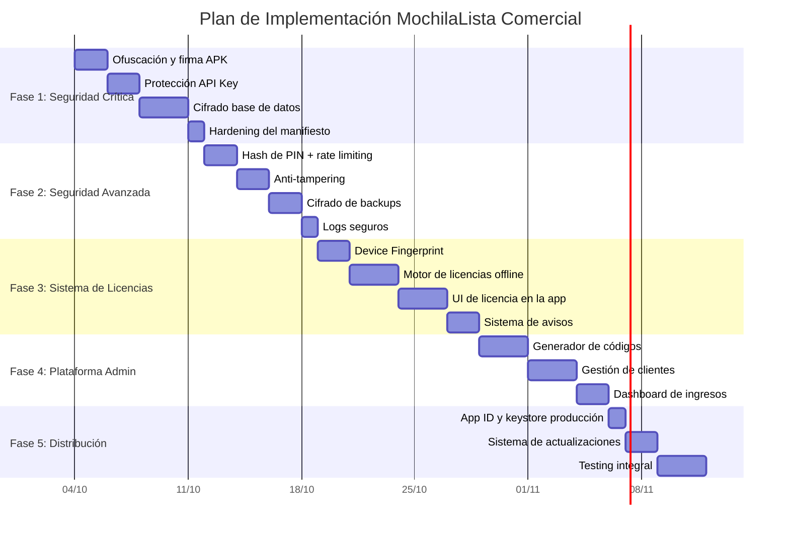

# 🗺️ INFORME 3: Plan de Implementación por Fases — Seguridad y Comercialización

**Fecha:** 3 de Octubre de 2026  
**Versión Base:** 8.5.0+47  
**Modelo Seleccionado:** Propuesta A — Sistema de Códigos de Acceso Offline  
**Objetivo:** Detallar todas las modificaciones necesarias, organizadas en fases secuenciales, para transformar MochilaLista de un proyecto de desarrollo a un producto comercial seguro.

> [!NOTE]
> Este plan asume que la **Propuesta A** (Códigos de Acceso Offline) es la seleccionada. Si se elige otra propuesta, las Fases 3 y 4 deberían ajustarse. Las Fases 1 y 2 (Seguridad) son obligatorias independientemente de la propuesta elegida.

---

## 📊 Vista General de las Fases



**Tiempo total estimado:** 5-7 semanas (trabajando a tiempo parcial)

---

## 🔴 FASE 1: Blindaje de Seguridad Crítico

**Duración estimada:** 5-7 días  
**Objetivo:** Resolver las 5 vulnerabilidades críticas que bloquean la comercialización.  
**Al completar:** La app será resistente a ataques básicos de ingeniería inversa.

### Tarea 1.1: Protección de la API Key de Gemini

**Vulnerabilidad:** CRIT-01  
**Archivos a modificar:**
- [`pubspec.yaml`](file:///c:/Users/vjuli/Documents/mochilalista-app/app_movil/pubspec.yaml) — Remover `.env` de assets
- [`api_constants.dart`](file:///c:/Users/vjuli/Documents/mochilalista-app/app_movil/lib/core/config/api_constants.dart) — Leer key de `--dart-define`
- [`main.dart`](file:///c:/Users/vjuli/Documents/mochilalista-app/app_movil/lib/main.dart) — Remover `dotenv.load()`
- `.env` — Se conserva solo para desarrollo local

**Cambios detallados:**

1. **Eliminar `.env` de los assets de producción:**
```diff
# pubspec.yaml
flutter:
  uses-material-design: true
  assets:
-    - .env
    - assets/logo.png
    - assets/logo1.png
```

2. **Modificar `api_constants.dart` para leer de `const String.fromEnvironment`:**
```dart
class ApiConstants {
  // En producción, se inyecta con: --dart-define=GOOGLE_API_KEY=xxx
  // En desarrollo, se lee del .env como fallback
  static String get googleApiKey {
    const compiledKey = String.fromEnvironment('GOOGLE_API_KEY');
    if (compiledKey.isNotEmpty) return compiledKey;
    
    // Fallback para desarrollo
    final envKey = dotenv.env['GOOGLE_API_KEY'];
    if (envKey != null && envKey.isNotEmpty) return envKey;
    
    return '';
  }
}
```

3. **Compilar con:**
```bash
flutter build apk --release \
  --dart-define=GOOGLE_API_KEY=TU_CLAVE_REAL \
  --obfuscate \
  --split-debug-info=build/debug-info
```

**Resultado:** La API Key ya no estará en ningún archivo dentro del APK. Solo existe como constante compilada en el binario ofuscado.

---

### Tarea 1.2: Application ID y Keystore de Producción

**Vulnerabilidades:** CRIT-02, CRIT-03  
**Archivos a modificar:**
- [`build.gradle.kts`](file:///c:/Users/vjuli/Documents/mochilalista-app/app_movil/android/app/build.gradle.kts)
- Nuevo archivo: `android/key.properties` (NO commitear a Git)
- Nuevo archivo: `mochilalista-release.jks` (guardar en lugar seguro)

**Cambios detallados:**

1. **Generar keystore de producción:**
```bash
keytool -genkey -v -keystore mochilalista-release.jks \
  -keyalg RSA -keysize 2048 -validity 10000 \
  -alias mochilalista
```

2. **Crear `android/key.properties`:**
```properties
storePassword=TU_PASSWORD_SEGURO
keyPassword=TU_KEY_PASSWORD
keyAlias=mochilalista
storeFile=../mochilalista-release.jks
```

3. **Modificar `build.gradle.kts`:**
```diff
android {
-   namespace = "com.example.app_movil"
+   namespace = "com.mochilalista.app"
    
    defaultConfig {
-       applicationId = "com.example.app_movil"
+       applicationId = "com.mochilalista.app"
    }

    signingConfigs {
+       create("release") {
+           val keystoreProperties = Properties()
+           val keystorePropertiesFile = rootProject.file("key.properties")
+           if (keystorePropertiesFile.exists()) {
+               keystoreProperties.load(FileInputStream(keystorePropertiesFile))
+           }
+           keyAlias = keystoreProperties["keyAlias"] as String
+           keyPassword = keystoreProperties["keyPassword"] as String
+           storeFile = file(keystoreProperties["storeFile"] as String)
+           storePassword = keystoreProperties["storePassword"] as String
+       }
    }

    buildTypes {
        release {
-           signingConfig = signingConfigs.getByName("debug")
+           signingConfig = signingConfigs.getByName("release")
-           isMinifyEnabled = false
+           isMinifyEnabled = true
-           isShrinkResources = false
+           isShrinkResources = true
+           proguardFiles(getDefaultProguardFile("proguard-android-optimize.txt"))
        }
    }
}
```

> [!CAUTION]
> **NUNCA pierdas el archivo `mochilalista-release.jks` ni sus contraseñas.** Sin este archivo, no podrás publicar actualizaciones de la app. Haz múltiples copias en USB, nube privada, etc.

---

### Tarea 1.3: Cifrado de Base de Datos con SQLCipher

**Vulnerabilidad:** CRIT-04  
**Archivos a modificar:**
- [`pubspec.yaml`](file:///c:/Users/vjuli/Documents/mochilalista-app/app_movil/pubspec.yaml) — Cambiar dependencia
- [`local_db.dart`](file:///c:/Users/vjuli/Documents/mochilalista-app/app_movil/lib/core/database/local_db.dart) — Agregar clave de cifrado
- [`backup_manager.dart`](file:///c:/Users/vjuli/Documents/mochilalista-app/app_movil/lib/core/utils/backup_manager.dart) — Ajustar restauración

**Cambios detallados:**

1. **Cambiar dependencia:**
```diff
# pubspec.yaml
dependencies:
-  sqflite: ^2.3.0
+  sqflite_sqlcipher: ^3.1.0+1
```

2. **Modificar apertura de base de datos:**
```dart
import 'package:sqflite_sqlcipher/sqflite.dart';
import 'package:flutter_secure_storage/flutter_secure_storage.dart';

class LocalDatabase {
  // Genera o recupera una clave de cifrado única por instalación
  static Future<String> _getEncryptionKey() async {
    const storage = FlutterSecureStorage();
    String? key = await storage.read(key: 'db_encryption_key');
    if (key == null) {
      // Generar clave aleatoria de 32 bytes en base64
      final random = Random.secure();
      final bytes = List<int>.generate(32, (_) => random.nextInt(256));
      key = base64Encode(bytes);
      await storage.write(key: 'db_encryption_key', value: key);
    }
    return key;
  }

  Future<Database> _initDB(String filePath) async {
    final dbPath = await getDatabasesPath();
    final path = join(dbPath, filePath);
    final password = await _getEncryptionKey();

    return await openDatabase(
      path,
      version: 23, // Incrementar versión
      password: password,  // ← Cifrado AES-256
      onCreate: _createDB,
      onConfigure: _onConfigure,
      onUpgrade: _onUpgrade,
    );
  }
}
```

> [!WARNING]
> **Migración necesaria:** Los usuarios existentes tienen una DB sin cifrar. Se necesita un proceso de migración que cifre la DB existente al actualizar. Esto se manejará en `_onUpgrade`.

---

### Tarea 1.4: Ofuscación de Código Dart

**Vulnerabilidad:** CRIT-05  
**Archivo a modificar:** Comando de compilación

**Cambio:**
```bash
# ANTES (inseguro)
flutter build apk --release

# DESPUÉS (seguro)
flutter build apk --release \
  --obfuscate \
  --split-debug-info=build/debug-info \
  --dart-define=GOOGLE_API_KEY=TU_CLAVE
```

**Archivos generados:**
- `build/debug-info/` — Mapeo de símbolos (guardar para debugging, NO distribuir)
- El APK resultante tendrá nombres de clases y métodos aleatorios

---

### Tarea 1.5: Hardening del AndroidManifest

**Vulnerabilidad:** ALTA-02, ALTA-04  
**Archivos a modificar:**
- [`AndroidManifest.xml`](file:///c:/Users/vjuli/Documents/mochilalista-app/app_movil/android/app/src/main/AndroidManifest.xml)
- Nuevo: `android/app/src/main/res/xml/network_security_config.xml`

**Cambios:**
```diff
# AndroidManifest.xml
<application
-   android:usesCleartextTraffic="true"
+   android:usesCleartextTraffic="false"
+   android:networkSecurityConfig="@xml/network_security_config"
    android:allowBackup="false"
```

```xml
<!-- network_security_config.xml -->
<?xml version="1.0" encoding="utf-8"?>
<network-security-config>
    <base-config cleartextTrafficPermitted="false">
        <trust-anchors>
            <certificates src="system" />
        </trust-anchors>
    </base-config>
</network-security-config>
```

### ✅ Entregable de Fase 1

| Componente | Estado Antes | Estado Después |
|------------|-------------|----------------|
| API Key | Texto plano en APK | Inyectada en compilación, invisible |
| App ID | `com.example.app_movil` | `com.mochilalista.app` |
| Firma | Debug key | Keystore de producción |
| Base de datos | Sin cifrar | AES-256 (SQLCipher) |
| Código Dart | Legible | Ofuscado |
| Red | HTTP permitido | Solo HTTPS |

---

## 🟠 FASE 2: Seguridad Avanzada

**Duración estimada:** 5-7 días  
**Objetivo:** Proteger datos sensibles, prevenir fuerza bruta, y detectar manipulaciones.

### Tarea 2.1: Hasheo de PIN + Rate Limiting

**Archivos a modificar:**
- [`auth_provider.dart`](file:///c:/Users/vjuli/Documents/mochilalista-app/app_movil/lib/core/providers/auth_provider.dart)
- Nuevo: `lib/core/services/security_service.dart`

**Implementación:**
```dart
class SecurityService {
  static String hashPin(String pin, String salt) {
    final bytes = utf8.encode(pin + salt);
    final digest = sha256.convert(bytes);
    return digest.toString();
  }

  // Rate limiting: bloqueo progresivo
  static const maxAttempts = 5;
  static const lockoutDurations = [30, 60, 300, 900, 3600]; // segundos
  
  static Future<bool> canAttemptPin() async {
    final prefs = await SharedPreferences.getInstance();
    final attempts = prefs.getInt('pin_attempts') ?? 0;
    final lastAttempt = prefs.getInt('pin_last_attempt') ?? 0;
    
    if (attempts >= maxAttempts) {
      final lockIndex = (attempts - maxAttempts).clamp(0, lockoutDurations.length - 1);
      final lockDuration = lockoutDurations[lockIndex];
      final elapsed = DateTime.now().millisecondsSinceEpoch - lastAttempt;
      
      if (elapsed < lockDuration * 1000) {
        return false; // Aún bloqueado
      }
    }
    return true;
  }
}
```

---

### Tarea 2.2: Verificación Anti-Tampering

**Nuevo archivo:** `lib/core/utils/integrity_checker.dart`

**Implementación:**
```dart
class IntegrityChecker {
  /// Verifica que el APK no ha sido re-firmado
  static Future<bool> verifySignature() async {
    // Obtener la firma actual del APK
    // Comparar con la firma esperada (hardcoded, ofuscada)
    // Si no coincide, la app fue reempaquetada
    ...
  }

  /// Verifica que no estamos en un emulador
  static Future<bool> isGenuineDevice() async {
    final deviceInfo = DeviceInfoPlugin();
    final androidInfo = await deviceInfo.androidInfo;
    
    // Checks de emulador
    if (androidInfo.isPhysicalDevice == false) return false;
    if (androidInfo.model.contains('sdk') || androidInfo.model.contains('Emulator')) return false;
    
    return true;
  }

  /// Verifica que el dispositivo no está rooteado
  static Future<bool> isDeviceSecure() async {
    // Checks básicos de root
    final rootIndicators = ['/system/app/Superuser.apk', '/system/bin/su', '/system/xbin/su'];
    for (var path in rootIndicators) {
      if (await File(path).exists()) return false;
    }
    return true;
  }
}
```

> [!NOTE]
> Estos checks NO bloquean la app en dispositivos rooteados/emuladores. Solo muestran una **advertencia** y lo registran localmente. Bloquear completamente podría alienar usuarios legítimos con dispositivos personalizados.

---

### Tarea 2.3: Cifrado de Archivos de Backup

**Archivo a modificar:** [`backup_manager.dart`](file:///c:/Users/vjuli/Documents/mochilalista-app/app_movil/lib/core/utils/backup_manager.dart)

**Cambio:** Cifrar el archivo ZIP de backup con una contraseña derivada del PIN del usuario antes de exportar.

---

### Tarea 2.4: Sistema de Logging Seguro

**Archivo a modificar:** [`app_logger.dart`](file:///c:/Users/vjuli/Documents/mochilalista-app/app_movil/lib/core/utils/app_logger.dart)

**Cambio:** En modo release, todos los `debugPrint` y `AppLogger` se silencian automáticamente.
```dart
class AppLogger {
  static void info(String tag, String message) {
    if (kDebugMode) {
      debugPrint('[$tag] $message');
    }
    // En release: no hacer nada
  }
}
```

### ✅ Entregable de Fase 2

| Componente | Logro |
|------------|-------|
| PIN | Almacenado como hash SHA-256, no texto plano |
| Fuerza bruta | Bloqueo progresivo tras 5 intentos |
| Anti-tampering | Detección de re-empaquetado y root |
| Backups | Cifrados con contraseña |
| Logs | Silenciados en producción |

---

## 🟢 FASE 3: Sistema de Licencias Offline

**Duración estimada:** 8-10 días  
**Objetivo:** Implementar el sistema de códigos de acceso vinculados al dispositivo.

### Tarea 3.1: Device Fingerprint Generator

**Nuevo archivo:** `lib/core/services/license/device_fingerprint.dart`

**Funcionalidad:**
- Genera un código único de 6-8 caracteres basado en el `androidId`.
- El código es legible y fácil de dictar por teléfono.
- Se almacena en la base de datos para persistencia.

```dart
class DeviceFingerprint {
  static Future<String> generate() async {
    final deviceInfo = DeviceInfoPlugin();
    final androidInfo = await deviceInfo.androidInfo;
    final androidId = androidInfo.id; // Único por instalación en Android 8+
    
    // Crear hash corto
    final bytes = utf8.encode(androidId + 'mochilalista_salt_v1');
    final hash = sha256.convert(bytes).toString();
    
    // Tomar primeros 8 caracteres alfanuméricos y formatear
    final fingerprint = hash.substring(0, 8).toUpperCase();
    return 'ML-${fingerprint.substring(0, 4)}';
  }
}
```

---

### Tarea 3.2: Motor de Validación de Licencias

**Nuevo archivo:** `lib/core/services/license/license_engine.dart`

**Funcionalidad:**
- Almacena el estado de la licencia en la DB local (tabla nueva).
- Valida códigos de acceso usando HMAC-SHA256.
- Controla el trial de 30 días.
- Implementa protección contra manipulación del reloj.

**Nueva tabla en la base de datos:**
```sql
CREATE TABLE licencia_app (
  id INTEGER PRIMARY KEY AUTOINCREMENT,
  device_fingerprint TEXT NOT NULL,
  tipo_licencia TEXT DEFAULT 'trial', -- trial, mensual, anual
  fecha_inicio TEXT NOT NULL,
  fecha_expiracion TEXT NOT NULL,
  ultimo_codigo_usado TEXT,
  fecha_ultimo_check TEXT NOT NULL,
  intentos_codigo_fallidos INTEGER DEFAULT 0,
  activa INTEGER DEFAULT 1
);
```

**Lógica de protección anti-reloj:**
```dart
bool _isClockManipulated() {
  final lastCheck = _license.fechaUltimoCheck;
  final now = DateTime.now();
  
  // Si el reloj retrocedió más de 1 hora respecto al último check
  if (now.isBefore(lastCheck.subtract(Duration(hours: 1)))) {
    return true; // Posible manipulación
  }
  return false;
}
```

---

### Tarea 3.3: Interfaz de Usuario para Licencias

**Nuevos archivos:**
- `lib/features/auth/screens/license/license_status_screen.dart`
- `lib/features/auth/screens/license/license_activation_screen.dart`
- `lib/features/auth/widgets/license_banner_widget.dart`
- `lib/features/auth/widgets/license_expiry_dialog.dart`

**Pantallas a crear:**

1. **Pantalla de Estado de Licencia** — Accesible desde el perfil del usuario.
   - Muestra: Device ID, fecha de vencimiento, tipo de plan.
   - Botón: "Ingresar Código de Acceso".
   - Botón: "Contactar Soporte" (abre WhatsApp).

2. **Banner de Aviso** — Se muestra en el HomeScreen cuando faltan ≤7 días.

3. **Modal de Bloqueo** — Reemplaza la navegación normal cuando la licencia vence.

---

### Tarea 3.4: Sistema de Avisos y Bloqueo Gradual

**Archivos a modificar:**
- [`main.dart`](file:///c:/Users/vjuli/Documents/mochilalista-app/app_movil/lib/main.dart) — Agregar check de licencia al arranque
- [`home_screen.dart`](file:///c:/Users/vjuli/Documents/mochilalista-app/app_movil/lib/core/screens/home_screen.dart) — Agregar banner de aviso

**Flujo de verificación al iniciar la app:**
```dart
// En main.dart, después de autenticar
if (auth.status == AuthStatus.authenticated) {
  final licenseStatus = await LicenseEngine.checkLicense();
  
  switch (licenseStatus) {
    case LicenseStatus.active:
      return HomeScreen();         // Todo normal
    case LicenseStatus.expiringSoon:
      return HomeScreen();         // Normal + banner de aviso
    case LicenseStatus.expired:
      return LicenseBlockScreen(); // Bloqueo suave: solo consulta
    case LicenseStatus.hardLocked:
      return LicenseActivationScreen(); // Solo activación + backup
  }
}
```

### ✅ Entregable de Fase 3

| Componente | Logro |
|------------|-------|
| Device ID | Código único visible para el usuario |
| Motor de licencias | Validación offline HMAC-SHA256 |
| Trial | 30 días automáticos desde instalación |
| Avisos | 7, 3, 1 día antes del vencimiento |
| Bloqueo suave | Consulta permitida, operaciones bloqueadas |
| Bloqueo total | Solo activación y backup |
| Anti-reloj | Detección de manipulación de fecha |

---

## 🔵 FASE 4: Plataforma de Administración (Tu Laptop)

**Duración estimada:** 6-8 días  
**Objetivo:** Crear una aplicación web local para gestionar clientes y generar códigos.

### Tarea 4.1: Aplicación Web de Administración

**Tecnología:** HTML + CSS + JavaScript vanilla (ejecutable con doble-click en el navegador, sin servidor necesario).

**Estructura de archivos:**
```
mochilalista-admin/
├── index.html          ← Dashboard principal
├── css/
│   └── styles.css      ← Estilos modernos
├── js/
│   ├── app.js          ← Lógica principal
│   ├── crypto.js       ← Generador de códigos (mismo algoritmo que la app)
│   └── storage.js      ← Almacenamiento en localStorage del navegador
└── data/
    └── clients.json    ← Base de datos de clientes (exportable)
```

**Funcionalidades:**
1. **Dashboard:** Resumen de clientes activos, por vencer, ingresos.
2. **Generador de Códigos:** Ingresa Device ID + período → genera código.
3. **Gestión de Clientes:** Alta, edición, historial de pagos.
4. **Reportes:** Ingresos mensuales, tasa de renovación.

---

### Tarea 4.2: Algoritmo de Generación Compartido

**CRÍTICO:** El mismo algoritmo debe estar tanto en la app Flutter como en la plataforma JavaScript.

```javascript
// crypto.js (Plataforma Admin)
async function generateAccessCode(deviceId, period, secretKey) {
  const message = `${deviceId}:${period}`;
  const encoder = new TextEncoder();
  
  const key = await crypto.subtle.importKey(
    'raw', encoder.encode(secretKey),
    { name: 'HMAC', hash: 'SHA-256' },
    false, ['sign']
  );
  
  const signature = await crypto.subtle.sign('HMAC', key, encoder.encode(message));
  const hashArray = Array.from(new Uint8Array(signature));
  const hashHex = hashArray.map(b => b.toString(16).padStart(2, '0')).join('');
  
  // Tomar primeros 12 caracteres y formatear
  const code = hashHex.substring(0, 12).toUpperCase();
  return `${code.substr(0,4)}-${code.substr(4,4)}-${code.substr(8,4)}`;
}
```

```dart
// license_engine.dart (App Flutter) — MISMO ALGORITMO
static String generateExpectedCode(String deviceId, String period) {
  final secretKey = _getObfuscatedSecret(); // Clave ofuscada en el código
  final message = '$deviceId:$period';
  
  final hmac = Hmac(sha256, utf8.encode(secretKey));
  final digest = hmac.convert(utf8.encode(message));
  final hashHex = digest.toString();
  
  final code = hashHex.substring(0, 12).toUpperCase();
  return '${code.substring(0,4)}-${code.substring(4,4)}-${code.substring(8,4)}';
}
```

---

### Tarea 4.3: Gestión de Clientes y Pagos

**Base de datos local (localStorage del navegador):**
```json
{
  "clients": [
    {
      "id": "1",
      "name": "Alejandrina",
      "phone": "+51 999 888 777",
      "deviceId": "ML-7K2X",
      "businessName": "Tienda Alejandrina",
      "registeredAt": "2026-10-01",
      "plan": "mensual",
      "payments": [
        {
          "date": "2026-10-01",
          "amount": 30,
          "method": "Yape",
          "period": "2026-10",
          "codeGenerated": "A7K2-X9F3-P2M1"
        }
      ],
      "notes": "Cliente frecuente, siempre paga a tiempo"
    }
  ]
}
```

### ✅ Entregable de Fase 4

| Componente | Logro |
|------------|-------|
| Plataforma web | Ejecutable localmente sin servidor |
| Generador de códigos | Mismo algoritmo que la app |
| Base de clientes | Almacenada localmente con export/import |
| Dashboard | Métricas de negocio en tiempo real |
| Integración WhatsApp | Botón para enviar código al cliente |

---

## 🟣 FASE 5: Preparación para Distribución Comercial

**Duración estimada:** 4-6 días  
**Objetivo:** Finalizar todos los detalles para la primera distribución comercial.

### Tarea 5.1: Branding del Aplicativo

**Cambios:**
- Actualizar `applicationId` a `com.mochilalista.app`.
- Verificar que los iconos de la app sean de alta calidad.
- Agregar splash screen profesional.

### Tarea 5.2: Sistema de Versionado para Actualizaciones

**Nuevo componente en la app:** Pantalla "Acerca de" con:
- Versión actual de la app.
- Changelog de las últimas actualizaciones.
- Información de contacto del soporte.
- Link de WhatsApp del desarrollador.

**Proceso de actualización:**
1. Compilar nueva versión con `versionCode` incrementado.
2. Enviar APK al cliente por WhatsApp / Google Drive.
3. El cliente instala sobre la versión anterior (los datos y licencia se conservan).

### Tarea 5.3: Testing Integral

**Checklist de verificación:**

| Test | Descripción | Pasa |
|------|-------------|------|
| Instalación limpia | App instala correctamente en dispositivo nuevo | ☐ |
| Trial funciona | 30 días de uso sin código | ☐ |
| Trial vence | Al día 31, bloqueo suave activo | ☐ |
| Código válido | Código generado desde plataforma desbloquea la app | ☐ |
| Código inválido | Código incorrecto es rechazado | ☐ |
| Código de otro dispositivo | Código generado para otro Device ID es rechazado | ☐ |
| Actualización preserva datos | Instalar nueva versión sobre la anterior NO pierde datos | ☐ |
| Actualización preserva licencia | La licencia activa sobrevive la actualización | ☐ |
| Backup cifrado | El backup exportado está cifrado | ☐ |
| Restauración de backup | El backup se puede restaurar correctamente | ☐ |
| Ofuscación efectiva | El APK descompilado no muestra código legible | ☐ |
| Anti-reloj | Retroceder el reloj del sistema no extiende la licencia | ☐ |
| Rendimiento | La app no se vuelve más lenta con las medidas de seguridad | ☐ |

---

## 📋 Resumen de Archivos Nuevos y Modificados por Fase

### Fase 1 (Seguridad Crítica)
| Acción | Archivo |
|--------|---------|
| ✏️ Modificar | `pubspec.yaml` |
| ✏️ Modificar | `api_constants.dart` |
| ✏️ Modificar | `main.dart` |
| ✏️ Modificar | `build.gradle.kts` |
| ✏️ Modificar | `local_db.dart` |
| ✏️ Modificar | `AndroidManifest.xml` |
| ➕ Crear | `android/key.properties` |
| ➕ Crear | `android/.../network_security_config.xml` |
| ➕ Crear | `mochilalista-release.jks` |

### Fase 2 (Seguridad Avanzada)
| Acción | Archivo |
|--------|---------|
| ✏️ Modificar | `auth_provider.dart` |
| ✏️ Modificar | `backup_manager.dart` |
| ✏️ Modificar | `app_logger.dart` |
| ➕ Crear | `lib/core/services/security_service.dart` |
| ➕ Crear | `lib/core/utils/integrity_checker.dart` |

### Fase 3 (Sistema de Licencias)
| Acción | Archivo |
|--------|---------|
| ✏️ Modificar | `main.dart` |
| ✏️ Modificar | `home_screen.dart` |
| ✏️ Modificar | `local_db.dart` (nueva tabla) |
| ➕ Crear | `lib/core/services/license/device_fingerprint.dart` |
| ➕ Crear | `lib/core/services/license/license_engine.dart` |
| ➕ Crear | `lib/core/providers/license_provider.dart` |
| ➕ Crear | `lib/features/auth/screens/license/license_status_screen.dart` |
| ➕ Crear | `lib/features/auth/screens/license/license_activation_screen.dart` |
| ➕ Crear | `lib/features/auth/widgets/license_banner_widget.dart` |
| ➕ Crear | `lib/features/auth/widgets/license_expiry_dialog.dart` |

### Fase 4 (Plataforma Admin)
| Acción | Archivo |
|--------|---------|
| ➕ Crear | `mochilalista-admin/index.html` |
| ➕ Crear | `mochilalista-admin/css/styles.css` |
| ➕ Crear | `mochilalista-admin/js/app.js` |
| ➕ Crear | `mochilalista-admin/js/crypto.js` |
| ➕ Crear | `mochilalista-admin/js/storage.js` |

### Fase 5 (Distribución)
| Acción | Archivo |
|--------|---------|
| ✏️ Modificar | `pubspec.yaml` (versión) |
| ➕ Crear | `lib/features/auth/screens/about_screen.dart` |

---

## 🎯 Hitos y Métricas de Éxito

| Fase | Hito | Métrica de Éxito |
|------|------|------------------|
| 1 | Seguridad base | El APK descompilado no revela información sensible |
| 2 | Protección avanzada | No se puede hacer fuerza bruta al PIN |
| 3 | Licencias funcionales | Un código válido desbloquea, uno inválido no |
| 4 | Plataforma operativa | Puedes generar códigos y gestionar clientes |
| 5 | Listo para vender | Primer APK comercial distribuido exitosamente |

---

## 📊 Consideraciones para Escalabilidad Futura (Premium)

Como mencionaste que en el futuro podrías implementar niveles premium, el sistema está diseñado para soportarlo:

### Cómo Agregar Niveles Premium en el Futuro

1. **En la tabla `licencia_app`**, el campo `tipo_licencia` ya soporta diferentes tipos.
2. **En el código de acceso**, se puede incluir un byte adicional que indique el nivel.
3. **En la plataforma admin**, agregar selector de nivel al generar códigos.

```
Ejemplo futuro de niveles:
┌─────────────────────────────────────────────────────┐
│ Nivel BÁSICO (S/ 30/mes)                             │
│ ✅ Inventario  ✅ Ventas  ✅ Clientes  ❌ IA Scanner │
├─────────────────────────────────────────────────────┤
│ Nivel PRO (S/ 50/mes)                                │
│ ✅ Inventario  ✅ Ventas  ✅ Clientes  ✅ IA Scanner │
│ ✅ Analíticas  ✅ Reportes PDF                       │
├─────────────────────────────────────────────────────┤
│ Nivel ENTERPRISE (S/ 100/mes)                        │
│ ✅ Todo PRO  ✅ Multi-negocio  ✅ Soporte prioritario │
└─────────────────────────────────────────────────────┘
```

> [!TIP]
> **No implementes niveles ahora.** Primero valida el producto con un solo nivel. Cuando tengas 20+ clientes estables y feedback real, entonces evalúa si los niveles premium tienen demanda.

---

> [!IMPORTANT]
> **Próximo paso:** Revisa los 3 informes en detalle. Cuando estés listo para proceder, indícame qué propuesta de comercialización eliges y comenzaremos a implementar fase por fase. Cada fase será una tarea independiente con su propio testing antes de avanzar a la siguiente.

---

*Informes relacionados:*
- [01_AUDITORIA_SEGURIDAD_ACTUAL.md](file:///c:/Users/vjuli/Documents/mochilalista-app/informe_proyecto/01_AUDITORIA_SEGURIDAD_ACTUAL.md)
- [02_PROPUESTAS_COMERCIALIZACION.md](file:///c:/Users/vjuli/Documents/mochilalista-app/informe_proyecto/02_PROPUESTAS_COMERCIALIZACION.md)
