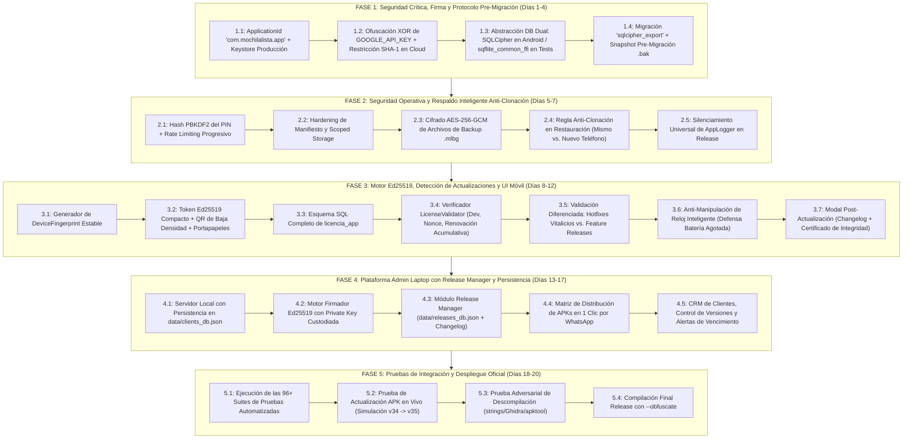

# 🗺️ INFORME 3: Plan de Implementación por Fases — Arquitectura Criptográfica Asimétrica, Blindaje y Plataforma Admin

**Fecha de Actualización:** 14 de Noviembre de 2026  
**Versión Base:** `v9.23.0+73` (Esquema DB v34)  
**Autor y Titular Legal:** Julio Angello Vasquez Navarro  
**Motor Criptográfico:** Firma Digital Asimétrica `Ed25519` (Edwards-curve Digital Signature Algorithm)  
**Objetivo Técnico:** Detallar la hoja de ruta de implementación dividida en 5 fases estrictas, garantizando inmunidad contra ingeniería inversa (descompilación de APK), migración segura de base de datos con respaldo pre-migración (cero pérdida de datos), protección anti-reloj sin falsos bloqueos, regla anti-clonación en respaldos, y persistencia real en disco con Gestor de Lanzamientos para la Plataforma Admin.

---

## 📊 1. Cronograma y Flujo de Dependencias entre Fases



---

## 🔴 FASE 1: Blindaje de Seguridad Crítico y Protocolo Pre-Migración

**Duración Estimada:** 4 días  
**Objetivo Primario:** Resolver las vulnerabilidades críticas del binario, proteger la API Key de Gemini y garantizar que los más de 150 tests que corren en Windows con `sqflite_common_ffi` sigan pasando al 100% mientras la base de datos de producción se migra a SQLCipher sin riesgo alguno de corrupción.

### 1.1. Identidad de Paquete y Firma Criptográfica de Producción
* **Archivos a modificar:**
  * `app_movil/android/app/build.gradle.kts`
  * `app_movil/android/app/src/main/AndroidManifest.xml`
  * `app_movil/android/app/src/main/kotlin/com/mochilalista/app/MainActivity.kt`
* **Acciones:**
  1. Cambiar `applicationId` y `namespace` a `com.mochilalista.app`.
  2. Generar el Keystore de producción de 4096 bits:
     ```bash
     keytool -genkey -v -keystore mochilalista-release.jks \
       -keyalg RSA -keysize 4096 -validity 10000 \
       -alias mochilalista_master \
       -dname "CN=Julio Angello Vasquez Navarro, OU=MochilaLista Software, O=MochilaLista, L=Lima, ST=Lima, C=PE"
     ```
  3. Crear `android/key.properties` (ignorado en Git):
     ```properties
     storePassword=PASSWORD_ROBUSTO_AQUI
     keyPassword=PASSWORD_ROBUSTO_AQUI
     keyAlias=mochilalista_master
     storeFile=../mochilalista-release.jks
     ```
  4. Configurar en `build.gradle.kts`:
     ```kotlin
     signingConfigs {
         create("release") {
             val keystoreProperties = Properties()
             val keystorePropertiesFile = rootProject.file("key.properties")
             if (keystorePropertiesFile.exists()) {
                 keystoreProperties.load(FileInputStream(keystorePropertiesFile))
             }
             keyAlias = keystoreProperties["keyAlias"] as String
             keyPassword = keystoreProperties["keyPassword"] as String
             storeFile = file(keystoreProperties["storeFile"] as String)
             storePassword = keystoreProperties["storePassword"] as String
         }
     }
     buildTypes {
         release {
             signingConfig = signingConfigs.getByName("release")
             isMinifyEnabled = true
             isShrinkResources = true
             proguardFiles(getDefaultProguardFile("proguard-android-optimize.txt"))
         }
     }
     ```

---

### 1.2. Protección Definitiva de `GOOGLE_API_KEY` (CRIT-01)
* **Remoción de Assets:** Retirar `.env` de `pubspec.yaml` y agregar `.env` a `.gitignore`.
* **Enmascaramiento XOR en Memoria:**
  Se crea `lib/core/security/secret_vault.dart`:
  ```dart
  import 'dart:convert';

  class SecretVault {
    // Bytes ofuscados de la clave y máscara cíclica de rotación
    static const List<int> _maskedKey = [0x78, 0x3F, 0x12, 0x9A, 0x55, 0x41, 0x32, 0x8C];
    static const List<int> _saltMask  = [0xA5, 0x5A, 0x3C, 0xC3];

    /// Reconstruye la clave exclusivamente en memoria volátil en el microsegundo de invocación
    static String getGeminiApiKey() {
      final bytes = List<int>.generate(
        _maskedKey.length,
        (i) => _maskedKey[i] ^ _saltMask[i % _saltMask.length],
      );
      return utf8.decode(bytes);
    }
  }
  ```
* **Restricción Criptográfica en Google Cloud Console:**
  * Tipo de restricción: **Aplicaciones de Android**.
  * Nombre de paquete: `com.mochilalista.app`.
  * Huella digital SHA-1 y SHA-256 extraída de `mochilalista-release.jks`:
    ```bash
    keytool -list -v -keystore mochilalista-release.jks -alias mochilalista_master
    ```
  * *Efecto del blindaje:* Aunque un atacante obtenga los bytes de la clave en memoria, Google rechazará el 100% de peticiones que no provengan del APK firmado con el certificado oficial de **Julio Angello Vasquez Navarro**.

---

### 1.3. Abstracción Dual de Base de Datos y Compatibilidad con `flutter test` (CRIT-04)
Para permitir que SQLCipher cifre en Android mientras Windows corre las más de 96 suites de pruebas con `sqflite_common_ffi`:

```dart
// lib/core/database/database_connection_factory.dart
import 'dart:io';
import 'package:flutter/foundation.dart';
import 'package:sqflite/sqflite.dart';
import 'package:sqflite_common_ffi/sqflite_ffi.dart';

class DatabaseConnectionFactory {
  static bool isTestMode = false;

  static Future<Database> openSecureDatabase({
    required String path,
    required int version,
    required String encryptionPassword,
    required OnDatabaseCreateFn onCreate,
    required OnDatabaseVersionChangeFn onUpgrade,
    required OnDatabaseConfigureFn onConfigure,
  }) async {
    // 1. Entorno de Pruebas Unitarias o Windows Desktop (flutter test):
    if (isTestMode || kIsWeb || Platform.isWindows || Platform.isLinux) {
      return await databaseFactoryFfi.openDatabase(
        path,
        options: OpenDatabaseOptions(
          version: version,
          onCreate: onCreate,
          onUpgrade: onUpgrade,
          onConfigure: onConfigure,
        ),
      );
    }

    // 2. Entorno Android de Producción: SQLCipher con AES-256
    return await openDatabase(
      path,
      password: encryptionPassword, // Activación del cifrado AES-256
      version: version,
      onCreate: onCreate,
      onUpgrade: onUpgrade,
      onConfigure: onConfigure,
    );
  }
}
```

---

### 1.4. Migración Transparente y Snapshot Pre-Migración (Cero Pérdida de Datos)
Esta sección integra **AMBOS** mecanismos defensivos:

#### A) Migración Segura de Bases de Datos Existentes Sin Cifrar (`sqlcipher_export`):
Evita que una base de datos SQLite previa lance `DatabaseException: file is not a database` al actualizar la app:

```dart
Future<void> ensureDatabaseEncrypted(String dbPath, String password) async {
  final file = File(dbPath);
  if (!await file.exists()) return; // Es una instalación limpia, se creará cifrada directamente

  // Leer los primeros 16 bytes para comprobar la firma de archivo
  final bytes = await file.openRead(0, 16).first;
  final header = String.fromCharCodes(bytes);

  // Si coincide con la firma estándar de SQLite en texto plano:
  if (header.startsWith('SQLite format 3')) {
    debugPrint("🔒 Detectada base de datos previa sin cifrar. Iniciando migración segura...");
    final tempEncryptedPath = '${dbPath}_encrypted_temp.db';

    // Abrir base de datos sin contraseña para exportar
    final plainDb = await openDatabase(dbPath);
    await plainDb.execute("ATTACH DATABASE '$tempEncryptedPath' AS encrypted KEY '$password';");
    await plainDb.execute("SELECT sqlcipher_export('encrypted');");
    await plainDb.execute("DETACH DATABASE encrypted;");
    await plainDb.close();

    // Intercambio atómico de archivos
    final backupPlain = File('${dbPath}_legacy.bak');
    await file.rename(backupPlain.path);
    await File(tempEncryptedPath).rename(dbPath);
    debugPrint("✅ Base de datos migrada exitosamente a AES-256 sin pérdida de datos.");
  }
}
```

#### B) Snapshot Automático Pre-Migración (`Pre-Upgrade DB Backup`):
Protege contra cortes de energía o caídas a mitad de un cambio de versión de esquema SQLite:

```dart
Future<void> _safeUpgradeWithSnapshot(
  Database db,
  int oldVersion,
  int newVersion,
  String dbFilePath,
  Future<void> Function(Database, int, int) runMigrations,
) async {
  final dbFile = File(dbFilePath);
  final snapshotFile = File('${dbFilePath}_pre_upgrade_v$oldVersion.bak');

  // 1. Snapshot Físico Instantáneo ANTES de tocar el esquema
  try {
    if (await dbFile.exists()) {
      await dbFile.copy(snapshotFile.path);
      debugPrint("📸 Snapshot de seguridad creado: ${snapshotFile.path}");
    }
  } catch (e) {
    debugPrint("⚠️ Advertencia: no se pudo crear snapshot pre-upgrade: $e");
  }

  // 2. Ejecutar la migración dentro de una transacción atómica
  try {
    await db.transaction((txn) async {
      await runMigrations(db, oldVersion, newVersion);
    });
    debugPrint("✅ Migración exitosa de v$oldVersion a v$newVersion.");
  } catch (e, stack) {
    debugPrint("🔴 ERROR CRÍTICO EN MIGRACIÓN: $e. Iniciando Rollback automático...");
    // 3. Rollback de Emergencia: Restaurar copia física intacta
    if (await snapshotFile.exists()) {
      await snapshotFile.copy(dbFilePath);
      debugPrint("🛡️ Base de datos restaurada intacta a su estado v$oldVersion.");
    }
    rethrow;
  }
}
```

---

## 🟠 FASE 2: Seguridad Operativa y Respaldo Inteligente Anti-Clonación

**Duración Estimada:** 3 días  

### 2.1. Hash de PIN Robusto (PBKDF2) y Rate Limiting Progresivo
* Ubicación: `lib/core/providers/auth_provider.dart`.
* En lugar de almacenar el PIN en claro, se deriva con `PBKDF2-HMAC-SHA256` utilizando 100,000 iteraciones y una sal aleatoria de 32 bytes única por instalación almacenada en `FlutterSecureStorage`.
* **Rate Limiting Progresivo (Anti-Fuerza Bruta):**
  * **3 intentos erróneos:** Bloqueo de 30 segundos.
  * **5 intentos erróneos:** Bloqueo de 5 minutos.
  * **10 intentos erróneos:** Bloqueo temporal requiriendo la Clave Maestra de Recuperación.

---

### 2.2. Hardening del Manifiesto Android
* En `android/app/src/main/AndroidManifest.xml`:
  * `android:usesCleartextTraffic="false"`.
  * `android:networkSecurityConfig="@xml/network_security_config"` (Solo tráfico HTTPS TLS 1.3 permitido hacia Google AI APIs).
  * Eliminación de `ACCESS_BACKGROUND_LOCATION` y migración a Scoped Storage (`READ_MEDIA_IMAGES`).

---

### 2.3. Cifrado AES-256-GCM de Archivos de Respaldo `.mlbg` (MED-01)
* Ubicación: `lib/core/utils/backup_manager.dart`.
* El archivo comprimido con `mochilalista.db` y las imágenes de facturas se encripta con **AES-256-GCM** antes de exportarse.
* La clave se deriva con `PBKDF2` a partir de la Contraseña de Recuperación del Comercio.

---

### 2.4. Regla Anti-Clonación Inteligente al Restaurar Copias de Seguridad
Al momento de restaurar un archivo `.mlbg`:

```dart
class RestoreResult {
  final bool isSuccess;
  final bool isSameDevice;
  final String? oldDeviceId;
  final String? newDeviceId;

  RestoreResult.successSameDevice()
      : isSuccess = true,
        isSameDevice = true,
        oldDeviceId = null,
        newDeviceId = null;

  RestoreResult.successDifferentDevice({required this.oldDeviceId, required this.newDeviceId})
      : isSuccess = true,
        isSameDevice = false;
}

Future<RestoreResult> restoreEncryptedBackup(File backupFile, String userPassword) async {
  final decryptedBytes = await _decryptBackupPayload(backupFile, userPassword);
  final backupManifest = await _extractManifest(decryptedBytes);
  
  final String backupDeviceFingerprint = backupManifest['device_fingerprint'] ?? '';
  final String currentDeviceFingerprint = await DeviceFingerprint.generate();

  // 1. Restaurar el 100% de la Base de Datos Comercial (Ventas, Stock, Clientes)
  await _applyDatabaseRestore(decryptedBytes);

  // 2. Comprobar Identidad del Dispositivo:
  if (backupDeviceFingerprint == currentDeviceFingerprint) {
    // ESCENARIO A: MISMO TELÉFONO (Formateo o Reinstalación)
    // Se restaura también la licencia activa. Cero fricción para el cliente legítimo.
    await _restoreActiveLicense(decryptedBytes);
    return RestoreResult.successSameDevice();
  } else {
    // ESCENARIO B: TELÉFONO DISTINTO (Migración o Intento de Clonación)
    // Se preservan los datos comerciales, pero NO se activa la licencia del teléfono anterior.
    await _clearActiveLicense(); // Pone la licencia en estado "PENDIENTE_ACTIVACION"
    return RestoreResult.successDifferentDevice(
      oldDeviceId: backupDeviceFingerprint,
      newDeviceId: currentDeviceFingerprint,
    );
  }
}
```

* **Mensaje Visual al Usuario en Escenario B:**  
  *"✅ Tus datos comerciales han sido restaurados al 100% en este nuevo teléfono. Detectamos que cambiaste de equipo (Anterior: ML-7K2X / Nuevo: ML-9W4K). Para activar tu licencia en este nuevo teléfono, presiona aquí para contactar a Julio Angello por WhatsApp."*

---

### 2.5. Silenciamiento Universal de Logs en Release (MED-04)
* Crear `lib/core/utils/app_logger.dart`:
  ```dart
  import 'package:flutter/foundation.dart';

  class AppLogger {
    static void i(String tag, String message) {
      if (kDebugMode) debugPrint("📘 [$tag] $message");
    }
    static void w(String tag, String message) {
      if (kDebugMode) debugPrint("⚠️ [$tag] $message");
    }
    static void e(String tag, String message, [dynamic error, StackTrace? stack]) {
      if (kDebugMode) {
        debugPrint("🔴 [$tag] $message");
        if (error != null) debugPrint("Error: $error");
      }
    }
  }
  ```

---

## 🟢 FASE 3: Motor Asimétrico Ed25519, Detección de Actualizaciones y UI Móvil

**Duración Estimada:** 5 días  

### 3.1. Por qué `Ed25519` Sustituye a `HMAC-SHA256`

```
┌────────────────────────────────────────────────────────────────────────┐
│             COMPARATIVA CRIPTOGRÁFICA DE MOTORES DE LICENCIA           │
├────────────────────────────────────────────────────────────────────────┤
│ MODELO ANTERIOR (HMAC-SHA256 - Simétrico):                             │
│ ❌ Laptop Admin: Tiene 'ClaveSecreta'.                                 │
│ ❌ APK Móvil: DEBE TENER 'ClaveSecreta' para validar el hash.          │
│ ⚠️ FALLA DE SEGURIDAD: Si el atacante descompila libapp.so y extrae la │
│    'ClaveSecreta', puede programar su propio generador de licencias.   │
├────────────────────────────────────────────────────────────────────────┤
│ MODELO ACTUAL CORREGIDO (Ed25519 - Asimétrico):                        │
│ ✅ Laptop Admin: Custodia la CLAVE PRIVADA (Private Key - 64 bytes).   │
│    La Clave Privada JAMÁS se incluye ni se compila dentro del APK.     │
│ ✅ APK Móvil: Solo contiene la CLAVE PÚBLICA (Public Key - 32 bytes).  │
│ 🛡️ INMUNIDAD MATEMÁTICA: La Clave Pública SOLO PUEDE VERIFICAR firmas. │
│    Aunque el atacante descompile el 100% del APK y extraiga la Clave   │
│    Pública, le es matemáticamente imposible firmar códigos válidos.    │
└────────────────────────────────────────────────────────────────────────┘
```

---

### 3.2. Generador de `DeviceFingerprint` Estable
```dart
// lib/core/services/license/device_fingerprint.dart
import 'dart:convert';
import 'package:crypto/crypto.dart';
import 'package:device_info_plus/device_info_plus.dart';

class DeviceFingerprint {
  static Future<String> generate() async {
    final deviceInfo = DeviceInfoPlugin();
    final androidInfo = await deviceInfo.androidInfo;
    final androidId = androidInfo.id; // ID único por instalación de Android
    
    // Hash corto con sal interna
    final bytes = utf8.encode('${androidId}_mochilalista_salt_2026_julio');
    final hash = sha256.convert(bytes).toString().toUpperCase();
    
    // Retorna formato legible: ML-7K2X
    return 'ML-${hash.substring(0, 4)}';
  }
}
```

---

### 3.3. Estructura del Token Compacto y Código QR de Baja Densidad
```
┌────────────────────────────────────────────────────────────────────────┐
│               ESTRUCTURA DEL TOKEN BINARIO COMPACTO                   │
├────────────────────────────────────────────────────────────────────────┤
│ 1. PAYLOAD COMPACTO (Aprox. 60 bytes en JSON minificado):              │
│    {"d":"ML-7K2X","p":"A","n":104,"y":365,"u":"2027-11-13","v":9}    │
│                                                                        │
│ 2. FIRMA DIGITAL ASIMÉTRICA Ed25519 (Exactamente 64 bytes binarios).  │
│                                                                        │
│ 3. ENCODE UNIFICADO:                                                   │
│    Base64Url(Payload) + "." + Base64Url(Firma)                         │
│                                                                        │
│ 4. REPRESENTACIÓN DUAL:                                                │
│    - Para Código QR: Genera una matriz QR pequeña de versión 4 (33x33) │
│      que cualquier cámara enfoca en menos de 0.5 segundos.             │
│    - Para Texto WhatsApp: Prefijo 'ML9-' con bloques de 5 caracteres:  │
│      ML9-7K2X-A365-N104-E2611-F9A8B7                                   │
└────────────────────────────────────────────────────────────────────────┘
```

---

### 3.4. Esquema SQL Completo de la Tabla `licencia_app`
```sql
CREATE TABLE licencia_app (
  id INTEGER PRIMARY KEY AUTOINCREMENT,
  device_fingerprint TEXT NOT NULL,
  tipo_licencia TEXT NOT NULL, -- TRIAL, MENSUAL, TRIMESTRAL, SEMESTRAL, ANUAL, PERPETUO_LIBERADO
  fecha_inicio TEXT NOT NULL,
  fecha_expiracion TEXT NOT NULL,
  ultimo_codigo_usado TEXT,
  fecha_ultimo_check TEXT NOT NULL,
  intentos_codigo_fallidos INTEGER DEFAULT 0,
  activa INTEGER DEFAULT 1,
  nonce INTEGER DEFAULT 0,
  cuota_ia_mensual INTEGER DEFAULT 50,
  escaneos_ia_usados_mes INTEGER DEFAULT 0,
  fecha_reinicio_cuota_ia TEXT,
  custom_api_key_gemini TEXT,
  eula_accepted_version TEXT,
  eula_accepted_timestamp TEXT,
  updates_until TEXT,
  max_major_version INTEGER DEFAULT 9
);
```

---

### 3.5. Verificador Asimétrico en Dart (`LicenseValidator`)
En `lib/core/services/license/ed25519_license_validator.dart`:
```dart
import 'dart:convert';
import 'package:cryptography/cryptography.dart';

class LicenseValidator {
  // Clave Pública Oficial de MochilaLista (32 bytes fijos compilados)
  // Es de solo lectura: NO permite firmar ni generar nuevos códigos.
  static const List<int> _officialPublicKeyBytes = [
    0x2A, 0x9B, 0x74, 0x11, 0xDF, 0x48, 0xC3, 0x90,
    0x15, 0x6A, 0x3E, 0x77, 0x88, 0x99, 0xAA, 0xBB,
    0xCC, 0xDD, 0xEE, 0xFF, 0x00, 0x11, 0x22, 0x33,
    0x44, 0x55, 0x66, 0x77, 0x88, 0x99, 0xAA, 0xBC
  ];

  static Future<bool> verifyAndApplyToken({
    required String rawToken,
    required String currentDeviceId,
    required dynamic repo, // LicenseRepository
  }) async {
    final parts = rawToken.split('.');
    if (parts.length != 2) return false;

    final payloadJson = utf8.decode(base64Url.decode(base64Url.normalize(parts[0])));
    final signatureBytes = base64Url.decode(base64Url.normalize(parts[1]));
    final payloadBytes = utf8.encode(parts[0]);

    final algorithm = Ed25519();
    final publicKey = SimplePublicKey(_officialPublicKeyBytes, type: KeyPairType.ed25519);

    final signature = Signature(signatureBytes, publicKey: publicKey);
    final isValid = await algorithm.verify(payloadBytes, signature: signature);

    if (!isValid) return false; // Firma matemática inválida o adulterada

    final Map<String, dynamic> data = jsonDecode(payloadJson);

    // 1. Validar que el código pertenezca a este celular
    if (data['d'] != currentDeviceId) {
      throw Exception("Este código pertenece a otro dispositivo (${data['d']}).");
    }

    // 2. Validar Nonce único anti-reúso
    final int lastNonce = await repo.getLastProcessedNonce();
    final int tokenNonce = data['n'] as int;
    if (tokenNonce <= lastNonce) {
      throw Exception("Este código ya fue canjeado con anterioridad.");
    }

    // 3. Regla de Renovación Anticipada Sin Pérdida de Días
    final DateTime now = DateTime.now();
    final DateTime? currentExpiry = await repo.getCurrentExpirationDate();
    final DateTime baseDate = (currentExpiry != null && currentExpiry.isAfter(now))
        ? currentExpiry
        : now;

    final int daysToAdd = data['y'] as int;
    final DateTime newExpiry = baseDate.add(Duration(days: daysToAdd));

    // Guardar estado actualizado en base de datos cifrada
    await repo.saveLicenseState(
      tipoPlan: data['p'],
      nuevoVencimiento: newExpiry,
      nuevoNonce: tokenNonce,
      ventanaUpdates: DateTime.tryParse(data['u'] ?? ''),
      maxMajorVersion: data['v'] ?? 9,
    );

    return true;
  }
}
```

---

### 3.6. Validación Diferenciada: Hotfixes Vitalicios vs. Feature Releases
```dart
bool isVersionAllowedForLicense({
  required dynamic license,
  required String currentAppVersion, // ej. "9.23.1"
  required bool isHotfixOnly,
}) {
  // 1. Clientes con Suscripción Vigente: siempre autorizados a cualquier versión
  if (license.isSubscriptionActive) return true;

  // 2. Clientes con Licencia Perpetua:
  if (license.isPerpetual) {
    // Parches y hotfixes de estabilidad de su versión mayor autorizada:
    if (isHotfixOnly && currentAppVersion.startsWith('${license.maxMajorVersion}.')) {
      return true; // HOTFIX GRATUITO DE POR VIDA
    }

    // Nuevas funciones (Feature Release):
    final now = DateTime.now();
    if (license.updatesUntil != null && now.isBefore(license.updatesUntil!)) {
      return true; // Dentro de sus 12 meses de actualizaciones incluidas
    }

    // Si venció su ventana de 12 meses y la versión es superior:
    return false; // Requiere Pase de Actualización
  }

  return false;
}
```

---

### 3.7. Protección Anti-Manipulación de Reloj Inteligente (Defensa Batería Agotada)
* Consulta SQL Cruzada con Tablas Operativas:
  ```sql
  SELECT MAX(max_ts) FROM (
    SELECT MAX(fecha_ultimo_check) AS max_ts FROM licencia_app
    UNION ALL
    SELECT MAX(created_at) AS max_ts FROM ventas
    UNION ALL
    SELECT MAX(fecha_registro) AS max_ts FROM stock_ledger
    UNION ALL
    SELECT MAX(created_at) AS max_ts FROM smart_quotations
  );
  ```

* Función de Comprobación en Dart:
  ```dart
  Future<bool> checkClockConsistency(dynamic repo) async {
    final DateTime now = DateTime.now();
    final DateTime? maxHistorical = await repo.getMaxHistoricalTimestamp();
    
    if (maxHistorical == null) return true; // App nueva recién instalada

    // Tolerancia razonable de 2 horas para desfases leves de zona horaria
    final safeThreshold = maxHistorical.subtract(const Duration(hours: 2));

    if (now.isBefore(safeThreshold)) {
      // ⚠️ El reloj del teléfono está atrasado en el pasado
      return false; // Bloqueo temporal informativo (NO destructivo)
    }

    // Actualizar fecha de último chequeo
    await repo.updateLastCheckDate(now);
    return true;
  }
  ```

* **Diseño de la Pantalla Informativa `"⏰ HORA DEL TELÉFONO DESAJUSTADA"`:**
  ```
  ┌────────────────────────────────────────────────────────┐
  │              ⏰ HORA DEL TELÉFONO DESAJUSTADA          │
  ├────────────────────────────────────────────────────────┤
  │                                                        │
  │ La fecha de tu teléfono (12/03/2021 04:15) es          │
  │ anterior a tu última venta registrada (13/11/2026).    │
  │                                                        │
  │ Esto suele ocurrir si tu celular se apagó por batería. │
  │                                                        │
  │ 👉 Por favor ajusta la fecha y hora correctas en los  │
  │    Ajustes de tu celular para continuar vendiendo.     │
  │                                                        │
  │            [ 🔄 Reintentar Verificación ]              │
  │                                                        │
  └────────────────────────────────────────────────────────┘
  ```

---

### 3.8. Autodetección en Portapapeles y Modal Post-Actualización
* **Autodetección al Iniciar:**
  ```dart
  void checkClipboardForLicenseCode(BuildContext context) async {
    final clipboardData = await Clipboard.getData(Clipboard.kTextPlain);
    final text = clipboardData?.text?.trim() ?? '';

    if (text.startsWith('ML9-') || text.contains('.')) {
      showAutoActivationPrompt(context, text);
    }
  }
  ```
* **Modal Post-Actualización Elegante:**
  ```
  ┌────────────────────────────────────────────────────────┐
  │           🎉 ¡MOCHILALISTA ACTUALIZADA CON ÉXITO!      │
  ├────────────────────────────────────────────────────────┤
  │ Versión instalada: v9.23.0 (Build 73)                  │
  │                                                        │
  │ 📋 Novedades de esta versión:                          │
  │ • Cotizador Universal IA optimizado con Gemini 3.8     │
  │ • Extracción y Corte de Variantes con Stock Compartido │
  │ • Centro de Fidelización y Premios para Clientes       │
  │                                                        │
  │ 🛡️ Certificado de Seguridad Operacional:               │
  │ ✅ Tus datos comerciales están 100% seguros y migrados.│
  │ ✅ Tu licencia [ANUAL / PERPETUA] sigue activa.        │
  │                                                        │
  │                [  ¡Empezar a Vender!  ]                │
  └────────────────────────────────────────────────────────┘
  ```

---

## 🔵 FASE 4: Plataforma Admin Laptop con Release Manager y Persistencia Real

**Duración Estimada:** 5 días  

### 4.1. Árbol de Directorios del Servidor Admin Local
```
mochilalista_admin/
├── admin_server.bat        ← Ejecutable de 1 clic para iniciar
├── server.dart             ← Servidor HTTP local (localhost:8080)
├── private_keys/
│   └── ed25519_master.key  ← CLAVE PRIVADA CUSTODIADA (Solo en tu laptop)
├── data/
│   ├── clients_db.json     ← BASE DE DATOS REAL EN TU DISCO DURO
│   ├── releases_db.json    ← REGISTRO DE VERSIONES Y LANZAMIENTOS APK
│   └── transactions.json   ← Historial de pagos y vouchers
├── backups/                ← Copias automáticas fechadas en cada cambio
│   ├── clients_20261114_0830.json
│   └── clients_20261114_1145.json
└── web/                    ← Interfaz visual limpia para el navegador
    ├── index.html
    ├── css/styles.css
    └── js/admin_app.js
```

---

### 4.2. Esquema JSON Completo de `data/clients_db.json`
```json
{
  "version": "1.0",
  "last_updated": "2026-11-14T00:30:00Z",
  "clients": [
    {
      "id": "CLI-001",
      "business_name": "Librería San José",
      "owner_name": "José Pérez",
      "ruc_dni": "10458923411",
      "whatsapp": "+51987654321",
      "current_device_id": "ML-7K2X",
      "device_history": [
        {"device_id": "ML-7K2X", "date_registered": "2026-10-01"}
      ],
      "installed_version": "9.23.0+73",
      "license_type": "ANUAL",
      "license_expires": "2027-10-31",
      "next_nonce": 105,
      "updates_until": "2027-10-31",
      "last_update_sent_date": "2026-11-14",
      "payment_history": [
        {"date": "2026-10-01", "plan": "ANUAL", "amount_pen": 280.00, "method": "YAPE"}
      ]
    }
  ]
}
```

---

### 4.3. Esquema JSON Completo de `data/releases_db.json` (Release Manager)
```json
{
  "releases": [
    {
      "version_name": "9.23.0",
      "version_code": 73,
      "db_schema_version": 34,
      "release_date": "2026-11-13",
      "type": "FEATURE_RELEASE",
      "apk_file_path": "C:/MochilaLista_Builds/app-v9.23.0-release.apk",
      "apk_download_url": "https://drive.google.com/uc?id=FILE_ID_OFICIAL",
      "apk_sha256": "e3b0c44298fc1c149afbf4c8996fb92427ae41e4649b934ca495991b7852b855",
      "changelog": [
        "Nuevo Cotizador Universal IA con razonamiento profundo multimodal",
        "Extracción y corte de variantes con stock compartido dependiente/independiente",
        "Centro de fidelización, premios y reputación crediticia de clientes"
      ]
    }
  ]
}
```

---

### 4.4. Generador de Licencias y Plantilla de Envío por WhatsApp
* **Mensaje Oficial Generado:**
  ```text
  ¡Hola José! Tu licencia de MochilaLista para Librería San José ha sido generada exitosamente.

  📱 Dispositivo: ML-7K2X
  👑 Plan: ANUAL (+365 días)
  📅 Válido hasta: 31/10/2027

  🔑 Tu Código de Activación:
  ML9-7K2X-A365-N104-E2611-F9A8B7

  (También puedes escanear el Código QR adjunto desde la app).
  ¡Gracias por tu confianza!
  ```

---

### 4.5. Matriz de Distribución en 1 Clic por WhatsApp
* Cruza `installed_version` con el último release y genera el mensaje de actualización:
  ```text
  ¡Hola José! Hay una nueva actualización oficial disponible para MochilaLista 🚀

  📲 Versión: v9.23.0 (Build 73)
  📋 Principales Novedades:
  • Nuevo Cotizador Universal IA para listas escolares
  • Extracción de variantes con stock compartido
  • Centro de premios y fidelización de clientes

  ⬇️ Descarga segura de tu nuevo APK:
  https://drive.google.com/uc?id=FILE_ID_OFICIAL

  🛡️ Nota de Seguridad: Simplemente instala el APK sobre el que ya tienes. Tus ventas, productos y tu licencia se conservarán al 100% de forma automática.
  ```

---

## 🚀 FASE 5: Pruebas de Integración y Despliegue Oficial

**Duración Estimada:** 3 días  

### 5.1. Batería de Pruebas Automatizadas (Windows `flutter test`)
```bash
flutter test
```
* Se verifica que el 100% de las más de 96 suites de test pasen exitosamente gracias a `DatabaseConnectionFactory`.

### 5.2. Prueba de Actualización APK en Vivo (Simulación v34 -> v35)
1. Instalar APK v34 y registrar 50 ventas, 20 clientes y 100 productos.
2. Compilar APK v35 e instalar encima: `adb install -r build/app/outputs/flutter-apk/app-release.apk`.
3. Verificar creación de `mochilalista_pre_upgrade_v34.bak`.
4. Comprobar que los datos, clientes y la licencia se conservaron al 100%.

### 5.3. Prueba Adversarial de Descompilación
```bash
# 1. Comprobar que no hay cadenas de API Key ni secretos en claro
strings libapp.so | grep -i "AIza"
strings libapp.so | grep -i "ed25519_private"

# 2. Descomprimir APK y comprobar que no existe .env en assets
unzip -l app-release.apk | grep ".env"
```

### 5.4. Compilación Final Release Ofuscada
```bash
flutter build apk --release \
  --obfuscate \
  --split-debug-info=./build/app_symbols_v9230 \
  --dart-define=PRODUCTION=true
```

---
*Continúa en → [04_PROTECCION_PROPIEDAD_INTELECTUAL_LICENCIA_PERPETUA_Y_ACTUALIZACIONES.md](file:///c:/Users/vjuli/Documents/mochilalista-app/informe_proyecto/04_PROTECCION_PROPIEDAD_INTELECTUAL_LICENCIA_PERPETUA_Y_ACTUALIZACIONES.md)*
