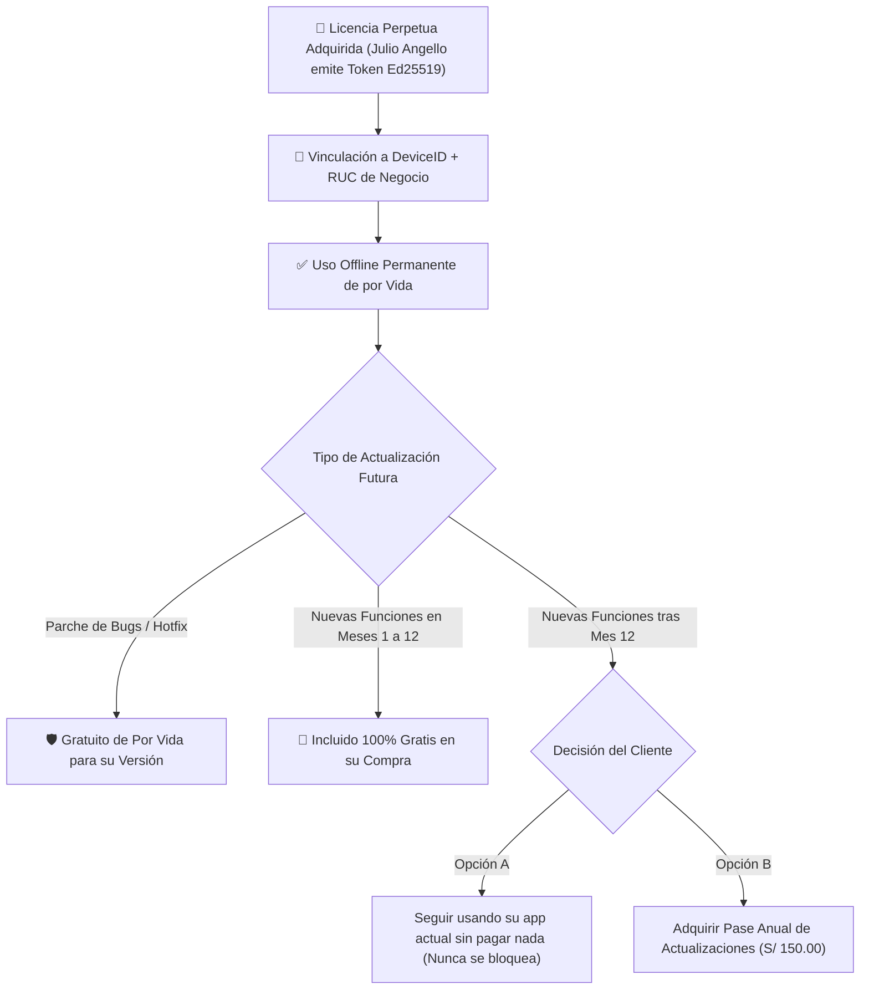

# ⚖️ INFORME 4: Protección de Propiedad Intelectual, Licencias Perpetuas y Gestión de Actualizaciones

**Fecha de Actualización:** 14 de Noviembre de 2026  
**Aplicación:** MochilaLista Mobile (`v9.23.0+73`, Esquema DB v34)  
**Autor y Titular Exclusivo de Derechos:** Julio Angello Vasquez Navarro  
**Marco Normativo Primario:** Decreto Legislativo 822 (Ley sobre el Derecho de Autor del Perú) — Dirección de Derecho de Autor del INDECOPI  
**Marco Normativo Complementario:** Decisión 351 de la Comunidad Andina (Régimen Común sobre Derecho de Autor y Derechos Conexos)  
**Objetivo Estratégico:** Proteger legal y técnicamente los derechos morales y patrimoniales del autor de MochilaLista, regular formalmente la modalidad de **Licencia Perpetua de Alto Valor** ("App Liberada para Siempre"), definir la parametrización centralizada de identidad legal (`OwnerLegalIdentity`), proteger la rentabilidad frente al consumo de IA y blindar la política de actualizaciones por distribución directa de APKs.

---

## 🏛️ 1. Marco Legal en el Perú: Venta de Software vs. Licencia de Uso

Bajo el Derecho de Autor peruano (D.L. 822) y la jurisprudencia del Tribunal del INDECOPI, el software (programa de ordenador) es considerado una **obra del ingenio humano** protegida desde el momento de su creación. 

Es un error comercial y jurídico crítico utilizar la expresión *"Te vendo la app"*. Cuando un comerciante paga por MochilaLista, lo que adquiere es una **Licencia de Uso**, no la propiedad de la obra.

```
┌────────────────────────────────────────────────────────────────────────┐
│                   DIFERENCIA JURÍDICA FUNDAMENTAL                     │
├────────────────────────────────────────────────────────────────────────┤
│ ❌ CESIÓN O VENTA DE SOFTWARE (Art. 30 y 31 D.L. 822):                 │
│    Transfiere la titularidad patrimonial. El comprador se convierte en │
│    dueño del software y podría exigir el código fuente, revenderlo o   │
│    comercializarlo a terceros sin autorización del creador.           │
├────────────────────────────────────────────────────────────────────────┤
│ ✅ OTORGAMIENTO DE LICENCIA DE USO (Art. 101 a 104 D.L. 822):          │
│    Es una AUTORIZACIÓN DE USO NO EXCLUSIVA E INTRANSFERIBLE.           │
│    El cliente adquiere únicamente el derecho a ejecutar la app en      │
│    un dispositivo específico conforme a las reglas del contrato EULA.  │
│    TODA la propiedad intelectual, código fuente, algoritmos, diseño,   │
│    marcas y bases de datos pertenecen al 100% al autor:               │
│    👉 JULIO ANGELLO VASQUEZ NAVARRO.                                   │
└────────────────────────────────────────────────────────────────────────┘
```

### Clasificación de Derechos del Autor:
1. **Derechos Morales (Art. 21 - 29 D.L. 822):** Son perpetuos, inalienables, inembargables e irrenunciables.
   - **Derecho de Paternidad:** El derecho imprescriptible de que **Julio Angello Vasquez Navarro** sea reconocido públicamente como el autor y creador de MochilaLista.
   - **Derecho de Integridad:** La facultad de oponerse a cualquier deformación, ingeniería inversa o mutilación del código.
2. **Derechos Patrimoniales (Art. 30 - 40 D.L. 822):** La exclusividad absoluta para explotar comercialmente la app, autorizar su reproducción, distribución o arrendamiento. Cualquier uso no licenciado o clonación no autorizada constituye un delito contra la propiedad intelectual (Art. 216 - 220 del Código Penal peruano).

---

## 🛡️ 2. Parametrización Centralizada de Identidad Legal (`OwnerLegalIdentity`)

Para asegurar que los contratos, avisos legales, pantallas, tickets de venta Bluetooth, reportes PDF y tokens de licencia mantengan una coherencia jurídica inquebrantable, se establece una **fuente única de verdad** en el código de la aplicación.

### Definición Técnica (`lib/core/config/owner_legal_identity.dart`):

```dart
class OwnerLegalIdentity {
  // Identidad del Titular y Autor
  static const String authorFullName = "Julio Angello Vasquez Navarro";
  static const String appCommercialName = "MochilaLista";
  static const String legalJurisdiction = "Lima, República del Perú";
  static const String legalFrameworkNotice = "Protegido por el D.L. 822 (Ley de Derecho de Autor) e INDECOPI";

  // Canales Oficiales de Soporte y Gestión de Licencias
  static const String supportPhone = "+51 999 888 777"; // Número oficial de Julio Angello
  static const String supportWhatsAppUrl = "https://wa.me/51999888777";
  static const String officialWebsite = "https://mochilalista.com";

  // Leyenda Legal Estándar para Documentos y Reportes
  static String get watermarkNotice =>
      "$appCommercialName © 2026 $authorFullName. Todos los derechos reservados. $legalFrameworkNotice.";

  // Leyenda de Ticket de Impresora Térmica Bluetooth
  static String get ticketFooterLegal =>
      "Comprobante emitido con $appCommercialName POS\n"
      "Software propiedad de $authorFullName\n"
      "Soporte: $supportPhone";

  // Identificador de Licencia para Cabeceras
  static String getLicenseAttribution({required String businessName, required String rucDni}) {
    return "Licencia Autorizada para: $businessName (Doc: $rucDni)\n"
           "Desarrollado y licenciado exclusivamente por $authorFullName";
  }
}
```

---

## 📜 3. Contrato de Licencia de Usuario Final (EULA) Oficial

El siguiente texto legal constituye el contrato vinculante que el usuario debe aceptar al iniciar la aplicación por primera vez:

```text
CONTRATO DE LICENCIA DE USUARIO FINAL (EULA) — MOCHILALISTA
AUTOR Y TITULAR EXCLUSIVO: JULIO ANGELLO VASQUEZ NAVARRO
MARCO JURÍDICO: DECRETO LEGISLATIVO 822 (PERÚ) / INDECOPI

LEA DETENIDAMENTE ESTE CONTRATO ANTES DE UTILIZAR ESTE SOFTWARE. AL MARCAR LA CASILLA "HE LEÍDO Y ACEPTO LOS TÉRMINOS", O AL INSTALAR, EJECUTAR O INGRESAR UN CÓDIGO DE ACTIVACIÓN EN MOCHILALISTA, USTED (EL "LICENCIATARIO") ACEPTA VINCULARSE JURÍDICAMENTE POR ESTOS TÉRMINOS CON EL AUTOR Y TITULAR EXCLUSIVO DEL SOFTWARE, JULIO ANGELLO VASQUEZ NAVARRO (EL "LICENCIANTE").

CLÁUSULA PRIMERA: PROPIEDAD INTELECTUAL Y TITULARIDAD
MochilaLista, incluyendo su código fuente compilado, arquitectura de base de datos, interfaces visuales, marcas, logos y algoritmos de cotización e inteligencia artificial, es una obra protegida por el Decreto Legislativo 822 (Ley sobre el Derecho de Autor del Perú) y los tratados internacionales de propiedad intelectual. Julio Angello Vasquez Navarro retiene el 100% de los derechos morales y patrimoniales sobre el software. Bajo ninguna circunstancia este contrato constituye una venta del software, ni una transferencia del código fuente ni de sus derechos patrimoniales.

CLÁUSULA SEGUNDA: OTORGAMIENTO DE LICENCIA DE USO
El Licenciante otorga al Licenciatario una licencia de uso personal, comercial limitada, no exclusiva, intransferible y no sublicenciable para ejecutar la aplicación MochilaLista exclusivamente en un (1) dispositivo móvil Android identificado mediante su huella digital única (DeviceFingerprint).

CLÁUSULA TERCERA: MODALIDADES DE LICENCIA
1. Periodo de Prueba (Trial): Autoriza el uso completo del software por un plazo de 30 días calendario desde su primera instalación.
2. Licencia por Suscripción (Mensual, Trimestral, Semestral o Anual): Autoriza el uso por el número exacto de días contratados. Vencido el plazo sin renovación, el software pasará a modo de lectura restringida y exportación de respaldos.
3. Licencia Perpetua ("App Liberada"): Autoriza el uso indefinido del software en el dispositivo registrado para el negocio titular, sin cobros recurrentes de acceso, sujeta a las condiciones de la Cláusula Sexta.

CLÁUSULA CUARTA: PROHIBICIONES Y RESTRICCIONES
Queda expresamente prohibido al Licenciatario:
a) Descompilar, desensamblar, aplicar ingeniería inversa o intentar descubrir el código fuente del software.
b) Modificar, alterar, burlar o desactivar el motor de licencias, firmas criptográficas o protecciones anti-adulteración.
c) Alquilar, arrendar, revender, redistribuir o prestar el software o sus códigos de activación a terceros.
d) Eliminar, ocultar o alterar las marcas de agua, nombres de autor o avisos de derechos de autor presentes en el software.

CLÁUSULA QUINTA: PRIVACIDAD Y DATOS DEL NEGOCIO (OFFLINE-FIRST)
El Licenciatario es el único y exclusivo propietario de la información comercial que registra en la aplicación (clientes, precios, ventas, inventario). El software almacena todos los datos de forma local en el dispositivo del Licenciatario. El Licenciante no tiene acceso a sus datos comerciales ni los almacena en servidores externos. La custodia y respaldo de la información es responsabilidad exclusiva del Licenciatario mediante la herramienta de copia de seguridad (.mlbg) provista por la aplicación.

CLÁUSULA SEXTA: POLÍTICA DE ACTUALIZACIONES Y SERVICIOS DE INTELIGENCIA ARTIFICIAL
1. Para Licencias Perpetuas, la adquisición incluye doce (12) meses de actualizaciones de nuevas funciones. Vencido dicho plazo, el software continuará funcionando a perpetuidad en su última versión autorizada. Los parches de corrección de errores (hotfixes de estabilidad) son gratuitos de por vida para su versión autorizada.
2. Las funciones de Inteligencia Artificial (procesamiento de facturas y listas escolares con Google Gemini) dependen de cuotas de cómputo en la nube. El Licenciante provee una cuota mensual de uso justo incluida. En licencias perpetuas a largo plazo, el Licenciatario podrá optar por registrar su propia clave de Google AI Studio gratuita o adquirir paquetes de recarga adicionales para uso ilimitado de IA.

CLÁUSULA SÉPTIMA: JURISDICCIÓN Y SOLUCIÓN DE CONTROVERSIAS
Cualquier controversia derivada de la interpretación o ejecución de este contrato se someterá a la jurisdicción de la Dirección de Derecho de Autor del INDECOPI y/o a los jueces y tribunales del Distrito Judicial de Lima, Perú.
```

---

## 📱 4. Diseño de la Pantalla de Aceptación Digital del EULA

Para garantizar la plena validez legal del consentimiento electrónico (conforme a la Ley N.º 27269 de Firmas y Certificados Digitales del Perú):

1. **Momento de Despliegue:**
   - Se muestra obligatoriamente en el primer arranque de la app (Onboarding) y como paso previo al canje de licencias.
2. **Scroll Obligatorio Hasta el Final:**
   - La pantalla presenta el texto del contrato en un contenedor deslizante (`NotificationListener<ScrollNotification>`).
   - El botón `[ Acepto los Términos y Condiciones de Licencia ]` permanece deshabilitado en gris (`onPressed: null`) hasta que el usuario alcanza el final exacto del documento (`scrollController.position.pixels >= scrollController.position.maxScrollExtent - 20`).
3. **Registro Criptográfico del Consentimiento en `licencia_app`:**
   Al presionar el botón de aceptación, se guarda en SQLite:
   ```sql
   UPDATE licencia_app SET
     eula_accepted_version = 'v1.0_2026',
     eula_accepted_timestamp = '2026-11-14T00:30:00Z'
   WHERE id = 1;
   ```
   *Efecto Probatorio:* Ante cualquier intento de reclamo, la base de datos almacena la fecha, hora exacta, versión del contrato y el `DeviceFingerprint` que aceptó la licencia.

---

## 👑 5. Operación Técnica de la Licencia Perpetua y Protocolo de Cambio de Celular



### 5.1. Emisión del Código Maestro Perpetuo
Desde la Plataforma Admin en la laptop:
* Se selecciona el cliente registrado y se selecciona `PERPETUO_LIBERADO`.
* El motor Ed25519 genera la firma que codifica:
  - `d`: `"ML-7K2X"` (Device Fingerprint)
  - `p`: `"PERPETUO_LIBERADO"`
  - `y`: `99999` (Más de 270 años de validez)
  - `u`: Fecha de emisión + 365 días (`upd_until`)
  - `v`: `9` (Versión mayor máxima autorizada)
  - `biz`: `"Bazar San Pedro - RUC 10452398411"`
* Al canjearse en el teléfono, la app fija la bandera perpetua. **El motor de expiración se desactiva permanentemente para ese teléfono**.

### 5.2. Protocolo Seguro ante Cambio de Teléfono del Cliente
Si un cliente de Licencia Perpetua cambia de celular, se le rompe o se lo roban:
1. **Paso 1 (Comprobación de Legitimidad):**
   El cliente entrega su último archivo de respaldo cifrado `.mlbg` y su nuevo Código de Dispositivo (ej. `ML-9W4K`).
2. **Paso 2 (Tarifa Administrativa de Reasignación):**
   Se le cobra una tarifa simbólica de **S/ 40.00** por gestión técnica de migración y soporte (evitando la compra de una licencia nueva de S/ 850.00).
3. **Paso 3 (Revocación y Emisión en Laptop Admin):**
   En la Plataforma Admin, accedes a su ficha:
   - Se mueve `ML-7K2X` a la lista `device_history` con estado `REVOCADO`.
   - Se registra el nuevo `ML-9W4K` como `current_device_id`.
   - Se genera un nuevo Código Maestro Perpetuo firmado con Ed25519 para `ML-9W4K`.
   - Se envía por WhatsApp junto con las instrucciones de restauración de su backup `.mlbg`.

---

## 🤖 6. Diseño Detallado de Pantalla `ai_settings_screen.dart` y Protección de Cuota IA

Para evitar que una licencia perpetua genere pérdidas por consumo ilimitado de la API de Gemini 3.8 Flash a lo largo de los años:

```
┌────────────────────────────────────────────────────────┐
│             🤖 INTELIGENCIA ARTIFICIAL Y CUOTA         │
├────────────────────────────────────────────────────────┤
│                                                        │
│  📊 CONSUMO MENSUAL INCLUIDO                           │
│  ┌──────────────────────────────────────────────────┐  │
│  │ Escaneos IA utilizados este mes: 34 / 50         │  │
│  │ [████████████████████░░░░░░░░░░] 68%             │  │
│  │ Tu cuota se reinicia automáticamente el 01/12/26 │  │
│  └──────────────────────────────────────────────────┘  │
│                                                        │
│  👑 ¿DESEAS ESCANEOS ILIMITADOS SIN COSTO?             │
│  Puedes conectar tu propia clave gratuita de Google.   │
│                                                        │
│  [  ⚙️ Configurar mi Propia Clave de Google AI Studio ] │
│                                                        │
│  📋 GUÍA SENCILLA EN 3 PASOS:                          │
│  1. Ingresa a aistudio.google.com desde tu navegador.  │
│  2. Inicia sesión con tu cuenta de Google (Gmail) y    │
│     presiona "Get API Key" (Obtener clave de API).     │
│  3. Copia tu clave y pégala en el recuadro inferior.   │
│                                                        │
│  Clave Personal de Google AI Studio:                   │
│  [ AIzaSyD9...REDACTADO...                          ]  │
│                                                        │
│  [ ✅ Guardar y Activar Escaneos Ilimitados Gratis ]    │
│                                                        │
│  ────────────────────────────────────────────────────  │
│  ¿No deseas crear una clave? Compra bolsas extra:      │
│  • Paquete 150 Escaneos IA: S/ 20.00                   │
│  [ 📱 Solicitar Paquete IA por WhatsApp ]              │
│                                                        │
└────────────────────────────────────────────────────────┘
```

---

## 🏷️ 7. Marcas de Agua Digitales (Visibles e Internas)

Toda salida física o digital de MochilaLista lleva incorporado el sello de autoría de **Julio Angello Vasquez Navarro**:

### 7.1. Marca de Agua Visual en Pantallas y Reportes
* **Menú Lateral y Pantalla Acerca de:**  
  *"MochilaLista v9.23.0 • Compilación Oficial • Autor y Titular: Julio Angello Vasquez Navarro • Licencia autorizada para: [Nombre del Comercio]"*
* **Proformas y Cotizaciones en PDF:**  
  *"Cotización generada con MochilaLista POS • Software desarrollado y propiedad de Julio Angello Vasquez Navarro"*
* **Tickets de Impresora Térmica Bluetooth:**  
  Pie de página formal configurado en `OwnerLegalIdentity.ticketFooterLegal`.

### 7.2. Marca Criptográfica en el Token Ed25519 y `libapp.so`
* El payload firmado con la clave privada de Julio Angello contiene la propiedad inmutable:
  `"copyright": "MochilaLista (C) 2026 Julio Angello Vasquez Navarro. D.L. 822 INDECOPI"`  
* Si un atacante modifica esta cadena, la firma matemática Ed25519 se invalida y la app bloquea el código de activación inmediatamente.

---

## 💼 8. Tabla Maestra de Precios y Estructura Comercial

| Concepto | Precio Sugerido | Duración | Actualizaciones de Funciones | Soporte y Hotfixes | Cuota IA Incluida |
|----------|:---------------:|:--------:|:----------------------------:|:------------------:|:-----------------:|
| **Trial Gratuito** | **S/ 0.00** | 30 días | Versión instalada | WhatsApp | 50 escaneos |
| **Suscripción Mensual** | **S/ 35.00** | 30 días | Siempre última versión | Continuo | 50 escaneos/mes |
| **Suscripción Trimestral** | **S/ 90.00** | 90 días | Siempre última versión | Continuo | 60 escaneos/mes |
| **Suscripción Semestral** | **S/ 160.00** | 180 días | Siempre última versión | Continuo | 75 escaneos/mes |
| **Suscripción Anual** | **S/ 280.00** | 365 días | Siempre última versión | Prioritario | 100 escaneos/mes |
| **👑 Licencia Perpetua** | **S/ 850.00** | **De por vida** | **12 meses incluidos** | **Vitalicio en su versión** | 50/mes o BYOK ilimitado |
| **Pase de Actualización Anual** *(Post-año 1 para perpetuos)* | **S/ 150.00** | +365 días de updates | Nuevas funciones mayores | Prioritario | Renovación de cuota |
| **Reasignación por Cambio de Celular** *(Clientes perpetuos)* | **S/ 40.00** | Único | Conserva su ventana | Soporte de migración | Se mantiene |
| **Bolsa Extra IA (150 escaneos)** | **S/ 20.00** | Sin vencimiento | N/A | Inmediato | +150 escaneos |

---

## 🏛️ 9. Trámite de Registro de Obra ante INDECOPI

Recomendación de registro formal ante la Dirección de Derecho de Autor de INDECOPI:
1. **Procedimiento:** Registro de Obra de Software (Programa de Ordenador) a nombre de **Julio Angello Vasquez Navarro**.
2. **Requisitos:** Formato oficial de solicitud, memoria descriptiva técnica (extraída de estos informes), extracto del código fuente y pago de la tasa del TUPA (aprox. S/ 390.50).
3. **Efecto:** Otorga presunción legal incontrovertible de autoría, permitiendo denuncias administrativas con multas de hasta 180 UIT e incautación cautelar inmediata en caso de plagio o distribución no autorizada.

---
*Fin del conjunto de 4 informes técnicos y legales pre-comercialización de MochilaLista.*
