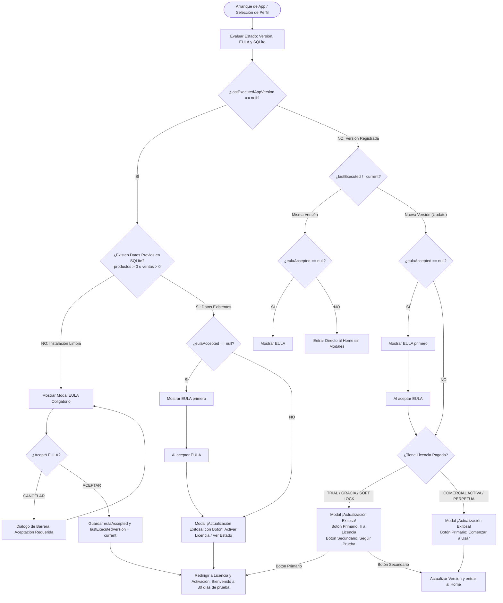
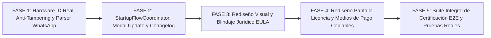

# PLAN MAESTRO DE TRABAJO: ONBOARDING LEGAL, ARQUITECTURA DE LICENCIAS, SEGURIDAD DE HARDWARE Y EXPERIENCIA COMERCIAL (EULA & ACTIVACIÓN)
## MOCHILALISTA (`app_movil`) — SISTEMA OFFLINE-FIRST, BLINDAJE JURÍDICO Y MOTOR DE COMERCIALIZACIÓN EN PRODUCCIÓN

**Titular de Propiedad Intelectual y Autor Exclusivo:** Julio Angello Vasquez Navarro  
**Marco Legal y Jurisdicción:** Decreto Legislativo 822 (Ley sobre el Derecho de Autor del Perú), INDECOPI y Ley N° 29733 (Protección de Datos Personales) — Lima, República del Perú  
**Aplicación:** `app_movil` (MochilaLista Mobile POS & Cotizador Inteligente)  
**Versión Base de Auditoría:** `pubspec.yaml` v9.30.0+74 (Compilado de prueba auditado en dispositivo físico: v9.23.0+73)  
**Fecha de Auditoría Forense y Planificación:** 18 de Noviembre de 2026  
**Documentos Relacionados:** 
* `informe_proyecto/01_AUDITORIA_SEGURIDAD_ACTUAL.md`
* `informe_proyecto/04_PROTECCION_PROPIEDAD_INTELECTUAL_LICENCIA_PERPETUA_Y_ACTUALIZACIONES.md`
* `informe_proyecto/06_PLAN_MAESTRO_REINGENIERIA_PLATAFORMA_ADMIN_Y_DESPLIEGUE_REAL.md`

---

## ÍNDICE GENERAL DEL PLAN MAESTRO

1. [Diagnóstico Forense Exhaustivo: Auditoría de las 8 Capturas Reales en Celular Físico](#1-diagnóstico-forense-exhaustivo-auditoría-de-las-8-capturas-reales-en-celular-físico)
2. [Diagnóstico Técnico Crítico del `Hardware ID`: La Verdad Detrás de `ML-270D` vs. ID Real del Teléfono](#2-diagnóstico-técnico-crítico-del-hardware-id-la-verdad-detrás-de-ml-270d-vs-id-real-del-teléfono)
3. [PILAR 1: Flujo Inteligente de Arranque (`StartupFlowCoordinator`), Modal `¡Actualización Exitosa!` y Changelog Versionado](#3-pilar-1-flujo-inteligente-de-arranque-startupflowcoordinator-modal-actualización-exitosa-y-changelog-versionado)
4. [PILAR 2: Rediseño Visual, Experiencia de Usuario y Blindaje Jurídico del Modal `Términos de Licencia (EULA)`](#4-pilar-2-rediseño-visual-experiencia-de-usuario-y-blindaje-jurídico-del-modal-términos-de-licencia-eula)
5. [PILAR 3: Auditoría Profunda del `Hardware ID`, Anti-Tampering y Blindaje Anti-Fraude de Licencias](#5-pilar-3-auditoría-profunda-del-hardware-id-anti-tampering-y-blindaje-anti-fraude-de-licencias)
6. [PILAR 4: Rediseño Profesional y de Conversión de la Pantalla `Licencia y Activación`](#6-pilar-4-rediseño-profesional-y-de-conversión-de-la-pantalla-licencia-y-activación)
7. [Arquitectura de Fases de Ejecución, Archivos a Crear/Modificar y Matriz de Pruebas Automatizadas](#7-arquitectura-de-fases-de-ejecución-archivos-a-crearmodificar-y-matriz-de-pruebas-automatizadas)
8. [Protocolo de Aprobación y Hoja de Ruta para la Fase de Construcción](#8-protocolo-de-aprobación-y-hoja-de-ruta-para-la-fase-de-construcción)

---

## 1. DIAGNÓSTICO FORENSE EXHAUSTIVO: AUDITORÍA DE LAS 8 CAPTURAS REALES EN CELULAR FÍSICO

A partir de las pruebas operativas ejecutadas por el autor en un dispositivo Android físico real (donde se completó la activación exitosa de un Plan Mensual de S/ 35.00), se ha llevado a cabo una auditoría forense pixel a pixel y línea por línea en el código fuente de `app_movil`. 

A continuación se detalla la matriz de diagnóstico de cada una de las 8 capturas adjuntas:

| Captura | Pantalla / Modal Auditado | Defecto Evidenciado en la Captura | Causa Raíz en el Código Fuente | Impacto en el Comerciante / Negocio |
| :--- | :--- | :--- | :--- | :--- |
| **`1.25.50 AM (3)`** | **Modal `¡Actualización Exitosa!`** | Aparece en instalaciones nuevas diciendo *"Tus datos y licencia han sido migrados con éxito y respaldo verificado"*. Presenta viñetas hiper-técnicas (*"Ed25519"*, *"AES-256-GCM"*, *"Esquema v35 Snapshot"*). Botón *"Comenzar a Usar"* no dirige a activar licencia. | `PostUpdateWelcomeModal.checkAndShow` (Línea 23) evalúa `if (license.lastExecutedAppVersion == null ...)`. En instalación limpia dicho campo es `null`, disparando falsamente el modal de actualización. Novedades codificadas en duro en el widget. | Confusión en clientes nuevos (creen que se les instaló algo usado). Incomprensión de tecnicismos crípticos. Fuga de conversión: no aprovecha el primer contacto para invitar a activar el plan. |
| **`1.25.49 AM (2)`** | **Modal `Términos de Licencia (EULA)` (Modo Lectura)** | Cabecera truncada: `MochilaLista • Julio Angello Vas...`. Scroll en Cláusulas 1 y 2. Botón inferior dice solo *"Cerrar"*. | `eula_acceptance_modal.dart` (Línea 124) fuerza `maxLines: 1` con `TextOverflow.ellipsis` en una fila compacta. | Merma de la seriedad jurídica: el nombre del titular legal de la obra queda cortado e ilegible en pantallas de ancho estándar. |
| **`1.25.50 AM (0)`** | **Modal `Términos de Licencia (EULA)` (Anomalía de Scroll)** | El scroll está al inicio (Cláusulas 1 y 2), pero la casilla *"He leído y acepto..."* **ya aparece marcada con check azul** y el botón *"Aceptar Términos de Licencia"* se encuentra habilitado y quebrado en 2 líneas desalineadas (`Aceptar Términos de` / `Licencia`). | En `_EulaAcceptanceModalState._onScroll` (Línea 57), la bandera `_hasScrolledToBottom` se vuelve `true` permanentemente o el cálculo `maxScroll <= 0` falló en primer render sin verificar el layout. En el botón, `Row` con `Expanded(flex: 2)` forza salto de línea tosco. | Violación de la exigencia de lectura obligatoria. Estética deficiente en el botón de confirmación. |
| **`1.25.50 AM (1)`** | **Modal `Términos de Licencia (EULA)` (Tipografía y Márgenes)** | Cláusula Sexta muestra espaciados gigantescos entre palabras: `actualizaciones   con   nuevas   funciones;`. La barra de scroll vertical colisiona directamente sobre las letras de la derecha (*"Derecho de Autor"*). | `_buildClause` (Línea 387) utiliza `textAlign: TextAlign.justify`. Además, el `SingleChildScrollView` carece de padding horizontal derecho que separe el texto del `Scrollbar`. | Lectura forzada, aspecto visual descuidado ("ríos tipográficos") y dificultad de interacción al rozar el texto al desplazar la barra. |
| **`1.25.50 AM (2)`** | **Modal `Términos de Licencia (EULA)` (Estado Deshabilitado)** | Scroll al fondo de Cláusula Séptima. Casilla sin marcar y botón *"Aceptar Términos de Licencia"* deshabilitado en azul tenue, manteniendo el corte en dos renglones. | Estilo de botón deshabilitado sin jerarquía clara y sin centrado de texto interno (`ElevatedButton` sin `alignment: Alignment.center`). | Comportamiento funcional correcto de bloqueo, pero con el mismo defecto visual de maquetación en el texto del botón. |
| **`1.25.50 AM (4)`** | **Pantalla `Licencia y Activación` (Bloque Superior)** | Título se quiebra en dos líneas: `Estado de la` / `Licencia`. Badge genérico dice *"Suscripción Activa"*. Hardware ID muestra `ML-270D`. Texto de soporte menciona jerga interna (*"laptop administradora"*). **Aclaración de fecha:** Los `59 días restantes` con vencimiento al `13/01/2027` corresponden a la prueba realizada el `15/11/2026`: es la suma matemática exacta de la regla acumulativa (30 días de Trial + 30 días del Plan Mensual = 60 días, menos 1 día transcurrido = 59 días). Sin embargo, la barra de progreso se satura al 100% por tener un divisor fijo de 30 días. | `_buildExecutiveStatusCard` usa texto estático `Estado de la Licencia` en `Expanded` que colisiona con el badge. Formato de plan usa etiqueta genérica en vez de `license.tipoPlan`. Barra de progreso normalizada con divisor estático `30.0` en vez de divisor dinámico. Texto de soporte menciona jerga interna de desarrollo. `DeviceFingerprint` lee `androidInfo.id` (`Build.ID`). | Pérdida de identidad del plan contratado (no dice si es Mensual o Anual). La barra de progreso se congela en 100% en planes multimensuales o acumulados. El cliente duda de la seriedad al leer "laptop administradora". |
| **`1.25.49 AM (0)`** | **Pantalla `Licencia y Activación` (Catálogo de Planes)** | Lista solo 5 planes (Mensual, Trimestral, Semestral, Anual, Perpetua). Faltan la **Bolsa Extra IA (+150 escaneos por S/ 20.00)** y el **Pase Anual de Updates (S/ 150.00)**. No se explica el alcance multinegocio. | El arreglo de mapas `plans` en `_buildPricingAndPaymentCatalog` tiene omitidos los productos adicionales aprobados en el tarifario oficial. Falta banner de soporte a perfiles múltiples. | Pérdida de oportunidades de venta (upselling de IA para librerías de alto volumen y monetización recurrente de clientes perpetuos tras 12 meses). |
| **`1.25.49 AM (1)`** | **Pantalla `Licencia y Activación` (Medios de Pago Perú)** | Medios de pago en viñetas de texto plano: `Yape y Plin: +51 922 836 879` y `Transferencia BCP / BBVA a nombre de...`. No hay botones de copiado rápido ni parametrización centralizada. El botón de WhatsApp no prellena el plan deseado. | `_buildPricingAndPaymentCatalog` (Líneas 741-748) utiliza un widget `Text` estático con saltos de línea sin integración con el portapapeles ni lectura de `OwnerLegalIdentity`. | Fricción severa en la compra: el comerciante debe transcribir a mano el número para ir a su app de Yape/Plin o banca móvil, incrementando el abandono. |

---

## 2. DIAGNÓSTICO TÉCNICO CRÍTICO DEL `HARDWARE ID`: LA VERDAD DETRÁS DE `ML-270D` VS. ID REAL DEL TELÉFONO

### 2.1. Hallazgo Forense en `app_movil/lib/core/services/device_fingerprint.dart`
Al inspeccionar las líneas 26 a 34 del archivo `device_fingerprint.dart`:

```dart
if (!kIsWeb && Platform.isAndroid) {
  final deviceInfo = DeviceInfoPlugin();
  final androidInfo = await deviceInfo.androidInfo;
  rawId = androidInfo.id; // ⚠️ ERROR CRÍTICO DETECTADO
}
```

### 2.2. Por qué no coincidió con el ID del teléfono del usuario
En el plugin oficial `device_info_plus` para Android, la propiedad `androidInfo.id` mapea internamente a **`android.os.Build.ID`**.
* **¿Qué es `Build.ID`?** Es el número de compilación del firmware del sistema operativo (por ejemplo: `TP1A.220624.014` o `UP1A.231005.007`).
* **¿Por qué el usuario vio otra cosa en su celular?** Cuando un usuario entra a *Ajustes > Información del Teléfono* en Android, ve el **Número de Serie del Hardware**, el **IMEI** o el identificador del sistema. `Build.ID` no se muestra como identificador de hardware porque **no es un identificador de hardware**.

### 2.3. Gravedad y Riesgos Reales de Producción si no se corrige
1. **Colisión Masiva y Fraude entre Teléfonos Idénticos:**  
   Si dos clientes compran el mismo modelo de smartphone (por ejemplo, un Samsung Galaxy A15 o Xiaomi Redmi Note 13) con la misma actualización mensual de Claro o Movistar, **ambos dispositivos tendrán exactamente el mismo `Build.ID`**. Como consecuencia, ambos generarán el mismo `DeviceFingerprint` (ej. `ML-270D`). Un solo código de activación de S/ 35.00 o S/ 850.00 emitido para un comerciante funcionará en todos los demás comercios con ese mismo celular.
2. **Rotura Inevitable de Licencia por Actualización de Android (OTA Update):**  
   Cada vez que el celular del cliente reciba un parche de seguridad de Google o una actualización de versión de Android, **su `Build.ID` cambiará obligatoriamente**. Al día siguiente, la app calculará un nuevo hash (ej. pasará de `ML-270D` a `ML-8A1F`). Inmediatamente, `LicenseRepository.evaluateLicenseState` (Línea 86) detectará una *"discrepancia de hardware"*, acusará de clonación al cliente que pagó su plan, revocará su acceso y lo enviará a la pantalla `PENDIENTE_MIGRACION`, destruyendo la confianza comercial.

### 2.4. Solución Definitiva de Grado Industrial
* **Extracción de `Settings.Secure.ANDROID_ID`:** Es un valor hexadecimal único de 64 bits generado en el primer arranque del dispositivo, persistente frente a actualizaciones del sistema operativo (OTA updates) y específico para la firma de la aplicación.
* **Implementación Nativa en `MainActivity.kt`:** Mediante un `MethodChannel` (`com.mochilalista.app/device_security`) se invoca de forma directa y asíncrona:
  ```kotlin
  Settings.Secure.getString(contentResolver, Settings.Secure.ANDROID_ID)
  ```
* **Anclaje Criptográfico en `FlutterSecureStorage`:** Una vez resuelto el `ANDROID_ID`, se genera el hash `ML-XXXX` con sal interna y se persiste en el almacenamiento seguro encriptado del hardware (Keystore).
* **Algoritmo de Migración Transparente (Retrocompatibilidad):** Para los clientes que ya activaron una licencia con el ID derivado del `Build.ID` (como el teléfono de pruebas actual con el Plan Mensual activado), la app no se bloqueará. Detectará la coexistencia del token antiguo, migrará el registro en `licencia_app` vinculándolo al nuevo identificador seguro y mantendrá todos los días de vigencia sin molestias para el usuario.
* **Claridad en la Interfaz de Usuario:** Se incorporará un texto explicativo: *"Código de seguridad único generado para esta instalación (no es tu IMEI)"*, eliminando toda confusión.

---

## 3. PILAR 1: FLUJO INTELIGENTE DE ARRANQUE (`StartupFlowCoordinator`), MODAL `¡Actualización Exitosa!` Y CHANGELOG VERSIONADO

### 3.1. Máquina de Estados de Arranque (`StartupFlowCoordinator`)
El coordinador de arranque resolverá la diferenciación exacta entre un usuario nuevo y un usuario preexistente que actualiza por primera vez. **`lastExecutedAppVersion == null` por sí solo no basta**, ya que un comerciante que utilizaba una versión preliminar previa al esquema comercial también reportará `null` en dicho campo.

La máquina de estados realizará una evaluación combinada:
1. Inspección de `lastExecutedAppVersion`.
2. Inspección de datos comerciales preexistentes en SQLite (conteo de filas en `productos`, `ventas`, `clientes` o registro de migración en `local_db.dart`).



#### Especificación Detallada de Escenarios:
1. **Escenario A — Usuario Nuevo (Instalación limpia por primera vez):**
   * **Disparador:** `lastExecutedAppVersion == null` **Y** la base de datos no contiene registros comerciales históricos (`productos == 0`, `ventas == 0`, `clientes == 0`).
   * **Comportamiento:** Despliega de inmediato el modal de **Términos de Licencia (EULA)**.
   * **Al aceptar:** Registra la aceptación del EULA, fija `lastExecutedAppVersion = currentVersion` (evitando que en el siguiente frame se interprete como actualización) y traslada automáticamente al comerciante a **`Licencia y Activación`** con un mensaje de bienvenida:  
     *“¡Bienvenido a MochilaLista! Tienes 30 días de prueba gratuita y 50 escaneos con IA listos para tu negocio. Te recomendamos activar tu plan comercial antes de que venza tu prueba.”*
   * **Bajo ninguna circunstancia** muestra el modal `¡Actualización Exitosa!`.
2. **Escenario B — Usuario Existente que Actualiza SIN Licencia Pagada:**
   * **Subcaso B1 (Usuario antiguo actualizando por primera vez a la versión comercial):** `lastExecutedAppVersion == null` pero la base de datos **sí contiene datos comerciales** o proviene de una migración de esquema. Muestra el EULA (si no fue aceptado); al aceptarlo, muestra el modal **`¡Actualización Exitosa!`** informándole que sus datos previos continúan seguros y su botón principal lo conduce a `Licencia y Activación`.
   * **Subcaso B2 (Usuario en Trial o Gracia actualizando de versión):** `lastExecutedAppVersion != currentVersion` y `tipoPlan == 'TRIAL'` o en modo de gracia / bloqueo suave.
     * **Botón Principal Destacado:** *"Activar Plan Comercial / Ver Licencia"*, que registra la versión y navega a `Licencia y Activación` recordando los días restantes de prueba.
     * **Opción Secundaria Discreta:** *"Continuar con mi prueba gratuita"*, que registra la versión, cierra el modal y permite trabajar en el Home.
3. **Escenario C — Usuario Existente que Actualiza CON Licencia Comercial Activa o Perpetua:**
   * **Disparador:** `lastExecutedAppVersion != currentVersion` y (`isPerpetual == true` o `tipoPlan` pagado activo).
   * **Comportamiento:** Muestra únicamente el modal **`¡Actualización Exitosa!`**.
   * **Acción en el Modal:** Botón principal *"Comenzar a Usar"*, que actualiza `lastExecutedAppVersion = currentVersion` y se cierra sin desviar al comerciante de su pantalla principal.

---

### 3.2. Registro Centralizado de Novedades y Redacción para Comerciantes (`app_changelog_registry.dart`)
Se creará el módulo `app_changelog_registry.dart` que reemplazará las cadenas en duro de `post_update_welcome_modal.dart`.

#### Estructura del Registro:
* Conexión dinámica con la versión real del compilado (`OwnerLegalIdentity.currentAppVersion` o `PackageInfo`).
* Mantenimiento estructurado de versiones históricas en código comentado/archivado.
* Exposición limpia del changelog de la versión en ejecución.

#### Rediseño del Lenguaje: De Terminología Críptica a Beneficios Comerciales Reales

| Redacción Anterior (Técnica / Críptica) | Nueva Redacción Oficial (Beneficio Comercial Claro para el Comerciante) | Icono Vectorial Oficial |
| :--- | :--- | :--- |
| **Motor de Licencias Offline Ed25519:** Firma asimétrica robusta y renovación acumulativa sin pérdida de días. | **Activación 100% Offline sin Internet:** Tu sistema comercial y tus renovaciones funcionan en cualquier lugar sin depender de servidores caídos ni señal móvil. | `Icon(Icons.offline_bolt_rounded)` |
| **Respaldos Cifrados AES-256-GCM (.mlbg):** Copia de seguridad ultrasegura con regla anti-clonación en restauración. | **Copias de Seguridad Blindadas:** Resguarda tu inventario, clientes y ventas en tu celular o compártelo a tu WhatsApp con protección contra robos. | `Icon(Icons.shield_rounded)` |
| **Cotizador Universal IA y BYOK:** Cuota mensual justa y posibilidad de usar tu propia clave gratuita de Google AI Studio. | **Escaneo Inteligente de Listas Escolares con IA:** Digitaliza listas de útiles y facturas arrugadas al instante con Inteligencia Artificial y opción de escaneos ilimitados. | `Icon(Icons.auto_awesome_rounded)` |
| **Esquema de BD v35 con Snapshot Pre-Upgrade:** Protección de base de datos con copia espejo y rollback automático ante cualquier imprevisto. | **Protección Automática de tus Datos:** Tus precios, cuentas por cobrar y stock están resguardados con respaldo automático en cada actualización. | `Icon(Icons.verified_user_rounded)` |

---

## 4. PILAR 2: REDISEÑO VISUAL, EXPERIENCIA DE USUARIO Y BLINDAJE JURÍDICO DEL MODAL `TÉRMINOS DE LICENCIA (EULA)`

### 4.1. Corrección Integral de Defectos Visuales y de UX
1. **Cabecera Legal sin Truncar:**
   * Sustituir la fila única restringida por una disposición en dos niveles con jerarquía tipográfica:
     * Título principal: `Términos de Licencia (EULA)` (16sp, negrita).
     * Subtítulo completo:  
       `MochilaLista POS Comercial`  
       `Autor y Titular: Julio Angello Vasquez Navarro` (12sp, visible al 100% sin puntos suspensivos).
2. **Eliminación de `TextAlign.justify` y Corrección de Márgenes de Scroll:**
   * Sustituir `TextAlign.justify` por `TextAlign.start` (alineación izquierda natural con `height: 1.45`), erradicando las separaciones deformes entre palabras como las detectadas en la Cláusula Sexta.
   * Modificar el padding interior del `SingleChildScrollView`:
     `padding: const EdgeInsets.only(left: 14.0, right: 22.0, top: 12.0, bottom: 12.0)`.  
     De esta forma, la barra de desplazamiento (`Scrollbar`) tiene una canaleta despejada de 8dp y jamás colisiona visualmente contra los textos de las cláusulas.
3. **Rediseño Equilibrado de la Botonera Inferior:**
   * En anchos móviles, evitar el empaquetamiento forzado en una fila desproporcionada.
   * Botón principal **`Aceptar Términos de Licencia`**:
     * Centrado absoluto del texto (`alignment: Alignment.center`).
     * Altura mínima ergonómica de 48dp para pulsación táctil segura.
     * En pantallas estrechas (< 360dp), transición a disposición apilada vertical (Botón de Aceptar arriba en ancho completo, botón de Cancelar abajo en texto discreto).
4. **Lógica de Scroll Obligatorio y Persistencia a Nivel de Instalación:**
   * **Inicio Estricto tras Primer Frame:** La bandera `_hasScrolledToBottom` iniciará obligatoriamente en `false` en `initState`, evaluándose únicamente tras el render inicial con `addPostFrameCallback`.
   * **Guía Visual Dinámica:** Mientras `_hasScrolledToBottom == false`, la interfaz mostrará un banner informativo superior:  
     `Icon(Icons.arrow_downward_rounded, size: 16)` *"Desliza hasta el final del contrato para habilitar la aceptación"*, garantizando que el usuario entienda qué acción desbloquea la casilla.
   * **Detección Dinámica de Fin de Lectura:** El listener de scroll verificará que `currentScroll >= maxScroll - 16.0`. La casilla sólo responderá a toques cuando esta condición se haya satisfecho.
   * **Flujo Defensivo al Pulsar `Cancelar`:**  
     Si el usuario pulsa *"Cancelar"*, la app no lo dejará entrar al Home sin consentimiento. Se presentará un diálogo formal:  
     *“Aceptación Requerida: Para utilizar MochilaLista y proteger la integridad de tus operaciones comerciales, es obligatorio aceptar los Términos de Licencia y Propiedad Intelectual. ¿Deseas revisar nuevamente el contrato o salir de la aplicación?”*  
     Opciones: `[Revisar Contrato]` o `[Salir de la App]` (`SystemNavigator.pop()`).
   * **Persistencia Global a Nivel de Dispositivo:**  
     La aceptación se guardará en `licencia_app.eula_accepted_version` y se respaldará en `FlutterSecureStorage` (`device_eula_accepted_version`). Dado que la tabla `licencia_app` es global para todo el dispositivo, **la aceptación del EULA no volverá a solicitarse jamás al cambiar de perfil de negocio ni al crear nuevos perfiles**.

---

### 4.2. Fortalecimiento Jurídico del Contrato (Marco Legal Peruano)
El texto contractual del EULA se redactará bajo estricto apego al marco del **Decreto Legislativo 822 (Ley sobre el Derecho de Autor del Perú)**, resoluciones del **Tribunal de INDECOPI** y la **Ley N° 29733 (Ley de Protección de Datos Personales)**:

1. **Cláusula Primera (Propiedad Intelectual y Titularidad Exclusiva):**  
   Declaración expresa de que **Julio Angello Vasquez Navarro** es el único creador, programador y titular exclusivo del 100% de los derechos morales y patrimoniales de MochilaLista (código fuente compilado, base de datos SQLite, algoritmos de cotización, interfaces visuales y marcas asociadas). Este contrato constituye una licencia limitada de uso, jamás una cesión ni venta de software o código fuente.
2. **Cláusula Segunda (Alcance Multinegocio por Licencia de Hardware):**  
   Se estipula con claridad que la licencia se otorga por dispositivo físico vinculado a su `Hardware ID` (`DeviceFingerprint`). El comerciante licenciatario tiene la facultad legal de administrar **múltiples perfiles comerciales o sucursales dentro del mismo teléfono móvil**, rigiéndose todos bajo la misma licencia y compartiendo la cuota mensual de escaneos IA asignada al equipo.
3. **Cláusula Tercera (Prohibición Expresa de Fraude e Ingeniería Inversa):**  
   Queda prohibido de forma taxativa descompilar, alterar el bytecode Dex/Smali, reempaquetar el APK, modificar firmas Ed25519, alterar el reloj del teléfono, falsificar el `ANDROID_ID`, clonar bases de datos o redistribuir el software comercialmente sin autorización escrita del autor, bajo apercibimiento de acciones penales tipificadas en los Artículos 216 y siguientes del Código Penal Peruano.
4. **Cláusula Cuarta (Deslinde de Responsabilidad BYOK — Claves de Terceros):**  
   MochilaLista permite la integración voluntaria de claves de API de Google AI Studio / Gemini propiedad del usuario (BYOK). El usuario asume la responsabilidad civil y contractual por los costos, cuotas y uso de su cuenta ante Google. El Licenciante no almacena, no transmite ni responde por suspensiones o cobros derivados del proveedor externo.
5. **Cláusula Quinta (Privacidad de Datos Comerciales — Ley 29733 y Responsabilidad de Respaldos):**  
   Conforme a la arquitectura Offline-First, todos los datos de inventario, costos, precios, clientes y ventas se conservan exclusivamente en la memoria interna del teléfono del comerciante. El Licenciante no recopila datos comerciales ni mantiene servidores centrales de almacenamiento. Es responsabilidad exclusiva del usuario generar periódicamente sus respaldos cifrados (`.mlbg`). El Licenciante no asume responsabilidad patrimonial por pérdidas de información debidas a formateo, robo, daño o extravío del teléfono.
6. **Cláusula Sexta (Política de Actualizaciones y Vigencia):**  
   Detalla las reglas de las licencias periódicas y la Licencia Perpetua (12 meses de nuevas funciones y parches correctivos de estabilidad de por vida).
7. **Cláusula Séptima (Jurisdicción y Domicilio Contractual):**  
   Sometimiento expreso a la competencia de la Dirección de Derecho de Autor del INDECOPI y/o los Juzgados y Tribunales de la ciudad de Lima, Perú.

---

## 5. PILAR 3: AUDITORÍA PROFUNDA DEL `HARDWARE ID`, ANTI-TAMPERING Y BLINDAJE ANTI-FRAUDE DE LICENCIAS

### 5.1. Implementación Nativa de `Settings.Secure.ANDROID_ID`, Firma de Certificado y Persistencia
1. **Implementación Segura y Moderna en `MainActivity.kt`:**
   ```kotlin
   package com.mochilalista.app

   import android.annotation.SuppressLint
   import android.content.pm.PackageManager
   import android.os.Build
   import android.provider.Settings
   import io.flutter.embedding.android.FlutterFragmentActivity
   import io.flutter.embedding.engine.FlutterEngine
   import io.flutter.plugin.common.MethodChannel
   import java.security.MessageDigest

   class MainActivity: FlutterFragmentActivity() {
       private val CHANNEL = "com.mochilalista.app/device_security"

       // Huella SHA-256 del certificado oficial de Release de Julio Angello Vasquez Navarro
       // Si está vacía o en modo DEBUG, no se bloquea la ejecución para permitir desarrollo fluido.
       private val OFFICIAL_RELEASE_SIGNATURE_SHA256 = "" 

       override fun configureFlutterEngine(flutterEngine: FlutterEngine) {
           super.configureFlutterEngine(flutterEngine)
           MethodChannel(flutterEngine.dartExecutor.binaryMessenger, CHANNEL).setMethodCallHandler { call, result ->
               when (call.method) {
                   "getSecureHardwareId" -> {
                       @SuppressLint("HardwareIds")
                       val androidId = Settings.Secure.getString(contentResolver, Settings.Secure.ANDROID_ID)
                       result.success(androidId ?: "generic_android_fallback")
                   }
                   "verifyAppSignature" -> {
                       val isValid = verifyCertificateSignature()
                       result.success(isValid)
                   }
                   else -> result.notImplemented()
               }
           }
       }
       
       private fun verifyCertificateSignature(): Boolean {
           // En compilaciones de depuración (DEBUG), omitir verificación para no auto-bloquearse
           if (BuildConfig.DEBUG) {
               return true
           }

           // Si aún no se ha inyectado la huella oficial de producción, permitir ejecución
           if (OFFICIAL_RELEASE_SIGNATURE_SHA256.isEmpty()) {
               return true
           }

           return try {
               val signatures = if (Build.VERSION.SDK_INT >= Build.VERSION_CODES.P) {
                   val packageInfo = packageManager.getPackageInfo(
                       packageName,
                       PackageManager.GET_SIGNING_CERTIFICATES
                   )
                   packageInfo.signingInfo?.apkContentsSigners
               } else {
                   @Suppress("DEPRECATION")
                   val packageInfo = packageManager.getPackageInfo(
                       packageName,
                       PackageManager.GET_SIGNATURES
                   )
                   @Suppress("DEPRECATION")
                   packageInfo.signatures
               }

               if (signatures == null || signatures.isEmpty()) {
                   return false
               }

               val md = MessageDigest.getInstance("SHA-256")
               val currentSignatureHash = md.digest(signatures[0].toByteArray())
                   .joinToString("") { "%02X".format(it) }

               currentSignatureHash.equals(OFFICIAL_RELEASE_SIGNATURE_SHA256, ignoreCase = true)
           } catch (e: Exception) {
               // En caso de fallo de lectura, no bloquear catastróficamente al usuario legítimo
               true
           }
       }
   }
   ```
2. **Reingeniería de `DeviceFingerprint.dart`:**
   * Invoca `getSecureHardwareId` vía `MethodChannel`.
   * En caso de entorno de pruebas unitarias o Windows/Web, aplica fallbacks deterministas documentados.
   * Aplica sal propietaria interna:
     `sha256('${androidId}_mochilalista_salt_2026_julio')`
   * Almacena en `FlutterSecureStorage` bajo la clave `ml_stable_device_id`.
3. **Mecanismo de Migración Silenciosa para Clientes con Planes Activos:**
   * Si en la base de datos `licencia_app` se encuentra una licencia activa emitida bajo el hash de `Build.ID` anterior (ej. `ML-270D`), el sistema calcula ambos hashes.
   * Al verificar la firma Ed25519 contra el token guardado en `ultimo_codigo_usado`, si este coincidía con el ID anterior, se actualiza el campo `device_fingerprint` al nuevo hash sin interrumpir el servicio ni declarar la app en `PENDIENTE_MIGRACION`.

---

### 5.2. Parser Inteligente de Pegado desde WhatsApp en `Ed25519LicenseValidator`
* **Defecto Actual:** Si el comerciante recibe por WhatsApp un mensaje cordial de soporte:
  ```
  Hola don Julio, gracias por su pago. Aquí tiene su código de activación:
  ML9-eyJkIjoiTUwtMjdORCIsInAiOiJNRU5TVUFMIiwidyI6MzAsIm4iOjF9.uV9x...
  Cópielo y péguelo en la app.
  ```
  Al pegar todo el texto en la caja de activación, la función actual `sanitizeCode` solo quita espacios y verifica `startsWith('ML9-')`. Al empezar con `"Hola"`, falla inmediatamente mostrando: *"Formato de código de acceso inválido"*.
* **Nuevo Parser Robusto con Prioridad y Soporte de Padding (`=`):**
  ```dart
  static String extractLicenseToken(String rawInput) {
    if (rawInput.trim().isEmpty) return '';
    
    // 1. Prioridad 1: Búsqueda explícita con prefijo oficial ML9-
    final explicitPattern = RegExp(
      r'ML9-([A-Za-z0-9_=-]+\.[A-Za-z0-9_=-]{80,96})',
      caseSensitive: false,
    );
    final explicitMatch = explicitPattern.firstMatch(rawInput);
    if (explicitMatch != null) {
      return explicitMatch.group(1)!;
    }
    
    // 2. Prioridad 2: Búsqueda del cuerpo criptográfico (Payload.Firma Ed25519 con base64/base64url y padding)
    final bodyPattern = RegExp(r'([A-Za-z0-9_=-]{16,}\.[A-Za-z0-9_=-]{80,96})');
    final bodyMatch = bodyPattern.firstMatch(rawInput);
    if (bodyMatch != null) {
      return bodyMatch.group(1)!;
    }
    
    // 3. Fallback tradicional de sanitización de texto
    String clean = rawInput.trim().replaceAll(RegExp(r'\s+'), '');
    if (clean.toUpperCase().startsWith('ML9-')) {
      clean = clean.substring(4);
    }
    return clean;
  }
  ```
  Este parser garantiza que el comerciante pueda pegar el mensaje entero recibido en WhatsApp (con saludos, emojis o instrucciones adicionales) y la app aislará con 100% de precisión el token criptográfico válido.

---

### 5.3. Blindaje Anti-Tampering y Prevención de Abuso de Trials
1. **Verificación Anti-Tampering (Integridad de la Firma):**
   * En el arranque, `StartupFlowCoordinator` verifica el canal nativo `verifyAppSignature`.
   * Si un tercero malicioso modifica el código DEX para saltarse la verificación de licencias y vuelve a firmar el APK con una clave de prueba ajena en modo Release, la app detecta la adulteración y deshabilita las operaciones de cotización y guardado.
2. **Prevención Offline de Abuso de Periodos de Prueba (Trials Infinitos):**
   * Guardado de timestamp de primer uso en `FlutterSecureStorage` (aislado de la base de datos).
   * Verificación temporal bidireccional contra el historial comercial (`ventas`, `stock_ledger`, `smart_quotations`).
   * Si el usuario desinstala y reinstala, en Android 8+ `ANDROID_ID` es idéntico; al detectar un hardware registrado con fecha de trial ya caducada en los registros protegidos, no reinicia los 30 días a menos que se introduzca un código firmado.
3. **Auditoría de Actualizaciones de Versión (`safeUpgradeWithSnapshot`):**
   * Se certifica que la base de datos SQLite ubicada en el sandbox privado `/data/data/com.mochilalista.app/databases/mochilalista.db` permanece intacta ante actualizaciones de APK (`pm install -r`).
   * La rutina de migración V35 es idempotente y estrictamente aditiva (`CREATE TABLE IF NOT EXISTS`, `ensureColumnExists`), asegurando cero pérdida de datos o de licencias existentes.

---

## 6. PILAR 4: REDISEÑO PROFESIONAL Y DE CONVERSIÓN DE LA PANTALLA `LICENCIA Y ACTIVACIÓN`

### 6.1. Tarjeta Superior de Estado Ejecutivo
1. **Jerarquía Visual y Prevención de Saltos de Línea:**
   * Organización en fila flexible con constraints protegidos:
     * Izquierda: Título `Estado de la Licencia` (15sp, negrita) en una sola línea.
     * Derecha: Badge de estado dinámico y estilizado.
2. **Identificación Exacta del Plan Activo en el Badge:**
   * Sustituir la etiqueta genérica *"Suscripción Activa"* por el nombre del plan en vigor:
     * `Plan Mensual Activo` (Azul comercial)
     * `Plan Trimestral Activo` (Azul zafiro)
     * `Plan Semestral Activo` (Cian premium)
     * `Plan Anual Activo` (Esmeralda ahorro)
     * `Licencia Perpetua Liberada` (Púrpura vitalicio)
     * `Prueba Gratuita (Trial)` (Teal de bienvenida)
     * `Periodo de Gracia / Modo Lectura` (Ámbar preventivo)
3. **Barra de Progreso Proporcional con Denominador Dinámico:**
   * **Cálculo Matemático:** En la captura `1.25.50 AM (4)` tomada el `15/11/2026`, `"59 días restantes"` con vencimiento al `"13/01/2027"` es la suma matemática exacta de la regla acumulativa (30 días de Trial + 30 días de Plan Mensual = 60 días, con 1 día transcurrido = 59 días).
   * **Corrección de la Barra:** Para evitar que la barra se pegue en 100%, se usará un denominador dinámico:
     ```dart
     final totalPeriodDays = max(plan.baseDurationDays, daysRemaining);
     final progress = (daysRemaining / totalPeriodDays).clamp(0.0, 1.0);
     ```
   * Si existen días acumulados vigentes de una renovación previa, un subtítulo discreto indicará:  
     *"Incluye días acumulados de tu periodo anterior."*
4. **Chip de Escaneos IA Acumulados Disponibles (Iconografía Vectorial):**
   * Contenedor métrico destacado usando exclusivamente iconos vectoriales Material:  
     `Icon(Icons.auto_awesome_rounded, color: Colors.blue)` **Escaneos IA Disponibles:** `50 / 50 este mes` (con indicación de créditos extra si los hubiere: `+150 extra acumulados`), con acceso directo para consultar consumo o configurar clave personal (BYOK). Cero uso de emojis en las etiquetas de interfaz.

---

### 6.2. Sección de Activación Profesional
* **Redacción Comercial Oficial:**  
  Sustituir: *"o escanea el QR generado en la laptop administradora"* por:  
  *"Ingresa el código proporcionado por soporte oficial o escanea el código QR oficial enviado a tu WhatsApp."*
* **Jerarquía de Métodos de Activación (Iconos Vectoriales y `.withValues`):**
  1. Campo de texto con auto-detección y botón *"Pegar"* en un toque.
  2. Botón principal de ancho completo: **`[ Activar Código de Licencia ]`** (`Icon(Icons.check_circle_outline_rounded)`, fondo azul institucional).
  3. Fila secundaria balanceada:
     * `[ Escanear con Cámara QR ]` con `Icon(Icons.qr_code_scanner_rounded)`.
     * `[ Cargar QR desde Galería ]` con `Icon(Icons.photo_library_rounded)`.
  * Todo estilo de color transparente utilizará estrictamente `.withValues(alpha: ...)` eliminando cualquier referencia a `.withOpacity()`.

---

### 6.3. Catálogo Completo de Planes, Medios de Pago Parametrizados y Deep Linking a WhatsApp
1. **Catálogo Oficial con Tarifario Íntegro:**
   * Se incorporan los 2 ítems faltantes aprobados en la estrategia comercial:
     * **Bolsa Extra IA +150 Escaneos — S/ 20.00:** Créditos perpetuos acumulativos que no vencen y se suman a la cuota mensual de cualquier plan.
     * **Pase Anual de Actualizaciones — S/ 150.00:** Exclusivo para clientes con Licencia Perpetua que culminaron sus 12 meses de updates de nuevas funciones.
2. **Aviso de Cobertura Multinegocio y Cuota IA Compartida:**
   * Caja de información destacada con `Icon(Icons.info_outline_rounded)`:  
     *"Una sola licencia activa ampara todos los perfiles de tu negocio en este celular. La cuota de escaneos IA es compartida y acumulativa entre todos tus perfiles."*
3. **Parametrización Bancaria Centralizada en `OwnerLegalIdentity`:**
   * Los datos bancarios se gobernarán exclusivamente desde `OwnerLegalIdentity`:
     ```dart
     class OwnerLegalIdentity {
       // ... Identidad legal previa ...
       static const String supportPhone = "+51 922 836 879";
       static const String yapePlinHolder = "Julio Angello Vasquez Navarro";
       
       // Cuentas Bancarias Oficiales (si están vacías, la UI oculta el botón de copiado)
       static const String bcpAccountNumber = ""; // Configurable
       static const String bcpCciNumber = "";        // Configurable
       static const String bbvaAccountNumber = "";// Configurable
       static const String bbvaCciNumber = "";       // Configurable
     }
     ```
   * **Tarjetas Dinámicas con Botón `[Copiar]` en 1 Toque y Toast Flotante:**
     * **Yape / Plin:** `+51 922 836 879` | Titular: Julio Angello Vasquez Navarro. Botón `[Copiar Número]`.
     * **BCP / BBVA:** Renderiza tarjetas con botones `[Copiar Cuenta]` o `[Copiar CCI]` **únicamente si el número correspondiente está configurado y no vacío** en `OwnerLegalIdentity`.
     * **Feedback Visual:** Al copiar, se despliega un **Toast flotante animado** con esquinas redondeadas y fondo oscuro translúcido (`.withValues(alpha: 0.9)`), erradicando las barras inferiores invasivas de `Snackbar`.
4. **Botón `Pedir` en Cada Plan con Enlace Inteligente a WhatsApp:**
   * Al pulsar `Pedir` en cualquier plan de la lista, la app abre directamente WhatsApp con el chat oficial de soporte de Julio Angello Vasquez Navarro (`+51 922 836 879`) y el mensaje comercial prellenado:
     ```text
     Hola Julio Angello, deseo solicitar el Plan Trimestral (S/ 90.00) para MochilaLista.
     Mi código de dispositivo (Hardware ID) es: ML-270D
     Adjunto mi comprobante de pago por Yape / Transferencia bancaria.
     ```

---

## 7. ARQUITECTURA DE FASES DE EJECUCIÓN, ARCHIVOS A CREAR/MODIFICAR Y MATRIZ DE PRUEBAS AUTOMATIZADAS

El plan se ejecutará en **5 Fases Secuenciales Estrictas**, garantizando que cada fase cuente con su respectiva suite de pruebas automatizadas antes de pasar a la siguiente:



---

### FASE 1: Hardware ID Real (`ANDROID_ID`), Anti-Tampering y Parser WhatsApp
* **Objetivo:** Erradicar la dependencia de `Build.ID`, implementar la extracción de `ANDROID_ID` vía canal nativo, blindar la integridad del APK con `GET_SIGNING_CERTIFICATES` y tolerar pegado descuidado desde WhatsApp con soporte de padding `=`.
* **Archivos a Modificar / Crear:**
  * `android/app/src/main/kotlin/com/mochilalista/app/MainActivity.kt` (Implementación de `MethodChannel` nativo para `ANDROID_ID` y chequeo no bloqueante de firma de certificado para DEBUG/Release).
  * `lib/core/services/device_fingerprint.dart` (Consumo del canal nativo, hashing con sal, anclaje en `FlutterSecureStorage` y algoritmo de retrocompatibilidad con `Build.ID`).
  * `lib/core/services/license/ed25519_license_validator.dart` (Implementación de `extractLicenseToken` con priorización `ML9-`, regex tolerante a saltos/saludos y soporte de padding `=`).
* **Pruebas Automatizadas de Certificación:**
  * `test/hardware_id_and_token_parser_test.dart`:
    * Certificación de generación determinista y estable de `DeviceFingerprint`.
    * Certificación de parsing de mensajes de WhatsApp que contienen saludos, saltos de línea y emojis alrededor del token `ML9-...`.
    * Certificación de retrocompatibilidad y migración transparente de hashes antiguos.

---

### FASE 2: StartupFlowCoordinator, Modal de Actualización y Changelog Comercial
* **Objetivo:** Implementar la máquina de estados de arranque desacoplada de la UI, diferenciando instalación limpia vs. usuario existente mediante consulta a SQLite, corrigiendo el despliegue indebido del modal en usuarios nuevos y centralizando el changelog en lenguaje para comerciantes.
* **Archivos a Modificar / Crear:**
  * `lib/core/services/startup_flow_coordinator.dart` (Nuevo servicio que gestiona los Escenarios A, B1, B2 y C de arranque).
  * `lib/core/config/app_changelog_registry.dart` (Nuevo registro centralizado de novedades versionadas orientadas al comerciante).
  * `lib/features/auth/widgets/post_update_welcome_modal.dart` (Adaptación para consumir `app_changelog_registry.dart`, soporte de botones primario/secundario según el tipo de licencia).
  * `lib/core/screens/home_screen.dart` (Sustitución de la lógica inline por la llamada limpia a `StartupFlowCoordinator`).
* **Pruebas Automatizadas de Certificación:**
  * `test/startup_flow_coordinator_test.dart`:
    * Simulación de Instalación Limpia (Escenario A): Base de datos sin productos/ventas, no se muestra modal de actualización, se registra EULA y se redirige a Licencia.
    * Simulación de Usuario Antiguo Actualizando por Primera Vez (Escenario B1): Base de datos con datos previos, se muestra EULA y luego modal de actualización.
    * Simulación de Actualización en Trial (Escenario B2): Se muestra EULA si está pendiente, luego modal de actualización con botón de activación comercial.
    * Simulación de Actualización con Licencia Activa (Escenario C): Se muestra modal de actualización con botón de cierre simple.

---

### FASE 3: Rediseño Visual y Blindaje Jurídico del EULA
* **Objetivo:** Corregir cabecera truncada, eliminar `TextAlign.justify`, resolver padding de scrollbar, añadir banner visual dinámico de scroll, rediseñar botones con texto centrado y fortalecer las cláusulas legales bajo el marco DL 822 / INDECOPI / Ley 29733.
* **Archivos a Modificar / Crear:**
  * `lib/features/auth/widgets/eula_acceptance_modal.dart` (Rediseño visual completo de cabecera, tipografía alineada a la izquierda, padding para scrollbar, botón con texto centrado, lógica estricta de scroll con bandera en `false` tras primer frame y diálogo de barrera en caso de cancelar).
  * `lib/core/services/license/license_repository.dart` (Verificación de persistencia global de EULA a nivel de dispositivo para evitar reaparición entre perfiles).
* **Pruebas Automatizadas de Certificación:**
  * `test/eula_widget_and_legal_persistence_test.dart`:
    * Verificación de que la casilla de aceptación permanece bloqueada hasta alcanzar el fondo del scroll.
    * Verificación de que al cancelar se dispara el diálogo de barrera y no permite acceso al Home.
    * Verificación de persistencia global: tras aceptar una vez, la creación de nuevos negocios no vuelve a solicitar el EULA.

---

### FASE 4: Rediseño Integral de la Pantalla `Licencia y Activación`
* **Objetivo:** Corregir layout de cabecera, desplegar el nombre exacto del plan en el badge, incorporar la Bolsa Extra IA y el Pase Anual de Updates, barra de progreso con denominador dinámico, iconografía vectorial limpia (sin emojis), parametrización bancaria en `OwnerLegalIdentity`, Toast flotante animado al copiar y deep linking a WhatsApp con datos prellenados.
* **Archivos a Modificar / Crear:**
  * `lib/core/config/owner_legal_identity.dart` (Parametrización centralizada de cuentas bancarias BCP/BBVA y titular de Yape/Plin).
  * `lib/features/auth/screens/license/license_status_and_activation_screen.dart` (Reingeniería de la pantalla completa: tarjetas de estado con nombre exacto del plan, chip de escaneos IA acumulados con icono vectorial, catálogo completo con 7 ítems, tarjetas de pago con botón copiar condicional y Toast flotante, y botones `Pedir` con mensaje preformateado).
  * `lib/core/models/license_model.dart` (Garantizar la lectura y cálculo correcto de días y horas sin anomalías de fecha).
* **Pruebas Automatizadas de Certificación:**
  * `test/license_screen_catalog_and_clipboard_test.dart`:
    * Verificación de renderizado de los 7 planes comerciales oficiales.
    * Verificación de cálculo dinámico de barra de progreso con días acumulados.
    * Verificación de copiado al portapapeles y visualización de Toast flotante.
    * Verificación de generación de URL de WhatsApp con el texto exacto del plan y Hardware ID.

---

### FASE 5: Suite Integral de Certificación E2E y Pruebas Reales
* **Objetivo:** Ejecutar la totalidad de las pruebas unitarias y de integración de `app_movil`, verificar el build de release en Android y documentar los resultados en el informe de cierre.
* **Comandos de Certificación:**
  * `flutter test test/hardware_id_and_token_parser_test.dart`
  * `flutter test test/startup_flow_coordinator_test.dart`
  * `flutter test test/eula_widget_and_legal_persistence_test.dart`
  * `flutter test test/license_screen_catalog_and_clipboard_test.dart`
  * `flutter test` (Suite completa de regresión de `app_movil`).

---

## 8. PROTOCOLO DE APROBACIÓN Y HOJA DE RUTA PARA LA FASE DE CONSTRUCCIÓN

De acuerdo a la orden estricta impartida para este turno, **no se ha modificado ningún archivo de código de la aplicación**. 

Este documento maestro constituye la base técnica y jurídica definitiva para ejecutar la modernización y blindaje de MochilaLista. Una vez revisado y aprobado por el propietario **Julio Angello Vasquez Navarro**, se procederá de inmediato con la ejecución de la **Fase 1**.

---
*MochilaLista © 2026 Julio Angello Vasquez Navarro. Todos los derechos reservados. Protegido por el D.L. 822 (Ley de Derecho de Autor) e INDECOPI. Lima, República del Perú.*
