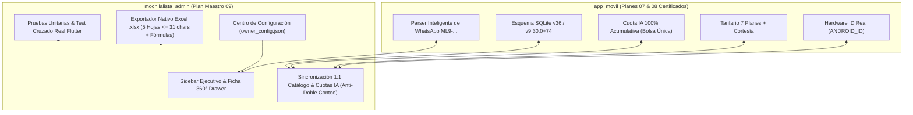
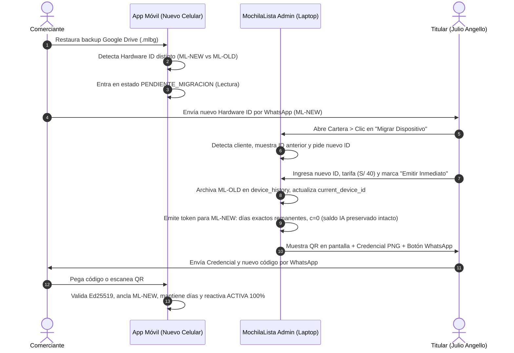
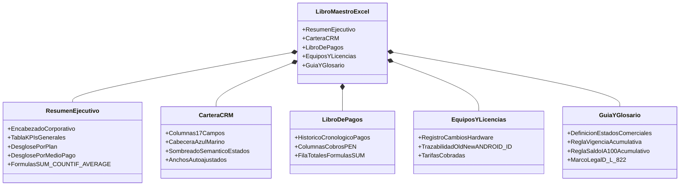

# PLAN MAESTRO 09: SINCRONIZACIÓN ADMINISTRATIVA 1:1 CON PLANES 07 Y 08, REINGENIERÍA UX 360°, CENTRO DE PERSONALIZACIÓN DEL PROPIETARIO Y EXPORTADOR EXCEL MULTI-HOJA (.XLSX)

**Documento Oficial de Ingeniería y Operaciones Comerciales**  
**Proyecto:** MochilaLista POS — Plataforma Administrativa Offline (`mochilalista_admin/`)  
**Autor y Titular Exclusivo:** Julio Angello Vasquez Navarro  
**Marco Legal:** Ley de Derecho de Autor (D.L. 822) e INDECOPI Perú • Ley de Protección de Datos Personales (Ley N° 29733)  
**Fecha de Emisión:** Noviembre 2026 (Versión 1.1 — Revisada y Blindada)  
**Estado:** PLAN REVISADO Y BLINDADO — LISTO PARA AUTORIZACIÓN DE EJECUCIÓN  

---

## ÍNDICE GENERAL

1. [Resumen Ejecutivo y Estado del Arte](#1-resumen-ejecutivo-y-estado-del-arte)
2. [Diagnóstico Integral de la Plataforma `mochilalista_admin/`](#2-diagnóstico-integral-de-la-plataforma-mochilalista_admin)
3. [PILAR 1: Sincronización 1:1 con los Planes Maestros 07 y 08 de `app_movil`](#3-pilar-1-sincronización-11-con-los-planes-maestros-07-y-08-de-app_movil)
   * 3.1. Hardware ID Real (`ANDROID_ID`), Identificador de Instalación y Migración Transparente
   * 3.2. Tarifario Oficial Integral de 7 Productos + Cortesía y Regla Estricta Anti-Doble Conteo IA
   * 3.3. Mensajes de WhatsApp Optimizados para el Parser Inteligente de `app_movil`
   * 3.4. Release Manager Sincronizado: Esquema SQLite `v36`, App `v9.30.0+74` y Catálogo de APKs
   * 3.5. Motor de Cuota IA 100% Acumulativa (Cero Reseteo Mensual) y Trazabilidad por Cliente
   * 3.6. Flujo Unificado de Migración de Celular (`PENDIENTE_MIGRACION` post Google Drive) con Preservación Cero Inflación
4. [PILAR 2: Reingeniería de Navegación, Ficha 360° del Cliente, QR Directo y Supresión de Redundancias](#4-pilar-2-reingeniería-de-navegación-ficha-360-del-cliente-qr-directo-y-supresión-de-redundancias)
   * 4.1. Navegación Ejecutiva con Sidebar Lateral Colapsable
   * 4.2. Visualizador Directo de QR y Credencial Oficial en Cartera CRM (`Ver QR / Credencial`)
   * 4.3. Drawer Deslizable: Ficha 360° del Cliente con Pestañas Internas
   * 4.4. Flujos Guiados de 1 Solo Paso y Dashboard Accionable con Gráficos Ligeros
5. [PILAR 3: Centro de Personalización Total del Propietario (`owner_config.json`)](#5-pilar-3-centro-de-personalización-total-del-propietario-owner_configjson)
   * 5.1. Arquitectura de Configuración Desacoplada sin Tocar Código, Cuentas Limpias y Blindaje `.gitignore`
   * 5.2. Editor de Tarifario Comercial y Asignación de Bolsas IA
   * 5.3. Editor de Plantillas de Mensajes de WhatsApp con Supresión Inteligente de Cuentas Vacías
   * 5.4. Datos de Identidad Legal, Medios de Pago y Preferencias de UI
6. [PILAR 4: Motor de Exportación a Microsoft Excel Profesional Multi-Hoja (`.xlsx`)](#6-pilar-4-motor-de-exportación-a-microsoft-excel-profesional-multi-hoja-xlsx)
   * 6.1. Limitaciones del CSV Actual y Adopción de `excel: ^4.0.6`
   * 6.2. Arquitectura de las 5 Hojas Oficiales (Límite Estricto $\le$ 31 Caracteres)
   * 6.3. Fórmulas Nativas de Hoja de Cálculo (`FormulaCellValue`), Rangos Seguros y Protección Anti-Error `#DIV/0!`
   * 6.4. Endpoints REST de Generación y Descarga Binaria
7. [PILAR 5: Pruebas Automatizadas, Auditoría en Vivo y Coordinación con Plan 10](#7-pilar-5-pruebas-automatizadas-auditoría-en-vivo-y-coordinación-con-plan-10)
   * 7.1. Suite de Pruebas Unitarias y de Integración en Dart
   * 7.2. Test Cruzado de Verificación Criptográfica Real `mochilalista_admin` ↔ `app_movil` en Terminal Flutter
   * 7.3. Auditoría en Vivo en Navegador (`http://localhost:8080`)
   * 7.4. Delimitación con Plan Maestro 10 (Persistencia Externa y Recuperación Multi-Llave)
8. [Plan de Trabajo por Fases de Ejecución (Fase 1, 2, 3, 4A, 4B y 5)](#8-plan-de-trabajo-por-fases-de-ejecución)
9. [Matriz de Trazabilidad de Archivos y Endpoints](#9-matriz-de-trazabilidad-de-archivos-y-endpoints)

---

## 1. RESUMEN EJECUTIVO Y ESTADO DEL ARTE

Habiendo certificado al 100% en `app_movil` tanto el **Plan Maestro 07** (Onboarding, Hardware ID nativo `ANDROID_ID`, EULA formal, catálogo unificado y validación robusta) como el **Plan Maestro 08** (Cuota IA 100% acumulativa sin reseteo mensual destructivo, arquitectura Multi-Perfil con bolsa compartida, bóveda multi-clave BYOK y respaldo en Google Drive con esquema SQLite `v36`), la Plataforma Administrativa de escritorio (`mochilalista_admin/`) requiere una modernización integral inmediata.

Actualmente, `mochilalista_admin/` opera como un servidor local en Dart (`server.dart`) que atiende una interfaz web monocomponente (`web/index.html` + `web/js/admin_app.js` + `web/css/styles.css`). Aunque el motor criptográfico Ed25519 es matemáticamente sólido, la plataforma presenta desfases críticos frente a la aplicación móvil:
* Hace referencia a esquemas desactualizados (esquema v35 y versión v9.24.0, cuando la app ya se encuentra en **v9.30.0+74** y **esquema v36**).
* Persiste la noción caduca de "50 escaneos IA mensuales que se resetean", en lugar del modelo **100% acumulativo** decretado en el Plan 08.
* Conserva parámetros comerciales, plantillas de texto y precios fijos incrustados directamente en el código fuente Dart y JavaScript, obligando a modificar archivos de programación ante cualquier cambio de tarifa o cuenta bancaria.
* Exporta información únicamente en formato `.csv` plano sin formato, sin colores semánticos, sin fórmulas analíticas y en una sola hoja.
* Presenta una barra de navegación horizontal comprimida y modales dispersos que saturan la experiencia del titular.

El presente **Plan Maestro 09** constituye la hoja de ruta definitiva para sincronizar 1:1 la consola administrativa con la aplicación móvil, implementando una arquitectura modular desacoplada, navegación ejecutiva por Sidebar, Ficha 360° del Cliente, Centro de Personalización dinámico (`data/owner_config.json`) y generación nativa de Libros de Microsoft Excel multi-hoja (`.xlsx`) enriquecidos con fórmulas matemáticas reales y estilos ejecutivos.



---

## 2. DIAGNÓSTICO INTEGRAL DE LA PLATAFORMA `mochilalista_admin/`

Una auditoría profunda línea por línea de los archivos existentes en `mochilalista_admin/` arroja los siguientes hallazgos y áreas de mejora obligatorias:

| Componente | Archivo Auditado | Situación Actual | Brecha / Deficiencia Detectada |
| :--- | :--- | :--- | :--- |
| **Dependencias** | `pubspec.yaml` | Solo `cryptography: ^2.7.0` y `crypto: ^3.0.3`. | Carece de librería para manipular libros `.xlsx` y de paquete de testing (`test`). |
| **Servidor REST** | `server.dart` | 915 líneas de código monolítico. Maneja rutas API estáticas y archivos de `web/`. | Valores por defecto desactualizados (`9.24.0`, esquema `35`). Sin endpoints para configuración (`/api/config`) ni exportación Excel (`/api/export/excel-master`). |
| **Persistencia** | `lib/database_service.dart` | 893 líneas. Maneja JSON para sandbox y prod, backups automáticos y matriz de releases. | La emisión de licencias no acredita automáticamente la cuota IA acumulativa según el plan contratado. No maneja configuración dinámica. Exporta solo a CSV. |
| **Criptografía** | `lib/license_signer.dart` | 227 líneas. Firma y valida Ed25519 con payload JSON Base64Url y prefijo `ML9-`. | Es matemáticamente compatible con `app_movil`, pero el Inspector no ofrece detalles contextuales sobre la procedencia del `Hardware ID (ANDROID_ID)`. |
| **Interfaz Web** | `web/index.html` | 1202 líneas. 6 pestañas horizontales superiores (`main-nav`), modales dispersos. | Pestañas apretadas en pantallas medianas. Modales de cliente y hardware desconectados. Sin vista rápida de QR desde la tabla. Falta sección de Configuración. |
| **Lógica Frontend** | `web/js/admin_app.js` | 2417 líneas. Control de vistas, canvas @2x para credencial, llamadas fetch. | Textos desfasados de cuota IA ("50 escaneos/mes"). Plantillas de WhatsApp hardcodeadas. Falta botón `Guardar y Emitir`. Tabla CRM con demasiadas columnas pequeñas. |
| **Estilos CSS** | `web/css/styles.css` | 1335 líneas. Sistema de variables CSS, modo oscuro y claro, tarjetas y botones. | No dispone de clases para Sidebar lateral colapsable, ni para el Drawer lateral Ficha 360°, ni para micro-gráficos SVG interactivos. |

---

## 3. PILAR 1: SINCRONIZACIÓN 1:1 CON LOS PLANES MAESTROS 07 Y 08 DE `app_movil`

### 3.1. Hardware ID Real (`ANDROID_ID`), Identificador de Instalación y Migración Transparente
En el Plan 07 se reemplazó la dependencia obsoleta de `Build.ID` por la extracción nativa en Kotlin de `Settings.Secure.ANDROID_ID`, anclándolo de forma inmutable en `FlutterSecureStorage`.
* **Actualización en el Admin:**
  * En todos los formularios de registro, edición, migración e inspector forense de tokens, se reemplazará la etiqueta ambigua `"Device ID"` por `"Hardware ID (ANDROID_ID)"`.
  * Se añadirán tooltips e insignias técnicas informando: *"Código de 4 caracteres generado a partir de Settings.Secure.ANDROID_ID. Identifica de manera unívoca la instalación física en el teléfono del comerciante (no cambia por reinicios ni actualizaciones; cambia al formatear de fábrica o cambiar de equipo)"*.
  * En el Inspector Forense (`tabInspector`), al decodificar el claim `d`, se presentará un indicador explícito de compatibilidad: *"Hardware Fingerprint: ML-XXXX (Basado en ANDROID_ID)"*.
  * **Migración Transparente:** Si un cliente antiguo registrado previamente reporta un ID con formato anterior o si el comerciante reinstaló en Android 8+, el sistema administrativo preservará el histórico completo en `device_history`, permitiendo vincular el nuevo identificador con un solo clic conservando el 100% de la antigüedad.

### 3.2. Tarifario Oficial Integral de 7 Productos + Cortesía y Regla Estricta Anti-Doble Conteo IA
El Plan 07 fijó el catálogo unificado de productos comerciales y sus valores en Soles (PEN). En `mochilalista_admin/` se homogeneizarán todos los selectores, badges y modelos de datos con los slugs oficiales.

> [!IMPORTANT]
> **REGLA CRÍTICA ANTI-DOBLE CONTEO DE CRÉDITOS IA:**  
> En `app_movil`, el método `LicenseRepository.redeemLicenseCode` (certificado en el Plan 08) opera sumando automáticamente la cuota base del plan más los créditos adicionales que viajen en el payload del token:  
> $$\text{scansToAdd} = \text{LicenseModel.getCumulativeScansForPlan}(\text{token.plan}) + \text{token.aiExtraCredits}$$  
> **Directiva de Generación del Token Ed25519 en `LicenseSigner`:**
> 1. Para planes comerciales estándar (`MENSUAL`, `TRIMESTRAL`, `SEMESTRAL`, `ANUAL`, `PERPETUO_LIBERADO`, `PASE_ACTUALIZACION_ANUAL`):  
>    El claim `c` (y `ai_extra`) del token **SOLO debe transportar el bono promocional de regalo** (`0` por defecto si no hay bono especial ingresado en los ajustes avanzados). De esta forma, al canjear el token, `app_movil` sumará: $\text{Base del Plan} + 0 = \text{Base del Plan}$. Si `mochilalista_admin` cometiese el error de inyectar la cuota base dentro de `c`, la app móvil acreditaría el doble de escaneos al cliente.
> 2. Para el producto **`RECARGA_IA_150`**:  
>    Como se trata de una recarga pura de escaneos (sin extender días), el claim `c` **SÍ transporta `150`** (o el valor parametrizado en `owner_config.json`).
> 3. En la persistencia del Administrador (`DatabaseService` en laptop):  
>    El historial y la ficha del cliente en el CRM sí deben sumar y reflejar la bolsa total acreditada ($\text{Base del Plan} + \text{Bono Extra}$) para mantener paridad 1:1 con el saldo que el comerciante ve en su celular.

| Producto Oficial | Slug en Admin / Payload (`p`) | Duración Otorgada (`y`) | Cuota IA en Token (`c`) | Cuota Acreditada al Cliente | Precio Oficial (PEN) | Tipo Comercial |
| :--- | :--- | :--- | :--- | :--- | :--- | :--- |
| **Prueba Gratuita** | `TRIAL` | 30 días | **`0`** *(+Bono)* | **+50 escaneos** | S/ 0.00 | Prueba inicial para prospectos |
| **Plan Mensual** | `MENSUAL` | 30 días | **`0`** *(+Bono)* | **+50 escaneos** | S/ 35.00 | Suscripción recurrente estándar |
| **Plan Trimestral** | `TRIMESTRAL` | 90 días | **`0`** *(+Bono)* | **+180 escaneos** | S/ 90.00 | Suscripción 3 meses (Ahorro) |
| **Plan Semestral** | `SEMESTRAL` | 180 días | **`0`** *(+Bono)* | **+450 escaneos** | S/ 160.00 | Suscripción 6 meses (Ahorro) |
| **Plan Anual** | `ANUAL` | 365 días | **`0`** *(+Bono)* | **+1200 escaneos** | S/ 280.00 | Suscripción 12 meses (Ahorro max) |
| **Perpetuo Liberado** | `PERPETUO_LIBERADO` | 99999 días (Vitalicio) | **`0`** *(+Bono)* | **+200 escaneos** | S/ 850.00 | Pago único de por vida + 12m updates |
| **Pase Anual Updates** | `PASE_ACTUALIZACION_ANUAL`* | 0 días (365d en `u`) | **`0`** *(+Bono)* | **+100 escaneos** | S/ 150.00 | 12 meses de APKs para perpetuos |
| **Recarga Extra IA** | `RECARGA_IA_150` | 0 días | **`150`** *(o config)* | **+150 escaneos** | S/ 20.00 | Bolsa pura acumulativa sin vencimiento |
| **Extensión Cortesía** | `EXTENSION_CORTESIA` | +7 días gracia | **`0`** | +0 escaneos | S/ 0.00 | Cortesía comercial extraordinaria |

*\*Nota de compatibilidad: Se garantizará tolerancia bidireccional para los alias `PASE_UPDATES_12M` y `PASE_ANUAL_UPDATES` recibidos o emitidos.*

### 3.3. Mensajes de WhatsApp Optimizados para el Parser Inteligente de `app_movil`
En `app_movil/lib/core/services/license/ed25519_license_validator.dart`, el parser inteligente utiliza la siguiente expresión regular de alta prioridad:
$$\text{RegExp}(r'\text{ML9-}([A-Za-z0-9_\-+=]+\.[A-Za-z0-9_\-+=]\{40,120\})')$$
Para garantizar que el comerciante pueda pulsar *"Copiar"* sobre todo el mensaje en WhatsApp y pegarlo directamente en la app sin que ningún carácter adyacente interfiera:
1. El código de activación se colocará en una **línea limpia e independiente**, precedida únicamente por un salto de línea y un encabezado claro.
2. No se encerrará el código en asteriscos, comillas, paréntesis o guiones que puedan inducir a error al usuario o al motor de extracción.
3. Se detallará con precisión el beneficio comercial otorgado (días y créditos IA acreditados a su bolsa acumulativa).

**Estructura Oficial del Mensaje de Entrega de Licencia:**
```text
Hola Carlos Mendoza, te saluda Julio Angello Vasquez Navarro de MochilaLista.

¡Tu licencia para Comercial & Librería El Estudiante ha sido emitida con éxito!

⭐ Plan: PLAN ANUAL (365 días)
📱 Dispositivo Vinculado: ML-9K4B
📅 Vence el: 19/11/2027
⚡ Escáner IA: +1,200 escaneos acumulados acreditados a tu saldo

🔑 Tu Código de Activación Oficial:
ML9-eyJkIjoiTUwtOUs0QiIsInAiOiJBTlVBTCIsInkiOjM2NSwibiI6MSwidiI6OSwiaWF0IjoiMjAyNi0xMS0xOVQwMzowMDowMFoifQ.SignatureDataHereSampleBase64UrlSafeString40to120Chars

Para activarlo en tu teléfono:
1. Abre MochilaLista y ve a: Menú Lateral > Licencia y Activación.
2. Pega el código de arriba o escanea la credencial oficial adjunta.

¡Gracias por tu confianza y éxito en tus ventas!
```

### 3.4. Release Manager Sincronizado: Esquema SQLite `v36`, App `v9.30.0+74` y Catálogo de APKs
1. **Actualización de Valores por Defecto:**
   * Esquema SQLite Requerido: **`v36`** (incorporando campos de multi-perfil, saldo IA acumulativo y respaldo en Google Drive).
   * Versión de App por Defecto: **`v9.30.0+74`** (sincronizada automáticamente desde `app_movil/pubspec.yaml`).
2. **Diferenciación de Builds ARM64 vs Universal:**
   * Al autodetectar archivos generados en `app_movil/build/app/outputs/flutter-apk/`, la plataforma identificará:
     * `app-arm64-v8a-release.apk` ➔ Badge Verde: **`APK Ligero ARM64 (Optimizado WhatsApp - ~18 MB)`**.
     * `app-release.apk` ➔ Badge Azul: **`APK Universal (Todas las arquitecturas - ~40 MB)`**.
   * Permitirá alojar ambos o conmutar el archivo de distribución preferente para envíos por WhatsApp.
3. **Registro de Novedades y Huella Criptográfica:**
   * Acceso directo al texto de `app_movil/lib/core/config/app_changelog_registry.dart` para autocompletar el changelog de la versión.
   * Cálculo automático del hash SHA-256 de 64 caracteres hexadecimales para verificación de integridad antes del envío al cliente.

### 3.5. Motor de Cuota IA 100% Acumulativa (Cero Reseteo Mensual) y Trazabilidad por Cliente
1. **Eliminación Total del Texto de Reseteo Mensual:**
   * Se erradicará del código, del Canvas de la Credencial PNG y de la UI cualquier frase referente a "escaneos mensuales que se reinician".
   * En la Credencial PNG se imprimirá: `⚡ Escáner IA: +X escaneos acumulados (o Modo BYOK ilimitado)`.
2. **Acreditación Automática en `DatabaseService.recordCodeEmission`:**
   * Cada vez que se emita una licencia de plan comercial, se sumarán a la bolsa acumulativa del cliente (`ai_accumulated_credits`) los escaneos estipulados en la tabla del Plan 08 (`LicenseModel.getCumulativeScansForPlan`), sumados a cualquier bono personalizado ingresado por el titular.
3. **Píldora de Impacto y Trazabilidad en CRM:**
   * Al seleccionar un plan en el Generador de Licencias, una tarjeta dinámica mostrará: *"Impacto: Agrega X días a la vigencia actual y acredita +Y escaneos a la bolsa acumulativa del cliente"*.
   * En la tabla de clientes y en la Ficha 360°, se visualizará el balance acumulado acreditado históricamente.

### 3.6. Flujo Unificado de Migración de Celular (`PENDIENTE_MIGRACION` post Google Drive) con Preservación Cero Inflación
Cuando un comerciante adquiere un teléfono nuevo o formatea su dispositivo y restaura su base de datos desde el archivo `.mlbg` de Google Drive, su app entra en estado `PENDIENTE_MIGRACION` al detectar una discrepancia entre el `Hardware ID` de la base restaurada y el `ANDROID_ID` del nuevo dispositivo.



* **Regla de Emisión de Token de Migración (Cero Inflación de Créditos y Días):**
  1. **Preservación de Vencimiento:** Se calcula la cantidad de días remanentes que le quedan al cliente:
     $$\text{remainingDays} = \max\left(0, \text{client.license\_expires.difference}(\text{DateTime.now()}).\text{inDays}\right)$$
  2. **Plan y Claims del Token de Migración:**  
     Se emite el token con el plan actual del cliente (o `client.license_type`), `y = remainingDays`, y **`c = 0`** (sin bono de IA adicional). Dado que la base de datos local restaurada desde Google Drive ya contiene el saldo acumulado real de escaneos del comerciante, asignar `c = 0` evita alterar o duplicar indebidamente la cuota IA que el comerciante tenía antes de migrar.
  3. **Despliegue Inmediato:** El modal de migración ofrece el QR grande, la Credencial PNG @2x y el botón de WhatsApp preformateado en un solo paso sin navegar a otra pestaña.

---

## 4. PILAR 2: REINGENIERÍA DE NAVEGACIÓN, FICHA 360° DEL CLIENTE, QR DIRECTO Y SUPRESIÓN DE REDUNDANCIAS

### 4.1. Navegación Ejecutiva con Sidebar Lateral Colapsable
La barra horizontal superior de 6 pestañas apretadas será reemplazada por un **Sidebar lateral izquierdo colapsable**, optimizando el espacio visual en laptops y monitores comerciales:

```
┌─────────────────┬──────────────────────────────────────────────────────────────────┐
│  MOCHILALISTA   │ [MODO REAL / SANDBOX]   [Exportar .xlsx]   [Tema]   Titular: Julio │
│  ADMIN CONSOLE  ├──────────────────────────────────────────────────────────────────┤
├─────────────────┤                                                                  │
│  OPERACIONES    │                                                                  │
│  [■] Dashboard  │                                                                  │
│  [👥] Cartera CRM│                                                                  │
│  [🔑] Licencias │                  ÁREA DE TRABAJO PRINCIPAL                       │
│  [📦] Versiones │                  (AMPLIA, RESPIRABLE Y LIMPIA)                   │
│                 │                                                                  │
│  AUDITORÍA      │                                                                  │
│  [🔍] Inspector │                                                                  │
│  [💰] Finanzas  │                                                                  │
│  [📊] Reportes  │                                                                  │
│                 │                                                                  │
│  SISTEMA        │                                                                  │
│  [⚙️] Ajustes   │                                                                  │
│  [◀] Colapsar   │                                                                  │
└─────────────────┴──────────────────────────────────────────────────────────────────┘
```

* **Características del Sidebar:**
  * **Modo Completo:** Ancho de 260px con logotipos, agrupaciones por categoría (`Operaciones`, `Auditoría & Análisis`, `Sistema`) y badges dinámicos con conteo de alertas urgentes (ej: `Por Vencer: 2`).
  * **Modo Compacto (Mini-Sidebar):** Ancho de 68px mostrando únicamente los íconos vectoriales SVG con tooltips emergentes en hover.
  * **Persistencia de Estado:** Almacena la preferencia de colapso en `localStorage`.

### 4.2. Visualizador Directo de QR y Credencial Oficial en Cartera CRM (`Ver QR / Credencial`)
En la tabla de Cartera de Clientes, cada fila incorporará un botón de acción rápida destacado: **`QR / Credencial`**.
* Al hacer clic, se abre un **Modal de Visualización Rápida** centrado y de alto contraste:
  1. **Código QR Grande (260x260 px):** Optimizado para escaneo óptico instantáneo apuntando la cámara del teléfono del cliente a la pantalla de la laptop.
  2. **Credencial Oficial PNG @2x:** Renderizada en vivo mediante HTML5 Canvas con sello legal de INDECOPI, titularidad de Julio Angello Vasquez Navarro y directivas criptográficas.
  3. **Barra de Acciones en 1 Clic:**
     * `[Copiar Credencial]`: Copia el PNG directamente al portapapeles del sistema operativo para pegarlo con `Ctrl + V` en WhatsApp Web o Telegram.
     * `[Descargar PNG]`: Descarga el archivo gráfico en alta resolución.
     * `[Copiar Código ML9]`: Copia el token alfanumérico limpio.
     * `[Enviar por WhatsApp]`: Abre WhatsApp Web con el mensaje preformateado y el código en línea limpia.

### 4.3. Drawer Deslizable: Ficha 360° del Cliente con Pestañas Internas
Para erradicar la saturación de botones diminutos y modales independientes, se simplifica la tabla del CRM y se introduce un **Drawer Lateral Deslizable (Ficha 360°)** que se abre al hacer clic en cualquier fila o en el botón `Ver Ficha 360°`:

* **Columnas de la Tabla CRM Simplificada:**
  1. `ID` (CLI-001)
  2. `Negocio & Titular` (Nombre comercial en negrita, propietario y RUC/DNI en texto secundario)
  3. `Plan & Vigencia` (Badge semántico de color + días exactos restantes)
  4. `Hardware ID` (Código `ML-XXXX` con botón de copia rápida en 1 clic)
  5. `Versión APK` (Versión instalada vs última versión con badge de estado)
  6. `Créditos IA` (Bolsa acumulada acreditada)
  7. `Acciones Clave` (Botones claros: `Ficha 360°`, `QR Rápido`, `WhatsApp`, `Emitir`)

* **Pestañas Internas del Drawer 360°:**
  * **Pestaña 1 — Resumen Ejecutivo y Licencia Actual:** Tarjetas de estado comercial, fecha de inicio y vencimiento, días restantes con barra de progreso, ventana de updates, saldo IA acumulado y contador nonce anti-replay.
  * **Pestaña 2 — QR y Última Credencial:** Visor del código QR y de la credencial oficial generada con botones de copia y descarga.
  * **Pestaña 3 — Historial Financiero y Pagos:** Tabla completa de pagos registrados (fecha, monto en S/, medio, referencia), con botón para registrar pago manual o anular transacciones erróneas.
  * **Pestaña 4 — Historial de Hardware y Migraciones:** Registro de cambios de celular (`old_device_id` ➔ `new_device_id`, fecha, tarifa cobrada, motivo).
  * **Pestaña 5 — Edición Rápida:** Formulario de actualización de datos comerciales y notas sin necesidad de abrir modales secundarios.

### 4.4. Flujos Guiados de 1 Solo Paso y Dashboard Accionable con Gráficos Ligeros
1. **Flujo de Registro Guiado:**
   * En el modal `Registrar Nuevo Cliente`, se agrega el botón primario de acción doble: **`Guardar y Emitir Licencia Ahora`**.
   * Guarda al cliente en la base de datos y transiciona automáticamente al generador de licencias con el cliente ya seleccionado y la proyección comercial lista, eliminando la fricción de buscarlo manualmente.
2. **Tarjetas KPI Clicables e Interactivas:**
   * Al hacer clic en la tarjeta `Por Vencer (≤ 7 días)`, navega al CRM activando automáticamente el filtro `Por Vencer`.
   * Al hacer clic en `Licencias Vencidas`, `Clientes Activos`, `Perpetuas` o `APK Desactualizado`, filtra la tabla inmediatamente por ese criterio.
3. **Micro-Gráficos Visuales SVG Puros (Cero Dependencias Externas):**
   * **Gráfico 1 — Evolución de Ingresos Mensuales (S/):** Gráfico interactivo de barras vectoriales SVG que muestra los ingresos cobrados mes a mes con tooltips en hover.
   * **Gráfico 2 — Distribución de Clientes por Plan:** Gráfico de dona (Donut Chart) SVG con porcentajes de clientes según su plan (`Mensual`, `Trimestral`, `Semestral`, `Anual`, `Perpetuo`, `Trial`).

---

## 5. PILAR 3: CENTRO DE PERSONALIZACIÓN TOTAL DEL PROPIETARIO (`owner_config.json`)

### 5.1. Arquitectura de Configuración Desacoplada sin Tocar Código, Cuentas Limpias y Blindaje `.gitignore`
Para asegurar que el titular pueda ajustar tarifas, cuentas bancarias, cuotas de IA o mensajes sin editar código fuente Dart ni JavaScript, se implementa el servicio `ConfigService` con persistencia física en `data/owner_config.json`.

> [!CAUTION]
> **SEGURIDAD Y PROTECCIÓN DE DATOS COMERCIALES:**  
> 1. `data/owner_config.json` se añade explícitamente a `.gitignore` para evitar que datos sensibles de cuentas bancarias se publiquen en repositorios.  
> 2. En la plantilla inicial de fábrica, las cuentas bancarias BCP y BBVA se inicializan limpias como cadenas vacías `""` (sin placeholders confusos como `XXXX`). El único canal activo preconfigurado es **Yape / Plin (+51 922 836 879)** a nombre de Julio Angello Vasquez Navarro.  
> 3. Cada vez que se guarde un cambio o se invoque una restauración de fábrica, el sistema crea un snapshot automático en `backups/`.

```json
{
  "system": {
    "default_mode": "sandbox",
    "theme": "dark",
    "table_density": "comfortable",
    "version": "1.0.0"
  },
  "legal_identity": {
    "author_full_name": "Julio Angello Vasquez Navarro",
    "commercial_name": "MochilaLista",
    "support_phone": "+51 922 836 879",
    "support_whatsapp_url": "https://wa.me/51922836879",
    "official_website": "https://mochilalista.com",
    "legal_framework": "Protegido por el D.L. 822 (Ley de Derecho de Autor) e INDECOPI Perú",
    "personal_data_law": "Ley N° 29733 (Ley de Protección de Datos Personales)"
  },
  "payment_methods": {
    "yape_plin_holder": "Julio Angello Vasquez Navarro",
    "yape_plin_phone": "922836879",
    "bcp_account_holder": "",
    "bcp_account_number": "",
    "bcp_cci": "",
    "bbva_account_holder": "",
    "bbva_account_number": "",
    "bbva_cci": ""
  },
  "catalog": {
    "TRIAL": { "price": 0.0, "days": 30, "ai_credits": 50, "label": "Prueba Gratuita" },
    "MENSUAL": { "price": 35.0, "days": 30, "ai_credits": 50, "label": "Plan Mensual" },
    "TRIMESTRAL": { "price": 90.0, "days": 90, "ai_credits": 180, "label": "Plan Trimestral" },
    "SEMESTRAL": { "price": 160.0, "days": 180, "ai_credits": 450, "label": "Plan Semestral" },
    "ANUAL": { "price": 280.0, "days": 365, "ai_credits": 1200, "label": "Plan Anual" },
    "PERPETUO_LIBERADO": { "price": 850.0, "days": 99999, "ai_credits": 200, "updates_months": 12, "label": "Perpetuo Liberado" },
    "PASE_ACTUALIZACION_ANUAL": { "price": 150.0, "days": 0, "updates_months": 12, "ai_credits": 100, "label": "Pase Anual de Updates" },
    "RECARGA_IA_150": { "price": 20.0, "days": 0, "ai_credits": 150, "label": "Recarga Extra IA (+150)" },
    "EXTENSION_CORTESIA": { "price": 0.0, "days": 7, "ai_credits": 0, "label": "Extensión de Cortesía" },
    "HARDWARE_MIGRATION_FEE": { "price": 40.0, "label": "Tarifa Técnica de Migración" }
  },
  "templates": {
    "license_issued": "Hola {titular}, te saluda {autor} de MochilaLista.\n\n¡Tu licencia para *{negocio}* ha sido emitida exitosamente!\n\n⭐ *Plan:* {plan} ({dias} días)\n📱 *Dispositivo Vinculado:* {device_id}\n📅 *Vigencia hasta:* {vencimiento}\n⚡ *Escáner IA:* +{creditos_ia} escaneos acumulados acreditados\n\n🔑 *Tu Código de Activación Oficial:*\n{codigo}\n\nPara activarlo en tu app:\n1. Abre MochilaLista en tu teléfono.\n2. Ve a Menú > Licencia y Activación.\n3. Pega el código de arriba o escanea la credencial oficial adjunta.\n\n¡Gracias por tu confianza y éxito en tus ventas!",
    "expiring_reminder": "Hola {titular}, te saluda {autor} de MochilaLista.\n\nTe recordamos que la licencia de tu negocio *{negocio}* vence en *{dias_restantes} días* ({vencimiento}).\n\nPara renovar tu servicio sin interrupciones en tus ventas:\n💳 Yape / Plin: {yape_phone} ({yape_titular}){bloque_banco_bcp}{bloque_banco_bbva}\n\nQuedo a tu disposición para emitir tu renovación inmediata.",
    "trial_welcome": "¡Bienvenido a MochilaLista, {titular}!\n\nHemos activado tu periodo de prueba gratuita de 30 días para *{negocio}* con 50 escaneos inteligentes de IA incluidos.\n\n📱 *Dispositivo:* {device_id}\n📅 *Vence el:* {vencimiento}\n\n🔑 *Tu Código de Activación:*\n{codigo}\n\n¡Comienza a registrar tus ventas e inventario hoy mismo!",
    "apk_update_eligible": "Hola {titular}, te saluda {autor} de MochilaLista.\n\n¡Tenemos lista una nueva actualización oficial para *{negocio}*!\n\n📦 *Versión:* MochilaLista v{version}\n✨ *Novedades:*\n{changelog}\n\n📥 *Enlace de Descarga Directa:*\n{link_descarga}\n\n🛡️ *Garantía Cero Pérdida:* Al instalar este APK sobre el actual, tu base de datos y productos se mantienen 100% intactos.",
    "apk_update_quote": "Hola {titular}, te saluda {autor} de MochilaLista.\n\nAcabamos de lanzar la versión oficial *v{version}* con mejoras avanzadas.\nTu negocio *{negocio}* cuenta con la versión v{version_actual}.\n\nPara acceder a este paquete de nuevas funciones, puedes adquirir tu *Pase Anual de Actualizaciones* por solo S/ {precio_pase}.\n¿Deseas que te emita el pase hoy mismo?",
    "device_migration": "Hola {titular}, te saluda {autor} de MochilaLista.\n\nHemos completado la migración de tu licencia al nuevo teléfono para *{negocio}*.\n\n📱 *Nuevo Dispositivo:* {device_id}\n📅 *Vencimiento Preservado:* {vencimiento}\n⚡ *Saldo IA Preservado:* +{creditos_ia} escaneos disponibles\n\n🔑 *Tu Nuevo Código de Activación:*\n{codigo}\n\nActívalo en tu nuevo teléfono para continuar operando sin contratiempos."
  }
}
```

### 5.2. Editor del Tarifario Comercial y Asignación de Bolsas IA
En la nueva sección de **Configuración** del Sidebar (`tabSettings`):
* Formulario estructurado para modificar los precios de cada uno de los 7 planes, la duración en días y la cantidad de escaneos IA acreditados.
* Modificación de la tarifa técnica de migración (`S/ 40.00`).
* Botón de guardado inmediato que actualiza `owner_config.json` y sincroniza en tiempo real los menús desplegables del generador y del CRM sin reiniciar el servidor.

### 5.3. Editor de Plantillas de WhatsApp con Supresión Inteligente de Cuentas Vacías
* **Supresión Dinámica de Cuentas Vacías:** El motor de renderizado de plantillas inspecciona `bcp_account_number` y `bbva_account_number`. Si el valor está vacío (`""`), la variable `{bloque_banco_bcp}` o `{bloque_banco_bbva}` se evalúa como una cadena vacía en lugar de generar una línea de texto incompleta.
* Editor interactivo para las 6 plantillas oficiales de comunicación con selector de plantilla.
* Lista de variables dinámicas insertables mediante botones rápidos: `{titular}`, `{negocio}`, `{plan}`, `{dias}`, `{vencimiento}`, `{creditos_ia}`, `{codigo}`, `{version}`, `{device_id}`, `{yape_phone}`.
* **Panel de Vista Previa en Vivo:** Muestra el renderizado en tiempo real del mensaje exactamente como se verá en WhatsApp con datos simulados.

### 5.4. Datos de Identidad Legal, Medios de Pago y Preferencias de UI
* Datos del autor y titular para atribución de derechos (D.L. 822 / INDECOPI).
* Cuentas bancarias y teléfonos Yape/Plin utilizados en los mensajes de cobro y en el pie de página de la credencial oficial.
* Preferencias de entorno (`sandbox` o `prod` por defecto), densidad visual de tablas y tema predeterminado.
* Botón de emergencia: **`Restaurar Configuración de Fábrica`** (con snapshot de seguridad previo en `backups/`).

---

## 6. PILAR 4: MOTOR DE EXPORTACIÓN A MICROSOFT EXCEL PROFESIONAL MULTI-HOJA (`.xlsx`)

### 6.1. Limitaciones del CSV Actual y Adopción de `excel: ^4.0.6`
La exportación actual a `.csv` plano presenta graves deficiencias para la gestión empresarial:
1. Carece de soporte para múltiples hojas en un solo archivo, forzando a exportar clientes y libro contable por separado.
2. No soporta anchos de columna precalculados, causando que los textos largos y los tokens se muestren truncados o en notación científica.
3. No permite estilos visuales corporativos (colores institucionales, negritas, bordes de celda).
4. No admite fórmulas de cálculo dinámicas de Excel (`=SUM`, `=COUNTIF`, `=AVERAGE`).

Para resolver esto de raíz, se integrará el paquete puro de Dart **`excel: ^4.0.6`**, el cual opera en memoria y en disco sin requerir que la laptop tenga instalado Microsoft Office ni dependencias nativas de C++.

### 6.2. Arquitectura de las 5 Hojas Oficiales (Límite Estricto $\le$ 31 Caracteres)
> [!IMPORTANT]
> **REGLA DE COMPATIBILIDAD ESTRICTA DE MICROSOFT EXCEL:**  
> Los nombres de hojas en Microsoft Excel tienen un **límite absoluto e inquebrantable de 31 caracteres**. Cualquier nombre superior corrompe el libro `.xlsx` al abrirse. Por esta razón, se establecen los 5 nombres oficiales idénticos tanto para la creación física de la hoja como para las referencias en fórmulas:

1. **`Resumen Ejecutivo`** (17 caracteres)
2. **`Cartera CRM`** (11 caracteres)
3. **`Libro de Pagos`** (14 caracteres)
4. **`Equipos y Licencias`** (19 caracteres)
5. **`Guia y Glosario`** (15 caracteres)



#### Estructura Detallada de Cada Hoja:
1. **Hoja 1 — `Resumen Ejecutivo`:**
   * **Bloque Superior:** Título corporativo `"MOCHILALISTA POS — REPORTE EJECUTIVO MAESTRO"`, Titular: Julio Angello Vasquez Navarro, Fecha y hora exacta de corte, Entorno (`PRODUCCIÓN REAL` o `MODO PRUEBAS`).
   * **Tabla de KPIs Generales:** Total de Clientes, Clientes Activos, Licencias por Vencer, Licencias Vencidas, Licencias Perpetuas, Aplicaciones Desactualizadas.
   * **Cuadro de Recaudación Financiera:** Recaudación acumulada histórica (S/), Recaudación del mes actual (S/), Ticket promedio por transacción (S/).
   * **Desglose por Medio de Pago:** Filas para `Yape`, `Plin`, `BCP`, `BBVA`, `Efectivo` con fórmulas `=COUNTIF(...)` y `=SUMIF(...)` calculando sobre la Hoja `Libro de Pagos`.
2. **Hoja 2 — `Cartera CRM`:**
   * **Estilo:** Cabecera azul marino corporativo (`#1E3A8A`), texto blanco en negrita, bordes sutiles.
   * **17 Columnas Oficiales:**
     `ID` | `Nombre Comercial` | `Propietario` | `RUC / DNI` | `Teléfono WhatsApp` | `Hardware ID (ANDROID_ID)` | `Plan Actual` | `Estado de Licencia` | `Fecha de Vencimiento` | `Días Restantes` | `Ventana Updates` | `Versión APK Instalada` | `Créditos IA Acumulados` | `Total Pagado (PEN)` | `N.° de Pagos` | `Último Token Emitido` | `Notas y Acuerdos`
   * **Sombreado Semántico de Filas:** Verde suave para `ACTIVA`, Ámbar para `POR_VENCER`, Rojo suave para `VENCIDA`, Púrpura suave para `PERPETUA`.
3. **Hoja 3 — `Libro de Pagos`:**
   * Registro histórico cronológico de cada cobro realizado en el sistema.
   * **Columnas:** `ID Transacción` | `Fecha y Hora` | `ID Cliente` | `Nombre Comercial` | `Titular` | `Concepto / Plan` | `Días Otorgados` | `Créditos IA Acreditados` | `Medio de Pago` | `N.° Operación / Referencia` | `Monto Cobrado (PEN)`.
   * **Fila Final de Totales:** Etiqueta `"TOTAL RECAUDADO (PEN)"` con fórmula `=SUM(K2:Kn)` y formato de celda moneda `S/ #,##0.00`.
4. **Hoja 4 — `Equipos y Licencias`:**
   * Trazabilidad completa de soporte técnico y cambios de celular.
   * **Columnas:** `Fecha de Migración` | `ID Cliente` | `Nombre Comercial` | `Hardware ID Anterior (ANDROID_ID)` | `Nuevo Hardware ID (ANDROID_ID)` | `Tarifa Técnica (S/)` | `Medio de Pago` | `Motivo de la Migración` | `Último Nonce Criptográfico`.
5. **Hoja 5 — `Guia y Glosario`:**
   * Documento de referencia autocontenido que explica las reglas de negocio del sistema:
     * Definición de cada estado (`ACTIVA`, `POR_VENCER`, `BLOQUEO_SUAVE`, `PENDIENTE_MIGRACION`, `PERPETUA`).
     * Explicación de la **Regla Acumulativa de Días** (la vigencia se añade a la fecha de vencimiento previa, nunca se pierden días al pagar antes).
     * Explicación de la **Cuota IA 100% Acumulativa** (los escaneos no vencen a fin de mes; se acumulan en la bolsa compartida).
     * Naturaleza del `Hardware ID (Settings.Secure.ANDROID_ID)` y firma asimétrica Ed25519 offline.

### 6.3. Fórmulas Nativas de Hoja de Cálculo (`FormulaCellValue`), Rangos Seguros y Protección Anti-Error `#DIV/0!`
Para asegurar que la generación en Dart con `excel: ^4.0.6` sea matemáticamente infalible y no genere errores de apertura ni celdas corruptas:
1. **Uso de `FormulaCellValue`:** En `excel: ^4.0.6`, las fórmulas se escriben como objetos `FormulaCellValue("SUM(...)")`.
2. **Nombres Entrecomillados con Espacios:** Todas las referencias a hojas con espacios se encerrarán con comillas simples: `'Cartera CRM'!`, `'Libro de Pagos'!`, `'Equipos y Licencias'!`.
3. **Cálculo de Rangos Dinámicos y Protección ante Producción Limpia (0 Pagos):**
   * Se calculará dinámicamente la última fila con datos: $\text{lastRowPayments} = \max(2, \text{payments.length} + 1)$.
   * Si la tabla contable tiene 0 cobros registrados, la fórmula de promedio usará `IFERROR` para evitar la división entre cero:
     $$=\text{IFERROR}(\text{AVERAGE}('Libro de Pagos'!K2:K\text{lastRowPayments}), 0)$$
   * La fórmula de clientes activos:
     $$=\text{COUNTIF}('Cartera CRM'!H2:H\text{lastRowCRM}, "ACTIVA")$$
   * La fórmula de suma total de ingresos:
     $$=\text{SUM}('Libro de Pagos'!K2:K\text{lastRowPayments})$$
4. **Auto-ajuste de Anchos de Columna:** Se calculará la longitud del texto más largo por columna más 4 unidades de padding para asegurar que ningún dato aparezca truncado con `###` en Excel.

### 6.4. Endpoints REST de Generación y Descarga Binaria
* **`GET /api/export/excel-master`:** Genera el Libro Maestro Completo de 5 Hojas. Cabecera `Content-Type: application/vnd.openxmlformats-officedocument.spreadsheetml.sheet`, con `Content-Disposition: attachment; filename="MochilaLista_Reporte_Maestro_[MODO]_[FECHA].xlsx"`.
* **`GET /api/export/excel-finances?from=YYYY-MM-DD&to=YYYY-MM-DD`:** Genera el reporte contable filtrado por fechas.
* **`GET /api/clients/export-csv` y `GET /api/finances/export-csv`:** Se preservarán como opciones secundarias ultraligeras con BOM UTF-8.

---

## 7. PILAR 5: PRUEBAS AUTOMATIZADAS, AUDITORÍA EN VIVO Y COORDINACIÓN CON PLAN 10

### 7.1. Suite de Pruebas Unitarias y de Integración en Dart
Se incorporará el paquete oficial `test: ^1.25.0` en `mochilalista_admin/pubspec.yaml` (dev_dependencies) y se diseñarán las siguientes baterías de pruebas en `mochilalista_admin/test/`:

1. **`test/license_signer_test.dart`:**
   * Certifica la generación y validación de tokens Ed25519 para los 7 planes oficiales.
   * Valida estrictamente la **Regla Anti-Doble Conteo**: certifica que para planes de suscripción el claim `c` transporte únicamente `0` (o el bono extra), mientras que para `RECARGA_IA_150` transporte `150`.
   * Valida la no colisión de nonces y verificación estricta de firma asimétrica.
2. **`test/config_service_test.dart`:**
   * Certifica la lectura y persistencia de `owner_config.json`.
   * Valida la actualización de tarifas, plantillas y canales de pago.
   * Valida la función de restauración a valores de fábrica sin pérdida de datos del CRM.
3. **`test/excel_export_test.dart`:**
   * Certifica la generación estructural del archivo binario `.xlsx`.
   * Verifica la existencia de las 5 hojas de cálculo obligatorias con sus nombres exactos ($\le 31$ caracteres).
   * Valida la presencia de fórmulas `=SUM(...)`, `=COUNTIF(...)` e `IFERROR` en celdas designadas.
4. **`test/database_service_test.dart`:**
   * Certifica el cómputo de la cuota acumulativa de IA según el plan (`TRIAL: +50`, `MENSUAL: +50`, `TRIMESTRAL: +180`, `SEMESTRAL: +450`, `ANUAL: +1200`, `PERPETUO: +200`, `PASE: +100`, `RECARGA: +150`).
   * Valida el registro atómico de migraciones de hardware y snapshots de backup.

### 7.2. Test Cruzado de Verificación Criptográfica Real `mochilalista_admin` ↔ `app_movil` en Terminal Flutter
Además de los tests unitarios propios en `mochilalista_admin/test/`, se ejecutará en terminal real la batería cruzada oficial ya existente en `app_movil`:
```bash
cd app_movil
flutter test --timeout 30s test/cross_platform_admin_to_mobile_ed25519_verification_test.dart
```
Esta prueba certifica de extremo a extremo:
1. Que los tokens generados por `mochilalista_admin` sean aceptados y canjeados sin errores por `app_movil/lib/core/services/license/license_repository.dart`.
2. Que la acumulación de saldo de IA sea exacta y no sufra doble conteo.
3. Que la firma Ed25519 coincida al 100% con la clave pública maestra compilada.

### 7.3. Auditoría en Vivo en Navegador (`http://localhost:8080`)
* Inicio del servidor local mediante `server.dart` en el puerto 8080.
* Inspección visual en Google Chrome / Microsoft Edge certificando:
  * Despliegue y colapso fluido del Sidebar lateral ejecutivo.
  * Apertura del modal `Ver QR / Credencial` en la tabla de clientes.
  * Renderizado del Drawer Lateral Ficha 360°.
  * Generación y descarga directa del archivo `.xlsx` de 5 hojas abriéndolo en Microsoft Excel.
  * Ausencia total de errores o advertencias en la Consola de DevTools (`F12`).

### 7.4. Delimitación con Plan Maestro 10 (Persistencia Externa y Recuperación Multi-Llave)
> [!IMPORTANT]
> **Coordinación Arquitectónica con el Plan Maestro 10:**  
> Para salvaguardar la simplicidad y el cumplimiento estricto del alcance de este Plan 09, **no se incluirá en esta fase** el sistema de sincronización multi-PC con almacenamiento cloud externo, ni la bóveda descentralizada multi-llave ("a prueba de olvidos"). Dichas capacidades se abordarán de manera independiente, exhaustiva y blindada en el **Plan Maestro 10**. El presente Plan 09 se concentra al 100% en la sincronización funcional, la experiencia de usuario ejecutiva, el centro de personalización y el exportador profesional a Excel.

---

## 8. PLAN DE TRABAJO POR FASES DE EJECUCIÓN

Para garantizar una implementación quirúrgica y sin riesgo de truncamiento en archivos frontend voluminosos, la Fase 4 se divide en **Fase 4A** (Arquitectura visual y flujos CRM) y **Fase 4B** (Centro de personalización y exportación Excel):

```mermaid
gantt
    title Cronograma de Implementación Plan Maestro 09 (Blindado)
    dateFormat  X
    axisFormat %s

    section FASE 1: Sincronización Núcleo & Cuotas IA
    Actualizar dependencias pubspec.yaml        :f1_1, 0, 1
    Sincronizar LicenseSigner y DatabaseService :f1_2, 1, 2
    Regla anti-doble conteo y cuota acumulativa :f1_3, 2, 3
    Sincronizar Release Manager (v36 / 9.30.0)  :f1_4, 3, 4

    section FASE 2: Centro de Personalización
    Diseñar ConfigService & owner_config.json   :f2_1, 4, 5
    Implementar endpoints REST /api/config      :f2_2, 5, 6
    Blindaje .gitignore y cuentas bancarias     :f2_3, 6, 7

    section FASE 3: Motor Excel .xlsx Multi-Hoja
    Implementar ExcelExportService (5 Hojas)    :f3_1, 7, 8
    FormulaCellValue, IFERROR y rango seguro    :f3_2, 8, 9
    Endpoints REST /api/export/excel-master     :f3_3, 9, 10

    section FASE 4A: Arquitectura Visual & CRM
    Sidebar Ejecutivo Colapsable                :f4a_1, 10, 11
    Modal Rápido Ver QR / Credencial en CRM     :f4a_2, 11, 12
    Drawer Lateral Ficha 360° (5 pestañas)      :f4a_3, 12, 13
    Flujos 1 Paso (Guardar y Emitir / Migración):f4a_4, 13, 14
    KPIs clicables y micro-gráficos SVG         :f4a_5, 14, 15

    section FASE 4B: Configuración UI & Excel
    Pestaña Configuración y Personalización     :f4b_1, 15, 16
    Editor WhatsApp con vista previa en vivo    :f4b_2, 16, 17
    Botones descarga Excel en Dashboard y CRM   :f4b_3, 17, 18
    Pulido visual Tema Oscuro y Tema Claro      :f4b_4, 18, 19

    section FASE 5: Pruebas Cruzadas & Cierre
    Tests unitarios mochilalista_admin/test/    :f5_1, 19, 20
    Test cruzado real en app_movil Flutter      :f5_2, 20, 21
    Auditoría en vivo en http://localhost:8080 :f5_3, 21, 22
    Informe final de certificación de entrega   :f5_4, 22, 23
```



---

### FASE 1: Sincronización del Núcleo de Licencias, Catálogo Oficial y Cuota IA Acumulativa
* **Objetivo:** Alinear el backend y motor criptográfico con los Planes 07 y 08 de `app_movil`.
* **Archivos a modificar / crear:**
  * `mochilalista_admin/pubspec.yaml`: Agregar dependencias `excel: ^4.0.6` y dev_dependency `test: ^1.25.0`.
  * `mochilalista_admin/lib/license_signer.dart`: Implementar la regla estricta anti-doble conteo en el claim `c` (0 para planes base, 150 para recarga pura, +bono).
  * `mochilalista_admin/lib/database_service.dart`: Implementar cálculo de cuota IA acumulativa automática según plan (`getCumulativeScansForPlan`), sincronizar valores iniciales de Sandbox a esquema `v36` y versión `v9.30.0+74`.
  * `mochilalista_admin/server.dart`: Actualizar versión por defecto y esquema en endpoints de detección de builds.
* **Entregable de Fase:** Pruebas unitarias de emisión de licencias certificando el incremento exacto de cuotas IA acumulativas y vigencias.

---

### FASE 2: Centro de Personalización Total del Propietario (`config_service.dart` y `owner_config.json`)
* **Objetivo:** Permitir al titular modificar precios, plantillas de WhatsApp, datos de pago y preferencias sin tocar código.
* **Archivos a modificar / crear:**
  * `mochilalista_admin/lib/config_service.dart`: Clase gestora con carga, validación, escritura y restauración de `data/owner_config.json`.
  * `mochilalista_admin/data/owner_config.json`: Archivo de configuración maestro inicial con valores limpios de cuentas y Yape oficial.
  * `mochilalista_admin/.gitignore`: Proteger `data/owner_config.json`.
  * `mochilalista_admin/server.dart`: Endpoints REST `GET /api/config`, `PUT /api/config` y `POST /api/config/reset`.
  * `mochilalista_admin/test/config_service_test.dart`: Batería de pruebas unitarias de persistencia y sanitización.
* **Entregable de Fase:** Configuración dinámica respaldada en disco y consumida por el servidor para tarifas y plantillas.

---

### FASE 3: Motor Exportador a Microsoft Excel Profesional Multi-Hoja (`.xlsx`)
* **Objetivo:** Generar libros de cálculo nativos de Microsoft Excel multi-hoja con fórmulas y estilos corporativos.
* **Archivos a modificar / crear:**
  * `mochilalista_admin/lib/excel_export_service.dart`: Motor de generación OOXML de las 5 Hojas (`Resumen Ejecutivo`, `Cartera CRM`, `Libro de Pagos`, `Equipos y Licencias`, `Guia y Glosario`) con nombres $\le 31$ caracteres, `FormulaCellValue`, `IFERROR` ante tablas vacías y anchos auto-ajustados.
  * `mochilalista_admin/server.dart`: Endpoints `GET /api/export/excel-master` y `GET /api/export/excel-finances`.
  * `mochilalista_admin/test/excel_export_test.dart`: Test unitario que crea, guarda y analiza la estructura interna del archivo `.xlsx` (hojas, estilos y fórmulas).
* **Entregable de Fase:** Descarga funcional del Libro Maestro de 5 Hojas verificado con Microsoft Excel.

---

### FASE 4A: Arquitectura Visual y Flujos CRM (Sidebar, QR Rápido, Drawer 360° y Flujos de 1 Paso)
* **Objetivo:** Construir la estructura base moderna de navegación y el núcleo operativo del CRM.
* **Archivos a modificar:**
  * `mochilalista_admin/web/index.html`: Estructura del Sidebar colapsable, tabla CRM simplificada, modal `Ver QR / Credencial`, Drawer Lateral 360° y botones de doble acción `Guardar y Emitir`.
  * `mochilalista_admin/web/css/styles.css`: Clases para Sidebar (completo y mini), Drawer deslizable, modal QR y tarjetas KPI interactivas.
  * `mochilalista_admin/web/js/admin_app.js`: Lógica de alternancia del Sidebar, navegación por Drawer 360°, apertura directa de QR, flujo guiado de registro y migración con emisión inmediata.
* **Entregable de Fase:** Navegación lateral fluida y gestión 360° del cliente completamente funcional.

---

### FASE 4B: Interfaz del Centro de Personalización, Exportación Excel `.xlsx` y Pulido Visual
* **Objetivo:** Implementar la UI de configuración, los disparadores de descarga Excel y el acabado gráfico final.
* **Archivos a modificar:**
  * `mochilalista_admin/web/index.html`: Vista completa `tabSettings` con editor de tarifas, editor de 6 plantillas de WhatsApp con vista previa en vivo, cuentas y botones de descarga de Excel en cabeceras.
  * `mochilalista_admin/web/css/styles.css`: Estilos para el editor de plantillas, vista previa estilo WhatsApp chat y micro-gráficos SVG.
  * `mochilalista_admin/web/js/admin_app.js`: Integración de llamadas a `/api/config`, vista previa reactiva en vivo, descarga de `.xlsx` vía fetch blob y renderizado de gráficos SVG interactivos.
* **Entregable de Fase:** Centro de personalización operativo y exportador Excel integrado en la interfaz web.

---

### FASE 5: Suite de Pruebas Cruzadas, Auditoría en Vivo (`http://localhost:8080`) y Documentación Final
* **Objetivo:** Certificar la estabilidad global, interoperabilidad matemática con Android y verificación en navegador.
* **Archivos a ejecutar / certificar:**
  * Tests unitarios propios en `mochilalista_admin/test/`.
  * Ejecución en terminal real del test cruzado de `app_movil`:  
    `cd app_movil; flutter test --timeout 30s test/cross_platform_admin_to_mobile_ed25519_verification_test.dart`.
  * Auditoría en vivo de la plataforma levantada en `http://localhost:8080`.
  * Generación de informe final de certificación y cierre del Plan 09.
* **Entregable de Fase:** Plataforma ejecutiva certificada al 100% lista para operaciones comerciales en producción.

---

## 9. MATRIZ DE TRAZABILIDAD DE ARCHIVOS Y ENDPOINTS

| Archivo del Proyecto | Tipo | Fase | Rol Técnico y Responsabilidad en el Plan Maestro 09 |
| :--- | :---: | :---: | :--- |
| `mochilalista_admin/pubspec.yaml` | Modificación | Fase 1 | Incorpora dependencias `excel: ^4.0.6` y `test: ^1.25.0`. |
| `mochilalista_admin/lib/license_signer.dart` | Modificación | Fase 1 | Sincroniza claims Ed25519, regla estricta anti-doble conteo y procedencia `ANDROID_ID`. |
| `mochilalista_admin/lib/database_service.dart` | Modificación | Fase 1 & 3 | Motor de cuota IA acumulativa automática, gestión de snapshots y soporte de exportación. |
| `mochilalista_admin/lib/config_service.dart` | Creación | Fase 2 | Manejo desacoplado de tarifas, mensajes de WhatsApp y cuentas en `owner_config.json`. |
| `mochilalista_admin/data/owner_config.json` | Creación | Fase 2 | Archivo físico de configuración comercial del titular (cuentas limpias). |
| `mochilalista_admin/.gitignore` | Modificación | Fase 2 | Protección de `data/owner_config.json` contra filtraciones en repositorios. |
| `mochilalista_admin/lib/excel_export_service.dart` | Creación | Fase 3 | Generador OOXML de Libros Excel `.xlsx` de 5 Hojas ($\le 31$ chars), `FormulaCellValue` y rangos seguros. |
| `mochilalista_admin/server.dart` | Modificación | Todas | Expone endpoints REST (`/api/config`, `/api/export/excel-master`, etc.) y sirve SPA. |
| `mochilalista_admin/web/index.html` | Modificación | Fase 4A & 4B | Sidebar, Drawer 360°, Modal QR rápido, vista Configuración y gráficos SVG. |
| `mochilalista_admin/web/css/styles.css` | Modificación | Fase 4A & 4B | Estilos para Sidebar colapsable, Drawer deslizable, gráficos y credencial PNG. |
| `mochilalista_admin/web/js/admin_app.js` | Modificación | Fase 4A & 4B | Controlador frontend: Ficha 360°, QR directo, 1 solo paso, editor reactivo y descarga `.xlsx`. |
| `mochilalista_admin/test/license_signer_test.dart` | Creación | Fase 1 | Test unitario de firma, validación y regla anti-doble conteo Ed25519. |
| `mochilalista_admin/test/config_service_test.dart` | Creación | Fase 2 | Test unitario de persistencia y restauración de configuración. |
| `mochilalista_admin/test/excel_export_test.dart` | Creación | Fase 3 | Test unitario de generación y verificación de estructura del archivo `.xlsx`. |
| `app_movil/test/cross_platform_admin_to_mobile_ed25519_verification_test.dart` | Ejecución Terminal | Fase 5 | Test cruzado real de interoperabilidad criptográfica con Flutter. |

### Inventario Completo de Endpoints REST del Servidor:
* **Configuración del Propietario (Pilar 3):**
  * `GET /api/config` ➔ Retorna el objeto JSON de configuración actual.
  * `PUT /api/config` ➔ Actualiza y persiste la configuración en disco con snapshot de seguridad.
  * `POST /api/config/reset` ➔ Restablece los valores oficiales de fábrica.
* **Exportación Avanzada (Pilar 4):**
  * `GET /api/export/excel-master` ➔ Genera y transmite el Libro Maestro Excel de 5 Hojas (`.xlsx`).
  * `GET /api/export/excel-finances` ➔ Genera y transmite el reporte contable estilizado (`.xlsx`).
  * `GET /api/clients/export-csv` ➔ Exportador CSV secundario con BOM UTF-8.
  * `GET /api/finances/export-csv` ➔ Exportador CSV contable secundario con BOM UTF-8.
* **Operaciones Comerciales & CRM (Pilares 1 & 2):**
  * `GET /api/dashboard` ➔ KPIs del dashboard financiero y alertas urgentes.
  * `GET /api/clients` ➔ Lista de clientes y estados.
  * `POST /api/clients` ➔ Registro de nuevo cliente.
  * `GET /api/clients/:id` ➔ Consulta individual de cliente.
  * `PUT /api/clients/:id` ➔ Actualización de datos de cliente.
  * `DELETE /api/clients/:id` ➔ Eliminación de cliente con snapshot previo.
  * `GET /api/clients/:id/history` ➔ Historial completo de pagos, tokens y hardware.
  * `POST /api/clients/:id/migrate-device` ➔ Migración de hardware con opción de emisión instantánea.
  * `POST /api/clients/:id/mark-updated` ➔ Marcado de cliente actualizado a nueva versión.
  * `POST /api/licenses/generate` ➔ Generación y firma Ed25519 con acreditación de bolsa IA acumulativa y regla anti-doble conteo.
  * `POST /api/licenses/inspect` ➔ Auditoría forense de tokens y decodificación de directivas claims.
  * `GET /api/releases` ➔ Catálogo de versiones publicadas.
  * `POST /api/releases` ➔ Publicación de nueva versión APK.
  * `GET /api/releases/detect-local-build` ➔ Autodetección de builds ARM64 y Universal en `app_movil`.
  * `POST /api/releases/upload-apk` ➔ Carga directa de archivo APK desde la PC.
  * `GET /api/releases/distribution-matrix` ➔ Matriz de compatibilidad y elegibilidad de actualizaciones.
  * `GET /api/system/mode` & `POST /api/system/mode` ➔ Alternancia entre Sandbox y Producción Real.
  * `POST /api/system/reset-sandbox` ➔ Restablecimiento de datos demo de prueba.

---

**FIN DEL DOCUMENTO TÉCNICO MAESTRO 09 (VERSIÓN 1.1)**  
*MochilaLista POS — Plataforma Administrativa Offline*  
*Julio Angello Vasquez Navarro • Titular y Autor Exclusivo*
