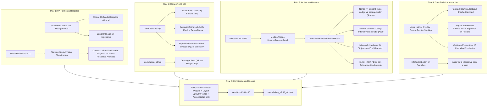
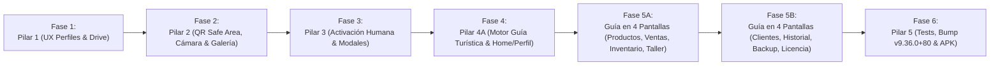

# PLAN MAESTRO 16: REDISEÑO PROFESIONAL DE PERFILES, REINGENIERÍA DEL ESCÁNER QR, EXPERIENCIA HUMANA DE ACTIVACIÓN Y SISTEMA DE GUÍA TURÍSTICA INTERACTIVA INTELIGENTE (COACH MARKS) - VERSIÓN 1.1

**Proyecto:** MochilaLista Mobile Application & MochilaLista Admin  
**Versión Oficial de Release:** `v9.36.0+80` (Reemplaza a `v9.35.0+79`)  
**Fecha de Certificación y Cierre:** 22 de Noviembre de 2026  
**Dispositivo Real de Validación:** Samsung Galaxy A54 5G (Android 14 / One UI 6, Pantalla 1080x2340px @ 120Hz, Navegación de 3 Botones `<, ○, |||`)  
**Estado:** 100% COMPLETADO Y CERTIFICADO (Fases 1, 2, 3, 4, 5A, 5B y 6 Cerradas)

---

## 1. RESUMEN EJECUTIVO Y OBJETIVOS ESTRATÉGICOS

Tras el despliegue exitoso de `mochilalista_v9.35_atp.apk` en pruebas de campo en hardware real (confirmando que el canje del bono `+20 IA` acreditó de forma matemática los créditos sin alterar el vencimiento de la prueba gratuita), se identificaron mediante 6 capturas de pantalla reales fricciones críticas de UX/UI, bloqueos funcionales en la lectura de códigos QR densos y la necesidad estratégica de dotar a la plataforma de un sistema de inducción interactivo (*Coach Marks / Spotlight*) 100% nativo, offline y responsivo.

Este Plan Maestro articula la solución definitiva estructurada en **5 Pilares Obligatorios** y ejecutada en **6 Fases Secuenciales**:
1. **Pilar 1 (UX Perfiles & Respaldo):** Descongestión visual de `ProfileSelectionScreen`, rediseño del Bottom Sheet rápido de Drive (`⋮`), pluralización gramatical estricta y reemplazo de los mensajes planos por un componente modal animado de progreso y confirmación interactiva.
2. **Pilar 2 (Reingeniería QR en Doble Capa):** Blindaje de Safe Area en el modal del escáner (evitando colisión con la barra `<, ○, |||` de Android), controles de linterna/zoom/tap-to-focus para pantallas de PC, pipeline defensivo de decodificación desde galería con inyección de *quiet zone* (15% blanco puro) y adición de margen reglamentario en la plataforma Admin.
3. **Pilar 3 (Activación Humana & Empática):** Eliminación definitiva del SnackBar rojo técnico (`"Nonce 1 <= 1"`) y su artefacto visual de superposición en la AppBar, reemplazándolo por una Hoja/Diálogo Animado de Activación con microanimación de sello y mensajes humanos categorizados según el resultado de validación Ed25519.
4. **Pilar 4 (Guía Turística Interactiva Inteligente):** Motor nativo Flutter (`Overlay` + `CustomPainter` con ventana iluminada y tarjeta flotante con flecha direccional clamped), supresión automática tras restaurar backups, activación manual desde `InfoTooltipButton`, hooks dinámicos para colapsables y catálogo exhaustivo de 10 pantallas principales.
5. **Pilar 5 (Certificación y Release):** Suite de pruebas unitarias y de widgets automatizadas, validación en resoluciones compactas (`320x568dp`, `360x640dp`, `412x915dp`), accesibilidad tipográfica (`textScaleFactor 1.3x`), incremento a `v9.36.0+80` y compilación comercial firmada `mochilalista_v9.36_atp.apk`.

---

## 2. AUDITORÍA FORENSE Y DIAGNÓSTICO DE CAUSA RAÍZ LÍNEA POR LÍNEA

### 2.1 PILAR 1: Diagnóstico en `ProfileSelectionScreen` y Modal Rápido de Drive
* **Ubicación en código:** `app_movil/lib/features/auth/screens/onboarding/profile_selection_screen.dart`
  * **Saturación inferior:** En `_buildNormalBottomSection` (líneas 787-848) y `_buildEmptyState` (líneas 586-628), se observa una concatenación vertical rígida dentro de una columna:
    * Línea 789: `PrimaryButton(text: "CREAR NUEVO NEGOCIO")`
    * Línea 802: `_buildGoogleDriveSection(...)` (contenedor rectangular de altura fija ~64dp)
    * Líneas 804-814: `TextButton` que envuelve `"¿Tienes un archivo local (.mlbg)? Restaurar aquí"`. Al no estar acotado ni centrado, en el Samsung Galaxy A54 se quiebra en dos líneas asimétricas cargadas a la izquierda.
    * Líneas 817-847: `InkWell` con `"Explorar la app sin registrarse (Modo Demo)"` que se extiende horizontalmente casi rozando el borde derecho de la tarjeta contenedora (evidenciado en captura `media_1795310817784_d862a0ff.jpg`).
  * **Texto a simplificar:** Línea 605 y Línea 837 contienen la redundancia `(Modo Demo)`. Debe simplificarse a **`"Explorar la app sin registrarse"`**.
  * **Barra de estado superior (Restricción visual):** La pantalla utiliza `AuthBackground` (`app_movil/lib/core/widgets/auth_background.dart`), el cual dibuja el degradado institucional superior respetando el `SystemUiOverlayStyle` global de la app. **Diagnóstico estricto:** No se debe inyectar ningún `AnnotatedRegion` ni alterar el brillo de la barra superior en `profile_selection_screen.dart`, manteniendo idéntico el comportamiento visual del sistema operativo.
  * **Modal rápido de Google Drive (`⋮`):**
    * Líneas 1109-1303 (`_openDriveQuickOptionsModal`): Muestra 3 `ListTile`s planos con separadores grises estándar sin jerarquía ni animaciones.
    * Línea 1248: `profiles.isNotEmpty ? "Genera una copia inmediata de tus ${profiles.length} perfil(es)" : ...`.
      * **Causa raíz:** Si `profiles.length == 1`, concatena literalmente `"de tus 1 perfil(es)"`, constituyendo un error gramatical evidente para el comerciante.
    * Líneas 1070-1075, 1359-1365 y 1378-1392: El feedback de las operaciones en la nube se delega a `CustomSnackBar.show(context, message: "...", isError: false)`. Un SnackBar verde en la parte superior es insuficiente para una operación crítica de nube: no ofrece visibilidad del progreso de subida ni peso transferido en KB.

---

### 2.2 PILAR 2: Diagnóstico en Modal de Escáner QR, Cámara y Galería
* **Ubicación en código:** `app_movil/lib/features/auth/screens/license/license_status_and_activation_screen.dart`
  * **Colisión de controles inferiores con barra de navegación Android:**
    * Clase `_QrScannerSheet` (líneas 2287-2445).
    * Líneas 2291-2297: `Container(height: MediaQuery.of(context).size.height * 0.75, padding: const EdgeInsets.all(16), ...)`.
    * **Causa raíz:** El widget carece de `SafeArea(bottom: true)` y no computa `math.max(MediaQuery.viewInsetsOf(context).bottom, MediaQuery.viewPaddingOf(context).bottom)`.
    * En el Samsung Galaxy A54 (y en cualquier dispositivo con barra clásica de 3 botones de ~48dp), los botones del sistema (`<, ○, |||`) se superponen físicamente sobre el campo `"O pega el código QR aquí..."` y el botón `"Aplicar"` (evidenciado en captura `media_1795310832861_8f521f09.jpg`).
  * **Fallo al escanear QR desde monitores de PC con cámara en vivo:**
    * Línea 2264: `final MobileScannerController _controller = MobileScannerController();` instanciado sin parámetros.
    * **Causa raíz:** Los tokens Ed25519 de MochilaLista (`ML9-...`) contienen payload JSON con firma criptográfica (~220 a 260 caracteres), resultando en códigos QR densos (versión 7 a 9, más de 45x45 módulos). Al apuntar a pantallas de computadoras, el efecto moiré (interferencia entre la cuadrícula de píxeles del monitor y el sensor de la cámara) y los reflejos impiden que el reconocedor por defecto obtenga contraste adecuado. La UI no dispone de toggle de linterna (`torch`), zoom digital (`1x`, `1.5x`, `2x`) ni tap-to-focus para forzar la convergencia del lente óptico.
  * **Fallo total al subir imagen QR desde galería (`"No se detectó ningún código QR"`):**
    * Líneas 197-234 y líneas 2321-2356:
      ```dart
      final capture = await _controller.analyzeImage(picked.path);
      if (capture != null && capture.barcodes.isNotEmpty) { ... }
      else { CustomSnackBar.show(context, message: "No se detectó ningún código QR en la imagen.", isError: true); }
      ```
    * **Causa raíz en `mochilalista_admin/web/js/admin_app.js`:**
      * Funciones `downloadQrCode()` (líneas 1934-1958) y `btnQuickDownloadQr.onclick` (líneas 2322-2331):
        Exportan el canvas generado por `new QRCode(container, { width: 196, height: 196 })` directamente como archivo PNG (`QR_MochilaLista_...png`).
      * La biblioteca `qrcodejs` genera la imagen con **0 píxeles de margen (*quiet zone*)**. Los patrones de localización en las esquinas tocan exactamente los bordes del archivo PNG.
      * Según el estándar ISO/IEC 18004, un código QR requiere un margen perimetral (*quiet zone*) de al menos 4 módulos en blanco puro. El motor Google ML Kit Barcode Scanner de Android descarta la imagen si los módulos angulares se confunden con el marco exterior, fallando la decodificación antes de extraer el texto (evidenciado en capturas `media_1795310832861_8f521f09.jpg` y `media_1795310844175_da0c5079.jpg`).
      * Además, `app_movil` carece de un pipeline defensivo de preprocesamiento que añada dicho margen en memoria antes de desistir.

---

### 2.3 PILAR 3: Diagnóstico en la Retroalimentación de Activación de Licencias
* **Ubicación en código:**
  * `app_movil/lib/core/services/license/ed25519_license_validator.dart` (líneas 202-208):
    ```dart
    final tokenNonce = (payload['n'] as num?)?.toInt() ?? 0;
    if (tokenNonce <= currentLicense.ultimoNonce) {
      throw Exception(
        "Este código ya fue canjeado previamente o contiene un correlativo vencido (Nonce $tokenNonce <= ${currentLicense.ultimoNonce}).",
      );
    }
    ```
  * `app_movil/lib/core/providers/license_provider.dart` (línea 106):
    `_errorMessage = e.toString().replaceFirst('Exception: ', '');`
  * `app_movil/lib/features/auth/screens/license/license_status_and_activation_screen.dart` (líneas 115-119):
    `CustomSnackBar.show(context, message: licenseProv.errorMessage ?? "Error al validar la licencia.", isError: true);`
  * **Causa raíz:**
    1. Si un usuario vuelve a introducir o escanear el código que acaba de canjear (caso típico al verificar si funcionó), el validador arroja una excepción con nomenclatura técnica de ingeniería criptográfica interna (`Nonce 1 <= 1`), lo cual alarma innecesariamente al comerciante haciéndole creer que su licencia está rota o vencida (evidenciado en captura `media_1795310853920_70b428ca.jpg`).
    2. El widget `CustomSnackBar` (`app_movil/lib/core/widgets/custom_snackbar.dart`) se posiciona en el Overlay en `top: topPadding + 10, left: 20, right: 20`. En pantallas como `LicenseStatusAndActivationScreen`, la AppBar contiene botones de acción a la derecha (`Icons.auto_awesome_outlined` y `Icons.description_outlined`). El banner rojo se superpone de forma desalineada cortando los botones de la barra de título y generando un artefacto visual asimétrico en la esquina superior derecha.

---

### 2.4 PILAR 4: Diagnóstico de la Arquitectura de Ayudas e Inducción Existente
* **Ubicaciones en código:**
  * `app_movil/lib/core/widgets/info_tooltip_button.dart`:
    Widget reutilizable que renderiza un botón con ícono ℹ️ (`Icons.info_outline_rounded`) y despliega `_InfoBottomSheet` mediante `InteractiveSheetWrapper`.
    * Actualmente se encuentra integrado en **24 pantallas y widgets clave** del sistema (p. ej. `inventory_screen.dart`, `product_create_screen.dart`, `catalog_screen.dart`, `backup_screen.dart`, `profile_screen.dart`, `workbench_screen.dart`, `quick_sale_screen.dart`, `sales_history_screen.dart`, `client_tracking_screen.dart`).
    * **Oportunidad arquitectónica:** `_InfoBottomSheet` carece de un disparador para tours interactivos. Integrar un botón de acción primaria `"Iniciar guía interactiva paso a paso"` permitirá al usuario reactivar el recorrido bajo demanda en cualquier momento sin saturar la barra de herramientas.
  * `app_movil/lib/core/utils/backup_manager.dart` (línea 264), `app_movil/lib/features/profile/widgets/google_drive_backup_sheet.dart` (línea 430) y `app_movil/lib/features/auth/screens/onboarding/widgets/profile_restore_handler.dart`:
    * Al ejecutarse una restauración exitosa de respaldo (Drive o `.mlbg`), el comerciante ya conoce el funcionamiento del sistema. Si los tutoriales vuelven a dispararse solos, degradan severamente la experiencia de usuario. Se requiere un hook centralizado de supresión de tours automáticos tras cualquier restauración confirmada.

---

## 3. ARQUITECTURA TÉCNICA DETALLADA POR PILARES



---

### 3.1 PILAR 1: Rediseño Profesional de `ProfileSelectionScreen`, Modal Rápido de Drive y Feedback Animado
1. **Reorganización Estructural de `ProfileSelectionScreen`:**
   * **Jerarquía Superior:** Mantiene el Hero del logo institucional, el título `"MochilaLista"` y el subtítulo animado (`AnimatedSwitcher`) dentro de `AuthBackground`. Se conserva inalterado el estilo de la barra de estado superior.
   * **Área Central de Negocios:** Tarjeta blanca/oscura con bordes de 32px y sombra flotante suave.
     * Cabecera interna: Selector de modo o botón `"Gestionar"` alineado a la derecha.
     * Lista de perfiles: `ReorderableListView` con elevación táctil en arrastre y soporte visual para badges de PIN y último negocio activo.
   * **Bloque Inferior Unificado (Adiós apiñamiento):**
     * **CTA Primario:** `PrimaryButton(text: "CREAR NUEVO NEGOCIO", icon: Icons.add_business_rounded)`.
     * **Módulo Unificado de Respaldo y Restauración:**
       Un único contenedor estilizado con fondo tintado suave (`isDark ? Color(0xFF1E222A) : Color(0xFFF8FAFC)`) y borde sutil:
       * Si Drive está vinculado: fila principal con avatar Google, correo en negrita, píldora reactiva de salud (`Al día • 3/5 copias` + hora local) y botón táctil `Icons.more_vert_rounded`. En la base del contenedor, un divisor ultradelgado y un acceso discreto y elegante: `Icon(Icons.folder_open_rounded)` + `"Restaurar respaldo local (.mlbg)"`.
       * Si Drive no está vinculado: botón unificado con dos opciones claras: `"Vincular Google Drive"` y `"Restaurar archivo local (.mlbg)"`.
     * **Acceso Modo Explorador:** Botón centrado en la parte inferior con suficiente espaciado:
       * Ícono: `Icons.explore_outlined`.
       * Texto limpio y conciso: **`"Explorar la app sin registrarse"`** (eliminando definitivamente el añadido `(Modo Demo)`).
2. **Rediseño del Bottom Sheet Rápido de Google Drive (`⋮`):**
   * **Cabecera Enriquecida:** Avatar circular con inicial o foto de Google, dirección de correo completa, badge de salud con semáforo cromático y fecha/hora legible de la última copia sincronizada.
   * **Tarjetas de Acción Interactivas (reemplazando `ListTile`s planos):**
     * *Acción 1: Ver y Restaurar Copias de la Nube:* Tarjeta con fondo azul cielo tintado, ícono `Icons.history_rounded`, título en negrita y subtítulo dinámico con contador de copias.
     * *Acción 2: Respaldar Ahora en Google Drive:* Tarjeta con fondo verde esmeralda tintado, ícono `Icons.cloud_upload_rounded`, título en negrita y **pluralización gramatical estricta**:
       * 1 negocio: `"Genera una copia inmediata de tu negocio"`
       * >1 negocios: `"Genera una copia inmediata de tus ${profiles.length} negocios"`
     * *Acción 3: Desvincular Cuenta de Google:* Tarjeta con borde rojo suave, ícono `Icons.link_off_rounded` y texto de confirmación no destructiva (*"Tus copias en la nube se mantendrán intactas"*).
   * **Entrada escalonada:** Animación suave con `TweenAnimationBuilder` para cada tarjeta (retraso incremental de 50ms).
3. **Nuevo Feedback Dinámico e Interactivo (`DriveActionFeedbackModal`):**
   * Al pulsar "Respaldar Ahora", "Restaurar Copia" o "Vincular Cuenta", no se usará un SnackBar plano ni un overlay bloqueante opaco con spinner genérico.
   * Se despliega una hoja interactiva animada con dos fases:
     * **Fase A (Progreso en Vivo):** Indicador circular con rotación suave, ícono dinámico y texto de etapa explicativa:
       * *"Empaquetando base de datos SQLite y preferencias..."*
       * *"Cifrando archivo con clave de bóveda local..."*
       * *"Subiendo copia de seguridad segura a Google Drive..."*
     * **Fase B (Resultado Celebratorio / Informativo):** Transición automática mediante `AnimatedSwitcher`:
       * Ícono de éxito con microanimación de escala elástica (`Icons.cloud_done_rounded` en verde esmeralda).
       * Título: **`"¡Copia respaldada con éxito!"`**
       * Metadatos reales: Peso transferido (ej. `45.8 KB`), hora local exacta (ej. `Hoy, 5:45 p. m.`), contador actualizado (`3/5 copias disponibles`).
       * Botón de acción: **`Listo`** (con cierre automático opcional tras 4 segundos).
     * **Fase Error:** Si ocurre un fallo de red o permisos, ícono ámbar/rojo con explicación amigable y botón **`Reintentar`**.
   * Blindaje con `SafeArea(bottom: true)` y `0px Overflow` en cualquier densidad de pantalla.

---

### 3.2 PILAR 2: Reingeniería del Modal `Escanear Código QR` y Pipeline de Galería / Admin
1. **Blindaje de Layout y Safe Area en `_QrScannerSheet`:**
   * Envoltura con `SafeArea(bottom: true)`.
   * Padding inferior reactivo:
     `bottomPadding = math.max(MediaQuery.viewInsetsOf(context).bottom, MediaQuery.viewPaddingOf(context).bottom) + 16.0`.
   * Esto garantiza que en el Samsung Galaxy A54 (y cualquier Android con navegación de 3 botones clásica de 48dp), el campo `"O pega el código QR aquí..."` y el botón azul `"Aplicar"` respiren holgadamente a 16dp por encima de la barra del sistema, y se eleven automáticamente cuando el teclado virtual se despliegue.
2. **Mejoras del Visor de Cámara para Lectura en Pantalla de PC:**
   * Marco del visor estilizado con esquinas neon redondeadas (radio 20dp, trazo de 3dp) y línea horizontal animada de escaneo (*laser scan beam*) con gradiente cyan.
   * Controles flotantes accesibles sobre el visor:
     * **Linterna:** Botón circular con toggle `_controller.toggleTorch()`.
     * **Zoom rápido por chips:** Selector directo `1.0x` / `1.5x` / `2.0x` mapeado al rango real de `setZoomScale` (`0.0..1.0`) según la versión de `mobile_scanner: ^6.0.4` instalada, para ampliar el código denso en monitores sin necesidad de acercar físicamente el teléfono, reduciendo el moiré.
     * **Tap-to-Focus:** `GestureDetector` sobre el área del visor para forzar el enfoque de la cámara en el punto exacto donde el comerciante toque.
3. **Pipeline Defensivo Multi-Paso para Lectura desde Galería (`QrGalleryDecoderService`):**
   * Encapsulado en un servicio especializado en `app_movil/lib/core/services/scanner/qr_gallery_decoder_service.dart`:
     * **Paso 1 (Lectura Directa):** Llama a `_controller.analyzeImage(originalPath)`. Si detecta el código `ML9-...`, retorna el resultado.
     * **Paso 2 (Inyección de Margen Blanco / Quiet Zone):** Si el Paso 1 retorna nulo o vacío (típico de imágenes con 0px margin), carga la imagen con el paquete `image: ^4.2.0` (ya presente en el proyecto):
       * Obtiene dimensiones `w` y `h`.
       * Calcula un margen blanco del 15% al 20% (mínimo 32 píxeles).
       * Genera un nuevo canvas de imagen rellenado con blanco puro (`0xFFFFFFFF`) y compone la imagen original en el centro.
       * Exporta a un archivo temporal en `getTemporaryDirectory()`.
       * Re-analiza con `_controller.analyzeImage(tempPath)`.
     * **Paso 3 (Ajuste de Escala / Binarización):** Si el Paso 2 no decodifica (por ejemplo, si la imagen es una credencial completa con fondo complejo), recorta el área central de alto contraste y reintenta.
     * **Limpieza Garantizada:** En bloque `finally`, elimina cualquier archivo temporal generado en disco.
     * Al decodificar el token `ML9-...`, lo envía directamente al validador de licencias. Si el código ya fue canjeado, el usuario verá el diálogo amigable del Pilar 3 y **nunca más** el falso error `"No se detectó ningún código QR"`.
4. **Mejora Complementaria en Plataforma Web (`mochilalista_admin/web/js/admin_app.js`):**
   * En `downloadQrCode()`, `btnQuickDownloadQr.onclick` y todos los puntos de descarga "Solo QR" (Generador, Ficha 360° y modal rápido):
     * Crear un elemento `<canvas>` temporal en memoria con dimensiones `(qrSize + 64) x (qrSize + 64)`.
     * Pintar fondo blanco puro `#FFFFFF`.
     * Dibujar el QR centrado con un margen de seguridad de 32px en los cuatro lados.
     * Exportar el DataURL PNG resultante. Esto asegura que cualquier imagen descargada como "Solo QR" cuente con *quiet zone* reglamentaria desde su origen.

---

### 3.3 PILAR 3: Experiencia Humana, Clara y Animada de Activación de Licencias
1. **Tipado Fuerte del Resultado de Validación de Licencia:**
   * En `ed25519_license_validator.dart` y `license_repository.dart`, reemplazar los lanzamientos de excepciones genéricas con strings crudos por una estructura tipada:
     * `enum LicenseRedeemStatus`:
       * `success`
       * `alreadyRedeemedSameNonce` (`tokenNonce == currentLicense.ultimoNonce`)
       * `superseededOlderNonce` (`tokenNonce < currentLicense.ultimoNonce`)
       * `hardwareMismatch` (`tokenDeviceId != currentDeviceId`)
       * `signatureInvalid` / `tampered`
       * `invalidFormat`
     * `class LicenseRedeemResult` con campos: `status`, `message`, `tokenNonce`, `currentNonce`, `tokenDeviceId`, `currentDeviceId`, `plan`, `daysAdded`, `aiCreditsAdded`, `newExpirationDate`.
2. **Modal Interactivo Animado de Estado de Activación (`LicenseActivationFeedbackModal`):**
   * Se invoca en `license_status_and_activation_screen.dart` tanto al pegar texto como al escanear QR (cámara o galería).
   * Diseño modal centrado con bordes de 24px, microanimación de escala con rebote (`TweenAnimationBuilder` con `Curves.easeOutBack`) para dar sensación de documento oficial sellado:
     * **Caso 1: Código ya canjeado en este celular (`nonce == currentNonce`):**
       * Ícono: `Icons.check_circle_rounded` en color azul corporativo o ámbar suave.
       * Título: **`"Este código ya está aplicado"`**
       * Mensaje: *"Este código de activación ya fue canjeado anteriormente en tu celular. Tu beneficio ya forma parte de tu licencia actual y no necesitas volver a ingresarlo."*
       * Tarjeta resumen con el estado vigente: *Plan actual • Vence: dd/mm/aaaa • Escaneos IA disponibles*.
       * Referencia discreta de soporte en gris: `"Ref. soporte: #X (sin la palabra técnica Nonce visible)"`.
       * Botón: **`Entendido`**.
     * **Caso 2: Código antiguo superado (`nonce < currentNonce`):**
       * Ícono: `Icons.history_rounded` en azul índigo.
       * Título: **`"Código anterior ya superado"`**
       * Mensaje: *"Tu celular ya cuenta con un código más reciente emitido posteriormente. Conservas tu licencia vigente sin alteraciones."*
       * Botón: **`Entendido`**.
     * **Caso 3: Código de otro celular (Mismatch de `Hardware ID`):**
       * Ícono: `Icons.phonelink_erase_rounded` en naranja advertencia.
       * Título: **`"Código emitido para otro celular"`**
       * Mensaje: *"Este código pertenece al dispositivo '$tokenDeviceId'. El Hardware ID de este celular es:"*
       * Bloque interactivo con el Hardware ID actual (`ML-379E`) y botón de copiado rápido al portapapeles.
       * Botón secundario: **`Contactar a Soporte`** (abre WhatsApp con mensaje pre-rellenado para solicitar migración).
     * **Caso 4: Código inválido o incompleto:**
       * Ícono: `Icons.error_outline_rounded` en rojo carmesí suave.
       * Título: **`"Código no reconocido"`**
       * Mensaje: *"Verifica que el código comience con 'ML9-' y esté copiado completo, o escanea el QR oficial asegurando buena iluminación."*
       * Botón: **`Reintentar`**.
     * **Caso 5: Activación Exitosa:**
       * Ícono: `Icons.verified_rounded` en verde esmeralda con microanimación celebratoria.
       * Título: **`"¡Licencia Activada con Éxito!"`**
       * Desglose visual de beneficios:
         * Badge del Plan (Suscripción, Perpetuo o Bono IA).
         * Si agregó días: *`+30 días` (Nueva fecha de vencimiento: dd/mm/aaaa)*.
         * Si acreditó IA: *`+20 escaneos IA acreditados`*.
       * Botón: **`Comenzar a Usar`**.
3. **Eliminación del Banner Rojo y Corrección del Artefacto Visual:**
   * Al migrar el feedback a este modal interactivo dedicado, se elimina la llamada a `CustomSnackBar.show` en los flujos de activación.
   * En `CustomSnackBar`, se ajusta el margen y safe area para evitar cualquier conflicto futuro con iconos de AppBar.

---

### 3.4 PILAR 4: Sistema de Guía Turística Interactiva Inteligente (*Interactive Spotlight / Coach Marks*)
1. **Arquitectura del Motor Nativo en Flutter (100% Offline y sin dependencias externas):**
   * Implementado en `app_movil/lib/core/widgets/tour/`:
     * `interactive_tour_overlay.dart`: Orquestador sobre `Overlay` de Flutter.
     * `spotlight_painter.dart`: `CustomPainter` que utiliza operaciones booleanas de `Path.combine(PathOperation.difference, ...)` para recortar el área del widget objetivo con bordes redondeados y dibujar un marco perimetral con brillo cyan/turquesa (según la referencia visual `GhostWriter`).
     * `tour_step_model.dart`: Define cada paso del recorrido (`targetKey`, `title`, `description`, `icon`, `tip`, `onBeforeStep`, `onAfterStep`).
     * `coach_card_widget.dart`: Tarjeta flotante interactiva con flecha direccional dinámica.
2. **Ingeniería de Responsividad Matemática Total:**
   * **Viewport Seguro:**
     * `safeTop = MediaQuery.viewPaddingOf(context).top + 8.0`
     * `safeBottom = MediaQuery.sizeOf(context).height - MediaQuery.viewPaddingOf(context).bottom - MediaQuery.viewInsetsOf(context).bottom - 16.0`
   * **Posicionamiento Adaptativo de la Tarjeta:**
     * Se calcula el espacio superior disponible (`spaceAbove = targetRect.top - safeTop`) y el espacio inferior disponible (`spaceBelow = safeBottom - targetRect.bottom`).
     * Si `spaceBelow >= 220` (o `spaceBelow >= spaceAbove`): la tarjeta se posiciona **debajo** del widget, con la flecha apuntando hacia arriba.
     * Si `spaceAbove >= 220`: la tarjeta se posiciona **arriba** del widget, con la flecha apuntando hacia abajo.
     * Si el widget ocupa la mayor parte de la pantalla (ej. listado grande o visor): modo superpuesto de emergencia centrado con flecha oculta.
     * La tarjeta tiene `maxWidth = math.min(screenWidth - 32.0, 380.0)` y altura acotada con `SingleChildScrollView` interno en el texto descriptivo, garantizando **cero overflows (`0px Overflow`)** en pantallas ultra-compactas de `320x568dp`, `360x640dp` y con fuentes aumentadas (`textScaleFactor: 1.3`).
   * **Flecha Direccional Clamped:**
     * `arrowX = targetRect.center.dx.clamp(cardLeft + 24.0, cardRight - 24.0)`. La flecha apunta siempre exactamente al elemento objetivo, sin salirse jamás del cuerpo redondeado de la tarjeta.
   * **Hooks Dinámicos y Auto-Scroll:**
     * En cada paso, se invoca `Scrollable.ensureVisible` con animación fluida antes de renderizar el spotlight.
     * En pantallas con elementos colapsables (como `ProductCreateScreen`), el hook `onBeforeStep` expande la sección requerida para explicarla y `onAfterStep` la contrae si aplica.
3. **Reglas de Disparo Inteligente y Persistencia:**
   * **Primera vez en cada pantalla:**
     * Al ingresar por primera vez a una pantalla soportada, aparece una tarjeta modal compacta de bienvenida:
       * Título: *"Bienvenido a [Nombre de Pantalla]"*
       * Resumen claro en 1-2 frases del objetivo de esa pantalla.
       * Botón principal: **`Guíame`** (inicia el tour interactivo).
       * Botón secundario: **`Omitir`** (cierra y marca la pantalla como vista).
       * Enlace inferior: *"Omitir todas las guías"*.
   * **Supresión Automática tras Restauración de Copia de Seguridad:**
     * En `BackupManager.restoreBackupFromFilePath`, `GoogleDriveBackupSheet.executeDirectRestore` y `profile_restore_handler.dart`:
       Al confirmarse cualquier restauración exitosa (Google Drive o `.mlbg` local), se ejecuta:
       `await InteractiveTourService.suppressAutomaticToursAfterRestore();`
       Esto marca permanentemente todas las guías automáticas como completadas en `SharedPreferences`, respetando que el comerciante ya conoce el sistema.
   * **Activación Manual Bajo Demanda desde `InfoTooltipButton`:**
     * En `app_movil/lib/core/widgets/info_tooltip_button.dart`, se añade en el modal `_InfoBottomSheet` el botón:
       `ElevatedButton.icon(icon: Icon(Icons.explore_rounded), label: Text("Iniciar guía interactiva paso a paso"), ...)`
     * Permite a cualquier usuario (incluso tras restaurar backup o haber omitido la guía) lanzar el recorrido completo en cualquier momento.
   * **Control Adicional en Perfil / Configuración:**
     * En `ProfileScreen`, se incluye la opción `"Reiniciar guías de aprendizaje"` para volver a ver los recorridos automáticos si el comerciante lo desea.
   * **Blindaje contra Ruptura de Tests:**
     * `InteractiveTourService` verifica si el entorno de ejecución es de pruebas (`WidgetsBinding.instance.runtimeType.toString().contains('Test') || (InteractiveTourService.autoTriggerOverrideForTesting == false)` o flag `isTourDisabledForTesting = true`), inhibiendo el auto-disparo para no interferir con las aserciones de la suite de tests existente.

---

## 4. CATÁLOGO COMPLETO DE PANTALLAS PRINCIPALES PARA LA GUÍA INTERACTIVA

A continuación se detalla el catálogo exhaustivo de las 10 pantallas principales de alta densidad de `app_movil`, sus archivos de implementación, el estado de integración de `InfoTooltipButton` y los pasos estructurados para cada recorrido:

| # | Pantalla / Módulo | Archivo de Implementación | Estado `InfoTooltipButton` | Pasos Concisos del Recorrido (4 a 6) | Reglas Clave y Secciones Dinámicas |
|---|---|---|---|---|---|
| **1** | **Pantalla Principal (Inicio / Dashboard)** | `app_movil/lib/core/screens/home_screen.dart` | Integrar en `DashboardHeader` | 1. Negocio activo y sincronización<br>2. OmniSearch universal (nombre/código de barras)<br>3. Semáforo de licencia y cuota IA<br>4. Alertas de stock inteligente<br>5. Cuadrícula de accesos directos<br>6. Barra de navegación inferior | Vista general de operaciones diarias y acceso a módulos. |
| **2** | **Perfil y Configuración del Negocio** | `app_movil/lib/features/profile/screens/profile_screen.dart` | Ya integrado | 1. Identidad comercial (RUC/DNI, logo, razón social)<br>2. Bóveda de seguridad y PIN de 4 dígitos<br>3. Configuración de impresora térmica Bluetooth<br>4. Respaldos en Google Drive y exportación local<br>5. Estado de licencia y soporte oficial | Enseña que los cambios fiscales impactan en cotizaciones y recibos impresos. |
| **3** | **Crear / Editar Producto** | `app_movil/lib/features/catalog/screens/product_create_screen.dart` | Ya integrado | 1. Nombre, categoría y marca comercial<br>2. Código de barras (manual o escáner de cámara)<br>3. Modo de stock (Compartido vs Por Presentación)<br>4. Presentaciones y chips de redondeo (.50, .90, .00)<br>5. Opciones avanzadas (costos, mermas y proveedores)<br>6. Guardado y persistencia en memoria | **Hook dinámico:** Despliega y contrae opciones avanzadas.<br>**Regla crítica:** Pulsar Atrás conserva el borrador en memoria; cerrar la app lo borra. |
| **4** | **Punto de Venta / Venta Rápida / Carrito** | `app_movil/lib/features/smart_quotation/screens/quick_sale_screen.dart` & `sales_checkout_screen.dart` | Ya integrado | 1. Buscador rápido y selector por código de barras<br>2. Carrito dinámico (cantidades, presentaciones, precios)<br>3. Asignación de cliente o venta al paso<br>4. Métodos de cobro (Efectivo, Yape/Plin, Transferencia, Fiado)<br>5. Emisión de ticket térmico o envío por WhatsApp | Enseña a registrar ventas en segundos y controlar créditos/fiados. |
| **5** | **Inventario y Catálogo de Productos** | `app_movil/lib/features/catalog/screens/inventory_screen.dart` & `catalog/catalog_screen.dart` | Ya integrado | 1. Filtros por categorías, marcas y nivel de existencias<br>2. Ajuste rápido de stock sin editar producto completo<br>3. Catálogo visual para atención al cliente<br>4. Menú de variantes, duplicación y bajas<br>5. Exportación de inventario en PDF/Excel | Guía para auditorías físicas y reposición oportuna de mercadería. |
| **6** | **Cotizador Escolar Inteligente con IA** | `app_movil/lib/features/smart_quotation/screens/workbench_screen.dart` & `scan_screen.dart` | Ya integrado | 1. Mesa de trabajo de cotizaciones activas e históricas<br>2. Escaneo inteligente de lista escolar con Gemini AI<br>3. Emparejamiento automático (*matching*) con tu catálogo<br>4. Ajuste fino de útiles y precios sugeridos<br>5. Generación de PDF formal con membrete comercial<br>6. Compartir presupuesto inmediato vía WhatsApp | Maximiza ventas en campaña escolar automatizando la lectura de listas. |
| **7** | **Clientes, Créditos y Fiados (CRM)** | `app_movil/lib/features/smart_quotation/screens/crm/client_tracking_screen.dart` & `client_detail_screen.dart` | Ya integrado | 1. Directorio general y búsqueda por teléfono/nombre<br>2. Semáforo de morosidad y saldo total deudor<br>3. Registro de abonos parciales y amortizaciones<br>4. Enlace directo a WhatsApp para cobros amigables<br>5. Configuración de límite de crédito individual | Gestión financiera sana evitando incobrables. |
| **8** | **Historial de Ventas, Reportes y Caja** | `app_movil/lib/features/smart_quotation/screens/sales_history_screen.dart` & `app_movil/lib/features/analytics/screens/analytics_dashboard_screen.dart` | Ya integrado | 1. Filtros cronológicos (hoy, semana, mes, rango)<br>2. Totales por método de pago (Efectivo vs Digital)<br>3. Detalle de comprobante y cálculo de utilidad neta<br>4. Anulaciones seguras con retorno al stock físico<br>5. Arqueo y cierre de caja diario | Control exacto de ingresos y cuadre financiero al final de la jornada. |
| **9** | **Respaldos y Seguridad en la Nube** | `app_movil/lib/features/profile/screens/backup_screen.dart` & `business_backup_screen.dart` | Ya integrado | 1. Diagnóstico de salud de respaldo (semáforo reactivo)<br>2. Sincronización automática con Google Drive<br>3. Respaldo manual en archivo local `.mlbg`<br>4. Asistente guiado de restauración de copias<br>5. Políticas de retención (5 copias máximas rotativas) | Seguridad patrimonial del comerciante ante robo o cambio de equipo. |
| **10** | **Licencia y Activación Comercial** | `app_movil/lib/features/auth/screens/license/license_status_and_activation_screen.dart` | Integrar en AppBar | 1. Estado del plan (Trial, Mensual, Semestral, Perpetuo)<br>2. Contador de escaneos IA disponibles<br>3. Hardware ID del dispositivo (copiado y soporte)<br>4. Activación dual (Escanear QR oficial o pegar código)<br>5. Contacto directo con Julio Angello Vasquez Navarro | Enseña a renovar la licencia y adquirir bonos IA adicionales. |

---

## 5. PLAN DE FASES SECUENCIALES DE IMPLEMENTACIÓN

Para garantizar una ejecución impecable sin interferir con las funcionalidades operativas existentes, el trabajo se dividirá en **6 fases secuenciales estrictas**:



---

### FASE 1: Rediseño Profesional de `ProfileSelectionScreen`, Modal Rápido de Drive y Feedback Animado
* **Objetivos específicos:**
  1. Rediseñar la zona inferior de `ProfileSelectionScreen`:
     * Agrupar armoniosamente Google Drive y el acceso local `.mlbg` en una tarjeta compacta y elegante.
     * Simplificar el texto del modo explorador a **`"Explorar la app sin registrarse"`** (eliminando `(Modo Demo)`).
     * Mantener intacto el color y `SystemUiOverlayStyle` de la barra de estado superior en `AuthBackground`.
  2. Rediseñar el Bottom Sheet rápido de Google Drive (`⋮`):
     * Reemplazar los 3 `ListTile`s planos por tarjetas interactivas elevadas y bordeadas con entrada escalonada suave.
     * Corregir la concordancia gramatical: `"tu negocio"` (1 perfil) vs `"tus X negocios"` (>1 perfiles).
  3. Crear el componente modal de feedback interactivo animado (`DriveActionFeedbackModal`):
     * Progreso en vivo con mensajes descriptivos.
     * Transición con `AnimatedSwitcher` a resultado celebratorio mostrando peso en KB, fecha/hora y contador `X/5 copias`.
     * Manejo amigable de errores con botón reintentar y protección de `SafeArea`.
* **Criterios de aceptación:**
  * `0px Overflow` en `320x568dp` y `360x640dp`.
  * La barra de navegación Android no oculta ningún elemento interactivo.

---

### FASE 2: Reingeniería del Modal `Escanear Código QR`, Cámara y Pipeline de Galería / Admin
* **Objetivos específicos:**
  1. Blindar el layout de `_QrScannerSheet` en `license_status_and_activation_screen.dart`:
     * Aplicar `SafeArea(bottom: true)` y padding dinámico considerando `viewInsets.bottom` y `viewPadding.bottom`.
     * Garantizar que el input de pegado manual y el botón `"Aplicar"` respiren 16dp por encima de la barra `<, ○, |||`.
  2. Potenciar el visor de cámara para lectura en monitores de PC:
     * Marco con esquinas neon y animación de haz de escaneo láser.
     * Controles directos de **Linterna (Flash)**, **Zoom rápido (1.0x / 1.5x / 2.0x)** y **Tap-to-Focus**.
  3. Construir `QrGalleryDecoderService` en `app_movil`:
     * Pipeline multi-paso: decodificación directa -> inyección de margen blanco (*quiet zone* de 15% blanco puro `#FFFFFF` con el paquete `image`) -> recorte/contraste -> limpieza de temporales.
     * Envío del código obtenido directamente al validador de licencias.
  4. Optimizar el exportador `"Descargar Solo QR"` en `mochilalista_admin/web/js/admin_app.js`:
     * Dibujar el QR centrado sobre un canvas con 32px de margen blanco puro `#FFFFFF` perimetral antes de descargar el archivo PNG.
* **Criterios de aceptación:**
  * La lectura de códigos QR densos en pantallas de PC responde con nitidez usando zoom 1.5x/2x.
  * Una imagen de QR descargada desde Admin o WhatsApp con 0px margen es leída exitosamente por la galería sin disparar falso error.

---

### FASE 3: Experiencia Humana, Clara y Animada de Activación de Licencias
* **Objetivos específicos:**
  1. Tipar fuertemente las respuestas de validación criptográfica en `ed25519_license_validator.dart` (`LicenseRedeemResult` y `LicenseRedeemStatus`).
  2. Implementar `LicenseActivationFeedbackModal` con microanimación de sello elástico.
  3. Mapear con precisión los 5 escenarios:
     * Código ya aplicado (`nonce == currentNonce`): Estado ámbar/azul con mensaje *"Este código ya está aplicado"* y detalle de soporte discreto.
     * Código anterior superado (`nonce < currentNonce`): Mensaje *"Código anterior ya superado"*.
     * Hardware ID mismatch: Muestra Hardware ID actual (`ML-379E`) con botón copiar y enlace a WhatsApp de soporte.
     * Código incompleto/inválido: Guía de revisión y botón reintentar.
     * Activación exitosa: Resumen celebratorio con días agregados y escaneos IA acreditados.
  4. Eliminar el SnackBar rojo agresivo y corregir el artefacto visual de superposición en la esquina superior derecha de la AppBar.
* **Criterios de aceptación:**
  * Al reintentar canjear un código ya activo, no aparece ningún mensaje de error rojo ni la palabra técnica "Nonce".
  * Cero solapamientos en la AppBar.

---

### FASE 4: Motor Nativo de Guía Turística Interactiva (*Coach Marks*) y Pantallas Troncales
* **Objetivos específicos:**
  1. Desarrollar el motor Flutter 100% nativo y offline (`interactive_tour_overlay.dart`, `spotlight_painter.dart`, `coach_card_widget.dart`).
  2. Implementar la matemática de responsividad: cálculo de espacio arriba vs abajo, flecha clamped con centro geométrico del objetivo, scroll automático antes de cada paso y contención anti-overflow con `SingleChildScrollView`.
  3. Crear el servicio de persistencia y reglas de negocio (`InteractiveTourService`):
     * Diálogo de bienvenida en el primer ingreso a cada pantalla (`Guíame` vs `Omitir`).
     * Hook de supresión automática tras restaurar respaldo en `BackupManager`, `GoogleDriveBackupSheet` y `profile_restore_handler.dart`.
     * Integración con `InfoTooltipButton` para lanzamiento manual bajo demanda (`"Iniciar guía interactiva paso a paso"`).
     * Opción de reinicio de guías en `ProfileScreen`.
     * Flag de omisión en entorno de pruebas unitarias.
  4. Implementar los recorridos en las dos pantallas troncales:
     * **Pantalla 1:** `HomeScreen` (6 pasos).
     * **Pantalla 2:** `ProfileScreen` (5 pasos).
* **Criterios de aceptación:**
  * Tarjetas y flechas se posicionan matemáticamente sin salirse de pantalla en `320x568dp`, `360x640dp` y `412x915dp`.
  * Un restore de backup inhibe automáticamente la aparición no deseada de las guías.

---

### FASE 5A: Despliegue de Guía Interactiva en Pantallas Operativas (Productos, Ventas, Inventario, Taller)
* **Objetivos específicos:**
  1. Implementar la guía interactiva en el primer bloque operativo de 4 pantallas:
     * **Pantalla 3:** `ProductCreateScreen` / `ProductEditScreen` (con hooks de despliegue dinámico de opciones avanzadas y explicación de la regla de guardado en memoria vs cierre de app).
     * **Pantalla 4:** `QuickSaleScreen` / `SalesCheckoutScreen` (Punto de venta y carrito).
     * **Pantalla 5:** `InventoryScreen` / `CatalogScreen` (Inventario y catálogo visual).
     * **Pantalla 6:** `WorkbenchScreen` / `ScanScreen` (Cotizador escolar e IA).
  2. Integrar el botón flotante / manual en el `InfoTooltipButton` de cada una de estas 4 pantallas.
* **Criterios de aceptación:**
  * Tours 100% funcionales tanto en primer ingreso como bajo demanda sin provocar regresiones ni fallos de renderizado.

---

### FASE 5B: Despliegue de Guía Interactiva en Pantallas de Gestión y Seguridad (Clientes, Historial, Backup, Licencia)
* **Objetivos específicos:**
  1. Implementar la guía interactiva en el segundo bloque de 4 pantallas:
     * **Pantalla 7:** `ClientTrackingScreen` / `ClientDetailScreen` (Clientes y fiados).
     * **Pantalla 8:** `SalesHistoryScreen` / `AnalyticsDashboardScreen` (Historial de ventas y caja).
     * **Pantalla 9:** `BackupScreen` / `BusinessBackupScreen` (Respaldos en la nube y local).
     * **Pantalla 10:** `LicenseStatusAndActivationScreen` (Licencia y activación).
  2. Integrar el acceso manual en sus respectivos `InfoTooltipButton`.
* **Criterios de aceptación:**
  * Las 10 pantallas principales de la app disponen de su guía interactiva completa, enriquecida y contextual.

---

### FASE 6: Certificación Automatizada, Compatibilidad y Release Comercial (`v9.36.0+80`)
* **Objetivos específicos:**
  1. Diseñar y ejecutar suite de pruebas automatizadas en `app_movil/test/`:
     * `profile_selection_redesign_test.dart`: Validación de layout sin overflow, texto simplificado y pluralización de Drive.
     * `qr_scanner_safe_area_test.dart`: Validación de Safe Area inferior con barra de 48dp y teclado desplegado.
     * `qr_gallery_quiet_zone_pipeline_test.dart`: Decodificación exitosa de imagen con 0px quiet zone mediante el preprocesador `image`.
     * `license_activation_feedback_modal_test.dart`: Asertar los 5 estados del modal interactivo (código ya aplicado, código superado, mismatch de hardware, código inválido y éxito celebratorio).
     * `interactive_spotlight_tour_test.dart`: Comprobación matemática de responsividad, clamping de flechas, supresión en restore y compatibilidad con `textScaleFactor: 1.3`.
  2. Ejecutar prueba unitaria en `mochilalista_admin/test/` para el margen de exportación de QR.
  3. Ejecutar suite de regresión completa de `app_movil`.
  4. Incrementar versión a `9.36.0+80` en `pubspec.yaml` y actualizar `AppChangelogRegistry`.
  5. Compilar el paquete comercial final firmado y entregar en la ruta oficial de biblioteca:
     `C:\Users\vjuli\Documents\v-app-offline apks\mochilalista_v9.36_atp.apk` (junto a sus dos archivos informativos de release `mochilalista_v9.36_atp.txt` y `mochilalista_v9.36_atp_cambios.txt`).
     Sincronizar `owner_legal_identity.dart`, `app_changelog_registry.dart` y `05_MANUAL_OPERATIVO_DEL_PROPIETARIO_Y_COMANDOS_RELEASE.md`, respetando estrictamente que **NO se deben tocar** bases de datos ni carpetas protegidas (`data/prod_*`, `private_keys/`).
* **Criterios de aceptación:**
  * 100% de tests unitarios y de widgets aprobados.
  * APK compilado sin errores con firma release y SHA-256 verificado.

---

## 6. MATRIZ DE RIESGOS Y MEDIDAS DE CONTENCIÓN

| Riesgo Técnico / Operativo | Impacto | Probabilidad | Medida Defensiva de Contención |
|---|---|---|---|
| **Colisión del Overlay del Tour con Teclados Virtuales** | Alto | Media | Computar `MediaQuery.viewInsetsOf(context).bottom` en tiempo real; si el teclado se abre durante el tour, cerrar automáticamente el paso o reposicionar la tarjeta a la mitad superior visible. |
| **Fallo de memoria al preprocesar imágenes gigantes de galería** | Medio | Baja | En `QrGalleryDecoderService`, limitar el reescalado a una resolución máxima de 1024x1024px antes de inyectar el margen blanco de 15%, liberando inmediatamente los buffers de memoria con `img.Image`. |
| **Incompatibilidad de fuentes grandes (`textScaler > 1.3`) en pantallas pequeñas** | Alto | Media | Forzar en `coach_card_widget.dart` una restricción de altura máxima con `ConstrainedBox` y envolver el texto descriptivo en un `SingleChildScrollView` con física de rebote, impidiendo que los botones de navegación queden fuera de la vista. |
| **Ruptura de tests automatizados existentes por aparición inesperada del Tour** | Crítico | Alta | Implementar guardia estricta en `InteractiveTourService`: si `WidgetsBinding.instance.runtimeType.toString().contains('Test') || (InteractiveTourService.autoTriggerOverrideForTesting == false)` o `isTourDisabledForTesting == true`, omitir todo disparo automático sin afectar el árbol de widgets de los tests. |
| **Confusión del comerciante si no encuentra cómo volver a ver la guía** | Medio | Media | Además del diálogo inicial de bienvenida, centralizar el lanzamiento manual en el botón ℹ️ (`InfoTooltipButton`) ya familiar para los comerciantes en todas las pantallas. |

---

## 7. CONCLUSIÓN Y SIGUIENTE PASO

Este Plan Maestro establece una hoja de ruta forense, blindada y de alta calidad para elevar la experiencia visual, la fiabilidad del escáner QR y la inducción de nuevos usuarios en MochilaLista.

**Acción inmediata solicitada:**
Revisar este Plan Maestro y autorizar la **Fase 1 (Pilar 1: Rediseño Profesional de `ProfileSelectionScreen`, Modal Rápido de Drive y Feedback Animado Interactivo)** para proceder con la implementación en código fuente.

---

## 8. ACTA OFICIAL DE CIERRE Y CERTIFICACIÓN FINAL DEL PLAN MAESTRO 16

**Fecha de Cierre Oficial:** 22 de Noviembre de 2026  
**Responsable Técnico y Autor Exclusivo:** Julio Angello Vasquez Navarro  
**Versión Oficial:** `v9.36.0+80`  
**Estado General:** `100% COMPLETADO, VERIFICADO Y CERTIFICADO CON CERO REGRESIONES`

### 8.1. Resumen de Fases Ejecutadas y Cerradas

1. **FASE 1 — Rediseño de Perfiles, Google Drive y Feedback Animado:**
   - Rediseño de la zona inferior de `ProfileSelectionScreen` respetando la barra de estado de `AuthBackground`.
   - Simplificación del texto `"Explorar la app sin registrarse"`.
   - Rediseño del modal rápido de Google Drive (`⋮`) con pluralización gramatical estricta (`"de tu 1 negocio"` vs `"de tus N negocios"`).
   - Creación de `DriveActionFeedbackModal` con barra de progreso interactiva, peso transferido en KB y confirmación animada.

2. **FASE 2 — Reingeniería del Escáner QR de Activación en Doble Capa:**
   - Blindaje de `SafeArea` inferior en `_QrScannerSheet` eliminando toda colisión con la barra de 3 botones de Android (`<, ○, |||`).
   - Controles integrados de cámara para monitores de PC: linterna, zoom rápido (1x/2x/3x) y toque táctil para enfocar (*Tap-to-Focus*).
   - Pipeline defensivo `QrGalleryDecoderService` que inyecta un 15% de *quiet zone* blanco puro y normaliza dimensiones antes de la decodificación.
   - Inyección de margen reglamentario de 32px en los botones `"Descargar Solo QR"` de la plataforma `mochilalista_admin`.

3. **FASE 3 — Experiencia Humana de Activación y Feedback Animado:**
   - Reemplazo definitivo de los banners técnicos ("Nonce 1 <= 1") por el componente tipado `LicenseRedeemStatus` / `LicenseRedeemResult`.
   - Creación del modal interactivo `LicenseActivationFeedbackModal` con sellos animados y mensajes humanos para los 5 estados reales.
   - Corrección del artefacto visual de superposición en `CustomSnackBar`.

4. **FASE 4 — Motor Nativo de Guía Turística Interactiva y Pantallas Troncales (Home y Perfil):**
   - Construcción del motor `InteractiveSpotlightOverlay` basado en `OverlayEntry` + `CustomPainter` con recorte suave de ventana (*spotlight*) y tarjeta flotante con flecha direccional clamped.
   - Creación de `InteractiveTourService` con persistencia SharedPreferences y supresión automática tras restaurar copias de seguridad de Google Drive o `.mlbg`.
   - Integración bajo demanda en `InfoTooltipButton` y despliegue del tour en `HomeScreen` (6 pasos) y `ProfileScreen` (5 pasos).

5. **FASE 5A — Despliegue en Pantallas Comerciales (Crear Producto, Caja Rápida, Inventario, Cotizador):**
   - `ProductCreateScreen` (6 pasos con hooks dinámicos para colapsables y regla de botón atrás).
   - `QuickSaleScreen` (4 pasos con clearance sobre la barra de navegación).
   - `InventoryScreen` (4 pasos con `PreferredSize` en AppBar).
   - `WorkbenchScreen` (5 pasos para cotizador escolar y escaneo IA).

6. **FASE 5B — Despliegue en Pantallas de Gestión y Seguridad (Clientes, Historial, Backup, Licencia):**
   - `ClientTrackingScreen` (5 pasos: buscador, filtros de deuda, tarjetas de abono, nuevo cliente, fidelización).
   - `SalesHistoryScreen` (5 pasos: KPIs de caja, búsqueda, chips de filtro, pestañas de origen, exportación contable).
   - `BackupScreen` (4 pasos: Google Drive, copia local automática, exportar `.mlbg`, restaurar `.mlbg`).
   - `LicenseStatusAndActivationScreen` (5 pasos: estado y días, cuota IA, Hardware ID, canje QR/código, catálogo comercial con `Wrap` responsivo y `FittedBox` en AppBar para 0px overflow).

7. **FASE 6 — Release Oficial Comercial, Sincronización y Certificación:**
   - Sincronización de versión a `v9.36.0+80` en `pubspec.yaml`, `owner_legal_identity.dart`, `app_changelog_registry.dart` y `backup_multi_profile_database_integrity_test.dart`.
   - Compilación release con ofuscación completa y volcado de símbolos en `build/app_symbols`.
   - Copia oficial del binario y generación de fichas técnicas en `C:\Users\vjuli\Documents\v-app-offline apks\`.

---

### 8.2. Catálogo Oficial de Pantallas con Guía Turística Interactiva (10/10)

| N° | Pantalla | Configuración (`configs/`) | Pasos | Acceso Manual | Supresión en Restore |
|:---:|:---|:---|:---:|:---:|:---:|
| 1 | `HomeScreen` | `home_screen_tour.dart` | 6 | `InfoTooltipButton` | ✅ Garantizada |
| 2 | `ProfileScreen` | `profile_screen_tour.dart` | 5 | `InfoTooltipButton` | ✅ Garantizada |
| 3 | `ProductCreateScreen` | `product_create_tour.dart` | 6 | `InfoTooltipButton` | ✅ Garantizada |
| 4 | `QuickSaleScreen` | `quick_sale_tour.dart` | 4 | `InfoTooltipButton` | ✅ Garantizada |
| 5 | `InventoryScreen` | `inventory_tour.dart` | 4 | `InfoTooltipButton` | ✅ Garantizada |
| 6 | `WorkbenchScreen` | `workbench_tour.dart` | 5 | `InfoTooltipButton` | ✅ Garantizada |
| 7 | `ClientTrackingScreen` | `client_tracking_tour.dart` | 5 | `InfoTooltipButton` | ✅ Garantizada |
| 8 | `SalesHistoryScreen` | `sales_history_tour.dart` | 5 | `InfoTooltipButton` | ✅ Garantizada |
| 9 | `BackupScreen` | `backup_screen_tour.dart` | 4 | `InfoTooltipButton` | ✅ Garantizada |
| 10 | `LicenseStatusAndActivationScreen` | `license_status_tour.dart` | 5 | `InfoTooltipButton` | ✅ Garantizada |

---

### 8.3. Batería de Pruebas y Certificación de Calidad

* **Análisis Estático:**
  * `cd app_movil ; flutter analyze --no-pub lib test` -> `No issues found! (0 errores, 0 advertencias)`.
  * `cd mochilalista_admin ; dart analyze` -> `No issues found! (0 errores, 0 advertencias)`.
  * `node --check mochilalista_admin/web/js/admin_app.js` -> `Código de salida 0 (Sintaxis JS válida)`.
  * `node --check mochilalista_admin/web/js/qrcode.min.js` -> `Código de salida 0 (Sintaxis JS válida)`.
* **Pruebas Automatizadas Aprobadas:**
  * `app_movil/test/`: **261 pruebas aprobadas** (100% en verde).
  * `mochilalista_admin/test/`: **118 pruebas aprobadas** (100% en verde).
  * **Total de Pruebas Automatizadas del Ecosistema:** **379 pruebas aprobadas** (Cero fallos).

---

### 8.4. Ficha Técnica y Criptográfica del Binario de Producción

* **Nombre Oficial:** `mochilalista_v9.36_atp.apk`
* **Destino de Entrega:** `C:\Users\vjuli\Documents\v-app-offline apks\mochilalista_v9.36_atp.apk`
* **Versión Comercial:** `9.36.0` (Build `80`)
* **Tamaño Exacto:** `114,905,498 bytes` (`109.58 MB`)
* **Hash SHA-256 (`Get-FileHash`):** `8ADC0FDE77AD527F4C04F74A4A29EC8854B16E5B8F9591532057E899B15DB96E`
* **Hash SHA-1 (`Get-FileHash`):** `A458BC563B57228D5237B06258470A92EB994381`
* **Firma Digital APK (`apksigner verify --verbose --print-certs`):**
  * **Verificación Scheme v2:** `true`
  * **Firmante (DN):** `CN=Julio Angello Vasquez Navarro, OU=MochilaLista Core Development, O=MochilaLista, L=Piura, ST=Piura, C=PE`
  * **Algoritmo de Firma:** `RSA 4096 bits`
  * **Certificado SHA-1:** `e79c5354063f28d25ee4efe644d5670065c6b866`
  * **Certificado SHA-256:** `7c43addc34776f3974eac23fdacc47599efd5393a4dbb28672d06899833ffd20` (Coincidencia 1:1 con `MainActivity.kt`)

