# PLAN MAESTRO 18.5: PULIDO DE LANZADOR WINDOWS, MODAL CONFIRMATORIO EN GENERADOR, BLINDAJE DE COMPROBANTES Y PERFECCIONAMIENTO DE DASHBOARD/CRM

**Fecha:** 23 de Noviembre de 2026  
**Autor:** Julio Angello Vasquez Navarro (Titular & Lead Architect)  
**Proyecto:** MochilaLista — Plataforma Administrativa de Escritorio (`mochilalista_admin/`)  
**Rama de Trabajo:** `dev/mejoras-v9.0-comercializacion-seguridad`  
**Estado:** 100% COMPLETADO Y CERTIFICADO (Fases 1, 2 y 3 Cerradas)  
**Versión:** 2.0 (Cierre y Certificación Integral de Producción)

---

## 1. RESUMEN EJECUTIVO & AUDITORÍA FORENSE DE HALLAZGOS REALES

Tras la culminación y certificación del **Plan Maestro 18** (Lanzador, Estudio Generador, CRM 360°, Pagos y Comprobantes BOL/FAC PDF Offline), se ejecutaron pruebas de campo exhaustivas en vivo bajo Windows 11. Se detectaron 5 puntos críticos que requieren corrección quirúrgica inmediata más 1 punto extra funcional en el Cajón 360°, corroborados visualmente con capturas reales proporcionadas por el usuario.

### Matriz Forense de Diagnóstico Raíz

| Pilar / Área | Evidencia Visual (Captura) | Síntoma Reportado | Causa Raíz Técnica Exacta | Archivo(s) Afectado(s) |
| :--- | :--- | :--- | :--- | :--- |
| **Pilar 1: Lanzador Windows & Chrome** | `media_1795413353206_22abe200.png` / `media_1795413356607_270fbcc5.png` / `media_1795413463295_5a1ab13a.png` | Crash inmediato al doble clic con error `"No se esperaba . en este momento"`; apertura en Edge sin servidor activo; botón `#btnOpenInChrome` deformado y apretado en la barra lateral. | En `Iniciar_MochilaLista_Admin.bat`, los bloques `if (...) ( ... )` contienen paréntesis sin escapar como `(HTTP 200 OK).` (líneas 41 y 57), `(20 segundos).` (línea 61) y variables `%ProgramFiles(x86)%` (líneas 75 y 88). En CMD.EXE, cualquier `)` dentro de un bloque parentizado rompe el analizador léxico. Además, `.sidebar-footer` posee `height: 52px; flex-direction: row;`, aplastando los botones a 30px de ancho. Falta ocultar `#btnOpenInChrome` cuando el usuario ya navega en pestaña estándar. | `Iniciar_MochilaLista_Admin.bat`<br>`Crear_Acceso_Directo_Escritorio.ps1`<br>`mochilalista_admin/web/css/styles.css`<br>`mochilalista_admin/web/js/admin_app.js` |
| **Pilar 2: Generador de Licencias Ed25519** | `media_1795413359611_f6029a8b.png` / `media_1795413385637_33a8c65a.jpg` | Emisión instantánea sin confirmación previa; riesgo de emitir licencias con parámetros accidentales; falta de feedback durante la firma criptográfica asimétrica. | El botón `#btnGenerateLicense` ejecuta directamente `POST /api/licenses/generate` sin confirmación modal interactiva. Falta un modal de revisión `#modalConfirmLicenseEmission` con balance AI, Nonce actual/nuevo, impacto financiero y badge de ajustes manuales, acompañado de una animación SVG de firma (~700-900ms) y destello en la columna de resultados. | `mochilalista_admin/web/index.html`<br>`mochilalista_admin/web/js/admin_app.js`<br>`mochilalista_admin/web/css/styles.css` |
| **Pilar 3: Comprobantes (Boletas y Facturas)** | `media_1795413467022_78b6bff8.png` / `media_1795413463295_5a1ab13a.png` | En la Factura PNG/PDF, el texto `"TOTAL FACTURADO:"` colisiona directamente con el monto `"S/ 35.00"` (`TOTAL FACTURADOS/ 35.00`). En el preview HTML en modo oscuro, los rótulos `"TOTAL A PAGAR"` / `"TOTAL FACTURADO"` son ilegibles sobre papel blanco. Aparece el slug crudo `MENSUAL` en vez del plan formal. | En `admin_app.js` (línea 3503), la caja de total no-IGV en `<canvas>` tiene un ancho fijo insuficiente de 360px (`width - 420`), provocando que la etiqueta (que termina en x=985) colisione con el monto alineado a la derecha (que comienza en x=955). En el HTML (líneas 3176 y 3183), se usaron variables CSS `var(--text-secondary)` y `var(--text-primary)`, que en modo oscuro son blancas sobre el papel `#ffffff`. En el concepto se imprime `payment.plan` crudo sin `formatPlanHumanLabel()`. | `mochilalista_admin/web/js/admin_app.js` |
| **Pilar 4: Unicidad de Correlativos y Finanzas** | Hallazgo contable en auditoría | `CLI-001` y `CLI-002` recibieron `BOL-0001`; al buscar `BOL-0001` en Finanzas, aparece `CLI-001` con badge `FAC-0001` sin explicación visual de por qué coincidió. | `consumeReceiptCorrelative` en `config_service.dart` solo incrementaba un contador de configuración sin cotejar los números reales persistidos en la base activa de clientes. Si el contador se reiniciaba o desfasaba, repetía correlativos. Al buscar en Finanzas, coincidió con el campo secundario `receipt_bol_number` sin mostrar una leyenda aclaratoria. | `mochilalista_admin/lib/database_service.dart`<br>`mochilalista_admin/lib/config_service.dart`<br>`mochilalista_admin/web/js/admin_app.js` |
| **Pilar 5: Dashboard y Ficha 360°** | `media_1795413408457_df575d1f.png` | El gráfico de dona `Distribución de Cartera por Plan` muestra *"Sin clientes registrados"* a pesar de existir 3 clientes activos. Emoji residual `⏳` en acciones urgentes. Ficha 360° muestra `+30 IA`, slug crudo `MENSUAL` y campo `Ventana Updates` en planes no perpetuos. | En `DOMContentLoaded` de `admin_app.js` (líneas 132-134), `await loadDashboard()` se invoca antes de `await loadClients()`. Cuando se ejecuta `renderPlanDistributionChart(globalClients)`, `globalClients` está vacío `[]`. En línea 698 existe el emoji residual `⏳`. En el cajón 360° se antepone `+` innecesariamente cuando no hay balance reportado y no se oculta el recuadro de updates para suscripciones. | `mochilalista_admin/web/js/admin_app.js`<br>`mochilalista_admin/web/css/styles.css` |
| **Punto Extra: Botón Ficha 360°** | `media_1795413359611_f6029a8b.png` / inspección del código | En el Cajón 360°, pestaña Resumen, el botón `#btnDrawerQuickEditFollowup` ("Editar Seguimiento / Notas") no hace nada al hacer clic. | En `index.html` (línea 3224), el botón define `onclick="switchDrawerTab('drawerTabEdit')"`, pero la función `switchDrawerTab` **no existe** en `admin_app.js` (genera `Uncaught ReferenceError: switchDrawerTab is not defined`). | `mochilalista_admin/web/js/admin_app.js`<br>`mochilalista_admin/web/index.html` |

---

## 2. REGLAS ESTRICTAS DE BLINDAJE Y SEGURIDAD OPERATIVA

1. **Blindaje de Archivos de Producción y Secretos:**
   - Queda terminantemente **prohibido** alterar o sobrescribir `mochilalista_admin/data/prod_clients_db.json`, `prod_releases_db.json`, `owner_config.json`, `vault_keyring.json` ni los certificados en `private_keys/`.
   - Cualquier prueba automatizada debe correr exclusivamente sobre sandbox o archivos temporales aislados en memoria/directorio temporal de prueba.
2. **Exclusión de Módulos Futuros (Plan Maestro 19):**
   - No se modificará `app_movil/` bajo ninguna circunstancia.
   - La pestaña `Versiones APK` y la reingeniería de compilación/firma de APKs queda estrictamente reservada para el Plan Maestro 19.
3. **Cero Emojis Crudos en la UI:**
   - Todo indicador, estado, botón o aviso debe utilizar exclusivamente vectores SVG limpios (`stroke="currentColor"`) o badges tipográficos con estilos CSS de alto contraste.
4. **Compatibilidad Estricta de Plataforma:**
   - El lanzador `.bat` debe mantener codificación ASCII puro y saltos de línea Windows CRLF (`\r\n`), libre de dependencias externas complejas.

---

## 3. ESTRUCTURA Y FASES SECUENCIALES DEL PLAN MAESTRO 18.5

```mermaid
flowchart TD
    subgraph FASE_1 ["FASE 1: Lanzador Windows & Navegador Chrome"]
        F1_1["Reescritura de Iniciar_MochilaLista_Admin.bat<br>(Arquitectura plana goto + ASCII + CRLF)"]
        F1_2["Lanzamiento determinista con parámetro ?mode=app"]
        F1_3["Ajuste de .sidebar-footer en styles.css<br>(Botón Abrir en Chrome apilado y responsivo)"]
        F1_4["Visibilidad condicional: oculto en navegador estándar,<br>visible solo en ventana de app de escritorio"]
        F1_5["Sincronización de Crear_Acceso_Directo_Escritorio.ps1"]
    end

    subgraph FASE_2 ["FASE 2: Estudio Generador & Reparación Cajón 360°"]
        F2_1["Modal flotante #modalConfirmLicenseEmission<br>(Resumen de Cliente, Plan, Expiración, Créditos IA, Nonce e Impacto)"]
        F2_2["Animación de firma asimétrica Ed25519 (~700-900ms)<br>(Escudo SVG pulsante en 3 etapas sin emojis)"]
        F2_3["Feedback visual en panel de resultado<br>(Destello sutil y scroll asistido)"]
        F2_4["Implementación de switchDrawerTab(tabId)<br>y conexión funcional de Editar Seguimiento / Notas"]
    end

    subgraph FASE_3 ["FASE 3: Comprobantes, Finanzas, Dashboard & Certificación"]
        F3_1["Corrección visual de Canvas: caja de 430px<br>(Cero colisión entre TOTAL FACTURADO y S/ 35.00)"]
        F3_2["Contraste oscuro garantizado en preview HTML (.rdoc-paper)<br>(Colores absolutos #1e293b / #475569)"]
        F3_3["Homologación comercial: formatPlanHumanLabel(plan)<br>en HTML, Canvas y PDF"]
        F3_4["Blindaje anti-colisión en database_service.dart<br>max(counter, maxExisting + 1)"]
        F3_5["Micro-leyenda (Previo: BOL-XXXX) en buscador Finanzas"]
        F3_6["Corrección de orden en DOMContentLoaded<br>(loadClients antes de loadDashboard para gráfico de dona)"]
        F3_7["Erradicación del emoji residual ⏳ en Dashboard"]
        F3_8["Pulido Ficha 360°: saldo IA sin +, updates condicional"]
        F3_9["Batería de pruebas automatizadas, análisis estático y cierre"]
    end

    FASE_1 --> FASE_2
    FASE_2 --> FASE_3
```



---

## 4. ESPECIFICACIÓN DETALLADA POR FASES

### FASE 1: Lanzador Windows de Escritorio & Integración Limpia de Navegador

#### 1.1 Reingeniería de `Iniciar_MochilaLista_Admin.bat`
- **Eliminación de bloques parentizados:** Reemplazar todas las estructuras `if (...) ( ... )` por etiquetas lineales y saltos `goto` directos. Por ejemplo:
  ```bat
  if not "%SERVER_HEALTHY%"=="1" goto START_SERVER
  echo [*] Servidor MochilaLista Admin ya esta activo y respondiendo.
  goto LAUNCH_BROWSER
  ```
- **Eliminación de caracteres especiales conflictivos:** Erradicar cualquier paréntesis dentro de comandos `echo`, tales como `(HTTP 200 OK)` o `(20 segundos)`, cambiándolos por guiones o corchetes que no interfieran con el motor léxico de CMD.
- **Rutas seguras para variables de entorno de 32/64 bits:** Manejar la detección de Google Chrome y Microsoft Edge mediante comprobaciones aisladas sin bloques de paréntesis anidados donde `%ProgramFiles(x86)%` pueda cerrar un bloque prematuramente.
- **Lanzamiento determinista en Modo App:**
  - Al abrir Chrome o Edge en modo aplicación, inyectar el parámetro URL:
    `--app=http://localhost:8080/?mode=app`
  - Esto permite a la interfaz web distinguir inequívocamente si corre en una ventana de aplicación independiente o en una pestaña normal de navegador.
- **Formato Binario Estricto:** Guardar con codificación ASCII puro y saltos de línea Windows CRLF (`\r\n`), certificado con análisis byte por byte.

#### 1.2 Estilos y Visibilidad del Botón "Abrir en Chrome"
- **Visibilidad Inteligente:**
  - En `admin_app.js`, verificar si la URL contiene `mode=app` o si se ejecuta en modo standalone:
    ```javascript
    const isAppMode = new URLSearchParams(window.location.search).get('mode') === 'app' || 
                      window.matchMedia('(display-mode: standalone)').matches;
    const btnOpenChrome = document.getElementById('btnOpenInChrome');
    if (btnOpenChrome) {
      btnOpenChrome.style.display = isAppMode ? 'flex' : 'none';
    }
    ```
  - Si el usuario abre el sistema en una pestaña estándar de Chrome o Edge, el botón permanece completamente oculto (`display: none`), evitando redundancia.
- **Reestructuración de `.sidebar-footer` en `styles.css`:**
  - Cambiar a disposición vertical flexible:
    ```css
    .sidebar-footer {
      padding: 0.75rem 1rem;
      border-top: 1px solid var(--border-color);
      display: flex;
      flex-direction: column;
      gap: 0.5rem;
      align-items: stretch;
      height: auto;
      min-height: 52px;
      box-sizing: border-box;
    }
    ```
  - `#btnOpenInChrome` y `#btnShutdownServer` tendrán ancho completo (`width: 100%`), íconos alineados a la izquierda y textos claros sin desbordamiento ni saltos de línea antiestéticos.

#### 1.3 Actualización de `Crear_Acceso_Directo_Escritorio.ps1`
- Confirmar que el target apunte a `Iniciar_MochilaLista_Admin.bat` en la raíz del proyecto.
- Asegurar que el acceso directo ejecute en modo minimizado (`WindowStyle = 7`) con el ícono corporativo oficial `mochilalista_admin/web/favicon.ico`.

---

### FASE 2: Estudio Generador de Licencias (Modal de Confirmación, Animación Ed25519 y UX) & Reparación del Cajón 360°

#### 2.1 Modal Flotante de Confirmación `#modalConfirmLicenseEmission`
- **Estructura en `index.html`:**
  - Modal centrado con fondo traslúcido y animación de entrada suave.
  - Título: *"Confirmar Emisión de Licencia Criptográfica Ed25519"*.
  - Tarjeta de desglose estructurado:
    * **Cliente:** Nombre Comercial, Titular y RUC/DNI.
    * **Dispositivo Vinculado:** Hardware ID (Device ID) con estilo monoespaciado.
    * **Plan Seleccionado:** Etiqueta amigable (ej. *Plan Mensual (30 días)*, *Licencia De por Vida*).
    * **Expiración:** Fecha Actual -> Fecha Proyectada (o *"De por Vida / Sin Caducidad"*).
    * **Créditos IA:** Saldo Celular Actual -> Saldo Proyectado (ej. *69 IA + 20 IA Bono = 89 IA*).
    * **Nonce Criptográfico:** *Nonce actual (#2) -> Siguiente (#3)* para garantizar anti-replay.
    * **Impacto Financiero:** *Cobro Registrado: S/ 35.00 (Yape - Op. 12345)* o *Cortesía / Sin Costo (S/ 0.00)*.
    * **Badge de Ajustes Manuales:** Si se personalizaron días, fecha exacta o bonos, mostrar un indicador visual destacado en color violeta/ámbar.
  - Botones de acción:
    * `btnCancelConfirmEmission`: *"Volver y Modificar"* (cierra modal y vuelve al formulario).
    * `btnExecuteConfirmEmission`: *"Confirmar y Firmar Licencia"* (inicia la secuencia de firma).

#### 2.2 Secuencia y Animación de Firma Criptográfica (~700-900ms)
- Al hacer clic en confirmar:
  - Deshabilitar botones para prevenir doble envío accidental.
  - Desplegar contenedor animado con sello SVG oficial de MochilaLista (escudo criptográfico pulsante con gradiente esmeralda/cian).
  - Transición progresiva de textos de estado:
    1. *[0ms - 250ms]*: "Validando correlativo Nonce y vinculación de Hardware..."
    2. *[250ms - 650ms]*: "Firmando con clave maestra Ed25519 (Envelope DPAPI)..."
    3. *[650ms - 850ms]*: "¡Licencia y Credencial Emitidas con Éxito!"
  - Llamada asíncrona real al backend `POST /api/licenses/generate` en paralelo con la animación.
  - Al completar: cerrar modal, actualizar la tarjeta derecha de resultado y credencial QR.

#### 2.3 Feedback Visual en la Columna de Resultados
- Aplicar una clase CSS temporal `.license-result-highlight` al contenedor `#licenseResultContainer` que ejecute un sutil destello de luz (glow perimetral esmeralda) durante 1.5 segundos.
- Si la pantalla es pequeña o móvil, ejecutar un desplazamiento suave (`scrollIntoView({ behavior: 'smooth' })`) hacia la credencial oficial.

#### 2.4 Reparación del Botón "Editar Seguimiento / Notas" en Ficha 360°
- Implementar en `admin_app.js` la función global solicitada:
  ```javascript
  function switchDrawerTab(targetTabId) {
    const btn = document.querySelector(`.drawer-tab-btn[data-dtab="${targetTabId}"]`);
    if (btn) {
      btn.click();
      if (targetTabId === 'drawerTabEdit') {
        setTimeout(() => {
          document.getElementById('drawerEditFollowupDate')?.focus();
        }, 150);
      }
    }
  }
  ```
- Vincular el evento tanto por atributo `onclick` como por listener seguro en `initDrawerEvents()`.

---

### FASE 3: Visualización de Comprobantes, Blindaje de Correlativos, Dashboard & Cierre Oficial

#### 3.1 Erradicación de la Colisión Visual en Canvas (Facturas y Boletas)
- En `admin_app.js` (`drawReceiptOnCanvas`):
  - Ampliar el ancho del recuadro de totales sin IGV de 360px a **430px**:
    `roundRect(ctx, width - 490, totalBoxY, 430, 75, 10, true, true);`
  - Posicionar la etiqueta `"TOTAL FACTURADO:"` / `"TOTAL RECIBIDO:"` en `width - 465` (x=735). Con una longitud estimada de ~180px, la etiqueta terminará holgadamente en x=915.
  - El monto `"S/ 35.00"` se renderizará alineado a la derecha en `width - 85` (x=1115), dejando más de 60px de margen libre entre la etiqueta y el monto, garantizando cero colisión bajo cualquier moneda o importe.

#### 3.2 Contraste Óptimo en Vista Previa HTML (`.rdoc-paper`)
- En `populateReceiptUI()`:
  - Eliminar todas las variables dinámicas de tema (`var(--text-secondary)`, `var(--text-primary)`) dentro del contenedor de la boleta.
  - Asignar colores fijos de alto contraste adecuados para fondo de papel blanco:
    - Rótulo de total: `color: #475569;` (gris pizarra oscuro).
    - Monto de total: `color: ${accentColor};` (azul institucional o color seleccionado por el usuario).
    - Subtotales e IGV: `color: #1e293b;` (texto oscuro nítido).

#### 3.3 Homologación de Conceptos Comerciales
- Reemplazar cualquier renderizado directo de `payment.plan` en la tabla de comprobantes (HTML, `<canvas>` y metadatos de PDF) por `formatPlanHumanLabel(payment.plan) || payment.plan || 'Pago Registrado'`, mostrando nombres elegantes como *"Plan Mensual"*, *"Plan Trimestral"*, *"Licencia De por Vida"*, en lugar de slugs crudos en mayúsculas.

#### 3.4 Blindaje Matemático Anti-Colisión de Correlativos en `database_service.dart`
- Al invocar `issueOrGetPaymentReceipt()`:
  - Analizar todos los pagos de todos los clientes en la base activa buscando el mayor número correlativo ya asignado para el tipo solicitado (`vType` = 'BOL' o 'FAC').
  - Extraer los sufijos numéricos (ej. `BOL-0001` -> 1, `BOL-0002` -> 2).
  - Calcular: `final maxExisting = ...;`
  - Consumir el correlativo de configuración y aplicar la regla defensiva de invariancia:
    ```dart
    final configCorrelative = await configService.consumeReceiptCorrelative(
      isSandbox: isSandbox,
      voucherType: vType,
    );
    final safeCorrelative = (configCorrelative <= maxExisting)
        ? (maxExisting + 1)
        : configCorrelative;
    ```
  - Si `safeCorrelative > configCorrelative`, sincronizar automáticamente el contador de `configService` a `safeCorrelative + 1` para mantener coherencia contable a futuro.

#### 3.5 Claridad en la Búsqueda de Finanzas
- En `renderFinancesTable()`:
  - Si un pago coincide con el término de búsqueda a través de un comprobante previo o secundario (por ejemplo, el usuario buscó `BOL-0001` pero la fila muestra la factura activa `FAC-0001` porque fue convertida o viceversa), agregar debajo del badge una micro-leyenda explicativa:
    `<small class="receipt-matched-prev">(Previo: ${escapeHtml(f.receipt_bol_number)})</small>`
  - Esto elimina cualquier desconcierto visual y le confirma al usuario por qué la fila aparece en los resultados.

#### 3.6 Corrección de Inicialización en Dashboard
- En `admin_app.js` (`DOMContentLoaded`):
  - Invertir el orden de arranque asíncrono:
    ```javascript
    await loadClients();    // Carga globalClients primero
    await loadDashboard();  // Ahora renderPlanDistributionChart(globalClients) tiene datos reales
    ```
  - Además, agregar una llamada defensiva `renderPlanDistributionChart(globalClients)` al final de `loadClients()`, asegurando que cualquier actualización posterior de clientes refresque el gráfico de dona de inmediato.

#### 3.7 Erradicación del Emoji Residual en Dashboard
- En la línea 698 de `admin_app.js`, reemplazar `⏳ ${action.days_left} día(s)` por un badge elegante con SVG de reloj o alarma:
  `<span class="badge badge-yellow"><svg width="11" height="11" viewBox="0 0 24 24" fill="none" stroke="currentColor"><circle cx="12" cy="12" r="10"/><polyline points="12 6 12 12 16 14"/></svg> ${action.days_left} día(s)</span>`

#### 3.8 Pulido de la Ficha 360° del Cliente
- **Créditos IA:** Mostrar `${realAi} IA` en lugar de anteponer el símbolo `+` (`+30 IA` -> `30 IA`). El símbolo `+` se reserva exclusivamente para los bonos pendientes de acreditación.
- **Plan Legible:** Usar `formatPlanHumanLabel(client.license_type)` en lugar de `plan.replace(/_/g, ' ')`.
- **Ventana de Updates:** Ocultar o marcar como `"Incluido en suscripción"` el bloque de actualizaciones para planes no perpetuos (`MENSUAL`, `TRIMESTRAL`, `SEMESTRAL`, `ANUAL`), reservando la fecha explícita solo para licencias de por vida (`PERPETUO_LIBERADO`).

#### 3.9 Pruebas Automatizadas y Certificación Final
- Archivo de pruebas unitarias y de integración creado y certificado: `mochilalista_admin/test/fase3_plan18_5_receipts_correlatives_and_dashboard_test.dart`.
  1. No-colisión de correlativos en `database_service.dart`.
  2. Idempotencia y recuperación de números BOL y FAC.
  3. Formato y etiquetas comerciales de planes.
- Ejecutar `dart analyze` verificando 0 advertencias o errores (`No issues found!`).
- Ejecutar la suite completa de pruebas unitarias (`dart test`), asegurando que todos los tests pasen al 100%.

---

## 5. MATRIZ DE RIESGOS Y MEDIDAS PREVENTIVAS

| Riesgo Técnico Identificado | Impacto Potencial | Medida Preventiva en el Plan |
| :--- | :--- | :--- |
| **Pérdida de retrocompatibilidad en comprobantes previos** | Fallos al visualizar boletas emitidas en versiones anteriores | Se mantiene la lectura prioritaria de `receipt_bol_number` y `receipt_fac_number` con fallback tolerante hacia `receipt_number`. |
| **Inconsistencias en CMD.EXE por codificación UTF-8** | Bloqueo o cierre repentino de la ventana en Windows | Lanzador `.bat` escrito en ASCII estricto con arquitectura de etiquetas planas y comprobación de bytes CRLF. |
| **Parpadeo o bloqueo en animación de firma** | Experiencia de usuario degradada al emitir licencias | Tiempos de animación acotados (700-900ms) ejecutados mediante CSS nativo y llamadas asíncronas no bloqueantes. |
| **Doble asignación de correlativos en entornos concurrentes** | Discrepancias fiscales en registros contables | Validación atómica contra la base activa antes de persistir cualquier número correlativo. |

---

## 6. CRITERIOS DE ACEPTACIÓN DEFINITIVOS

1. **Lanzador Oficial:**
   - Al hacer doble clic en `Iniciar_MochilaLista_Admin.bat` o en el acceso directo del Escritorio, el servidor inicia en segundo plano y Google Chrome se abre en modo aplicación de escritorio sin ningún error en consola.
   - Si se abre en una pestaña estándar del navegador, el botón `#btnOpenInChrome` permanece oculto.
2. **Estudio Generador:**
   - Al pulsar *"Firmar Criptográficamente y Emitir Licencia"*, se abre el modal `#modalConfirmLicenseEmission` mostrando el resumen financiero, balance de IA, Nonce y vigencia.
   - Al confirmar, se reproduce la animación de firma de tres fases y la credencial emitida se actualiza con un destello visual en la columna derecha.
3. **Cajón 360°:**
   - El botón *"Editar Seguimiento / Notas"* cambia limpiamente a la pestaña de edición rápida y sitúa el cursor en el campo correspondiente.
   - El saldo de IA se visualiza sin el prefijo `+` no deseado y los planes muestran su denominación comercial.
4. **Comprobantes y Finanzas:**
   - La Factura y Boleta en formato PNG, PDF y preview HTML muestran una separación perfecta entre el texto *"TOTAL FACTURADO:"* y el monto cobrado.
   - La tabla de comprobantes muestra el concepto comercial amigable y los textos del preview son legibles en modo oscuro.
   - La búsqueda en Finanzas explica claramente coincidencias con correlativos históricos.
5. **Dashboard:**
   - El gráfico de dona muestra la distribución real de clientes activos desde el primer instante de carga.
   - Se erradica por completo el emoji `⏳`.
6. **Calidad de Código:**
   - `dart analyze` finaliza con `No issues found!`.
   - Todos los tests de la suite (`dart test`) finalizan con resultado exitoso (100% verde).

---

## 7. ACTA OFICIAL DE CIERRE Y CERTIFICACIÓN DEL PLAN MAESTRO 18.5

**Fecha de Cierre:** 23 de Noviembre de 2026  
**Responsable Técnico:** Julio Angello Vasquez Navarro (Titular & Lead Architect)  
**Resultado de Certificación:** APROBADO 100% — APTO PARA PRODUCCIÓN

### 7.1 Síntesis de Entregables Certificados por Fase

1. **FASE 1: Lanzador Windows de Escritorio & Modo Aplicación:**
   - `Iniciar_MochilaLista_Admin.bat`: Reescritura completa con arquitectura plana `goto` (0 bloques de paréntesis), codificación ASCII puro y saltos de línea Windows CRLF (`\r\n`), soporte para Chrome y Edge con parámetro determinista `?mode=app`.
   - `Crear_Acceso_Directo_Escritorio.ps1`: Sincronizado para crear el acceso directo de escritorio apuntando al nuevo lanzador con ícono oficial.
   - `styles.css`: Reestructuración vertical de `.sidebar-footer` (flexbox vertical, ancho completo para botones, responsive).
   - `admin_app.js`: Detección de `?mode=app` / standalone; `#btnOpenInChrome` oculto automáticamente si ya se navega en pestaña normal del navegador.
   - Suite de prueba certificada: `test/fase1_plan18_launcher_and_browser_test.dart` (4/4 tests en verde).

2. **FASE 2: Estudio Generador de Licencias & Reparación del Cajón 360°:**
   - `index.html`: Estructura del modal flotante `#modalConfirmLicenseEmission` con desglose de cliente, hardware, plan, vigencia, créditos IA, Nonce anti-replay e impacto financiero, junto al contenedor de animación SVG `@keyframes shieldPulse`.
   - `admin_app.js`: Lógica pre-emisión `openLicenseConfirmationModal`, secuencia de firma asimétrica Ed25519 en 3 fases (~750ms) y feedback visual perimetral (`.license-result-highlight`) con auto-scroll.
   - `admin_app.js` & `index.html`: Implementación global de `window.switchDrawerTab(tabId)` con auto-enfoque al campo `#drawerEditFollowupDate`, reparando el botón *"Editar Seguimiento / Notas"* en la Ficha 360°.
   - Suite de prueba certificada: `test/fase2_plan18_5_confirm_modal_and_drawer_test.dart` (4/4 tests en verde).

3. **FASE 3: Comprobantes, Finanzas, Dashboard & Certificación Integral:**
   - `admin_app.js` (`drawReceiptOnCanvas`): Ampliación de la caja de total no-IGV en `<canvas>` a un mínimo de 430px dinámico con `ctx.measureText`, erradicando la colisión del texto `"TOTAL FACTURADO:"` con el monto.
   - `admin_app.js` (`renderReceiptPreviewAndCanvas`): Colores fijos de alto contraste (`#1e293b`, `#475569`, `#0f172a`, `#334155`) en el preview HTML de comprobantes sobre papel blanco.
   - `admin_app.js`: Homologación comercial con `formatPlanHumanLabel(payment.plan)` en HTML, `<canvas>` y metadatos PDF.
   - `database_service.dart` (`issueOrGetPaymentReceipt`) & `config_service.dart` (`syncReceiptCorrelativeMin`): Algoritmo de invariancia anti-colisión matemática `safeNum = max(configNum, maxExisting + 1)` que garantiza unicidad absoluta ante cualquier desajuste de contadores.
   - `admin_app.js` & `styles.css`: Micro-leyenda aclaratoria `.receipt-matched-prev` en el buscador de Finanzas al coincidir correlativos secundarios/previos.
   - `admin_app.js`: Inversión del orden de inicialización en `DOMContentLoaded` (`await loadClients()` antes de `await loadDashboard()`) y llamada defensiva al final de `loadClients()`, garantizando que la dona de distribución de cartera renderice datos desde el primer instante.
   - `admin_app.js`: Erradicación total del emoji residual `⏳` en Acciones Urgentes mediante ícono vectorial SVG limpio de reloj.
   - `admin_app.js`: Pulido de la Ficha 360° (eliminación del prefijo `+` en créditos del dispositivo, denominación comercial y ventana de actualizaciones condicional a suscripciones).
   - Suite de prueba certificada: `test/fase3_plan18_5_receipts_correlatives_and_dashboard_test.dart` (4/4 tests en verde).

### 7.2 Métrica Final de Pruebas y Análisis Estático

- **Sintaxis JavaScript:** `node --check mochilalista_admin/web/js/admin_app.js` -> 0 errores.
- **Análisis Estático Dart:** `dart analyze` -> `No issues found!`.
- **Batería Automatizada Dart:** `dart test` -> **165 de 165 pruebas unitarias y de integración superadas exitosamente (100% verde)**.
- **Protección de Datos Productivos:** Archivos en `data/prod_*`, `owner_config.json`, `vault_keyring.json` y `private_keys/` intactos e ignorados por Git.
- **Sincronización:** Rama `dev/mejoras-v9.0-comercializacion-seguridad` sincronizada con GitHub.

---

*Fin del Plan Maestro 18.5. Sistema 100% estabilizado, pulido y certificado para producción antes del paso al Plan Maestro 19.*
