# PLAN MAESTRO 18 (VERSIÓN 1.1): REINGENIERÍA FORENSE DEL LANZADOR DE ESCRITORIO, ESTUDIO GENERADOR DE LICENCIAS ED25519, CARTERA CRM 360°, GESTIÓN DE PAGOS Y EMISIÓN DE COMPROBANTES ADMINISTRATIVOS (BOLETAS & FACTURAS)

* **Documento Oficial del Proyecto:** `informe_proyecto/18_PLAN_MAESTRO_ADMIN_LANZADOR_GENERADOR_CRM_PAGOS_COMPROBANTES_Y_FINANZAS.md`
* **Versión del Plan:** **v1.1 (Aprobado formalmente — En ejecución secuencial)**
* **Autor, Arquitecto de Software y Titular del Ecosistema:** Julio Angello Vasquez Navarro (Piura, Perú)
* **Entorno de Ejecución:** Windows 10/11 x64, Dart SDK 3.x, Shelf HTTP Server, JavaScript ES6+, HTML5, CSS3, Canvas 2D
* **Fecha de Emisión / Actualización:** 22 de Noviembre de 2026
* **Estado del Documento:** **100% COMPLETADO Y CERTIFICADO EXITOSAMENTE**
* **Regla de Oro de Seguridad:** **BLINDAJE ESTRICTO DE ALCANCE Y PRODUCCIÓN**. Exclusión de `Versiones APK` y `app_movil/` (asignadas al Plan 19). **Blindaje absoluto sobre `data/prod_*`, `owner_config.json`, `vault_keyring.json` y `private_keys/`**. Cero emojis crudos en la interfaz (solo SVG vectoriales).

---

## 1. RESUMEN EJECUTIVO Y ANÁLISIS FORENSE DE EVIDENCIAS EN VIVO

Durante pruebas reales en caliente sobre la plataforma **MochilaLista Admin (`mochilalista_admin/`)** y su lanzador en Windows, se registraron 10 evidencias fotográficas críticas que demuestran fallos en el script `.bat`, discrepancias en cálculos de créditos IA y Nonces, campos desalineados o no sincronizados en la edición de pagos, errores de renderizado en el motor `<canvas>` de comprobantes y ausencia de filtros operativos de alta necesidad comercial.

### Desglose de Evidencias Fotográficas:

| Evidencia | Captura | Diagnóstico Visual | Causa Raíz Detectada |
| :--- | :--- | :--- | :--- |
| **E1** | `161524.png` | Consola `cmd.exe` muestra cascada de comandos no reconocidos (`"Validar"`, `"level"`, `"ho."`, `"use"`, `"rorlevel"`, `"cho"`, `"tart"`, `"P"`). El servidor Dart nunca inicia. | `Iniciar_MochilaLista_Admin.bat` está guardado en formato `LF` (`\n`) en vez de `CRLF` (`\r\n`). Al tener saltos de línea Unix, el intérprete por lotes de Windows no segmenta las líneas y ejecuta fragmentos truncados de texto y comentarios. |
| **E2** | `161531.png` | La ventana web se abre en **Microsoft Edge** mostrando `ERR_CONNECTION_REFUSED` (`http://localhost:8080`). | En `Iniciar_MochilaLista_Admin.bat` la Prioridad 1 estaba asignada a `msedge.exe` en vez de Google Chrome. Además, el script no esperaba a que `http://localhost:8080/api/vault/health` devolviera `200 OK` antes de invocar el navegador. |
| **E3** | `162443.jpg` | En la tarjeta superior del Generador para `Luzam`, se muestra `+90 escaneos IA vitalicios`, mientras que en CRM / Ficha 360° su saldo real reportado es `69 IA`. | En `web/js/admin_app.js` (L1582), al actualizar la tarjeta de resumen, si `client.ai_extra_credits > 0`, se sobreescribe el texto real del celular con el valor histórico acumulado en `ai_extra_credits`, rompiendo la fuente única de verdad. |
| **E4** | `162459.jpg` | Al seleccionar `luzam ML-270D`, en la columna derecha de licencia emitida aparece `NONCE: -` y `CRÉDITOS IA: +0 IA`, mientras que el canvas abajo muestra `+80 escaneos IA` y la ficha muestra `Nonce #2`. | `renderSelectedGeneratorLicense` (L1814, L1837) lee propiedades planas del historial `code.nonce` y `code.ai_credits`. En registros antiguos donde esos campos no se guardaron planos en JSON, no decodifica el token `ML9-` que sí contiene los claims `n` y `c`. |
| **E5** | `163014.jpg` | Con el plan `Bono / Recarga IA Personalizada` y `Entrega Gratuita / Cortesía (S/ 0.00)` seleccionada, los campos de cobro siguen visibles ocupando espacio en pantalla. | En `updateEcoModeUI` (L1493), para el modo gratuito solo se aplicaba `opacity: 0.5` en vez de `display: none`, dejando los campos en el flujo visual del formulario. |
| **E6** | `163046.jpg` | El input `Bono de Créditos IA de Regalo` retiene el valor `20` de una sesión anterior y se suma automáticamente a la proyección (`Regalo (+20 IA)`) incluso con el acordeón cerrado y al cambiar a otro cliente. | Al cambiar de cliente o de plan en `admin_app.js` (L1323), nunca se restablecen los inputs del acordeón. Además, `updateLiveLicenseProjection` (L1641) lee el input sin verificar si el acordeón está activo o habilitado. |
| **E7** | `162626.png` | En la tabla de Cartera CRM, la columna `CRÉDITOS IA` mezcla formatos heterogéneos (`+30 IA`, `+120 IA` frente a `69 IA`, `0 IA`). | `renderClientsTable` (L1211) muestra `${c.ai_reported_balance} IA` si existe, pero si es nulo cae en `+${c.ai_extra_credits} IA`, mezclando saldos totales con deltas promocionales. |
| **E8** | `162713.png` | En el cajón 360° `Edición Rápida` de un cliente `TRIAL`, el campo `Ventana Updates` sigue visible, y el botón `Eliminar Cliente` queda pegado al borde inferior. | `updateDrawerEditPlanFields` (L2440) solo deshabilitaba el input para `TRIAL`, pero no ocultaba el contenedor `.form-group`. Falta respiro de padding inferior en el drawer. |
| **E9** | `162750.png` | En la pestaña `Hardware` del cajón 360°, la fecha `2026-11-14` se parte en dos líneas (`2026-11-` / `14`). | En `index.html` (L3266) la columna de fecha tiene `width: 85px` sin la regla CSS `white-space: nowrap`. |
| **E10** | `162825.png` | Al editar un pago `MENSUAL`, el selector cae en `Otro Concepto Personalizado...` mostrando `MENSUAL` en texto, monto `35` sin decimales y checkbox desalineado. | En `index.html` (L1893) los `option` tienen valores descriptivos (`value="Renovación Mensual"`) mientras en la BD se guarda el slug `MENSUAL`. El matching estricto falla siempre. |
| **E11** | `162842.png` | En el modal de boletas hay doble scrollbar (vertical y horizontal), botones cortados abajo y campos desalineados. | `.receipt-controls-pane` tiene `max-height: calc(85vh - 70px); overflow-y: auto` dentro de `.modal-body` con scroll. Elementos internos superan el ancho disponible. |
| **E12** | `162848.png` | En la imagen PNG descargada (`Boleta_BOL-0001_luzam.png`), la tarjeta `DATOS DEL CLIENTE` tiene **fondo gris oscuro censurando los datos** y texto con 0 padding. | En `drawReceiptOnCanvas()` (L2736-2747), `ctx.fillStyle` queda en `#475569` tras dibujar el texto del emisor. La caja del cliente se dibuja sin redefinir `ctx.fillStyle = '#f8fafc'`. El texto se dibuja en `90 + colW`, omitiendo el padding de 20px. |

---

## 2. AUDITORÍA FORENSE LÍNEA POR LÍNEA DE LOS 6 PILARES

```mermaid
flowchart TD
    subgraph P1["Pilar 1: Lanzador Windows"]
        A1["Iniciar_MochilaLista_Admin.bat en LF"] -->|Mutilación cmd.exe| B1["server.dart nunca levanta"]
        A2["Prioridad 1 en Edge"] -->|No abre Chrome| B2["Abre navegador secundario"]
    end
    subgraph P2["Pilar 2: Estudio Generador Ed25519"]
        C1["L1582: ai_extra_credits sobreescribe realAi"] --> D1["+90 IA irreal en vez de 69 IA"]
        C2["L1641: Input +20 retenido sin reset"] --> D2["Regalo +20 fantasma en proyección"]
        C3["L1660: currentNonce = next_nonce"] --> D3["Desfase: Salta correlativo (#2 -> #3)"]
        C4["L1814: No decodifica token antiguo"] --> D4["NONCE: - y CRÉDITOS IA: +0 IA"]
        C5["L1493: Solo opacity: 0.5 en cortesía"] --> D5["Campos de cobro ocupan espacio en S/ 0"]
    end
    subgraph P3["Pilar 3: Cartera CRM y 360"]
        E1["Faltan filtros de Bono, Trial y Seguimiento"] --> F1["Riesgo de perder ventas"]
        E2["L1211: Formatos dispares en columna IA"] --> F2["+30 IA vs 69 IA"]
        E3["L3266: Falta white-space: nowrap"] --> F3["Fecha partida 2026-11- / 14"]
    end
    subgraph P4["Pilar 4: Edición de Pagos"]
        G1["L1893: Option value 'Renovación Mensual'"] --> H1["payment.plan 'MENSUAL' cae en CUSTOM"]
        G2["L3872: amount || 0 sin toFixed(2)"] --> H2["Monto 35 sin decimales"]
        G3["Falta validación de BOL- ya emitido"] --> H3["Riesgo de alteración contable"]
    end
    subgraph P5["Pilar 5: Comprobantes y Boletas"]
        I1["L2743: ctx.fillStyle = '#475569' residual"] --> J1["Tarjeta Cliente pintada de GRIS OSCURO"]
        I2["L2747: Coordenada X sin padding 20px"] --> J2["Texto pegado al borde izquierdo"]
        I3["Falta tipo Factura y desglose IGV"] --> J3["Limitación a solo personas naturales"]
        I4["Solo descarga PNG, falta PDF offline"] --> J4["No hay documento formal directo"]
    end
    subgraph P6["Pilar 6: Finanzas y Certificación"]
        K1["L5014: Sin buscador por BOL/FAC"] --> L1["Imposible rastrear comprobante"]
        K2["L5057: receiptBadge calculado pero no mostrado"] --> L2["Columna comprobante ausente"]
    end
```



---

### PILAR 1: Diagnóstico del Lanzador de Escritorio (`.bat`) y Acceso Directo

* **Archivo auditado:** `Iniciar_MochilaLista_Admin.bat` (raíz).
* **Líneas 1 a 103:**
  * **Causa Raíz 1.1 (Formato de Archivo):** Verificación binaria en PowerShell:
    ```powershell
    $raw = [System.IO.File]::ReadAllText("Iniciar_MochilaLista_Admin.bat");
    Has CRLF: False | Has LF Only: True
    ```
    El archivo fue guardado con finales de línea Unix (`LF`). El intérprete `cmd.exe` de Windows exige obligatoriamente `CRLF` (`\r\n`). En presencia de `LF`, el búfer de comandos lee bytes desplazados y ejecuta fragmentos rotos: `:: 2. Validar...` lo lee como `Validar`, `errorlevel` lo lee como `level` o `rorlevel`, `pause` como `use`, `echo` como `cho`, `start` como `tart`.
  * **Causa Raíz 1.2 (Codificación y Tildes):** La línea 2 declara `chcp 65001 >nul`, pero el script contiene caracteres multibyte UTF-8 con tildes (`Asegúrese`, `agréguelo`, `segundo`, `máximo`, `agotado`, `aplicación`). En versiones antiguas de Windows o consolas estándar, `chcp 65001` genera congelamientos o truncamiento de comandos. Debe ser **ASCII puro** sin caracteres multibyte.
  * **Causa Raíz 1.3 (Navegador Predeterminado):** Las líneas 58-72 ejecutan:
    ```bat
    :: Prioridad 1: Microsoft Edge
    if exist "%ProgramFiles(x86)%\Microsoft\Edge\Application\msedge.exe" ...
    ```
    Colocando Microsoft Edge como primera opción antes de Google Chrome.
  * **Causa Raíz 1.4 (Sondeo del Servidor):** Las líneas 36-50 usan `netstat -ano | findstr ":8080 "` que solo verifica si algún proceso abrió el puerto, pero no valida que `server.dart` haya terminado de inicializar su base de datos y responda `200 OK` en `/api/vault/health`. Si el navegador se abre antes de que Dart esté listo, se produce `ERR_CONNECTION_REFUSED`.
* **Archivo auditado:** `Crear_Acceso_Directo_Escritorio.ps1`.
  * El script crea el acceso directo en el Escritorio apuntando al `.bat`. Debe asegurarse de pasar los parámetros correctos, usar el ícono oficial `web/favicon.ico` y soportar la detección dinámica de Chrome.

---

### PILAR 2: Diagnóstico del Estudio Generador de Licencias Ed25519

* **Archivos auditados:** `mochilalista_admin/web/js/admin_app.js`, `mochilalista_admin/web/index.html`, `mochilalista_admin/lib/database_service.dart`.
* **Línea por Línea:**
  * **Causa Raíz 2.1 (Suma irreal de Créditos IA en cabecera):**
    En `admin_app.js` líneas 1575-1585:
    ```javascript
    const realAi = (client.ai_reported_balance !== undefined && client.ai_reported_balance !== null)
      ? client.ai_reported_balance
      : (client.ai_accumulated_credits ?? client.ai_extra_credits ?? 0);
    const pendingAi = client.ai_pending_bonus || 0;
    let aiText = `${realAi} IA en celular`;
    if (pendingAi > 0) {
      aiText += ` (+${pendingAi} IA pendientes de emitir)`;
    } else if ((client.ai_extra_credits || 0) > 0) {
      aiText = `+${client.ai_extra_credits} escaneos IA vitalicios`; // <-- BUG CRÍTICO
    }
    document.getElementById('sumAiCredits').textContent = aiText;
    ```
    Si el cliente tiene `ai_pending_bonus === 0` y `ai_extra_credits > 0` (por ejemplo `90` por acumulaciones previas en la BD), la línea 1583 descarta por completo `realAi` (`69 IA`) y muestra `+90 escaneos IA vitalicios`. La fuente única de verdad es el saldo en el celular (`69 IA`).
  * **Causa Raíz 2.2 (Bug del `+20 IA` fantasma en Ajustes Comerciales):**
    1. En `admin_app.js` líneas 1302-1305, cuando se abre un cliente con bono pendiente se asigna `bonusInput.value = client.ai_pending_bonus;`.
    2. Al cambiar de cliente en el `<select>` (líneas 1323-1328), la función `updateLiveLicenseProjection` se ejecuta pero **nunca restablece a 0** el input `licCustomAiBonus`.
    3. En la línea 1641:
       ```javascript
       const customAiBonus = parseInt(document.getElementById('licCustomAiBonus')?.value) || 0;
       ```
       Se lee el valor directamente sin comprobar si el acordeón `#licCustomContent` está abierto o si el usuario habilitó los ajustes personalizados. Como consecuencia, para cualquier otro cliente (`luzam ML-270D`), la proyección añade `Regalo (+20 IA)`.
  * **Causa Raíz 2.3 (Desfase de Nonce en la Proyección):**
    En `admin_app.js` líneas 1660 y 1685:
    ```javascript
    const currentNonce = client?.next_nonce || 1;
    ...
    <div>🔐 Nonce Criptográfico: Nonce actual (#${currentNonce}) → Siguiente (#${currentNonce + 1})</div>
    ```
    En la base de datos de MochilaLista, `client.next_nonce` **ya representa el próximo nonce que se utilizará para firmar**. Si el cliente tiene emitida 1 licencia (Nonce #1), su `next_nonce` es `2`. El código asume que `currentNonce = 2` y anuncia que el siguiente será `#3`, saltándose un correlativo.
    Lo correcto es:
    - Último Nonce Emitido: `(client.next_nonce > 1 ? client.next_nonce - 1 : 0)` (o el nonce del último token en el historial).
    - Próximo Nonce a Firmar: `client.next_nonce`.
  * **Causa Raíz 2.4 (Metadatos vacíos `NONCE: -` y `CRÉDITOS IA: +0 IA`):**
    En `admin_app.js` líneas 1814 y 1837 (`renderSelectedGeneratorLicense`):
    ```javascript
    if (metaNonce) metaNonce.textContent = code.nonce !== undefined ? `#${code.nonce}` : '-';
    ...
    const aiCreds = code.ai_credits ?? code.ai_extra_credits ?? 0;
    if (metaAi) metaAi.textContent = `+${aiCreds} IA`;
    ```
    Si un registro del historial guardado en `generated_codes_history` proviene de versiones anteriores donde no se guardó la clave `nonce` de forma plana, muestra `-` y `+0 IA`, a pesar de que el campo `code.token` (`ML9-...`) sí tiene los claims `n` y `c` intactos.
  * **Causa Raíz 2.5 (Campos de cobro visibles en Cortesía `S/ 0.00`):**
    En `admin_app.js` líneas 1493-1495:
    ```javascript
    if (isFree) {
      if (amountInput) amountInput.value = '0.00';
      if (grpAmount) grpAmount.style.opacity = '0.5';
      if (grpMethod) grpMethod.style.opacity = '0.5';
      if (grpRef) grpRef.style.opacity = '0.5';
    ```
    Solo se aplica opacidad `0.5`, manteniendo los 3 campos en el DOM y ocupando espacio vertical.
  * **Causa Raíz 2.6 (Emojis crudos):**
    Líneas 1670, 1683, 1684, 1685, 1686, 1710, 1713, 1714, 1722, 1725, 1733, 1745, 1755, 1768 contienen emojis crudos (`💡`, `📅`, `⚡`, `🔐`, `💰`) en lugar de íconos SVG corporativos.

---

### PILAR 3: Diagnóstico de Cartera CRM, Ficha 360° y Filtros de Seguimiento

* **Archivos auditados:** `mochilalista_admin/web/js/admin_app.js`, `mochilalista_admin/web/index.html`, `mochilalista_admin/lib/database_service.dart`.
* **Línea por Línea:**
  * **Causa Raíz 3.1 (Falta de Filtros Operativos Clave):**
    En `admin_app.js` líneas 1115-1134, solo se contemplan chips para `all`, `active`, `expiring`, `expired`, `perpetual`, `prospect`, `outdated`. No existen filtros para clientes con **Bono IA pendiente**, clientes en **Trial** (mezclados con clientes comerciales activos en el filtro "Activos") ni clientes con **fecha de seguimiento pendiente o vencida**.
  * **Causa Raíz 3.2 (Inconsistencia de formato en columna `CRÉDITOS IA`):**
    En `admin_app.js` líneas 1211-1213:
    ```javascript
    const aiDisplay = (c.ai_reported_balance !== undefined && c.ai_reported_balance !== null)
      ? `${c.ai_reported_balance} IA`
      : ((c.ai_extra_credits || 0) > 0 ? `+${c.ai_extra_credits} IA` : '0 IA');
    ```
    Un cliente con balance reportado muestra `69 IA`, pero un cliente sin sincronización muestra `+30 IA` o `+120 IA`. Esto confunde un saldo acumulado con un bono delta.
  * **Causa Raíz 3.3 (Fecha partida en Pestaña Hardware):**
    En `index.html` línea 3266:
    ```html
    <th style="width:85px;">Fecha</th>
    ```
    La celda carece de `white-space: nowrap; min-width: 95px;`, provocando que el navegador parta `2026-11-14` en dos líneas.
  * **Causa Raíz 3.4 (`Ventana Updates` visible en planes Trial y Suscripciones):**
    En `admin_app.js` líneas 2440-2457 (`updateDrawerEditPlanFields`), solo se deshabilitaba el input para `PROSPECTO` o `TRIAL`, pero el campo permanecía visible en pantalla. La ventana de actualizaciones solo tiene validez técnica para `PERPETUO_LIBERADO` y `PASE_ACTUALIZACION_ANUAL`.
  * **Causa Raíz 3.5 (Nombres técnicos crudos y falta de badge de comprobante en Pagos):**
    En `admin_app.js` líneas 3439-3441, se dibuja `<span class="badge badge-mono">${p.plan}</span>` mostrando strings crudos como `SERVICIO_MIGRACION`, y no se renderiza el número de comprobante `p.receipt_number` (`BOL-XXXX`) si ya fue emitido.
  * **Causa Raíz 3.6 (Respiro inferior en Edición Rápida):**
    En `index.html` línea 3280, el bloque `.danger-zone` no cuenta con separación respecto al fondo del viewport del modal/drawer.

---

### PILAR 4: Diagnóstico del Modal "Editar Pago Registrado" y Reglas Contables

* **Archivos auditados:** `mochilalista_admin/web/index.html`, `mochilalista_admin/web/js/admin_app.js`, `mochilalista_admin/lib/database_service.dart`.
* **Línea por Línea:**
  * **Causa Raíz 4.1 (Desconexión entre Slugs de BD y Valores de `<select>`):**
    En `index.html` líneas 1893-1904:
    ```html
    <option value="Renovación Mensual" data-price="35.00">Renovación Mensual (S/ 35.00)</option>
    <option value="Renovación Trimestral" data-price="90.00">Renovación Trimestral (S/ 90.00)</option>
    ...
    <option value="CUSTOM">Otro Concepto Personalizado...</option>
    ```
    Y en `admin_app.js` líneas 3880-3886 (`openEditPaymentModal`):
    ```javascript
    for (const opt of presetSel.options) {
      if (opt.value !== 'CUSTOM' && (opt.value === planVal || planVal.toLowerCase() === opt.value.toLowerCase())) {
        presetSel.value = opt.value;
        matched = true;
        break;
      }
    }
    ```
    Como en la base de datos se guarda el slug canónico `MENSUAL`, al evaluar `"Renovación Mensual" === "MENSUAL"` el resultado es `false`. Como ningún `option.value` coincide con el slug de la base de datos, el código cae obligatoriamente en `presetSel.value = 'CUSTOM'`, mostrando el input de concepto personalizado prellenado con la palabra `MENSUAL`.
  * **Causa Raíz 4.2 (Monto sin decimales):**
    En `admin_app.js` línea 3872:
    ```javascript
    document.getElementById('manualPayAmount').value = payment.amount || 0;
    ```
    Al no usar `.toFixed(2)`, un monto de 35 se inserta como `35` en vez de `35.00`.
  * **Causa Raíz 4.3 (Checkbox de generar boleta desalineado):**
    En `index.html` línea 1940, el checkbox y la etiqueta se encuentran dentro de un `.form-group` genérico cuyas reglas en `styles.css` fuerzan `display: block` sobre los inputs, provocando que el cuadro del checkbox se monte encima de la primera línea de texto.
  * **Causa Raíz 4.4 (Ausencia de Reglas de Protección Contable sobre Comprobantes Emitidos):**
    Si un pago ya tiene asignado un comprobante (`BOL-0001`), el modal permite modificar el monto o concepto sin advertir que el comprobante ya fue entregado al cliente, ni actualiza los metadatos del comprobante emitido. Tampoco se registra la fecha de última edición `updated_at`.

---

### PILAR 5: Diagnóstico del Generador de Boletas y Facturas de Pago

* **Archivos auditados:** `mochilalista_admin/web/js/admin_app.js`, `mochilalista_admin/web/css/styles.css`, `mochilalista_admin/lib/config_service.dart`, `mochilalista_admin/lib/database_service.dart`.
* **Línea por Línea:**
  * **Causa Raíz 5.1 (Bug de Tarjeta del Cliente en Gris Oscuro en el Canvas PNG):**
    En `admin_app.js` líneas 2736-2748:
    ```javascript
    ctx.fillStyle = '#475569'; // Color de texto para WhatsApp/Ciudad del Emisor
    ctx.font = '16px sans-serif';
    ctx.fillText(`Documento: ${issuerDoc}`, 80, 252);
    ctx.fillText(`WhatsApp: ${issuerPhone}`, 80, 280);
    ctx.fillText(`Ciudad: ${issuerCity}`, 80, 308);

    // Dibuja la tarjeta del Cliente
    roundRect(ctx, 60 + colW + 30, 165, colW, 160, 8, true, true); // <-- BUG CRÍTICO
    ```
    La función `roundRect(..., fill=true, stroke=true)` utiliza el valor activo de `ctx.fillStyle`. Como la última asignación fue `ctx.fillStyle = '#475569'`, el rectángulo del cliente se rellena con ese gris oscuro.
    Inmediatamente después, en la línea 2745:
    ```javascript
    ctx.fillStyle = '#64748b';
    ctx.fillText('DATOS DEL CLIENTE', 90 + colW, 192);
    ```
    Se escribe texto en color `#64748b` sobre fondo `#475569`, resultando en una censura visual total.
    Además, la coordenada X es `90 + colW`, que coincide exactamente con el borde izquierdo del rectángulo (`60 + colW + 30 = 90 + colW`), dejando **cero píxeles de padding interno** (a diferencia de la tarjeta del emisor que inicia en 80 con respecto al borde 60, teniendo 20px de padding).
  * **Causa Raíz 5.2 (Doble Scrollbar y Botones Cortados en el Modal):**
    En `styles.css` líneas 3270-3280:
    ```css
    .receipt-controls-pane {
      max-height: calc(85vh - 70px);
      overflow-y: auto;
    }
    ```
    El panel de controles tiene scroll vertical propio, pero su contenedor padre `.modal-body` también tiene `overflow-y: auto`. Esto genera dos barras de desplazamiento verticales simultáneas. Adicionalmente, los campos `.rc-form-row` y `.rc-swatches` exceden el ancho de 340px, generando un scroll horizontal molesto. Los botones de acción de entrega (`Imprimir`, `WhatsApp`) se encuentran al final del flujo scrolleable y quedan parcialmente ocultos.
  * **Causa Raíz 5.3 (Carencia de Factura de Pago y Desglose de IGV):**
    El sistema solo soporta `Boleta de Pago Administrativa` con numeración `BOL-XXXX`. Clientes comerciales con negocio formal requieren `Factura de Pago` con serie independiente (`FAC-XXXX`), campos de **RUC**, **Razón Social**, **Dirección Fiscal** y la opción de desglosar el **IGV (18%)** (Subtotal + IGV = Total) o emitir como exonerado/sin desglose.
  * **Causa Raíz 5.4 (Ausencia de Descarga Directa en PDF Real 100% Offline):**
    Actualmente solo existe `Descargar Boleta PNG (@2x)` e `Imprimir / PDF` (que depende del diálogo nativo del navegador). Falta una función de 1 clic que genere y descargue directamente un archivo binario `.pdf` local sin depender de la nube ni de controladores de impresora.

---

### PILAR 6: Diagnóstico de Finanzas, Búsqueda de Comprobantes y Sincronización Excel

* **Archivos auditados:** `mochilalista_admin/web/js/admin_app.js`, `mochilalista_admin/web/index.html`, `mochilalista_admin/lib/excel_export_service.dart`, `mochilalista_admin/lib/database_service.dart`.
* **Línea por Línea:**
  * **Causa Raíz 6.1 (Sin Buscador de Comprobante en Finanzas):**
    En `admin_app.js` líneas 5014-5020:
    ```javascript
    const filtered = globalFinances.filter(f => {
      if (fromVal && f.date && f.date.substring(0, 10) < fromVal) return false;
      if (toVal && f.date && f.date.substring(0, 10) > toVal) return false;
      if (planVal !== 'all' && !(f.plan || '').toUpperCase().includes(planVal.toUpperCase())) return false;
      if (methodVal !== 'all' && !(f.method || '').toUpperCase().includes(methodVal.toUpperCase())) return false;
      return true;
    });
    ```
    Solo se filtra por fecha, plan y medio de pago. No existe barra de búsqueda reactiva por texto libre (`BOL-0001`, `FAC-0001`, nombre de cliente, titular, teléfono o número de operación Yape).
  * **Causa Raíz 6.2 (Variable `receiptBadge` calculada pero no inyectada):**
    En la línea 5057 se calcula:
    ```javascript
    const receiptBadge = f.receipt_number ? `<span class="badge badge-success">...</span>` : `...`;
    ```
    Sin embargo, en las líneas 5060-5075 las columnas de la tabla ignoran la variable y no existe la columna `Comprobante` en la cabecera `<thead>`.
  * **Causa Raíz 6.3 (Sincronización de Excel `.xlsx`):**
    En `excel_export_service.dart`, la columna de referencia financiera solo concatena el correlativo de boleta de forma secundaria. Con la incorporación de facturas (`FAC-XXXX`) y fechas de seguimiento en CRM, el libro contable de Excel debe reflejar de forma explícita el tipo y número de comprobante y las fechas de contacto comercial.

---

## 3. DISEÑO TÉCNICO DE LA SOLUCIÓN DEFINITIVA

### 3.1. PILAR 1: Lanzador de Escritorio Nativo con Prioridad a Google Chrome

1. **Reescritura total de `Iniciar_MochilaLista_Admin.bat`:**
   * Guardado estrictamente en formato **CRLF (`\r\n`)**.
   * Redacción en **ASCII puro** (sin tildes, sin eñes, sin caracteres multibyte, sin `chcp 65001`).
   * Verificación limpia de Dart SDK en PATH.
   * Ejecución desacoplada de `dart run server.dart` en ventana minimizada.
   * **Bucle de Sondeo HTTP Real**:
     Sondea en PowerShell `Invoke-WebRequest -Uri "http://localhost:8080/api/vault/health" -UseBasicParsing -TimeoutSec 1` hasta obtener código `200` (con límite de 20 segundos) antes de intentar abrir el navegador.
     *Garantía Técnica:* `/api/vault/health` está exento del middleware de PIN y responde `HTTP 200 OK` incluso si la sesión está bloqueada, evitando falsos positivos de timeout.
   * **Detección Jerárquica de Google Chrome**:
     ```bat
     set CHROME_BIN=
     if exist "%ProgramFiles%\Google\Chrome\Application\chrome.exe" set CHROME_BIN=%ProgramFiles%\Google\Chrome\Application\chrome.exe
     if not defined CHROME_BIN if exist "%ProgramFiles(x86)%\Google\Chrome\Application\chrome.exe" set CHROME_BIN=%ProgramFiles(x86)%\Google\Chrome\Application\chrome.exe
     if not defined CHROME_BIN if exist "%LocalAppData%\Google\Chrome\Application\chrome.exe" set CHROME_BIN=%LocalAppData%\Google\Chrome\Application\chrome.exe
     ```
   * **Modos de Lanzamiento**:
     * **Modo Predeterminado (App de Escritorio):**
       `"%CHROME_BIN%" --app=http://localhost:8080` (abre ventana limpia sin barra de direcciones, simulando una aplicación nativa de Windows).
     * **Modo Argumento Browser (`--browser` o `-b`):**
       `"%CHROME_BIN%" "http://localhost:8080"` (abre pestaña normal).
     * **Fallback Inteligente:** Si Chrome no existe en ninguna ruta, busca Edge; si Edge tampoco existe, utiliza `start http://localhost:8080`.
2. **Endpoint Backend `POST /api/system/open-browser` y Botón `"Abrir en Chrome"` en la Plataforma Web:**
   * Endpoint en `server.dart` con soporte de inyección `onOpenBrowserOverride` para pruebas unitarias sin abrir ventanas reales durante `dart test`.
   * Botón `#btnOpenInChrome` ubicado en `.sidebar-footer` (encima de `#btnShutdownServer`) con ícono SVG vectorial, compatible con sidebar colapsado y tooltip `#sidebarFloatingTooltip`.
   * Al hacer clic, invoca `POST /api/system/open-browser` con `window.open('http://localhost:8080', '_blank')` como fallback defensivo en el frontend.
3. **Actualización de `Crear_Acceso_Directo_Escritorio.ps1`:**
   * Garantiza que el `.lnk` apunte al archivo `.bat` corregido con working directory en la raíz del proyecto y asigna el ícono corporativo oficial `mochilalista_admin\web\favicon.ico`.

---

### 3.2. PILAR 2: Estudio Generador de Licencias Ed25519 con Ajustes Herméticos

1. **Unificación 1:1 de Saldos IA:**
   * Saldo en Celular (fuente única de verdad): `client.ai_reported_balance ?? client.ai_accumulated_credits ?? client.ai_extra_credits ?? 0`.
   * En la tarjeta superior del Generador se muestra exactamente: `${realAi} IA en celular` (y solo si `ai_pending_bonus > 0` se añade `(+${pending} IA pendientes)`). Se elimina la sustitución errónea por `+90 escaneos vitalicios`.
2. **Ajustes Comerciales Personalizados Herméticos y Prevención de Doble Bono:**
   * Se agrega un interruptor explícito (`<input type="checkbox" id="chkEnableCustomSettings">`) o estado observable.
   * Al seleccionar un nuevo cliente o plan, los campos de ajustes personalizados se **restablecen automáticamente a cero / vacíos**:
     * `licCustomDays = ''`
     * `licCustomAiBonus = '0'`
     * `licCustomExactDate = ''`
   * **Regla Anti-Doble Bono:** Cuando el plan activo en el selector principal sea `BONO_IA_PERSONALIZADO`, el campo `Bono de Créditos IA de Regalo` dentro de Ajustes Comerciales Personalizados debe **ocultarse o deshabilitarse automáticamente**, ya que la cantidad de créditos IA ya es controlada por el selector de bonos principal (`+20`, `+50`, `+100`, `+150` o personalizado), evitando sumas dobles no intencionadas.
   * Si el acordeón está cerrado o el interruptor no está marcado, `updateLiveLicenseProjection` y la función de emisión ignoran completamente cualquier valor residual y usan estrictamente los valores del plan oficial.
   * Se agrega botón `"Restablecer valores del plan"` dentro del acordeón para volver a los valores de fábrica en 1 clic.
3. **Cálculo Exacto de Nonces:**
   * `ultimoNonce = (client.next_nonce > 1) ? client.next_nonce - 1 : (client.generated_codes_history?.length > 0 ? client.generated_codes_history.last.nonce : 0)`.
   * `proximoNonce = client.next_nonce || 1`.
   * Visualización clara en proyección:
     `Último Nonce Emitido (#${ultimoNonce > 0 ? ultimoNonce : '-'}) → Próximo Nonce a Firmar (#${proximoNonce})`.
4. **Decodificación Forense en Historial Derecho:**
   * En `renderSelectedGeneratorLicense`, si `code.nonce` o `code.ai_credits` son nulos o no vienen guardados de forma plana, se decodifica en cliente el payload Base64URL de `code.token` (`ML9-...`):
     * `payload.n` para Nonce.
     * `payload.c ?? payload.ai_extra` para Créditos IA.
     * `payload.y` para días otorgados.
   * Garantiza que nunca se muestre `NONCE: -` ni `CRÉDITOS IA: +0 IA` si el token contiene claims reales.
5. **Ocultamiento Dinámico de Cobro en Cortesía (`S/ 0.00`):**
   * Cuando el plan es `EXTENSION_CORTESIA` o en `BONO_IA_PERSONALIZADO` se selecciona `Entrega Gratuita / Cortesía (S/ 0.00)`, los contenedores `grpLicPaymentAmount`, `grpLicPaymentMethod` y `grpLicPaymentRef` se ocultan con `display: none` liberando espacio visual.
6. **Eliminación Total de Emojis Crudos:**
   * Sustitución de `💡`, `📅`, `⚡`, `🔐`, `💰` por íconos SVG vectoriales (`currentColor`, 16x16) con clases semánticas (`icon-plan-exp`, `icon-plan-ai`, `icon-plan-nonce`, `icon-plan-money`).
7. **Botón Directo "Generar / Ver Boleta" y Vinculación de `payment_id`:**
   * En la columna derecha del Generador (`#resultContent`), visible automáticamente si la licencia activa o seleccionada en el historial tuvo cobro registrado (`payment_amount > 0` o cobro asociado en el cliente).
   * Al emitir una licencia comercial con cobro registrado en el Generador, el ID del pago creado (`payment_id`) se vincula y almacena directamente dentro del registro en `generated_codes_history`.
   * Para registros históricos previos donde `payment_id` no exista, se implementa un lookup de fallback determinístico buscando en `client.payment_history` por coincidencia de fecha (mismo día), plan y monto.
   * Al pulsar `"Generar / Ver Boleta"`, abre directamente `#modalPaymentReceipt` con el contexto del pago exacto sin necesidad de navegar a Cartera CRM ni a Finanzas.
8. **WhatsApp Contextual y Copiado 1-Clic:**
   * El botón `Enviar por WhatsApp` del Generador invoca `#modalWaComposer` cargado con la plantilla exacta según el tipo de emisión:
     * `license_issued` para planes comerciales y renovaciones.
     * `ai_bonus_issued` para bonos IA (gratuitos o cobrados).
     * `courtesy_extension` para prórrogas de cortesía.
   * Nuevo botón `"Copiar Mensaje + Código"` para portapapeles inmediato.

---

### 3.3. PILAR 3: Evolución de Cartera CRM, Ficha 360° y Seguimientos

1. **Nuevos Filtros Rápidos en Cartera CRM:**
   * **`Con Bono IA Pendiente`**: `client.ai_pending_bonus > 0`.
   * **`En Trial`**: `client.license_type === 'TRIAL'`.
   * **`Seguimientos Hoy / Vencidos`**: Clientes con `next_followup_date` menor o igual a la fecha actual.
2. **Alerta Discreta en Dashboard (Sin Emojis Crudos):**
   * Tarjeta KPI o cintillo informativo en la parte superior del Dashboard con ícono SVG vectorial de campana (`icon-bell-alert`):
     `[Ícono SVG Campana] X prospectos o acuerdos comerciales con seguimiento programado para hoy o vencidos`.
3. **Campo `next_followup_date` (Fecha de Próximo Seguimiento):**
   * Persistido en el modelo de cliente (`database_service.dart`).
   * Editable en Modal de Alta, Cajón 360° (`Edición Rápida`) y convertible para prospectos.
4. **Normalización Visual y Tipográfica:**
   * Formato uniforme en columna `CRÉDITOS IA`: `${saldo} IA` (con sub-badge discreto `+${c.ai_pending_bonus} pend.` si aplica).
   * Teléfonos formateados consistentemente con `+51` en CRM y Ficha 360°.
   * `white-space: nowrap;` en todas las celdas de fechas de la pestaña `Hardware` y `Pagos`.
5. **Ajustes en el Cajón 360°:**
   * Ocultar el grupo `Ventana Updates` salvo que el plan sea `PERPETUO_LIBERADO` o `PASE_ACTUALIZACION_ANUAL`.
   * Incorporar `padding-bottom: 2.5rem` en el drawer para dar respiro a la zona de peligro.
   * Mostrar en cada tarjeta de pago el badge del comprobante emitido (`BOL-XXXX` / `FAC-XXXX`) y etiquetas legibles mediante diccionario de conceptos.

---

### 3.4. PILAR 4: Reingeniería del Modal "Editar Pago Registrado" y Reglas Contables

1. **Homologación de Slugs y Retrocompatibilidad en `<select id="manualPayPlanPreset">`:**
   ```html
   <option value="MENSUAL">Plan Mensual (S/ 35.00)</option>
   <option value="TRIMESTRAL">Plan Trimestral (S/ 90.00)</option>
   <option value="SEMESTRAL">Plan Semestral (S/ 160.00)</option>
   <option value="ANUAL">Plan Anual (S/ 280.00)</option>
   <option value="PERPETUO_LIBERADO">Licencia Perpetua Liberada (S/ 850.00)</option>
   <option value="PASE_ACTUALIZACION_ANUAL">Pase Anual de Updates (S/ 150.00)</option>
   <option value="RECARGA_IA_150">Recarga Extra IA (+150 escaneos) (S/ 20.00)</option>
   <option value="BONO_IA_PERSONALIZADO">Bono IA Personalizado</option>
   <option value="SERVICIO_MIGRACION">Servicio Técnico de Migración de Celular (S/ 40.00)</option>
   <option value="EXTENSION_CORTESIA">Extensión de Cortesía (S/ 0.00)</option>
   <option value="ABONO_PARCIAL">Abono / Pago Parcial</option>
   <option value="CUSTOM">Otro Concepto Personalizado...</option>
   ```
   * **Retrocompatibilidad Defensiva:** Al abrir el modal en modo edición, `openEditPaymentModal` debe normalizar tanto el slug canónico (`MENSUAL`) como etiquetas legadas (`"Renovación Mensual"` -> `"MENSUAL"`, `"Renovación Trimestral"` -> `"TRIMESTRAL"`, etc.), garantizando que pagos registrados previamente con texto descriptivo se mapeen al `option` correcto sin saltar a `CUSTOM`.
2. **Formateo Monetario:**
   `manualPayAmount.value = parseFloat(payment.amount || 0).toFixed(2);`.
3. **Alineación del Checkbox:**
   Reestructuración CSS con `.checkbox-row-styled` (`display: flex; align-items: center; gap: 0.75rem;`).
4. **Reglas Contables de Comprobante Existente (Cero Emojis Crudos):**
   * Si `payment.receipt_number` existe:
     * Se muestra un banner informativo azul con ícono SVG de información (`icon-info-circle`):
       `[Ícono SVG Info] Este pago ya cuenta con comprobante emitido: ${receipt_number}. Al guardar los cambios se actualizarán los datos del comprobante sin alterar el número correlativo.`
     * El checkbox inferior cambia su etiqueta a: `"Actualizar datos del comprobante ${receipt_number} al guardar"`.
   * Al guardar la edición, se añade el metadato `updated_at: DateTime.now().toUtc().toIso8601String()`.
   * Se recalculan automáticamente los totales de ingresos en CRM, Dashboard, Finanzas y reportes Excel.

---

### 3.5. PILAR 5: Generador de Boletas y Facturas (Fix PNG Gris, Facturas, PDF Offline e Idempotencia)

1. **Aislamiento y Corrección del Motor `<canvas>` (`drawReceiptOnCanvas`):**
   * Encapsular operaciones con `ctx.save()` y `ctx.restore()`.
   * Fijar explícitamente los colores de fondo y borde antes de dibujar ambas tarjetas:
     ```javascript
     // Tarjeta Emisor
     ctx.fillStyle = '#f8fafc';
     ctx.strokeStyle = '#e2e8f0';
     roundRect(ctx, 60, 165, colW, 160, 8, true, true);
     
     // Tarjeta Cliente (FIX DE FONDO GRIS Y PADDING)
     ctx.fillStyle = '#f8fafc';
     ctx.strokeStyle = '#e2e8f0';
     roundRect(ctx, 60 + colW + 30, 165, colW, 160, 8, true, true);
     
     // Texto del Cliente con 20px de padding idéntico al emisor
     const clientTextX = 60 + colW + 30 + 20; // 110 + colW
     ctx.fillStyle = '#64748b';
     ctx.font = 'bold 14px sans-serif';
     ctx.fillText(voucherType === 'FAC' ? 'DATOS DE LA EMPRESA / CLIENTE' : 'DATOS DEL CLIENTE', clientTextX, 192);
     ```
   * Esto elimina al 100% el fondo gris oscuro en la imagen PNG descargada y en el portapapeles.
2. **Soporte Bivalente: Boleta de Pago vs. Factura de Pago e Idempotencia:**
   * **Selector de Tipo de Comprobante:**
     * `Boleta de Pago Administrativa` (`BOL-XXXX`): para personas naturales y consumidores finales.
     * `Factura de Pago Administrativa` (`FAC-XXXX`): para empresas con RUC.
   * **Series y Correlativos Independientes:**
     * `next_correlative` / `sandbox_next_correlative` para Boletas (`BOL-`).
     * `next_invoice_correlative` / `sandbox_next_invoice_correlative` para Facturas (`FAC-`).
   * **Regla de Idempotencia y Reemisión:** Si un pago ya tiene asignado un número (`BOL-0001`), reabrir el modal o guardar cambios reutiliza estrictamente `BOL-0001` sin consumir un nuevo correlativo. Si el usuario decide cambiar explícitamente el tipo de comprobante de Boleta a Factura o viceversa, se emite el nuevo correlativo asignado preservando el registro anterior en auditoría.
   * **Campos Específicos para Factura:**
     * RUC del Cliente (validación de 11 dígitos numéricos).
     * Razón Social.
     * Dirección Fiscal.
   * **Conmutador Opcional de Desglose de IGV (18%):**
     * Modo Desglosado: Muestra Subtotal (Valor Venta), IGV (18%) y Total Recibido.
     * Modo Total Directo / Exonerado: Muestra Total Recibido con leyenda "Operación Exonerada / Software de Control Administrativo".
3. **Reorganización Ergonómica del Panel de Personalización:**
   * Scroll vertical único y fluido; eliminación total del scroll horizontal.
   * **Pie Sticky para Botones de Acción**: Los botones `Descargar PNG (@2x)`, `Descargar PDF`, `Copiar Imagen`, `Imprimir` y `WhatsApp` quedan fijados al pie del panel o en el `modal-footer`.
   * **Envío por WhatsApp vía `#modalWaComposer`**: El botón `WhatsApp` del comprobante abre `#modalWaComposer` precargado con el mensaje corporativo formal, adjuntando o enlazando los detalles del comprobante emitido.
   * **Interruptores de Visibilidad:** Checkboxes para mostrar/ocultar los bloques del comprobante, guardables en `owner_config.json`.
4. **Descarga Directa en Archivo `.pdf` Binario Estándar 1.4 con Stream `/DCTDecode` (100% Offline):**
   * Generación binaria instantánea de PDF local:
     * Motor binario ligero que encapsula la imagen renderizada en alta resolución (`@2x`, 2400x1880 a 300 DPI) dentro de una estructura estándar **PDF 1.4 con stream JPEG `/DCTDecode`** de una sola página A4 horizontal.
     * Al hacer clic en `Descargar PDF`, el navegador genera y descarga inmediatamente `Boleta_BOL-0001_luzam.pdf` o `Factura_FAC-0001_luzam.pdf` sin dependencias externas, sin CDNs y sin requerir conexión a internet.
     * Se mantiene además el botón `Imprimir / PDF` del navegador para envío directo a impresora.

---

### 3.6. PILAR 6: Buscador por Correlativo en Finanzas y Certificación Global

1. **Buscador en Tiempo Real en `Finanzas & Respaldos`:**
   * Input reactivo `<input type="text" id="inputFinSearch" placeholder="Buscar por correlativo (BOL-0001, FAC-0001), cliente, titular o referencia...">`.
   * Filtra al instante mientras el usuario escribe, combinable con los filtros de fecha, plan y método.
2. **Nueva Columna `Comprobante` en la Tabla Contable:**
   * Muestra el badge oficial:
     * Verde para `BOL-XXXX`.
     * Azul/Púrpura para `FAC-XXXX`.
     * Gris `"Sin emitir"` si no cuenta con comprobante.
   * Clic en el botón o badge abre directamente `#modalPaymentReceipt` para visualizar, reimprimir o enviar por WhatsApp.
3. **Sincronización del Exportador Excel `.xlsx` Multi-Hoja:**
   * Hoja `Libro de Pagos`: Incorpora columna dedicada para `Tipo de Comprobante`, `N° de Comprobante (BOL/FAC)` y `Fecha de Emisión del Comprobante`.
   * Hoja `Cartera CRM`: Incorpora columna `Fecha de Próximo Seguimiento`.
4. **Batería Integral de Pruebas Automatizadas en `mochilalista_admin/test/`:**
   * Validación estricta de CRLF y caracteres ASCII en scripts `.bat`.
   * Validación de fórmulas IA, no-doble conteo y correlativos de Nonce.
   * Pruebas de filtros CRM (Bono pendiente, Trial, Seguimientos).
   * Pruebas de homologación de planes en edición de pagos.
   * Pruebas de generación y segregación de correlativos de Facturas (`FAC-`).
   * Pruebas de renderizado de canvas y generación de PDF.

---

## 4. PLAN DE TRABAJO MAESTRO EN FASES SECUENCIALES

```mermaid
gantt
    title Cronograma Secuencial - Plan Maestro 18
    dateFormat  X
    axisFormat %s
    section Fase 1
    Lanzador CRLF, Chrome App y Health Check :0, 1
    section Fase 2
    Estudio Generador Ed25519 y No-Doble Conteo :1, 2
    section Fase 3
    Cartera CRM, Ficha 360 y Filtros Seguimiento :2, 3
    section Fase 4
    Modal Editar Pago y Reglas Contables :3, 4
    section Fase 5
    Boletas, Facturas FAC, Fix Canvas y PDF :4, 5
    section Fase 6
    Buscador Finanzas, Excel y Certificación Global :5, 6
```



---

### FASE 1: Reparación Definitiva del Lanzador de Escritorio y Prioridad Google Chrome

* **Objetivo:** Garantizar que el lanzador arranque limpiamente en `cmd.exe` sin fragmentos truncados, espere a la API HTTP y ejecute la aplicación en Google Chrome en modo escritorio, con soporte de endpoint backend para abrir en navegador normal.
* **Archivos Involucrados:**
  * `Iniciar_MochilaLista_Admin.bat` (reescritura completa en CRLF + ASCII).
  * `Crear_Acceso_Directo_Escritorio.ps1` (regeneración del acceso directo con ícono).
  * `mochilalista_admin/server.dart` (endpoint `POST /api/system/open-browser`, exención PIN `/api/vault/health`).
  * `mochilalista_admin/web/index.html` (botón `#btnOpenInChrome` con SVG puro).
  * `mochilalista_admin/web/css/styles.css` (estilos de `#btnOpenInChrome` y tooltip sidebar colapsado).
  * `mochilalista_admin/web/js/admin_app.js` (handler del botón con fallback `window.open`).
  * `mochilalista_admin/test/fase1_plan18_launcher_and_browser_test.dart` (suite de pruebas unitarias).
* **Entregables Concretos:**
  1. Script `.bat` en formato CRLF puro y codificación ASCII sin tildes ni caracteres multibyte.
  2. Sondeo HTTP activo contra `http://localhost:8080/api/vault/health` (esperando `200 OK`). Se certifica que `/api/vault/health` responde `200 OK` incluso con bloqueo PIN activo en el Vault, previniendo timeouts accidentales en el arranque.
  3. Detección automática de `chrome.exe` en `Program Files`, `Program Files (x86)` y `LocalAppData`.
  4. Ejecución predeterminada con flag `--app=http://localhost:8080` (modo app nativa).
  5. Soporte para parámetro `--browser` (o `-b`) para lanzar en pestaña estándar de Chrome.
  6. Endpoint `POST /api/system/open-browser` en `server.dart` con inyección de callback `onOpenBrowserOverride` para pruebas unitarias sin abrir procesos externos durante `dart test`.
  7. Botón discreto `#btnOpenInChrome` en `.sidebar-footer` (encima de `#btnShutdownServer`) con ícono vectorial SVG (cero emojis crudos), soporte de tooltip en sidebar colapsado y fallback en frontend con `window.open`.
  8. Regeneración del acceso directo oficial en el Escritorio mediante `Crear_Acceso_Directo_Escritorio.ps1`.
* **Criterios de Verificación:**
  * Ejecutar el `.bat` desde `cmd.exe`: Cero mensajes de comandos no reconocidos.
  * El navegador Google Chrome se abre maximizado en modo ventana de aplicación.
  * Si el servidor no estaba activo, levanta automáticamente antes de abrir la interfaz.
  * Suite automatizada en `test/` pasa al 100%.

---

### FASE 2: Corrección Matemática y Reingeniería del Estudio Generador de Licencias Ed25519

* **Objetivo:** Restablecer la verdad 1:1 de los saldos IA, blindar el acordeón de ajustes comerciales, corregir el desfase de nonces, eliminar emojis crudos e incorporar acceso directo a boletas y WhatsApp contextual.
* **Archivos Involucrados:**
  * `mochilalista_admin/web/js/admin_app.js` (fórmulas, nonces, proyecciones, listeners).
  * `mochilalista_admin/web/index.html` (íconos SVG, acordeón, botones de boleta y WhatsApp).
  * `mochilalista_admin/web/css/styles.css` (estilos de íconos, botones y transiciones).
* **Entregables Concretos:**
  1. Corrección en `updateClientSummaryCard` para mostrar `${realAi} IA en celular` sin sobreescrituras espurias.
  2. Reset atómico de inputs de ajustes personalizados (`licCustomAiBonus = 0`, `licCustomDays = ''`) al cambiar de cliente o plan.
  3. Interruptor real de activación para ajustes personalizados; si no está activo, la proyección ignora cualquier valor en esos campos.
  4. Corrección de la fórmula de nonces: `Último Nonce Emitido (#${lastNonce}) → Próximo Nonce a Firmar (#${nextNonce})`.
  5. Decodificación Base64URL fallback de tokens históricos en la columna derecha para mostrar Nonce y Créditos IA reales si faltan campos en la BD.
  6. Ocultamiento limpio (`display: none`) de campos de cobro cuando el monto es `S/ 0.00`.
  7. Reemplazo de todos los emojis crudos por íconos SVG vectoriales.
  8. Botón `"Generar / Ver Boleta"` visible en la columna derecha cuando la emisión tuvo cobro registrado (`> S/ 0.00`).
  9. Integración contextual de `Enviar por WhatsApp` abriendo `#modalWaComposer` con plantilla adaptada al plan y botón `"Copiar Mensaje + Código"`.
* **Criterios de Verificación:**
  * Seleccionar `Luzam`: la tarjeta muestra `69 IA en celular` (no 90).
  * Cambiar de cliente: el input de bono IA vuelve a 0 y no contamina la proyección con `+20 IA`.
  * La proyección muestra correlativos consecutivos exactos (`Nonce #1 -> Nonce #2`).
  * Emisiones históricas muestran sus claims reales decodificados del token.

---

### FASE 3: Evolución de Cartera CRM, Ficha 360° y Filtros de Seguimiento

* **Objetivo:** Proveer herramientas visuales y de filtrado para no perder ventas, separar prospectos de clientes pagados y pulir detalles estéticos en la ficha del cliente.
* **Archivos Involucrados:**
  * `mochilalista_admin/lib/database_service.dart` (soporte de `next_followup_date`).
  * `mochilalista_admin/web/index.html` (chips de filtros, campo en modal de alta y cajón 360°).
  * `mochilalista_admin/web/js/admin_app.js` (lógica de filtros, normalización de créditos y teléfonos).
  * `mochilalista_admin/web/css/styles.css` (estilos de chips, `white-space: nowrap`, respiro inferior).
* **Entregables Concretos:**
  1. Nuevos filtros rápidos en Cartera CRM: `Con Bono IA Pendiente`, `En Trial`, `Seguimientos Hoy / Vencidos`.
  2. Cintillo o tarjeta de alerta discreta en el Dashboard con seguimientos pendientes del día.
  3. Campo `next_followup_date` editable en Alta, Edición Rápida y Ficha 360°.
  4. Formato uniforme en columna `CRÉDITOS IA`: `${saldo} IA` (con sub-badge discreto `+${c.ai_pending_bonus} pend.` si aplica).
  5. Normalización del prefijo `+51` en la visualización de teléfonos.
  6. Aplicación de `white-space: nowrap;` en fechas de `Hardware` y `Pagos`.
  7. Ocultamiento de `Ventana Updates` en el cajón de edición salvo que el plan sea `PERPETUO` o `PASE_ACTUALIZACION_ANUAL`.
  8. Respiro de `2.5rem` en el fondo del cajón de edición rápida.
  9. Badges de comprobantes emitidos (`BOL-XXXX` / `FAC-XXXX`) y etiquetas amigables en las tarjetas de pagos del cajón 360°.
* **Criterios de Verificación:**
  * Al hacer clic en `Con Bono IA Pendiente`, solo se muestran clientes con bono acordado.
  * En la pestaña Hardware las fechas se muestran completas en una sola línea.
  * Clientes en Trial no muestran el campo de ventana de actualizaciones.

---

### FASE 4: Reingeniería del Modal "Editar Pago Registrado" y Reglas Contables

* **Objetivo:** Eliminar la desconexión de planes en el modal de edición de pagos, formatear montos, corregir la alineación del checkbox y blindar la integridad contable de comprobantes ya emitidos.
* **Archivos Involucrados:**
  * `mochilalista_admin/web/index.html` (homologación de slugs en select y estructura del checkbox).
  * `mochilalista_admin/web/js/admin_app.js` (lógica de pre-llenado, validaciones y formato).
  * `mochilalista_admin/web/css/styles.css` (alineación flex del checkbox).
  * `mochilalista_admin/lib/database_service.dart` (registro de `updated_at` y actualización de comprobantes).
* **Entregables Concretos:**
  1. Homologación de los valores de `<select id="manualPayPlanPreset">` con los slugs oficiales del sistema (`MENSUAL`, `TRIMESTRAL`, etc.).
  2. Al editar un pago `MENSUAL`, el selector se posiciona exactamente en `Plan Mensual` sin caer en `CUSTOM`.
  3. Monto formateado con 2 decimales (`35.00`).
  4. Estilo del checkbox corregido (`display: flex; align-items: center; gap: 0.75rem;`).
  5. Detección de comprobante emitido (`payment.receipt_number`): muestra aviso azul informativo indicando que el correlativo asignado se preservará.
  6. Registro de `updated_at` en el pago y recálculo automático de totales contables.
* **Criterios de Verificación:**
  * Abrir modal para editar pago `MENSUAL`: el selector muestra `Plan Mensual` y el monto `35.00`.
  * Si el pago tenía `BOL-0001`, se muestra el aviso y al guardar se mantiene `BOL-0001` sin generar un número duplicado.

---

### FASE 5: Reingeniería del Generador de Boletas y Facturas de Pago (Fix Canvas, Facturas y PDF Offline)

* **Objetivo:** Corregir el bug crítico del fondo gris en el PNG descargado, permitir emisión de Facturas con IGV, eliminar el doble scrollbar y permitir descarga directa en PDF real 100% offline.
* **Archivos Involucrados:**
  * `mochilalista_admin/web/js/admin_app.js` (motor canvas, generación PDF binario, lógica de facturas).
  * `mochilalista_admin/web/index.html` (select de tipo comprobante, campos de RUC/Razón Social/Dirección, toggle IGV).
  * `mochilalista_admin/web/css/styles.css` (corrección de scrollbar, pie sticky para botones).
  * `mochilalista_admin/lib/config_service.dart` (soporte de correlativos de factura `FAC-XXXX`).
  * `mochilalista_admin/lib/database_service.dart` (emisión idempotente de facturas y boletas).
* **Entregables Concretos:**
  1. Corrección del motor `<canvas>`: fijar explícitamente `ctx.fillStyle = '#f8fafc'` en la tarjeta del cliente y aplicar padding de 20px (`110 + colW`).
  2. Selector de tipo de comprobante: `Boleta de Pago Administrativa` (`BOL-XXXX`) vs. `Factura de Pago Administrativa` (`FAC-XXXX`).
  3. Correlativos independientes y segregados para Boletas y Facturas (`BOL-` y `FAC-`) tanto en Sandbox como en Producción.
  4. Campos de Factura: RUC (11 dígitos), Razón Social, Dirección Fiscal.
  5. Conmutador opcional `Desglosar IGV (18%)` con cálculo dinámico: Subtotal + IGV = Total Recibido (o modo Total Directo / Exonerado).
  6. Panel de controles reorganizado con scroll vertical único y pie sticky para las acciones de entrega.
  7. Interruptores de visibilidad para todos los bloques del comprobante, guardables en `owner_config.json`.
  8. Botón `Descargar PDF` que genera y descarga directamente un archivo `.pdf` real (`Boleta_BOL-0001_luzam.pdf` o `Factura_FAC-0001_luzam.pdf`) 100% offline sin dependencias externas.
* **Criterios de Verificación:**
  * Descargar PNG de boleta: el recuadro `DATOS DEL CLIENTE` tiene fondo blanco/marfil idéntico a la vista previa, sin manchas grises.
  * Emitir Factura: genera correlativo `FAC-0001` sin afectar el correlativo de boletas `BOL-`.
  * Hacer clic en `Descargar PDF`: se descarga un archivo `.pdf` válido que se abre en cualquier visor de PDF.

---

### FASE 6: Buscador por Correlativo en Finanzas, Exportación Excel, Documentación Operativa y Cierre Global

* **Objetivo:** Facilitar la auditoría contable con búsqueda en vivo por correlativo, incorporar la columna de comprobantes, sincronizar el libro Excel `.xlsx`, actualizar manuales operativos y certificar todos los cambios con pruebas automatizadas, control git y blindaje de producción.
* **Archivos Involucrados:**
  * `mochilalista_admin/web/index.html` (input de búsqueda en Finanzas y cabecera de tabla).
  * `mochilalista_admin/web/js/admin_app.js` (filtro reactivo por correlativo y renderizado de badges).
  * `mochilalista_admin/lib/excel_export_service.dart` (columnas de comprobante y seguimiento en Excel).
  * `informe_proyecto/05_MANUAL_OPERATIVO_DEL_PROPIETARIO_Y_COMANDOS_RELEASE.md` (manual operativo actualizado).
  * `informe_proyecto/18_PLAN_MAESTRO_ADMIN_LANZADOR_GENERADOR_CRM_PAGOS_COMPROBANTES_Y_FINANZAS.md` (acta de cierre y certificación final).
  * `mochilalista_admin/test/` (nueva suite de pruebas integrales para todos los pilares).
* **Entregables Concretos:**
  1. Input de búsqueda en vivo en la pestaña `Finanzas & Respaldos` que filtra al instante por `BOL-XXXX`, `FAC-XXXX`, cliente o referencia.
  2. Columna `Comprobante` en la tabla de finanzas con badge interactivo para reabrir el comprobante en 1 clic.
  3. Actualización de `ExcelExportService` para incluir correlativos de facturas y fechas de seguimiento en las hojas correspondientes.
  4. Actualización integral de `informe_proyecto/05_MANUAL_OPERATIVO_DEL_PROPIETARIO_Y_COMANDOS_RELEASE.md` documentando el uso del nuevo lanzador, modos de Google Chrome (`--app` vs normal), botón "Abrir en Chrome", emisión de Facturas con IGV, descarga en PDF offline y atajos comerciales.
  5. Verificación de blindaje con `git check-ignore` garantizando que ningún secreto (`vault_keyring.json`, `private_keys/`, `owner_config.json`) ni base de datos de producción (`data/prod_*`) esté expuesto o trackeado indebidamente.
  6. Suite de pruebas en `test/` validando:
     * Integridad CRLF y ASCII del archivo `.bat`.
     * Fórmulas matemáticas de IA y Nonces.
     * Mapeo de planes en edición de pagos.
     * Segregación y persistencia de correlativos `BOL-` y `FAC-`.
     * Generación de comprobantes y validación de coordenadas del canvas.
  7. Commit y push limpio a la rama `dev/mejoras-v9.0-comercializacion-seguridad`.
* **Criterios de Verificación:**
  * Escribir `BOL-0001` en el buscador de Finanzas: filtra de inmediato la fila exacta.
  * Exportar Excel `.xlsx`: el archivo se abre en Microsoft Excel mostrando los correlativos correctos.
  * Ejecutar `dart test`: 100% de las pruebas pasan con éxito.
  * `git status` limpio y sincronizado.

---

## 5. MATRIZ DE RIESGOS, SALVAGUARDAS Y POLÍTICA DE NO-REGRESIÓN

| Riesgo | Probabilidad | Impacto | Salvaguarda Obligatoria |
| :--- | :--- | :--- | :--- |
| **Corrupción de datos reales en Producción** | Baja | Catastrófico | **Regla estricta:** No tocar `data/prod_*`, `owner_config.json`, `vault_keyring.json` ni `private_keys/`. Todas las pruebas de desarrollo se realizan sobre el entorno `sandbox` (`sandbox_clients_db.json`). |
| **Pérdida de correlatividad en comprobantes** | Baja | Alta | La función `issueOrGetPaymentReceipt` es 100% idempotente: si el pago ya tiene asignado un correlativo (`BOL-XXXX` o `FAC-XXXX`), lo devuelve intacto sin volver a incrementar el contador. |
| **Regresión en pruebas criptográficas Ed25519** | Baja | Crítica | Mantener intacta la lógica de firma asimétrica en `license_signer.dart`. El claim `c` solo viaja si hay créditos adicionales para evitar doble conteo en la app móvil. |
| **Conflictos de formato de línea en Windows** | Media | Alta | Toda edición de scripts `.bat` debe forzar `CRLF` (`\r\n`) explícito mediante script de escritura seguro que no dependa del editor de texto. |

---

## 6. CRITERIOS DE ACEPTACIÓN DEFINITIVOS

1. **Lanzador de Escritorio:**
   * Al hacer doble clic en `Iniciar_MochilaLista_Admin.bat` o en el acceso directo de Escritorio, la consola `cmd.exe` se ejecuta sin ningún error sintáctico.
   * Google Chrome se abre en modo aplicación de escritorio nativa (`--app=http://localhost:8080`) una vez que el servidor responde `200 OK`.
   * El botón "Abrir en Chrome" permite abrir la plataforma en una pestaña normal de navegador.
2. **Estudio Generador:**
   * La tarjeta superior de `Luzam` muestra exactamente `69 IA en celular` (sin saltar a 90).
   * Al cambiar de cliente o de plan, los ajustes personalizados inician limpios en 0 y no añaden `+20 IA` fantasma a la proyección.
   * El cálculo de Nonce muestra el correlativo siguiente exacto sin saltos.
   * Al seleccionar `Entrega Gratuita / Cortesía`, los campos de cobro se ocultan limpiamente.
   * Los emojis crudos en la proyección son reemplazados por íconos SVG corporativos.
   * La columna derecha cuenta con el botón directo "Generar / Ver Boleta" para emisiones con cobro y WhatsApp contextual.
3. **Cartera CRM y 360°:**
   * Los filtros `Con Bono IA Pendiente`, `En Trial` y `Seguimientos Hoy / Vencidos` filtran con precisión la tabla.
   * La columna `CRÉDITOS IA` muestra un formato homogéneo `${saldo} IA`.
   * La pestaña Hardware muestra fechas en una sola línea (`white-space: nowrap`).
   * `Ventana Updates` solo es visible para licencias perpetuas o pases de actualización.
4. **Edición de Pagos:**
   * Un pago guardado como `MENSUAL` es reconocido al 100% en el select oficial.
   * Los montos se presentan a 2 decimales (`35.00`).
   * Si el pago ya tiene comprobante emitido, se notifica claramente y se preserva el número.
5. **Comprobantes y Facturas:**
   * El archivo PNG descargado tiene fondo claro `#f8fafc` en la tarjeta del cliente y padding de 20px, sin zonas grises ni censura visual.
   * Es posible alternar entre `Boleta de Pago` (`BOL-`) y `Factura de Pago` (`FAC-`) con correlativos independientes.
   * La opción de desglosar IGV 18% calcula Subtotal, IGV y Total con precisión contable.
   * El botón `Descargar PDF` guarda un archivo `.pdf` válido de forma 100% offline.
6. **Finanzas y Certificación:**
   * El buscador en vivo de Finanzas encuentra de inmediato pagos por correlativo `BOL-XXXX` o `FAC-XXXX`.
   * La tabla de Finanzas incluye la columna `Comprobante` con acceso de 1 clic al modal.
   * El reporte Excel `.xlsx` refleja los nuevos comprobantes y datos de seguimiento.
   * El conjunto completo de pruebas unitarias pasa con código de salida 0.
7. **Comprobación de Seguridad:**
   * Cero secretos ni bases de producción trackeadas en git (`git check-ignore`).
   * Cero regresiones en suites de pruebas preexistentes (118 tests previos aprobados).

---

## 7. ACTA OFICIAL DE CIERRE Y CONFORMIDAD TÉCNICA DEL PLAN MAESTRO 18

| Ítem | Detalle de Certificación Forense y Entrega | Estado |
| :--- | :--- | :--- |
| **Fase 1** | **Lanzador Windows & Integración Google Chrome:** Conversión binaria estricta de `Iniciar_MochilaLista_Admin.bat` a CRLF (`\r\n`) y ASCII puro (`≤ 127`), sondeo HTTP real sobre `http://localhost:8080/api/vault/health`, prioridad 1 para Google Chrome en modo ventana nativa `--app=http://localhost:8080`, fallback interactivo `cmd /c ... \|\| pause`, actualización de `Crear_Acceso_Directo_Escritorio.ps1`, botón discreto `Abrir en Chrome` con endpoint `POST /api/system/open-browser` y batería de pruebas en `test/fase1_plan18_launcher_and_browser_test.dart`. | **CERTIFICADO (100% OK)** |
| **Fase 2** | **Estudio Generador de Licencias Ed25519:** Unificación del saldo de escaneos IA bajo `reportedAi` (priorizando saldo real del dispositivo sobre acumulados históricos), sanitización de inputs del acordeón al cambiar cliente o plan (eliminación del regalo `+20 IA` fantasma), cálculo exacto del Nonce proyectado (`#2` actual $\rightarrow$ `#3` siguiente sin saltos), extracción retrocompatible de claims en tokens históricos (`n` y `c`), ocultamiento completo de campos en entregas de cortesía ($S/ 0.00$), reemplazo total de emojis crudos por íconos SVG vectoriales, botón directo para emisión de comprobante y batería de pruebas en `test/fase2_plan18_generator_calculations_test.dart`. | **CERTIFICADO (100% OK)** |
| **Fase 3** | **Cartera CRM & Ficha 360°:** Nuevos filtros rápidos operativos (`Con Bono IA Pendiente`, `En Trial`, `Seguimientos Hoy / Vencidos`), alerta interactiva en Dashboard con navegación directa sin emojis crudos, persistencia formal del campo `next_followup_date` (Fecha de Próximo Seguimiento) en base de datos y ciclo REST completo, formateo tipográfico estricto de fechas con `white-space: nowrap`, homologación visual de créditos IA `${saldo} IA` y batería de pruebas en `test/fase3_plan18_crm_filters_and_followup_test.dart`. | **CERTIFICADO (100% OK)** |
| **Fase 4** | **Reingeniería del Modal Editar Pago (`#modalManualPayment`):** Homologación exhaustiva del selector de planes con soporte dual para slugs canónicos en mayúsculas (`MENSUAL`, `TRIMESTRAL`, `SEMESTRAL`, `ANUAL`, `PERPETUO_LIBERADO`, `PASE_UPDATES_ANUAL`, `RECARGA_IA_150`, `EXTENSION_CORTESIA`) y etiquetas legadas, formateo numérico obligatorio a 2 decimales (`35.00`), corrección del checkbox inferior con contenedor flexible y etiqueta legible, blindaje contable anti-manipulación para pagos con comprobante ya emitido y batería de pruebas en `test/fase4_plan18_edit_payments_modal_test.dart`. | **CERTIFICADO (100% OK)** |
| **Fase 5** | **Generador de Comprobantes (Boletas & Facturas FAC):** Reingeniería del motor `<canvas>` corrigiendo el bug visual del recuadro gris oscuro mediante aislamiento `ctx.save()` / `ctx.restore()` y padding de 20px (`110 + colW`), soporte para Facturas de Pago (`FAC-XXXX`) con correlativos independientes e idempotencia estricta, desglose opcional de IGV 18% (Subtotal, IGV y Total), reorganización del modal con barra sticky `.receipt-actions-sticky` sin doble scrollbar, motor generador de PDF 1.4 binario offline nativo y batería de pruebas en `test/fase5_plan18_receipts_invoices_canvas_pdf_test.dart`. | **CERTIFICADO (100% OK)** |
| **Fase 6** | **Finanzas, Respaldos & Exportación Contable:** Buscador en tiempo real por correlativo (`BOL-XXXX` / `FAC-XXXX`), negocio, titular, RUC/DNI, medio, referencia, plan y notas; columna interactiva `Comprobante` en la tabla con badges visuales distintivos (`.badge-receipt-bol`, `.badge-receipt-fac`, `.btn-fin-emit`); sincronización multi-hoja de `ExcelExportService` preservando fórmulas en columna K e incorporando columnas de comprobante y fecha de seguimiento; exportador CSV con BOM UTF-8 (`\uFEFF`); integración con compositor de WhatsApp editable sin romper capas del cajón 360°; sanitización estricta de nombres de archivo Windows y batería de pruebas en `test/fase6_plan18_finances_excel_and_closure_test.dart`. | **CERTIFICADO (100% OK)** |
| **Certificación Global** | **Análisis Estático y Suite Completa de Pruebas:** Ejecución de `dart analyze` reportando `No issues found!`, y `dart test` reportando **157/157 pruebas aprobadas al 100%** sin advertencias ni regresiones en ningún componente del backend ni frontend de MochilaLista Admin. | **CERTIFICADO (100% OK)** |

### Declaración de Conformidad y Blindaje
El suscrito certifica que el Plan Maestro 18 ha sido implementado en su totalidad, respetando de manera irrestricta el blindaje de producción (`data/prod_*`, `owner_config.json`, `vault_keyring.json`, `private_keys/`), la exclusión de módulos reservados para el Plan 19 (`Versiones APK` y `app_movil/`), y cumpliendo los más altos estándares de arquitectura limpia, seguridad criptográfica, estética corporativa y robustez operativa en Windows.

**Fecha de Cierre:** 23 de Noviembre de 2026.  
**Firma:** Julio Angello Vasquez Navarro — Titular y Arquitecto del Ecosistema MochilaLista.

