# PLAN MAESTRO 19: REINGENIERÍA COMPLETA DEL GESTOR DE VERSIONES APK, MATRIZ INTELIGENTE DE DISTRIBUCIÓN, ENVÍO ASISTIDO POR WHATSAPP Y PROTOCOLO DUAL DE SINCRONIZACIÓN OFFLINE DE CLIENTES (.mlsync / MLS1-...)

**Fecha:** 23 de Noviembre de 2026  
**Autor:** Julio Angello Vasquez Navarro (Titular & Lead Architect)  
**Proyecto:** MochilaLista Ecosistema Comercial (`mochilalista_admin/` & `app_movil/`)  
**Rama de Trabajo:** `dev/mejoras-v9.0-comercializacion-seguridad`  
**Estado:** 100% COMPLETADO Y CERTIFICADO (Fases 1 a 6 Cerradas — Release v9.38.0+82)  
**Versión Inicial:** `v9.37.0+81` ➔ **Versión Certificada Meta:** `v9.38.0+82`  

---

## 1. RESUMEN EJECUTIVO & AUDITORÍA FORENSE DE HALLAZGOS REALES

Tras la culminación y certificación de los Planes Maestros 18 y 18.5 (commit `ac52ea9`, 165/165 pruebas automatizadas en verde), se realizó una auditoría de campo exhaustiva del ecosistema de distribución de versiones y gestión de clientes. A través de 7 capturas reales provistas por el propietario y la revisión forense línea por línea del código fuente en `mochilalista_admin/` y `app_movil/`, se identificaron fallas estructurales de diseño, validación y sincronización que impiden una operación comercial fluida, segura y profesional.

### Matriz Forense de Diagnóstico Raíz

| Pilar / Área | Evidencia Visual | Síntoma Reportado | Causa Raíz Técnica Exacta | Archivo(s) y Líneas Afectadas |
| :--- | :--- | :--- | :--- | :--- |
| **Pilar 1: Carga y Metadatos APK** | `media_1795424944654_66e1acf6.png`<br>`media_1795424952105_24cd7d79.jpg`<br>`media_1795424960139_a4cbc13e.jpg` | Al arrastrar o subir un APK (ej. `mochilalista_v9.35_atp.apk`), solo se llenan Tamaño y SHA-256; los campos `Versión`, `Código de Build` y `Changelog` quedan vacíos, induciendo a errores manuales críticos (ej. `Build Code: 24`). Texto obsoleto `(15-40 MB)` cuando el APK pesa ~109 MB. Selector `Tipo de Lanzamiento` truncado en CSS. Emojis crudos (`✅`, `ℹ️`). | En `server.dart` (líneas 1402-1430), el endpoint `/api/releases/upload-apk` únicamente almacena el flujo binario en disco y calcula `sha256` y `size_mb`. No realiza inspección del binario APK. En `admin_app.js` (líneas 6004-6007), la expresión regular `match(/(\d+\.\d+\.\d+)/)` falla al procesar nombres con dos dígitos mayores como `v9.35_atp.apk`. El botón `#btnDetectLocalBuild` tiene un fallback hardcodeado `data.version_code || 24` (línea 5922). En `index.html` (línea 2551), el subtítulo tiene texto fijo y el `<select id="relType">` carece de estilos de contenedor elástico con ancho suficiente. | `mochilalista_admin/server.dart` (L1402-1430)<br>`mochilalista_admin/web/js/admin_app.js` (L5911-6015)<br>`mochilalista_admin/web/index.html` (L2545-2605)<br>`mochilalista_admin/web/css/styles.css` (L1324-1355) |
| **Pilar 1: Escudo Anti-debug.apk** | Hallazgo de seguridad operativa | Riesgo inminente de distribuir por error un archivo `app-debug.apk` compilado sin firmas comerciales oficiales de Julio Angello Vasquez Navarro. | No existe validación de certificados de firma en el backend. Ni `server.dart` ni `admin_app.js` verifican la huella SHA-256 del certificado firmante del APK (`7c43addc34776f3974eac23fdacc47599efd5393a4dbb28672d06899833ffd20`), permitiendo publicar APKs de depuración o de origen desconocido. | `mochilalista_admin/server.dart`<br>`mochilalista_admin/lib/apk_inspector_service.dart` (nuevo) |
| **Pilar 1: Biblioteca Oficial APK** | Inspección de disco | La detección local solo busca en `app_movil/build/...` ignorando la biblioteca oficial del propietario en `C:\Users\vjuli\Documents\v-app-offline apks\`, donde residen todos los releases históricos y comerciales con sus archivos `*_cambios.txt`. | En `server.dart` (líneas 1435-1440), la lista `candidateFiles` contiene únicamente rutas relativas a `app_movil/build/...` y `releases_apks/`. No consulta `apk_library_dir` configurable en `owner_config.json`. | `mochilalista_admin/server.dart` (L1435-1440)<br>`mochilalista_admin/lib/config_service.dart` |
| **Pilar 2: Edición de Versión & Catálogo** | `media_1795424984433_0ce2a36c.png`<br>`media_1795424992330_febc720c.jpg` | Modal `#modalEditRelease` bloquea `Versión` impidiendo corregir un `Build Code` erróneo; no permite editar Esquema SQLite ni Versión Mínima; no permite reemplazar/vincular binarios APK ni indica si el archivo existe físicamente en disco. Acciones de catálogo con emojis crudos (`⬇️`, `📁`, `✏️`, `🗑️`). | En `index.html` (líneas 2634-2636), `editRelVersionDisplay` es de solo lectura y no existen campos para `version_code`, `db_schema_version` ni `min_required_version`. En `admin_app.js` (líneas 5643-5668), se concatenan emojis directos y no se verifica `apk_file_path` en disco para mostrar badges de integridad física. | `mochilalista_admin/web/index.html` (L2624-2660)<br>`mochilalista_admin/web/js/admin_app.js` (L5633-5706) |
| **Pilar 3: Matriz Semver & Envío WhatsApp** | `media_1795424999600_44d235c0.jpg`<br>`media_1795424973340_11c37f09.png` | `Luzam` con `v9.34.0` figuraba como desactualizado frente a `v9.32.0`, habilitando un botón `Marcar Actualizado` que degradaría al cliente. El botón `Enviar APK` saltaba directamente a WhatsApp Web con una URL inútil `http://localhost:8080/api/releases/download/9.32.0` y exponía notas de ingeniería internas (`Plan Maestro 11`, `30 snapshots`). `bazar` sin prefijo `+51`. Faltaba barra de avance de despliegue. | En `database_service.dart` (línea 1356), la comparación es una igualdad estricta de cadenas: `installedVersion == latestRelease['version_name']`. Si la versión instalada es superior a la última registrada en BD, la evalúa como no actualizada. En `admin_app.js` (líneas 5757 y 5787), se genera un enlace `localhost:8080` y se abre `api.whatsapp.com` omitiendo el modal `#modalWaComposer`. El changelog guardado provenía de notas de ingeniería internas en lugar de novedades comerciales limpias. Teléfonos sin normalizar en matriz. | `mochilalista_admin/lib/database_service.dart` (L1350-1425)<br>`mochilalista_admin/web/js/admin_app.js` (L5730-5858)<br>`mochilalista_admin/web/index.html` (L2780-2905) |
| **Pilar 4: Sincronización Offline & Migración** | Auditoría de arquitectura cruzada | El estado real del cliente en el móvil (créditos IA reales usados, versión APK real, modelo de hardware, salud de respaldo Drive) se desfasa de la plataforma Admin. Cuando el cliente restaura un backup en un teléfono nuevo, la app entra en `PENDIENTE_MIGRACION`, pero el cliente debe transcribir manualmente códigos complejos bajo estrés. | En `app_movil/`, `backup_manager.dart` (líneas 551-573) almacena en BD `migrated_from_device_id` y en secure storage `license_old_device_fingerprint`, pero `LicenseLockedScreen` (líneas 56-86) solo ofrece un mensaje plano de texto sin protocolo criptográfico ni exportación `.mlsync`. El Admin carece de un parser unificado capaz de extraer e importar el estado real desde WhatsApp o archivo `.mlsync` y cruzarlo con el cliente original mediante `bhw` (`bound_hardware_id`). | `app_movil/lib/features/auth/screens/license/license_locked_screen.dart`<br>`app_movil/lib/features/auth/screens/license/license_status_and_activation_screen.dart`<br>`mochilalista_admin/web/js/admin_app.js`<br>`mochilalista_admin/server.dart` |

---

## 2. REGLAS ESTRICTAS DE BLINDAJE Y SEGURIDAD OPERATIVA

1. **Blindaje de Archivos de Producción y Secretos Criptográficos:**
   * Queda estrictamente **prohibido** modificar, eliminar o sobrescribir `mochilalista_admin/data/prod_*`, `mochilalista_admin/data/owner_config.json`, `mochilalista_admin/data/vault_keyring.json`, el directorio `mochilalista_admin/private_keys/`, los binarios en `releases_apks/prod/`, y las claves de firma en `app_movil/android/key.properties`.
   * Cualquier prueba unitaria o de integración debe instanciarse con directorios temporales aislados creados con `Directory.systemTemp` y eliminados en `tearDown()`.
2. **Blindaje de Módulos Críticos en `app_movil/`:**
   * Prohibido modificar `lock_screen.dart` (bóveda de PIN del usuario).
   * Prohibido modificar el esquema de base de datos SQLite `v36` a menos que sea estrictamente indispensable y retrocompatible.
3. **Erradicación Total de Emojis Crudos en la UI:**
   * En `mochilalista_admin/`, toda interfaz nueva, botón, modal o estado debe utilizar exclusivamente iconos vectoriales SVG limpios (`stroke="currentColor"`) o badges CSS bien contrastados. Cero emojis Unicode en HTML o JS.
   * En `app_movil/`, toda interfaz debe utilizar iconos vectoriales `Icons.*` del SDK de Flutter.
4. **Regla de No-Colgado de Procesos en Segundo Plano:**
   * Prohibido ejecutar comandos o scripts que abran ventanas interactivas o queden en bucles infinitos en background. Las invocaciones a `explorer.exe` o `PowerShell` deben ser no bloqueantes o síncronas con timeout estricto.
5. **Garantía Visual y de Accesibilidad en `app_movil/`:**
   * Cero desbordamientos (`0px Overflow`) en resoluciones compactas y estándar: `320x568dp`, `360x640dp` y `412x915dp` con factor de escala de accesibilidad `TextScaler.linear(1.3)`.
   * Uso estricto de `SafeArea` y `.withValues(alpha: ...)`.
   * Preservación 1:1 de las 19 pantallas de la Guía Turística Interactiva certificadas en el Plan Maestro 17.

---

## 3. ANÁLISIS FORENSE PROFUNDO: HALLAZGOS TÉCNICOS & ARQUITECTURA

### 3.1. Herramientas Android SDK en Windows y Extractor Híbrido Determinista

Se ejecutó un diagnóstico en el entorno local de desarrollo de Windows obteniendo los siguientes hallazgos:
* **Ruta SDK:** `C:\Users\vjuli\AppData\Local\Android\Sdk`
* **Versiones de build-tools disponibles:** `30.0.3`, `33.0.1`, `34.0.0`, `35.0.0`, `36.1.0`, `37.0.0`
* **Herramientas verificadas operativas:**
  * `aapt2.exe` (ubicado en `build-tools\35.0.0\aapt2.exe` y `37.0.0\aapt2.exe`).
  * `apksigner.bat` (ubicado en `build-tools\35.0.0\apksigner.bat`).
* **Prueba en vivo sobre `mochilalista_v9.37_atp.apk`:**
  * Comando: `aapt2 dump badging "mochilalista_v9.37_atp.apk"`
  * Resultado: `package: name='com.mochilalista.app' versionCode='81' versionName='9.37.0' ... compileSdkVersion='36'`
  * Comando: `apksigner verify --verbose --print-certs "mochilalista_v9.37_atp.apk"`
  * Resultado: `Signer #1 certificate DN: CN=Julio Angello Vasquez Navarro, OU=MochilaLista Core Development, O=MochilaLista, L=Piura, ST=Piura, C=PE`
  * Huella SHA-256 del certificado: `7c43addc34776f3974eac23fdacc47599efd5393a4dbb28672d06899833ffd20`
  * Huella SHA-256 de clave pública: `acfbf0b7fafd956c7d7eee56e9d4eaffc9191f6f44e61346fc2a8377bd647426`
  * Algoritmo: `RSA-4096`, esquema de firma: `v2` (APK Signature Scheme v2).

#### Arquitectura del Extractor Multicapa en `ApkInspectorService`
Para que el Admin funcione tanto en la laptop de desarrollo como en cualquier otra máquina (incluso si no tiene Android SDK instalado), se diseña un extractor multicapa:
1. **Capa 1 (Extracción nativa Dart sin dependencias externas):**
   * Dado que un `.apk` es una estructura ZIP estándar, se inspecciona el directorio central de archivos en binario puro (End of Central Directory Record `0x06054b50` y Central Directory File Header `0x02014b50`).
   * Detecta la presencia de carpetas bajo `lib/`:
     * Si contiene solo `lib/arm64-v8a/` ➔ Variante `ARM64`.
     * Si contiene `lib/arm64-v8a/` y `lib/armeabi-v7a/` (y/o `x86_64`) ➔ Variante `UNIVERSAL`.
     * Si no contiene `lib/` (assets puros) ➔ Variante `UNIVERSAL`.
   * Calcula de forma síncrona `file_size_mb` y `sha256` en un solo pase de bytes.
2. **Capa 2 (Extracción profunda con Android SDK si existe):**
   * Escanea dinámicamente `ANDROID_HOME`, `ANDROID_SDK_ROOT` y `%LOCALAPPDATA%\Android\Sdk\build-tools\`. Selecciona la versión más alta de build-tools disponible.
   * Ejecuta `aapt2 dump badging` para obtener `package_name`, `version_name`, `version_code`, `minSdkVersion` y `targetSdkVersion`.
   * Si no existe `aapt2`, utiliza un extractor fallback en Dart que lee el nombre del archivo (con tolerancia a patrones como `v9.38.0`, `v9.38`, `9.38_atp.apk`) y consulta `app_movil/pubspec.yaml` para obtener `version_name` y `version_code`.
3. **Capa 3 (Escudo Anti-debug.apk con `apksigner`):**
   * Invoca `apksigner verify --verbose --print-certs <apk>`.
   * Extrae la línea `Signer #1 certificate SHA-256 digest: <hash>`.
   * Si coincide exactamente con `7c43addc34776f3974eac23fdacc47599efd5393a4dbb28672d06899833ffd20` ➔ Marca `signature_verified: true`, `signer_sha256`, `signer_dn: "Julio Angello Vasquez Navarro"`.
   * Si no coincide (clave de depuración `androiddebugkey` o huella ajena) ➔ Marca `signature_verified: false` y genera alerta roja preventiva en la UI impidiendo su publicación sin confirmación forzada.
   * Si `apksigner` no está disponible en la máquina ➔ Marca `signature_verified: null` y estado `"apksigner no disponible en entorno"`.
4. **Capa 4 (Sugerencia de Changelog Comercial):**
   * Busca en la biblioteca `v-app-offline apks` un archivo compañero con sufijo `*_cambios.txt` (ej. `mochilalista_v9.38_atp_cambios.txt`).
   * Si existe, lee sus líneas comerciales limpias. Si no, consulta `AppChangelogRegistry.activeChangelog` en `app_movil` para extraer los bullets comerciales. Jamás expone notas técnicas de ingeniería (`*_notas.txt` o `*.txt` interno).

---

### 3.2. Copia al Portapapeles en Windows y Despacho Asistido por WhatsApp

#### Mecanismo del Portapapeles de Archivos
En Windows 11/10, para que una aplicación como WhatsApp Desktop o WhatsApp Web reciba un archivo binario mediante `Ctrl + V`, el archivo no debe copiarse como texto plano de su ruta, sino registrarse en el Portapapeles como una lista de descriptores de archivo (`CF_HDROP` / `FileDropList`).
* **Implementación probada en PowerShell:**
  ```powershell
  Set-Clipboard -LiteralPath "C:\ruta\absoluta\archivo.apk"
  ```
* **Endpoint en Dart Server:**
  `POST /api/releases/:version/copy-file?variant=universal|arm64`
  * Localiza la ruta absoluta del APK solicitado.
  * Valida que el archivo exista en disco.
  * Ejecuta de forma síncrona `PowerShell -NoProfile -Command "Set-Clipboard -LiteralPath '...'"` (con escapado de comillas).
  * Retorna `{ "ok": true, "copied_path": "...", "file_name": "..." }`.
  * Permite inyectar un callback `onCopyFileOverride` para pruebas unitarias sin tocar el portapapeles del sistema operativo.
* **Flujo en el Compositor de WhatsApp:**
  * Al pulsar "Enviar APK", se abre el compositor editable precargado con el mensaje comercial oficial.
  * Botón principal: **"Copiar Archivo .APK y Abrir WhatsApp"**:
    1. Llama a `/api/releases/:version/copy-file`.
    2. Registra la trazabilidad: `last_apk_sent_version = latestVersion` y `last_apk_sent_at = now`.
    3. Abre el chat de WhatsApp con el mensaje personalizado (`https://api.whatsapp.com/send?phone=...&text=...`).
    4. Muestra un Toast destacado: *"Archivo APK copiado al portapapeles: presiona Ctrl + V en WhatsApp para adjuntarlo directamente"*.
  * Botón secundario: **"Abrir Carpeta del APK"** (ejecuta `explorer.exe /select,"<ruta>"`).

---

### 3.3. Protocolo Dual de Sincronización Offline (`.mlsync` y `MLS1-...`)

El objetivo primordial del protocolo es transferir el **estado operativo real** del teléfono del cliente a la computadora del propietario de manera **100% offline**, sin requerir servidores intermedios, preservando la privacidad absoluta de los datos contables y comerciales del cliente.

#### Especificación del Payload y Privacidad
El payload recopila métricas operativas y de diagnóstico del sistema:

| Clave | Tipo | Descripción | Ejemplo |
| :--- | :--- | :--- | :--- |
| `v` | `int` | Versión del protocolo de sincronización | `1` |
| `hw` | `String` | Hardware ID activo del teléfono | `"ML-379E"` |
| `bhw` | `String?` | Bound Hardware ID (Hardware ID original archivado si está en `PENDIENTE_MIGRACION`) | `"ML-9K4B"` o `null` |
| `mod` | `String` | Modelo comercial del dispositivo móvil | `"Samsung Galaxy A54 5G"` |
| `os` | `String` | Versión del sistema operativo Android y nivel de API | `"Android 14 (API 34)"` |
| `av` | `String` | Versión actual de la app instalada | `"9.38.0"` |
| `bc` | `int` | Código de compilación (Version Code) | `82` |
| `db` | `int` | Versión del esquema SQLite local | `36` |
| `pl` | `String` | Plan de licencia actual en el dispositivo | `"MENSUAL"` |
| `st` | `String` | Estado de la licencia en la app | `"ACTIVA"`, `"PENDIENTE_MIGRACION"`, etc. |
| `exp` | `String` | Fecha de expiración de la licencia (ISO UTC) | `"2027-01-13T23:59:59.000Z"` |
| `dr` | `int` | Días naturales restantes de vigencia | `28` |
| `n` | `int` | Último nonce canjeado en la app | `1` |
| `ai` | `int` | Saldo actual disponible de créditos de IA | `42` |
| `aiu` | `int` | Total histórico de escaneos IA ejecutados en el teléfono | `68` |
| `byok` | `bool` | Indica si el usuario tiene configurada su propia API Key de Gemini | `false` |
| `pc` | `int` | Número total de perfiles de negocio activos en la app | `1` |
| `drv` | `bool` | Indica si la cuenta de Google Drive para respaldo está vinculada | `true` |
| `bh` | `String` | Estado de salud del respaldo en Google Drive (`OPTIMAL`, `ATTENTION`, `CRITICAL`, `NONE`) | `"OPTIMAL"` |
| `lb` | `String?` | Fecha y hora de la última copia de seguridad exitosa (ISO UTC) | `"2026-11-22T18:30:00.000Z"` |
| `ts` | `int` | Timestamp de generación del reporte en milisegundos UTC (anti-repetición y ordenamiento) | `1795415400000` |

> [!IMPORTANT]
> **Privacidad Inviolable:** El payload no contiene nombres de productos, precios de costo, márgenes de ganancia, nombres de clientes finales, montos de venta ni saldos de deuda de terceros. Cumple estrictamente con la Ley N° 29733 (Protección de Datos Personales de Perú).

#### Sello Criptográfico de Integridad Offline (HMAC-SHA256)
Para asegurar que el token no sea adulterado, truncado o corrompido durante su tránsito por WhatsApp o al ser manipulado en texto plano, se genera un sello de **integridad y anti-corrupción offline** (verificado bidireccionalmente con paridad 1:1 entre `app_movil/` y `mochilalista_admin/` en Fase 5 con vectores de prueba fijos):
1. Se serializa el JSON canónico del payload y se codifica en Base64URL sin padding: `<payload_b64>`.
2. Se calcula el HMAC-SHA256 de `<payload_b64>` utilizando una clave derivada determinista conocida por ambos extremos offline.
3. Se toman los primeros 16 bytes (128 bits) del digest y se codifican en Base64URL: `<hmac_tag>`.
4. El token resultante adopta el formato compacto:
   ```text
   MLS1-<payload_b64>.<hmac_tag>
   ```

#### Formato Dual: Código en Texto vs Archivo `.mlsync`
* **Vía Texto (`MLS1-...`):** Se inserta discretamente al pie de los mensajes de WhatsApp generados al pulsar "Pedir Plan", "Bolsa Extra IA" o "Soporte":
  ```text
  Ref. soporte: MLS1-eyJ2IjoxLCJodyI6Ik1MLTM3OUUiLC...w8F2
  ```
  El Admin cuenta con un parser con expresión regular capaz de aislar el token `MLS1-...` aunque el usuario pegue el mensaje completo con saludos, saltos de línea y emojis.
* **Vía Archivo (`.mlsync`):** Archivo descargable generado en la app móvil con estructura:
  ```json
  {
    "format": "MLSYNC_V1",
    "token": "MLS1-eyJ2IjoxLCJodyI6Ik1MLTM3OUUiLC...w8F2",
    "hardware_id": "ML-379E",
    "generated_at": "2026-11-23T04:15:00.000Z"
  }
  ```

#### Rescate Directo desde `PENDIENTE_MIGRACION`
Cuando un comerciante adquiere un teléfono nuevo y restaura su copia de seguridad (`.mlbg` o Google Drive):
1. `backup_manager.dart` detecta que el `currentFingerprint` (`ML-379E`) difiere del guardado en la copia (`ML-9K4B`).
2. Establece `estado_actual = 'PENDIENTE_MIGRACION'` y persiste `migrated_from_device_id = 'ML-9K4B'`.
3. La app muestra la pantalla de bloqueo `LicenseLockedScreen`.
4. En esta pantalla se habilita el botón: **"Enviar solicitud de migración por WhatsApp"**.
5. Al presionarlo, genera el token `MLS1` donde `hw: "ML-379E"` y `bhw: "ML-9K4B"`.
6. Cuando el propietario recibe este código o archivo en `mochilalista_admin/`:
   * El sistema busca en la cartera de clientes un registro cuyo `current_device_id == bhw` (`ML-9K4B`).
   * Al encontrarlo, muestra: *"Solicitud de Migración detectada para el cliente Carlos Mendoza Quispe (Celular anterior: ML-9K4B ➔ Nuevo celular: ML-379E — Samsung Galaxy A54 5G)"*.
   * Un botón destacado de 1 clic: **"Migrar Dispositivo (Restauración — 0 días)"** abre el modal `#modalMigrateDevice` preconfigurado en el escenario `RESTORED_BACKUP` con el nuevo Hardware ID listo para emitir el token de migración (`m: 1`) sin fricción manual.

---

## 4. ESTRUCTURA Y FASES SECUENCIALES DEL PLAN MAESTRO 19

```mermaid
flowchart TD
    subgraph FASE_1 ["FASE 1: Backend & Motor de Inspección APK (Admin)"]
        F1_1["Creación de ApkInspectorService en lib/<br>(Detector SDK, Extractor ZIP Dart determinista, Verificador apksigner RSA-4096)"]
        F1_2["Ampliación de DatabaseService para Doble Variante y Trazabilidad<br>(universal_apk, arm64_apk, last_apk_sent_*, etc.)"]
        F1_3["Endpoints en server.dart:<br>/api/releases/upload-apk, detect-local-build, copy-file y PUT release"]
        F1_4["Pruebas unitarias de inspección, firma y portapapeles Windows"]
    end

    subgraph FASE_2 ["FASE 2: UI/UX Versiones APK, Catálogo & Matriz Semver (Admin)"]
        F2_1["Rediseño de modalCreateRelease<br>(Drag & Drop ampliado, tarjetas de build local, selector sin truncado y tarjetas explicativas)"]
        F2_2["Rediseño de modalEditRelease<br>(Edición de build_code, sqlite, min_version, notas internas vs changelog comercial)"]
        F2_3["Acciones de Catálogo 100% SVG (cero emojis)<br>(Descarga dual, copiar APK, abrir carpeta, editar, eliminar)"]
        F2_4["Barra de Progreso de Despliegue Global (#releasesRolloutProgress)"]
        F2_5["Matriz Semver Real (compareSemver: Desactualizado / Al día / Superior jamás degradable)"]
        F2_6["Dinamización de versión en modalCreateClient"]
        F2_7["Pruebas de matriz y renderizado visual"]
    end

    subgraph FASE_3 ["FASE 3: Despacho Asistido de APK por WhatsApp (Admin)"]
        F3_1["Conexión de botón 'Enviar APK' con Compositor Universal modalWaComposer"]
        F3_2["Integración con endpoint copy-file:<br>Botón principal 'Copiar Archivo .APK y Abrir WhatsApp'"]
        F3_3["Botón secundario 'Abrir Carpeta del APK'"]
        F3_4["Selector de variante Universal vs ARM64"]
        F3_5["Trazabilidad de despacho: badge Enviado DD/MM en la matriz"]
        F3_6["Pruebas de flujo de despacho y portapapeles"]
    end

    subgraph FASE_4 ["FASE 4: Protocolo Dual .mlsync / MLS1-, Inspector & Migración 1-Clic (Admin)"]
        F4_1["Servicio ClientSyncService:<br>Parser, extractor regex WhatsApp, verificador HMAC-SHA256"]
        F4_2["Endpoints en server.dart:<br>/api/sync/parse, /api/sync/apply, /api/inspector/inspect-sync"]
        F4_3["3 Puntos de entrada en UI:<br>Ficha 360° modalSyncReported, botón global en CRM, e Inspector Forense tabInspector"]
        F4_4["Comparador visual 'Antes (Admin) -> Real (Celular)' con alerta anti-sobrescritura por timestamp"]
        F4_5["Detección inteligente de PENDIENTE_MIGRACION por bhw y migración en 1 clic"]
        F4_6["Pruebas exhaustivas de sincronización y migración"]
    end

    subgraph FASE_5 ["FASE 5: Implementación del Protocolo Offline en app_movil (v9.38.0+82)"]
        F5_1["Servicio ClientSyncService en app_movil/lib/core/services/sync/<br>(Generador y firmador HMAC-SHA256)"]
        F5_2["Vía A: Botón 'Compartir estado con Soporte' en LicenseStatusAndActivationScreen<br>(Archivo temporal .mlsync vía share_plus)"]
        F5_3["Vía B: Switch amigable activo por defecto en modales de pedido WhatsApp<br>('Incluir datos de mi licencia para atención rápida' -> Ref. soporte: MLS1-...)"]
        F5_4["Vía C: Rescate directo desde LicenseLockedScreen (PENDIENTE_MIGRACION)<br>(Botón directo WhatsApp con MLS1 conteniendo hw y bhw)"]
        F5_5["Verificación estricta: 0px Overflow a 1.3x en 320/360/412dp, paridad 19 pantallas de guía y cero emojis"]
        F5_6["Pruebas automatizadas de protocolo, switch y rescate"]
    end

    subgraph FASE_6 ["FASE 6: Certificación Integral, Release v9.38.0+82 & Cierre Documental"]
        F6_1["Ejecución completa de suites de pruebas en ambos proyectos"]
        F6_2["Sincronización de versión a v9.38.0+82 en pubspec.yaml y metadatos"]
        F6_3["Compilación oficial ofuscada mochilalista_v9.38_atp.apk entregada en biblioteca v-app-offline apks"]
        F6_4["Verificación de firma apksigner 1:1 con MainActivity.kt"]
        F6_5["Actualización de Manual Operativo y Acta Oficial de Cierre"]
    end

    FASE_1 --> FASE_2
    FASE_2 --> FASE_3
    FASE_3 --> FASE_4
    FASE_4 --> FASE_5
    FASE_5 --> FASE_6
```



---

## 5. DETALLE TÉCNICO DE CADA FASE

### FASE 1: Backend & Motor de Inspección APK en `mochilalista_admin/`

#### 1.1. Nuevo Servicio `lib/apk_inspector_service.dart`
* **Localizador dinámico de SDK:** Busca en `ANDROID_HOME`, `ANDROID_SDK_ROOT` y `%LOCALAPPDATA%\Android\Sdk\build-tools\`. Ordena versiones de build-tools numéricamente (`37.0.0` > `35.0.0`) para ubicar `aapt2.exe` y `apksigner.bat`.
* **Extractor ZIP en Dart puro:** Lee el directorio central del ZIP sin dependencias externas para inspeccionar archivos en `lib/` y determinar variante (`UNIVERSAL` vs `ARM64`).
* **Inferencia de Esquema SQLite y Versión Mínima:** Lee `app_movil/lib/core/database/local_db.dart` (o `database_helper.dart`) para extraer la constante `version: 36` (fallback `36`) y fija `min_required_version: '9.0.0'`.
* **Verificador de Firma Oficial:**
  * Invoca `apksigner verify --verbose --print-certs <apk>`.
  * Compara el SHA-256 del certificado firmante contra `7c43addc34776f3974eac23fdacc47599efd5393a4dbb28672d06899833ffd20`.
  * Si coincide: `signature_verified = true`, `signature_status = 'VERIFIED'`, `signer_sha256 = ...`, `signer_dn = ...`.
  * Si no coincide: `signature_verified = false`, `signature_status = 'UNOFFICIAL_OR_DEBUG'`, emitiendo alerta de APK no oficial / debug.
  * Si no hay `apksigner`: `signature_verified = null`, `signature_status = 'TOOL_UNAVAILABLE'`, estado informativo.
* **Lector de Changelog Comercial:** Escanea la biblioteca oficial `v-app-offline apks` buscando `*_cambios.txt` vinculado al APK analizado; como alternativa lee `AppChangelogRegistry` si coincide la versión.
* **Escaneo Transparente de Builds Locales (`detectLocalApks`):** Escanea `apkLibraryDir` y `app_movil/build/app/outputs/flutter-apk/`, ordena por `lastModified` descendente y ejecuta inspección profunda (`aapt2`/`apksigner`) exclusivamente sobre los **6 archivos `.apk` más recientes** para garantizar respuestas instantáneas.
* **Inyección para Pruebas:** Permite inyectar funciones mock para ejecución de procesos (`processRunnerOverride`) y rutas de búsqueda (`sdkSearchRootsOverride`) para garantizar pruebas 100% deterministas sin depender del SDK ni tocar Windows.

#### 1.2. Extensiones en `lib/database_service.dart` y `lib/config_service.dart`
* **Configuración:** Agregar `apk_library_dir` en `owner_config.json` con valor por defecto `r'C:\Users\vjuli\Documents\v-app-offline apks'`.
* **Comparador Semver Real (`compareSemVer(String a, String b)`):** Función pública y determinista en `DatabaseService` que ignora prefijos `v` y sufijos `+build`, comparando numéricamente `major`, `minor`, `patch`.
* **Matriz de Distribución con Estados Semver Explícitos:**
  * Reemplaza la igualdad estricta por `compareSemVer`:
    * Cliente `PROSPECTO` -> `update_status: 'PROSPECT'`.
    * `installed > latest` -> `update_status: 'AHEAD'` (*Versión superior*, jamás degradable).
    * `installed == latest` -> `update_status: 'UP_TO_DATE'`.
    * `installed < latest` y `last_apk_sent_version == latest` -> `update_status: 'SENT'`.
    * `installed < latest` -> `update_status: 'OUTDATED'`.
* **Soporte Doble Variante en Releases:**
  * Estructura por release compatible con registros anteriores:
    ```json
    {
      "version_name": "9.38.0",
      "version_code": 82,
      "db_schema_version": 36,
      "min_required_version": "9.0.0",
      "release_date": "2026-11-23T...",
      "type": "FEATURE_RELEASE",
      "changelog": "• Novedades comerciales...",
      "internal_notes": "Notas técnicas internas...",
      "signature_verified": true,
      "signer_sha256": "7c43addc34776f3974eac23fdacc47599efd5393a4dbb28672d06899833ffd20",
      "universal_apk": {
        "file_name": "mochilalista_v9.38_atp.apk",
        "file_path": "...",
        "size_mb": "109.50 MB",
        "sha256": "...",
        "signature_verified": true
      },
      "arm64_apk": {
        "file_name": "app-arm64-v8a-release.apk",
        "file_path": "...",
        "size_mb": "31.20 MB",
        "sha256": "...",
        "signature_verified": true
      }
    }
    ```
* **Campos de Trazabilidad en Clientes:**
  * `last_apk_sent_version` (`String?`), `last_apk_sent_at` (`String?` ISO UTC), `device_model`, `android_version`, `backup_health_status`, `ai_reported_balance`, `last_sync_at`, `last_sync_payload`.
  * Helper `recordApkDispatched(clientId, version, {variant})`.
  * Blindaje anti-degradación en `markClientUpdated` (si `installed > target`, no degrada salvo `force: true`).

#### 1.3. Endpoints en `server.dart`
* `POST /api/releases/upload-apk`: Recibe el binario, lo guarda, invoca `ApkInspectorService` y retorna metadatos completos (`version_name`, `version_code`, `abi_variant`, `db_schema_version`, `min_required_version`, `sha256`, `size_mb`, `signature_verified`, `signature_status`, `signer_sha256`, `signer_dn`, `suggested_changelog`).
* `GET /api/releases/detect-local-build`: Escanea la biblioteca oficial `apk_library_dir` y `app_movil/build/outputs/flutter-apk/`, ordenando del más reciente al más antiguo e inspeccionando profundamente los 6 más recientes.
* `POST /api/releases/import-local-apk`: Recibe `{ "source_path": "..." }` (validando pertenencia a `apk_library_dir` o `app_movil/build/` para evitar path traversal), lo copia atómicamente a `releases_apks/<env>/` y devuelve los metadatos completos sin pasar 110 MB por el navegador.
* `POST /api/releases/:version/copy-file?variant=universal|arm64`: Ejecuta `Set-Clipboard -LiteralPath` en Windows (o invoca `onCopyFileOverride` para tests) con timeout y escapado de comillas.
* `POST /api/releases/mark-sent`: Registra trazabilidad de despacho (`last_apk_sent_version` y `last_apk_sent_at`).
* `PUT /api/releases/:version`: Permite actualizar `version_code`, `db_schema_version`, `min_required_version`, `type`, `changelog`, `internal_notes`, y adjuntar/reemplazar variantes de APK.

---

### FASE 2: UI/UX Versiones APK, Catálogo & Matriz Semver en `mochilalista_admin/`

#### 2.1. Modal `Subir y Registrar Nueva Versión del APK` (`#modalCreateRelease`)
* Eliminar texto restrictivo `(15-40 MB)`; reemplazar por descripción clara de soporte para APK Universal y ARM64 Ligero.
* Zona de Drag & Drop enriquecida: al soltar un APK, se auto-rellenan de inmediato `Versión`, `Código de Build`, `Esquema SQLite`, `Versión Mínima`, `Variante ABI`, `Tamaño`, `SHA-256`, `Changelog Comercial Sugerido` y `Estado de Firma Oficial`.
* Tarjeta de Autodetección: lista compilaciones encontradas en tarjetas individuales con:
  * Nombre de archivo y ruta completa.
  * Fecha y hora exacta de modificación en disco.
  * Versión + Build Code.
  * Variante (`Universal` vs `ARM64 Ligero`).
  * Badge de Firma Oficial (`Firma Oficial Verificada` en verde vs `Alerta: Firma no oficial / Debug` en rojo).
  * Botón de selección en 1 clic.
* Selector `Tipo de Lanzamiento`:
  * Corregir truncado con contenedor flexible y `width: 100%`.
  * Tarjeta reactiva debajo que explica en lenguaje cristalino:
    * **FEATURE_RELEASE:** Nuevas funciones comerciales. Gratis para suscripciones activas, Trial y Perpetuos con pase vigente. Requiere Pase Anual (`S/ 150.00`) para Perpetuos vencidos.
    * **HOTFIX:** Parche correctivo o de estabilidad. Gratuito de por vida para **todos** los clientes.

#### 2.2. Modal `Editar Versión & Changelog` (`#modalEditRelease`)
* Desbloquear la edición de:
  * `version_code` (para enmendar errores manuales como `Build 24`).
  * `db_schema_version`.
  * `min_required_version`.
  * `type` (`FEATURE_RELEASE` vs `HOTFIX`).
  * `changelog` (comercial para clientes).
  * `internal_notes` (notas de ingeniería privadas para el autor).
* Selector para reemplazar o adjuntar archivos físicos de APK (Universal / ARM64).
* Indicador de integridad en disco (`Archivo presente en disco` vs `Archivo local no encontrado`).

#### 2.3. Acciones de Catálogo de Versiones Publicadas (100% SVG)
* Sustituir emojis crudos (`⬇️`, `📁`, `✏️`, `🗑️`) por botones estilizados con SVG:
  * **Descargar APK:** Icono de descarga. Si el release posee dos variantes, despliega un menú rápido (`Universal` o `ARM64 Ligero`).
  * **Copiar Archivo APK:** Icono de portapapeles. Invoca `/api/releases/:version/copy-file`.
  * **Abrir en Carpeta:** Icono de carpeta. Ejecuta `explorer.exe /select,"<ruta>"`.
  * **Editar:** Icono de lápiz. Abre modal `#modalEditRelease`.
  * **Eliminar:** Icono de papelera con confirmación modal segura.

#### 2.4. Barra de Progreso de Despliegue Global (`#releasesRolloutProgress`)
* Panel KPI superior sobre la matriz de distribución respecto a la última versión oficial lanzada:
  * Barra segmentada visualmente con colores de alto contraste:
    * Verde: **Al día** (versión instalada == última disponible).
    * Azul / Morado: **APK Enviado** (despachado pero pendiente de que el cliente aplique actualización).
    * Ámbar / Rojo: **Pendientes** (versión instalada < última y aún no enviado).
  * Clic en cualquiera de los segmentos filtra reactivamente la matriz de clientes.

#### 2.5. Matriz Inteligente Semver Real
* Sustituir la comparación de igualdad estricta por `compareSemVer(vInstalled, vLatest)`:
  * `installed < latest` ➔ **Desactualizado** (acción: `Enviar APK` o `Cotizar Pase`).
  * `installed == latest` ➔ **Al día** (badge verde, sin acción pendiente).
  * `installed > latest` ➔ **Versión Superior** (badge informativo azul, jamás degradable).
* Excluir o separar clientes en situación `PROSPECTO` que aún no tienen la aplicación instalada.
* Normalizar números de WhatsApp peruanos con `formatPeruvianPhoneDisplay` (`+51`).
* Buscador omnicanal y chips de filtrado rápido:
  * `Solo Desactualizados`, `Requieren Pase`, `APK Enviado`, `Al Día`, `Todos`.

#### 2.6. Dinamización de Versión en Registro de Clientes
* Al abrir `#modalCreateClient`, rellenar el campo `Versión de App Instalada` (`#newInstalledVersion`) dinámicamente con `getLatestPublishedVersion()`, eliminando valores fijos heredados en `index.html`.

---

### FASE 3: Despacho Asistido de APK por WhatsApp y Portapapeles en `mochilalista_admin/`

#### 3.1. Conexión del Botón "Enviar APK" con el Compositor
* Al hacer clic en "Enviar APK" en la Matriz de Distribución, abrir `#modalWaComposer`:
  * Pre-cargar los datos del cliente (`business_name`, `owner_name`, `phone`, `current_device_id`).
  * Pre-cargar la plantilla comercial oficial `apk_update_eligible`:
    * Cero referencias a `http://localhost:8080`.
    * Cero notas de ingeniería interna.
    * Enlace externo de Google Drive únicamente si la versión registrada lo incluye explícitamente.
  * Si el release dispone de variantes Universal y ARM64, ofrecer selector de variante:
    * *"Universal (109 MB - Compatible con cualquier celular)"*
    * *"Ligero ARM64 (31 MB - Rápido para transferir por WhatsApp)"*

#### 3.2. Botón de Acción Principal y Trazabilidad
* Botón: **"Copiar Archivo .APK y Abrir WhatsApp"**:
  1. Invoca `POST /api/releases/:version/copy-file?variant=...`.
  2. Actualiza la trazabilidad del cliente: `last_apk_sent_version = latestVersion` y `last_apk_sent_at = now()`.
  3. Lanza el enlace oficial `https://api.whatsapp.com/send?phone=...&text=...`.
  4. Muestra un Toast con instrucción clara: *"Archivo listo en portapapeles: presiona Ctrl + V en WhatsApp para adjuntarlo"*.
* Botón secundario: **"Abrir Carpeta del APK"** para arrastre manual alternativo.
* En la matriz, el cliente pasa inmediatamente al estado visual: **`Enviado DD/MM`**.

---

### FASE 4: Protocolo Dual `.mlsync` / `MLS1-...`, Inspector & Migración 1-Clic en `mochilalista_admin/`

#### 4.1. Servicio `lib/client_sync_service.dart`
* **Parser Universal:**
  * Reconoce tokens `MLS1-...` embebidos en texto arbitrario (mensajes de WhatsApp pegados enteros).
  * Reconoce archivos `.mlsync` parseando su estructura JSON.
* **Validador HMAC-SHA256:**
  * Verifica el sello criptográfico de 16 bytes contra el payload Base64URL.
  * Rechaza tokens cortados o alterados.
* **Defensa Anti-Sobreescritura por Timestamp:**
  * Coteja `ts` del token con `client.last_sync_at`.
  * Si el reporte es cronológicamente anterior a una sincronización ya aplicada, emite advertencia de datos obsoletos.

#### 4.2. Endpoints en `server.dart`
* `POST /api/sync/parse`: Recibe el texto o contenido `.mlsync`, valida HMAC y retorna el payload decodificado junto con la coincidencia en la base de clientes (por `hw` o por `bhw`).
* `POST /api/sync/apply`: Persiste los datos reales en la ficha del cliente (`installed_version`, `device_model`, `android_version`, `backup_health_status`, `ai_reported_balance`, `last_sync_at`, etc.). Si la versión coincide con la última publicada, el cliente pasa automáticamente a `Al día` en la matriz.

#### 4.3. Los 3 Puntos de Entrada en la UI
1. **Modal `Sincronizar Celular` (`#modalSyncReported` en Ficha 360°):**
   * Área interactiva para pegar texto con `MLS1-...` o arrastrar archivo `.mlsync`.
   * Comparador interactivo:
     * `Antes (Admin)` ➔ `Real (Celular)`
     * Resalta cambios en IA, versión de APK, modelo de celular y salud de respaldos.
2. **Botón Global en Cabecera de Cartera CRM:**
   * "Importar Ficha Cliente (.mlsync / MLS1)".
   * Autodetecta al cliente por Hardware ID actual (`hw`) o Hardware ID vinculado (`bhw`).
   * Si no existe, permite crear un nuevo cliente pre-llenado con todos los datos reportados.
3. **Pestaña `Inspector Forense` (`#tabInspector`):**
   * Detecta automáticamente si el token ingresado es un token de licencia `ML9-...` o una ficha de sincronización `MLS1-...`.
   * Si es `MLS1`, renderiza la tabla forense de estado del celular, validación HMAC y botón directo: **"Aplicar Sincronización en Cartera CRM"**.

#### 4.4. Detección Inteligente de `PENDIENTE_MIGRACION` y Migración 1-Clic
* Si el reporte contiene `st === 'PENDIENTE_MIGRACION'`:
  * El Admin identifica al cliente original mediante `bhw` (`bound_hardware_id`).
  * Muestra una tarjeta destacada de alerta:
    * *"Restauración de Respaldo detectada: Celular anterior ML-XXXX ➔ Nuevo celular ML-YYYY (Modelo detectado)"*.
  * Habilita el botón directo: **"Migrar Dispositivo (Restauración — 0 días)"**:
    * Abre `#modalMigrateDevice` pre-cargado con el nuevo Hardware ID, el modelo de celular y el escenario `RESTORED_BACKUP` (0 días extra), listo para confirmar y generar el token `m: 1`.

---

### FASE 5: Implementación del Protocolo Offline en `app_movil/` (`v9.38.0+82`)

#### 5.1. Servicio Criptográfico `ClientSyncService` en `app_movil/`
* Ubicación: `app_movil/lib/core/services/sync/client_sync_service.dart`.
* Construye el mapa de datos operativos leyendo:
  * `deviceFingerprint` y `migratedFromDeviceId` de `LicenseProvider` / SQLite `licencia_app`.
  * `tipoPlan`, `estadoActual`, `fechaExpiracion`, `diasRestantes`, `ultimoNonce`.
  * `remainingAiScans`, `aiScansUsedMonth`, `isUsingByokMode`.
  * Modelo de dispositivo y versión Android vía `device_info_plus`.
  * Conteo de perfiles comerciales en SQLite.
  * Salud del respaldo y fecha de última copia vía `GoogleDriveBackupProvider`.
* Serializa a JSON, codifica en Base64URL, calcula HMAC-SHA256 (16 bytes) y genera el token `MLS1-...`.
* Genera el archivo temporal `.mlsync` mediante `path_provider`.

#### 5.2. Vía A: Compartir Estado desde `LicenseStatusAndActivationScreen`
* Botón destacado en la sección de soporte/información: **"Compartir estado con Soporte"** (`Icons.sync_rounded` / `Icons.share_rounded`).
* Genera en el directorio de caché temporal el archivo `Estado_MochilaLista_<HardwareID>.mlsync`.
* Abre el selector nativo del sistema operativo mediante `share_plus` para compartirlo directamente a WhatsApp.

#### 5.3. Vía B: Switch Amigable en Pedidos de WhatsApp (Activo por Defecto)
* En `OrderPlanBottomSheet` y en los modales de pedido de bono IA y soporte:
  * Agregar un switch / chip amigable con redacción tranquilizadora para el comerciante:
    * **Título:** `"Incluir datos de mi licencia para atención rápida"`
    * **Subtítulo:** *"Ayuda a verificar tu plan y agilizar tu solicitud"*
    * **Valor por defecto:** `true` (activo).
  * Cuando está activo, añade al pie del mensaje de WhatsApp:
    ```text
    Ref. soporte: MLS1-...
    ```
  * Si el usuario desmarca el switch, la línea de referencia se elimina en vivo del mensaje sin afectar el texto del pedido.

#### 5.4. Vía C: Rescate Directo desde `LicenseLockedScreen` (`PENDIENTE_MIGRACION`)
* En `app_movil/lib/features/auth/screens/license/license_locked_screen.dart`:
  * Cuando `isPendingMigration == true`:
    * Botón principal de WhatsApp actualizado: **"Enviar solicitud de migración por WhatsApp"**.
    * Incluye automáticamente el token `MLS1-...` con el nuevo `hw` y el `bhw` original.
    * Botón secundario: **"Compartir ficha de migración (.mlsync)"** mediante `share_plus`.

#### 5.5. Blindaje de Interfaz y Compatibilidad
* Verificación de `0px Overflow` en resoluciones `320x568dp`, `360x640dp` y `412x915dp` con `TextScaler.linear(1.3)`.
* Cero emojis crudos en los componentes nuevos de Flutter (uso exclusivo de `Icons.*`).
* Respetar `lock_screen.dart` sin modificaciones.
* Preservación intacta del recorrido de 19 pantallas de la Guía Turística Interactiva.

---

### FASE 6: Certificación Integral, Release Comercial `v9.38.0+82` & Cierre Documental

#### 6.1. Batería de Pruebas Automatizadas
* **En `mochilalista_admin/test/`:**
  * `test/apk_inspector_and_releases_test.dart`:
    * Extracción determinista de arquitectura ZIP (Universal vs ARM64).
    * Verificación de firma oficial vs firma debug/ajena.
    * Lectura de changelog comercial `*_cambios.txt`.
    * Soporte y persistencia de doble variante.
    * Endpoint `copy-file` y ejecución segura de PowerShell.
  * `test/releases_matrix_and_ui_test.dart`:
    * Comparador Semver numérico (Desactualizado, Al día, Superior).
    * Trazabilidad de APK enviado (`last_apk_sent_*`).
    * Barra de progreso de despliegue segmentada.
  * `test/client_offline_sync_and_migration_test.dart`:
    * Generación y validación de firma HMAC de `MLS1-...` y `.mlsync`.
    * Extracción de token embebido en mensajes de WhatsApp con texto arbitrario.
    * Alerta anti-sobreescritura por timestamp antiguo.
    * Detección de `PENDIENTE_MIGRACION` por `bhw` y apertura de migración en 1 clic.
* **En `app_movil/test/`:**
  * `test/client_sync_protocol_and_migration_rescue_test.dart`:
    * Generación del payload `MLS1` y verificación de que **no incluye** datos sensibles de ventas ni productos.
    * Generación de archivo `.mlsync`.
    * Switch amigable de inclusión de datos en `OrderPlanBottomSheet` (activado por defecto, desmarcable en vivo).
    * Rescate de migración en `LicenseLockedScreen` con `hw` y `bhw`.
    * Prueba de renderizado libre de overflow a 1.3x en pantallas pequeñas.
    * Prueba de integridad multi-perfil y versión v9.38.0+82.

#### 6.2. Sincronización de Versión a `v9.38.0+82`
* Actualizar a `9.38.0+82`:
  * `app_movil/pubspec.yaml`
  * `app_movil/lib/core/config/owner_legal_identity.dart`
  * `app_movil/lib/core/config/app_changelog_registry.dart`
  * `app_movil/test/backup_multi_profile_database_integrity_test.dart`

#### 6.3. Compilación Oficial Ofuscada y Entrega de Binarios
* Ejecutar compilación oficial comercial:
  ```powershell
  flutter build apk --release --obfuscate --split-debug-info=build/app_symbols --dart-define=PRODUCTION=true
  ```
* Entregar los binarios y documentación **exclusivamente** en la biblioteca oficial:
  * `C:\Users\vjuli\Documents\v-app-offline apks\mochilalista_v9.38_atp.apk`
  * `C:\Users\vjuli\Documents\v-app-offline apks\mochilalista_v9.38_atp.txt` (notas internas)
  * `C:\Users\vjuli\Documents\v-app-offline apks\mochilalista_v9.38_atp_cambios.txt` (novedades comerciales limpias)
* Verificar con `apksigner` que el certificado SHA-256 coincida al 100% con `MainActivity.kt`:
  `7c43addc34776f3974eac23fdacc47599efd5393a4dbb28672d06899833ffd20`.

#### 6.4. Documentación y Sincronización
* Actualizar `informe_proyecto/05_MANUAL_OPERATIVO_DEL_PROPIETARIO_Y_COMANDOS_RELEASE.md`.
* Redactar el Acta Oficial de Cierre y Certificación del Plan Maestro 19.
* Sincronización limpia en la rama `dev/mejoras-v9.0-comercializacion-seguridad`.

---

## 6. MAPEO DE ARCHIVOS POR FASE

| Fase | Proyecto | Archivo(s) | Acción Prevista |
| :--- | :--- | :--- | :--- |
| **Fase 1** | `mochilalista_admin/` | `lib/apk_inspector_service.dart` | **Crear:** Motor de inspección APK, detector de build-tools, extractor ZIP Dart y verificador `apksigner`. |
| **Fase 1** | `mochilalista_admin/` | `lib/database_service.dart` | **Modificar:** Esquema de doble variante, campos de trazabilidad de despacho y sincronización. |
| **Fase 1** | `mochilalista_admin/` | `lib/config_service.dart` | **Modificar:** Configuración de `apk_library_dir` y plantillas de release. |
| **Fase 1** | `mochilalista_admin/` | `server.dart` | **Modificar:** Rutas `/api/releases/upload-apk`, `/detect-local-build`, `/copy-file`, `PUT /api/releases/:version`. |
| **Fase 1** | `mochilalista_admin/` | `test/apk_inspector_and_releases_test.dart` | **Crear:** Batería de pruebas unitarias de inspección y portapapeles. |
| **Fase 2** | `mochilalista_admin/` | `web/index.html` | **Modificar:** Rediseño de `#modalCreateRelease`, `#modalEditRelease`, barra `#releasesRolloutProgress`, dinamización de `#modalCreateClient`. |
| **Fase 2** | `mochilalista_admin/` | `web/js/admin_app.js` | **Modificar:** Lógica de carga de versiones, autollenado inteligente, acciones 100% SVG, semver real y barra de progreso. |
| **Fase 2** | `mochilalista_admin/` | `web/css/styles.css` | **Modificar:** Estilos responsivos de selector, barra de progreso segmentada y tarjetas de release. |
| **Fase 2** | `mochilalista_admin/` | `test/releases_matrix_and_ui_test.dart` | **Crear:** Pruebas de matriz Semver y barra de despliegue. |
| **Fase 3** | `mochilalista_admin/` | `web/js/admin_app.js` | **Modificar:** Conexión de "Enviar APK" con `#modalWaComposer`, llamado a `copy-file` y marcado de trazabilidad. |
| **Fase 3** | `mochilalista_admin/` | `web/index.html` | **Modificar:** Controles de variante y botones de portapapeles en el compositor. |
| **Fase 3** | `mochilalista_admin/` | `test/whatsapp_apk_dispatch_test.dart` | **Crear:** Pruebas de integración de despacho por WhatsApp. |
| **Fase 4** | `mochilalista_admin/` | `lib/client_sync_service.dart` | **Crear:** Parser y verificador criptográfico HMAC-SHA256 de fichas `.mlsync` y tokens `MLS1-...`. |
| **Fase 4** | `mochilalista_admin/` | `server.dart` | **Modificar:** Endpoints `/api/sync/parse`, `/api/sync/apply` e integración en `/api/licenses/inspect`. |
| **Fase 4** | `mochilalista_admin/` | `web/index.html` | **Modificar:** Comparador visual en `#modalSyncReported`, botón global CRM e Inspector Forense `#tabInspector`. |
| **Fase 4** | `mochilalista_admin/` | `web/js/admin_app.js` | **Modificar:** Lógica de parseo, comparador "Antes vs Real", alerta anti-sobreescritura y apertura de migración en 1 clic. |
| **Fase 4** | `mochilalista_admin/` | `test/client_offline_sync_and_migration_test.dart` | **Crear:** Pruebas completas de sincronización offline y rescate de migración. |
| **Fase 5** | `app_movil/` | `lib/core/services/sync/client_sync_service.dart` | **Crear:** Generador de estado y firmador HMAC-SHA256 del protocolo `MLS1` y archivo `.mlsync`. |
| **Fase 5** | `app_movil/` | `lib/features/auth/screens/license/license_status_and_activation_screen.dart` | **Modificar:** Botón "Compartir estado con Soporte" (Vía A) y switch amigable en `OrderPlanBottomSheet` (Vía B). |
| **Fase 5** | `app_movil/` | `lib/features/auth/screens/license/license_locked_screen.dart` | **Modificar:** Rescate directo de migración con `MLS1` conteniendo `hw` y `bhw` (Vía C). |
| **Fase 5** | `app_movil/` | `test/client_sync_protocol_and_migration_rescue_test.dart` | **Crear:** Pruebas unitarias de protocolo, switch amigable y rescate de migración. |
| **Fase 6** | Ambos proyectos | Metadatos y documentación | **Sincronizar:** `pubspec.yaml`, `owner_legal_identity.dart`, manual de propietario, actas y compilación ofuscada `v9.38.0+82`. |

---

## 7. CRITERIOS DE ACEPTACIÓN Y CERTIFICACIÓN FINAL

1. **Auto-Lectura Real de APK:** Al subir o arrastrar cualquier APK compilado (ej. `mochilalista_v9.35_atp.apk` o `mochilalista_v9.38_atp.apk`), el formulario se completa automáticamente con `version_name`, `version_code`, `db_schema_version`, `abi_variant`, `size_mb`, `sha256` y sugerencia de novedades comerciales limpias, sin requerir intervención manual ni permitir discrepancias como `Build 24`.
2. **Escudo Anti-debug.apk Operativo:** Si un APK no cuenta con la firma comercial oficial de Julio Angello Vasquez Navarro (`7c43addc34776f3974eac23fdacc47599efd5393a4dbb28672d06899833ffd20`), el Admin muestra una alerta roja prominente impidiendo su publicación sin confirmación explícita.
3. **Catálogo y Edición Total:** El modal `#modalEditRelease` permite corregir cualquier campo (`version_code`, `min_required_version`, `db_schema_version`, notas internas vs changelog comercial) y reemplazar binarios con verificación en disco. La tabla de catálogo luce iconos 100% SVG limpios.
4. **Matriz Semver Libre de Degradaciones:** Clientes con versiones superiores a la última registrada (ej. `v9.34.0` frente a `v9.32.0`) se muestran como "Versión Superior" con badge informativo y sin botón que permita degradarlos. La barra de progreso superior refleja fielmente el porcentaje de clientes al día, con APK enviado y pendientes.
5. **Despacho WhatsApp & Portapapeles Windows:** El botón "Enviar APK" abre el compositor editable con el changelog comercial limpio (cero `localhost:8080`), copia el archivo físico al portapapeles mediante PowerShell `Set-Clipboard -LiteralPath` listo para `Ctrl + V`, y marca la trazabilidad del cliente (`last_apk_sent_version`).
6. **Protocolo Offline `MLS1` / `.mlsync`:** `app_movil` genera fichas de estado íntegras firmadas con HMAC-SHA256 (cero datos de ventas o productos). El usuario dispone de switch amigable activo por defecto para incluir su referencia en pedidos de WhatsApp.
7. **Rescate 1-Clic de `PENDIENTE_MIGRACION`:** Cuando un cliente restaura un respaldo en un celular nuevo, la app permite enviar la solicitud por WhatsApp con el token que incluye tanto el nuevo Hardware ID (`hw`) como el original (`bhw`). El Admin detecta al cliente original de inmediato y ofrece migrarlo en 1 clic con 0 días adicionales.
8. **Calidad de Código y Suites Verdes:** 100% de pruebas unitarias y de integración pasando en verde en ambos proyectos sin alertas estáticas. Binario oficial `mochilalista_v9.38_atp.apk` generado y resguardado en la biblioteca oficial.

---

## 8. ACTA OFICIAL DE CIERRE Y CERTIFICACIÓN FINAL DEL PLAN MAESTRO 19

**Fecha de Cierre:** 23 de Noviembre de 2026  
**Responsable Técnico:** Julio Angello Vasquez Navarro (Titular & Lead Architect)  
**Estado:** 100% COMPLETADO, VERIFICADO Y CERTIFICADO EN PRODUCCIÓN  

### 8.1. Matriz de Fases y Entregables del Plan Maestro 19

| Fase | Alcance y Objetivos | Estado | Pruebas Automatizadas | Entregables Principales |
| :--- | :--- | :---: | :---: | :--- |
| **Fase 1** | Backend `mochilalista_admin/`: `ApkInspectorService`, Escudo Anti-`debug.apk`, ABI ZIP puro, Matriz SemVer y Endpoints REST | **CERRADA** | 5/5 pruebas (Suite `apk_inspector_and_releases_test.dart`) | `lib/apk_inspector_service.dart`, extensiones en `config_service.dart` y `database_service.dart` |
| **Fase 2** | Frontend `#tabReleases`: Rediseño de `#modalCreateRelease`, `#modalEditRelease`, barra `#releasesRolloutProgress` tricolor, iconos SVG y versión dinámica en `#modalCreateClient` | **CERRADA** | 6/6 pruebas (Suite `releases_matrix_and_ui_test.dart`) | `web/index.html`, `web/js/admin_app.js`, `web/css/styles.css` |
| **Fase 3** | Despacho Asistido WhatsApp: `#modalWaComposer`, selector Universal vs. ARM64, copia real de binario (`Set-Clipboard -LiteralPath`), apertura de carpeta y trazabilidad (`mark-sent`) | **CERRADA** | 4/4 pruebas (Suite `whatsapp_apk_dispatch_test.dart`) | Integración portapapeles Windows en `server.dart` y compositor WhatsApp |
| **Fase 4** | Protocolo Dual Admin: `ClientSyncService`, endpoints `/api/sync/*`, comparador "Antes vs Real" con escudo anti-sobreescritura y Rescate 1-Clic `PENDIENTE_MIGRACION` vía `bhw` | **CERRADA** | 6/6 pruebas (Suite `client_offline_sync_and_migration_test.dart`) | `lib/client_sync_service.dart`, integraciones en `#tabInspector`, `#modalSyncReported` y Cartera CRM |
| **Fase 5** | Protocolo Dual `app_movil/`: `ClientSyncService` (HMAC-SHA256 paridad 1:1, lista blanca 21 claves), Vía A (`.mlsync`), Vía B (switch WhatsApp pedidos) y Vía C (rescate en bloqueo de migración) | **CERRADA** | 14/14 pruebas (Suite `client_sync_protocol_and_migration_rescue_test.dart`) | `lib/core/services/sync/client_sync_service.dart`, `license_status_and_activation_screen.dart`, `license_locked_screen.dart` |
| **Fase 6** | Sincronización oficial a `v9.38.0+82`, compilación comercial ofuscada `mochilalista_v9.38_atp.apk`, verificación `aapt2`/`apksigner`, manual operativo y entrega en biblioteca | **CERRADA** | Regresión completa en ambos proyectos | Binario en `v-app-offline apks\`, fichas `.txt`, manual actualizado y commit/push |

### 8.2. Certificación Criptográfica del Protocolo Offline (`.mlsync` / `MLS1-...`)
* **Vector Canónico de Integridad:**
  ```text
  MLS1-eyJ2IjoxLCJodyI6Ik1MLTdLOUEiLCJiaHciOm51bGwsIm1vZCI6IlNhbXN1bmcgR2FsYXh5IEE1NCA1RyIsIm9zIjoiQW5kcm9pZCAxNCAoQVBJIDM0KSIsImF2IjoiOS4zOC4wIiwiYmMiOjgyLCJkYiI6MzYsInBsIjoiTUVOU1VBTCIsInN0IjoiQUNUSVZBIiwiZXhwIjoiMjAyNi0xMi0zMSIsImRyIjozOCwibiI6NSwiYWkiOjQyLCJhaXUiOjE4LCJieW9rIjpmYWxzZSwicGMiOjEsImRydiI6dHJ1ZSwiYmgiOiJPSyIsImxiIjoiMjAyNi0xMS0yM1QxMDowMDowMFoiLCJ0cyI6MTc5NTQzMDAwMDAwMH0.QIj8FO1DHXdH4DTxraO6tQ
  ```
* **Firma HMAC-SHA256 Validada:** `QIj8FO1DHXdH4DTxraO6tQ` (Idéntica 1:1 entre Dart Server y Flutter Mobile).
* **Blindaje de Privacidad:** Lista blanca hermética de 21 claves técnicas operativas. Cero fuga de ventas, productos ni clientes.

### 8.3. Certificación Forense del Binario de Producción (`mochilalista_v9.38_atp.apk`)
* **Ruta de Entrega Oficial:** `C:\Users\vjuli\Documents\v-app-offline apks\mochilalista_v9.38_atp.apk`
* **Tamaño Exacto:** `109.80 MB` (`115,135,546 bytes`)
* **Hash Criptográfico SHA-256:** `4bd39f39ad6a2b4a1b8226056e7ff876df55eb24f3a20be2dfcaf7d3aaf7b6de`
* **Verificación Android `aapt2 dump badging`:**
  ```text
  package: name='com.mochilalista.app' versionCode='82' versionName='9.38.0'
  minSdkVersion:'24'
  targetSdkVersion:'36'
  application-label:'MochilaLista'
  ```
* **Verificación Android `apksigner verify --verbose --print-certs`:**
  ```text
  Verifies
  Verified using v2 scheme (APK Signature Scheme v2): true
  Number of signers: 1
  V2 Signer: certificate DN: CN=Julio Angello Vasquez Navarro, OU=MochilaLista Core Development, O=MochilaLista, L=Piura, ST=Piura, C=PE
  V2 Signer: certificate SHA-256 digest: 7c43addc34776f3974eac23fdacc47599efd5393a4dbb28672d06899833ffd20
  V2 Signer: key algorithm: RSA 4096 bits
  ```

### 8.4. Resumen Consolidado de Calidad y Pruebas Automatizadas
* **`mochilalista_admin/`:** **184/184 pruebas en verde (100% pasando)** en 1 min 10 s.
* **`mochilalista_admin/` (Análisis):** `dart analyze` reporta **`No issues found!`**.
* **Frontend Web Admin:** `node --check` reporta **0 errores de sintaxis** en `admin_app.js` y `qrcode.min.js`.
* **`app_movil/` (Análisis):** `flutter analyze` reporta **`No issues found!`**.
* **`app_movil/` (Plan 19 & Regresión Core):** 100% de pruebas de sincronización, tours, catálogo y respaldos pasando en verde.
* **Accesibilidad Visual:** `0px Overflow` verificado con `TextScaler.linear(1.3)` en resoluciones `320x568dp`, `360x640dp` y `412x915dp`.
* **Cero Emojis Crudos:** Erradicación total en interfaces nuevas de ambos proyectos.

