# PLAN MAESTRO 21: PULIDO ERGONÓMICO DE HOME Y FLUIDEZ DE NAVEGACIÓN, REINGENIERÍA DEL SISTEMA DE GUÍAS INTERACTIVAS, RADAR COMERCIAL POR PERFIL DE NEGOCIO Y SANEAMIENTO 100% DE LA SUITE DE PRUEBAS (`v9.40.0+84`)

**Documento:** `21_PLAN_MAESTRO_HOME_FLUIDEZ_GUIAS_INTERACTIVAS_RADAR_PERFIL_Y_TEST_SUITE_100.md`  
**Versión del Plan:** `1.1` *(Plan Maestro Ejecutado Integralmente — Fases 1 a 6 Cerradas)*  
**Estado:** 100% COMPLETADO Y CERTIFICADO (Fases 1 a 6 Cerradas — Release v9.40.0+84)  
**Versión Base:** `v9.39.0+83` (Commit `b28fb76`)  
**Versión Objetivo:** `v9.40.0+84` (`Build Code 84`)  
**Fecha:** Noviembre 2026  
**Ámbito Exclusivo:** `app_movil/` e `informe_proyecto/` *(Prohibido tocar `mochilalista_admin/`, `lock_screen.dart`, esquema SQLite `v36` y `app_movil/android/key.properties`)*

---

## 1. RESUMEN EJECUTIVO Y LOS 5 PILARES OBLIGATORIOS

Tras certificar el Plan Maestro 20 (`v9.39.0+83`) e iniciar las pruebas visuales y funcionales previas a la jornada en hardware real, la auditoría forense línea por línea del código fuente y las capturas de pantalla reales identificaron cinco áreas críticas de mejora para llevar la experiencia móvil a nivel de producción impecable:

1. **Pilar 1 — Optimización del Encabezado Azul de `Home` y Erradicación del Doble Salto `Perfil -> Home`:**
   * Recuperar ~50–65 dp de altura útil en el primer pantallazo de `HomeScreen` ajustando armónicamente el ritmo vertical del bloque azul superior (`dashboard_header.dart`) y los espaciados iniciales de `_HomeDashboardView` (`home_screen.dart`), eliminando el recorte de la tarjeta `MESA DE TRABAJO` y corrigiendo un overflow horizontal real de `2.0 px` en `DashboardHeader` (Row de saludo/etiqueta `INVITADO`).
   * Erradicar el parpadeo / doble salto de ~1 segundo al volver desde `ProfileScreen` hacia `HomeScreen`, cuya causa raíz es una triple cascada de reconstrucción (`dashboard_header.dart:115` llamando a `auth.checkInitialState()` que desmonta todo `HomeScreen` hacia un spinner en `main.dart:271` cuando no hay ventas + `WorkbenchProvider.loadDashboard()` emitiendo `ShimmerBox` incondicional + animación `TweenAnimationBuilder` reiniciada desde `0.0`).
2. **Pilar 2 — Reingeniería Integral del Sistema de Guías Turísticas Interactivas:**
   * **Cero Reactivación al Actualizar APK:** Blindar `InteractiveTourService` y `StartupFlowCoordinator` para que las guías automáticas **SOLO** se activen en una instalación limpia genuina sin historial ni datos previos; cualquier actualización desde una versión anterior o usuario con negocio existente quedará sellada automáticamente (conservando siempre el acceso manual vía botón `(i)` y el reinicio explícito en Perfil).
   * **Reparación Paso 4/4 de `Gestión de Negocio` + 5 Guías Dedicadas por Pestaña:** Resolver el salto involuntario de pestaña causado por `Scrollable.ensureVisible` desplazando el `PageView` horizontal de `TabBarView`, corregir `HomeScreen` pasando `onEnsureProductsTabActive` y crear guías contextuales dedicadas para las 5 pestañas reales (`PRODUCTOS`, `OFERTAS / BUNDLES`, `CATEGORÍAS`, `MARCAS`, `PROVEEDORES`), explicando secciones plegables (`Insights & Sugerencias`) y modales internos.
   * **Fix Visual de `Cotización Manual` + Guía Completa:** Eliminar el recorte `"izaci"` del título en el `AppBar` de `manual_quotation_screen.dart` y construir su recorrido paso a paso explicando ambos acordeones plegables (`Identificación de Cotización` y `Cliente y Colegio`), el modal `Buscar Productos`, el botón de privacidad (`ojo`), `GUARDAR` y la hoja inferior expandible (`ManualQuoteFooter`).
   * **Enriquecimiento Profundo y Cobertura Secundaria Total:** Enriquecer `ClientDetailTour` y `ProfileScreenTour`, crear el nuevo `SaleFinancialDetailTour`, y dotar de guías interactivas paso a paso (o enriquecimiento integral) a las pantallas operativas secundarias relevantes que aún carecen de cobertura, actualizando `knownScreenIds` y sus pruebas de paridad 1:1 (manteniendo `lock_screen.dart` 100% excluido por seguridad).
3. **Pilar 3 — Ubicación de `Radar Comercial IA` Ligada al `profile_id` Activo:**
   * Migrar la persistencia global actual en `SharedPreferences` (`commercial_radar_selected_region` / `commercial_radar_selected_location_json`) y los cachés del servicio hacia almacenamiento segmentado por `profile_id` activo (`AuthProvider.activeUserId`), con migración transparente de preferencias heredadas y recarga reactiva al cambiar de perfil, sin alterar el esquema SQLite `v36`.
4. **Pilar 4 — Saneamiento Total de los 26 Fallos Legados en `flutter test` (`100%` en Verde):**
   * Corregir de raíz las 26 pruebas heredadas pre-Plan 20 en `app_movil/test/` — alineando expectativas obsoletas de UX evolucionada en Plan 19/20 (12 en `ClientFinanceActionsModal`, 3 en `SalePaymentTimeline`/`Detail`, 4 en estilos/editor WhatsApp, 3 en `CommercialRadar`), reparando el overflow real de `2.0 px` en `DashboardHeader` (1 fallo) e incluyendo la columna faltante `fecha_creacion` en dos mocks SQLite `:memory:` (3 fallos) — sin eliminar tests ni relajar reglas de negocio.
5. **Pilar 5 — Certificación Cruzada, Nuevas Pruebas Plan 21 y Release `v9.40.0+84`:**
   * Escribir nuevas pruebas unitarias y de widgets cubriendo todos los pilares en `320x568dp`, `360x640dp` y `412x915dp` con `TextScaler.linear(1.3)`, alcanzar `100%` de éxito en `app_movil/test/` (`0` fallos), validar `mochilalista_admin` sin regresiones, compilar el APK oficial ofuscado `v9.40.0+84`, certificar firma/manifiesto (`aapt2`/`apksigner`), actualizar el Manual Operativo y sincronizar GitHub.

---

## 2. AUDITORÍA FORENSE LÍNEA POR LÍNEA (CAUSAS RAÍZ EN CÓDIGO REAL)

### 2.1. Pilar 1: Encabezado Azul de `Home` y Doble Salto `Perfil -> Home`

| Hallazgo Forense | Archivo Afectado | Líneas Exactas | Diagnóstico Técnico Verificado |
| :--- | :--- | :--- | :--- |
| **Exceso de altura en el bloque azul de `Home`** | `lib/core/widgets/home/dashboard_header.dart` y `lib/core/screens/home_screen.dart` | `dashboard_header.dart:168-174`, `374`, `562`, `613-614`; `home_screen.dart:372`, `391`, `409`, `431` | El header aplica `top: effectiveTopInset + 16`, `bottom: 52`, un `SizedBox(height: 30)` entre el saludo y el carrusel KPI, tarjetas de `height: 82` con padding vertical `12`, y `home_screen.dart:372` agrega `EdgeInsets.fromLTRB(20, 14, 20, 0)` más separadores de `12`, `4`, `20` y `24 dp`. En una pantalla estándar (`360–412 dp`), esa suma empuja `MESA DE TRABAJO` hacia el borde inferior y recorta su descripción (captura `5.04.08 PM.jpeg`). |
| **Overflow real horizontal de `2.0 px` en Modo Invitado (`360dp`)** | `lib/core/widgets/home/dashboard_header.dart` | `189-236` (`Row` en línea `201`) | En la fila de nombre + etiqueta `INVITADO`, los tres botones derechos (`refresh`, `notifications`, `info_outline`) dejan solo `94.0 dp` al título cuando está el badge `Container("INVITADO")`. En fuentes anchas / `TextScaler 1.3x` o pruebas (`Ahem`), el pill sin `Flexible`/`FittedBox` excede los `94.0 dp` en `2.0 px` (Fail #20 en `flutter test`). |
| **Causa #1 del doble salto `Perfil -> Home`: Destrucción de `HomeScreen` por `AuthStatus.checking`** | `lib/core/widgets/home/dashboard_header.dart`, `lib/core/providers/auth_provider.dart` y `lib/main.dart` | `dashboard_header.dart:114-116`, `341-347`; `auth_provider.dart:70-103`; `main.dart:265-289` | Al volver de `ProfileScreen`, `dashboard_header.dart:344` ejecuta `Navigator.push(...).then((_) => _loadData(forceRefresh: true))`. Cuando el usuario aún no tiene ventas (`salesProv.salesHistory.isEmpty`, caso exacto de la captura con `0 Vendidas`), se omite el `if` de línea `103` y entra a `if (forceRefresh) await auth.checkInitialState();` (línea `115`). `checkInitialState()` emite `_status = AuthStatus.checking` + `notifyListeners()` (`auth_provider.dart:71-72`). En `main.dart:271-273`, `Consumer<AuthProvider>` **desmonta por completo `HomeScreen`** y dibuja un `Scaffold(body: Center(child: CircularProgressIndicator()))`, y ~150 ms después **monta un nuevo `HomeScreen`** desde cero reiniciando `initState`, `StartupFlowCoordinator`, `_bgAnimController` y cargas paralelas. |
| **Causa #2 del doble salto: Shimmer incondicional + reinicio de contadores desde `0.0`** | `lib/features/smart_quotation/providers/workbench_provider.dart`, `sale_provider.dart` y `dashboard_header.dart` | `workbench_provider.dart:228-232`, `286-289`; `sale_provider.dart:570-584`; `dashboard_header.dart:498`, `546`, `633-645` | Incluso cuando `salesProv.salesHistory.isNotEmpty`, `dashboard_header.dart:105` llama a `WorkbenchProvider.loadDashboard()`, que asigna `_isLoading = true; notifyListeners();` incondicionalmente aunque ya existan datos en memoria. Las tarjetas KPI reemplazan instantáneamente los números por `ShimmerBox` (`633-634`) y al terminar reinician `TweenAnimationBuilder<double>(begin: 0.0, end: numericTarget)` (`642`), creando un parpadeo visual de número -> shimmer -> conteo `0..N` al cerrar `ProfileScreen`. |
| **Causa #3: Refrescos no sucios y cascada asíncrona** | `dashboard_header.dart`, `profile_screen.dart`, `home_screen.dart` | `dashboard_header.dart:85-147`, `342-347`; `home_screen.dart:96-105`, `261` | `_loadData(forceRefresh: true)` y `auth.refreshActiveUser()` se disparan siempre al hacer `pop` de `ProfileScreen` aunque el usuario solo haya entrado a consultar datos sin guardar cambios ni cambiar de negocio. |

#### Solución Arquitectónica Definida (Pilar 1)
1. **Ritmo Vertical Armónico en `DashboardHeader` y `_HomeDashboardView`:**
   * En `dashboard_header.dart`: reducir `top: effectiveTopInset + 10` (antes `+ 16`), `bottom: 24` (antes `52`, compensado suavemente por el radio inferior curvo de `28`), separador greeting->KPIs de `30` a `16 dp`, alto de `_buildAnimatedKpi` / `_buildKpiCard` a `74 dp` con padding interno `symmetric(horizontal: 12, vertical: 10)` conservando iconos limpios de `21 dp` y tipografía legible con `FittedBox`. En `home_screen.dart` ajustar el padding superior bajo el header a `12.0`, `SizedBox(height: 10)` y espaciados `14`/`18` entre `WeeklySalesChart`, `QuotationBanner` y `SmartActionGrid`. Se recuperan **~56 dp** verticales reales dejando `MESA DE TRABAJO` íntegra en el primer pantallazo sin comprimir tarjetas y respetando `0px Overflow` a `1.3x` en `320/360/412dp`.
   * En `dashboard_header.dart:201`: envolver el badge `INVITADO` en `Flexible` + `FittedBox(fit: BoxFit.scaleDown)` y compactar los márgenes horizontales entre iconos de barra superior (`SizedBox(width: 2)`, splash radius compacto), erradicando el overflow de `2.0 px` en `320dp` y `360dp`.
2. **Eliminación Completa del Doble Salto `Perfil -> Home`:**
   * **Prohibición de `auth.checkInitialState()` desde `DashboardHeader` y recargas en vivo:** Reemplazar la llamada `await auth.checkInitialState()` en `dashboard_header.dart:115` por `await auth.refreshActiveUser()` **sin** pasar nunca por `AuthStatus.checking` (de modo que `main.dart:271` jamás destruye ni remonta `HomeScreen` mientras la sesión siga activa).
   * **Contrato `bool` / dirty-result de retorno en `ProfileScreen` + modo `silent` real:** Al editar datos de usuario, negocio, logo o reiniciar guías en `ProfileScreen`, los modales ya llaman a `auth.refreshActiveUser()`. Al volver de `ProfileScreen`, `DashboardHeader` ejecutará **exclusivamente** una sincronización ligera en segundo plano (`silentRefresh`) solo si hubo cambios o si venció el cooldown de 30 s, y nunca cuando `ProfileScreen` se cerró sin mutaciones (o ejecutando refrescos diferidos tras concluir la transición `TransitionRoute.completed`, >350 ms).
   * **Modo `silent` en `WorkbenchProvider.loadDashboard({bool silent = false})` y `SaleProvider.loadSalesHistory({bool silent = false})`:** Cuando ya existen datos en RAM o `silent == true`, **no** emitir `_isLoading = true` ni mostrar `ShimmerBox`; comparar valores KPI previos y animar `TweenAnimationBuilder` únicamente desde el valor anterior (`_previousValue`) hacia el nuevo (o sin animación si el valor no cambió), logrando **0 parpadeos y 0 saltos** en la transición de retorno.

---

### 2.2. Pilar 2: Reingeniería del Sistema de Guías Turísticas Interactivas

#### A. Diagnóstico Forense de Reactivación Automática al Actualizar el APK
| Archivo y Líneas | Causa Raíz Exacta |
| :--- | :--- |
| `lib/core/services/tour/interactive_tour_service.dart:8-33`, `56-117` | 1. `_kEnabledKey = 'tour_automatic_enabled'` asume `prefs.getBool(_kEnabledKey) ?? true` (línea `73`). Para cualquier usuario que actualice desde una versión anterior donde aún no existía ese flag o no había cerrado manualmente todos los tours, arranca en `true`.<br>2. `markScreenSeen()` solo apaga `_kEnabledKey` cuando **las 19 pantallas** de `knownScreenIds` han sido vistas (`lines 104-115`). Como ningún comerciante visita el 100% de pantallas en un mismo flujo, `_kEnabledKey` permanece indefinidamente en `true`.<br>3. Cada vez que una actualización agrega pantallas nuevas o tab-IDs nuevos a `knownScreenIds` (por ejemplo en Plan 17B o en Plan 21), `prefs.getBool('tour_screen_seen_<nuevo_id>')` es `false` y el tour salta automáticamente encima del usuario experimentado. |
| `lib/core/services/startup_flow_coordinator.dart` (`Escenarios B, B2, C`) | `StartupFlowCoordinator` detecta actualizaciones (`last_executed_app_version != currentAppVersionWithBuild`) o datos previos en SQLite (`hasPriorCommercialData`), pero **nunca sella** las guías automáticas ni notifica a `InteractiveTourService` que se trata de una actualización o instalación preexistente. |

**Solución Inviolable Anti-Reactivación en Actualizaciones:**
* Crear dos claves globales de instalación en `InteractiveTourService`:
  * `_kInstallOriginSealedKey = 'tour_install_cohort_sealed_v21'` (sello definitivo de cohorte: `'clean_first_install'` vs `'updated_or_existing'`).
  * `_kUserManualOptInKey = 'tour_user_manual_opt_in'` (solo `true` cuando el usuario activa explícitamente el interruptor `"Guías interactivas automáticas"` o pulsa `"Reiniciar guías de aprendizaje"` en `ProfileScreen`).
* **Regla única de disparo automático (`shouldAutoShowTour` / `evaluateAutoShowEligibility`):**
  1. Si `StartupFlowCoordinator` detecta **actualización de versión (`Escenarios B / B2 / C`)** O `hasPriorCommercialData == true` (tablas SQLite `usuarios`, `negocios`, `productos`, `ventas`, `clientes` con datos) O existen claves previas (`last_active_user_id != null` o cualquier `tour_screen_seen_*` de versión anterior) y `_kUserManualOptInKey != true`: se ejecuta `await InteractiveTourService.sealAutomaticToursForExistingOrUpdatedInstall()`, fijando `_kInstallOriginSealedKey = 'updated_or_existing'`, `_kEnabledKey = false` y `automaticToursEnabledNotifier.value = false`.
  2. **Instalación limpia real (`Escenario A` sin datos previos y sin historial de versiones previas):** se sella `_kInstallOriginSealedKey = 'clean_first_install'` y `_kEnabledKey = true` exclusivamente para esa primera sesión de descubrimiento inicial. Al concluir o pulsar *"Omitir todas"*, queda desactivado para siempre y jamás volverá a dispararse en futuras actualizaciones del APK (`v9.40 -> v9.41+`), incluso si futuras versiones añaden nuevas pantallas a `knownScreenIds`.
  3. **Inyección de dependencias para tests (`autoTriggerOverrideForTesting` + helper testeable):** Mantener compatibilidad 100% con los tests unitarios existentes de `fase2_tour_persistence_and_reset_test.dart` y añadir pruebas específicas simulando actualización `v9.39 -> v9.40` con DB poblada verificando que `shouldAutoShowTour(...)` retorne estrictamente `false` para todas las pantallas antiguas y nuevas.

#### B. Diagnóstico Forense de `Gestión de Negocio` Paso 4/4 Roto (`5.04.08 PM (1).jpeg`)
* **Archivo 1 — `lib/core/screens/home_screen.dart:135-138` y `275-278`:** Al invocar `InventoryTour.buildConfig(keys: _inventoryTourKeys)` desde el arranque/navegación de `HomeScreen`, **NO se pasa** el callback `onEnsureProductsTabActive` (a diferencia del botón `(i)` dentro de `inventory_screen.dart:270-273`). Por tanto, si el usuario está en la pestaña `OFERTAS / BUNDLES` (`Tab 1`), el paso 3 (`step_search_filters`) y el paso 4 (`step_new_product_fab`) no devuelven el `TabController` a `PRODUCTOS` (`Tab 0`).
* **Archivo 2 — `lib/core/widgets/tour/interactive_tour_overlay.dart:298-305`:** Para cada paso, `_focusCurrentStep()` ejecuta incondicionalmente `await Scrollable.ensureVisible(targetContext, duration: 250ms, alignment: 0.35);`.
* **Archivo 3 — `lib/features/catalog/screens/tabs/products_tab.dart:932-934`:** `newProductFabKey` está envuelto en un `Positioned(bottom: 20, right: 20)` dentro de un `Stack` (fuera del `CustomScrollView`/`ListView` vertical). Al llamar a `Scrollable.ensureVisible`, Flutter busca el `Scrollable` ancestro más cercano — ¡que es el **`PageView` horizontal de `TabBarView`**! Como `Tab 0` está fuera de pantalla (`x = -360`), `ensureVisible` arrastra horizontalmente el `TabBarView` hacia la derecha (~`178 dp`) dejando el FAB vacío debajo del dedo y tomando la coordenada `_targetRect` en `[x: 100..168 dp]` (encima de la pestaña inferior `Inventario`); inmediatamente después la física `PageScrollPhysics` rebota de regreso a `OFERTAS / BUNDLES`, dejando en pantalla el **recuadro blanco vacío** capturado en `5.04.08 PM (1).jpeg`.

**Solución Arquitectónica para `InteractiveTourOverlay` + `Gestión de Negocio` (5 Pestañas):**
1. **Blindaje en `InteractiveTourOverlay._focusCurrentStep()`:** Reemplazar `Scrollable.ensureVisible(targetContext)` genérico por un helper `_ensureVerticalAncestorVisible(targetContext)` que busque explícitamente el `ScrollableState` ancestro con **`axisDirection` vertical (`Axis.vertical`)** y llame únicamente sobre ese scroll vertical (`context` del scroll vertical o `Scrollable.ensureVisible` solo si el ancestro inmediato es vertical y pertenece al mismo viewport visible), **nunca** permitiendo que `ensureVisible` mueva un `TabBarView` o `PageView` horizontal.
2. **Despacho Contextual por Pestaña Activa en `Gestión de Negocio` (`InventoryScreen`):**
   * En `inventory_screen.dart:257-276`, modificar `onStartInteractiveTour` para leer `_tabController.index` y construir la guía **específica de la pestaña activa** mediante una arquitectura desacoplada (`InventoryTour.buildConfigForTab(tabIndex: ..., keys: ...)` + `InventoryTabTourKeys`), de modo que cada una de las **5 pestañas** tenga su propio `ScreenTourConfig` contextual sin forzar saltos confusos ni apuntar a widgets inexistentes:
     * **Tab 0 — `PRODUCTOS` (`screenId: 'inventory_screen'`):**
       1. `step_tabs`: Selector de las 5 pestañas de Gestión de Negocio.
       2. `step_invoice_ai`: Botón superior Facturas de Proveedor con IA (`InvoiceHistoryScreen`).
       3. `step_search_filters`: Buscador en tiempo real, escáner y panel de filtros (bajo stock / agotados / rangos de precio).
       4. `step_product_card` *(nuevo)*: Tarjeta de producto (stock vendible compartido/propio, costo, margen y toque rápido para detalle o edición).
       5. `step_new_product_fab`: Botón flotante `+` con menú de creación rápida (**Ingreso Manual**, **Auto-categorizar IA**, **Escanear Código** y **Escanear Factura IA**).
     * **Tab 1 — `OFERTAS / BUNDLES` (`screenId: 'inventory_offers_tab'`):**
       1. `step_offers_insights`: **Sección plegable `Insights & Sugerencias`** (hook `onBeforeStep` expande `_isInsightsExpanded = true` y `onAfterStep` lo restaura) explicando cómo el algoritmo detecta artículos de baja rotación (>20 días sin movimiento y stock >= 5) y sugiere combos o liquidación mediante el modal `_showSuggestionInsightModal`.
       2. `step_offers_new_btn`: Botón `+ Nuevo` que abre `BundleBuilderScreen` para armar promociones Flash, Liquidez, 2x1, Mayoreo o Escolar.
       3. `step_offers_list`: Tarjetas de paquetes activos/agotados (badge de modalidad, precio de venta, margen estimado, stock máximo combinable y fecha de vigencia).
     * **Tab 2 — `CATEGORÍAS` (`screenId: 'inventory_categories_tab'`):**
       1. `step_cat_toolbar`: `SortableToolbar` con ordenamiento, botón **Auto-categorizar IA** (`AutoCategorizationModal`) y **Detectar Duplicados** (fusión segura de categorías repetidas).
       2. `step_cat_suggested`: Banner/acordeón inteligente de `Categorías Sugeridas` (creación en 1 toque desde estándares de librería/bazar).
       3. `step_cat_list_modal`: Tarjetas de categoría que abren el modal detalle (`MasterDetailModal`) con conteo de productos, edición y reasignación.
       4. `step_cat_fab`: FAB `"Nueva Categoría"` que abre el formulario modal de creación rápida.
     * **Tab 3 — `MARCAS` (`screenId: 'inventory_brands_tab'`):**
       1. `step_brand_toolbar`: `SortableToolbar` y herramienta **Detectar Duplicados** para unificar marcas duplicadas sin perder productos.
       2. `step_brand_list`: Tarjetas de marcas que abren el `MasterDetailModal` (productos vinculados, edición rápida).
       3. `step_brand_fab`: FAB `"Nueva Marca"` y diálogo de creación (`_BrandFormDialog`).
     * **Tab 4 — `PROVEEDORES` (`screenId: 'inventory_providers_tab'`):**
       1. `step_prov_toolbar`: `SortableToolbar` y unificación de proveedores duplicados.
       2. `step_prov_list`: Fichas de proveedor con RUC/teléfono/productos vinculados en `MasterDetailModal`.
       3. `step_prov_fab`: FAB `"Nuevo Proveedor"` y modal de alta/edición rápida.
   * También en `HomeScreen._dispatchTourForActiveTab()`, delegar en `_inventoryScreenKey.currentState?.startActiveTabTour(automatic: true)` o construir con `_inventoryTourKeys` pasando `onEnsureProductsTabActive` si se dispara automáticamente, y si la pestaña 1–4 ya tiene un usuario actualizado, recuérdese que el auto-disparo está blindado contra actualizaciones (`solo primera instalación`).

#### C. Diagnóstico Forense de `Cotización Manual` AppBar (`izaci`) + Nuevo Tour Completo
* **Causa Exacta (`lib/features/smart_quotation/screens/manual_quotation_screen.dart:362-425`):**
  En `360 dp` (`5.04.08 PM (2).jpeg`), el `AppBar` carece de `titleSpacing: 0` (conserva `16 dp` por defecto), usa `MarqueeText("Nueva Cotización")` en un título que recibe solo **~43 dp** de ancho disponible debido a las 3–4 acciones simultáneas a la derecha: `InfoTooltipButton` (~48 dp) + `IconButton(visibility_outlined)` (~48 dp) + condicional `IconButton(delete_sweep)` (~48 dp) + `Padding(left:8, right:16)` + `FilledButton.icon("GUARDAR")` (~135 dp) + botón Atrás (`56 dp`). Como resultado, `MarqueeText` se desplaza en scroll horizontal dentro de esa rendija mínima mostrando únicamente el fragmento `"izaci"`.
* **Fix Visual en AppBar de `Cotización Manual`:**
  1. Configurar `titleSpacing: 0`, envolver el título en `FittedBox(fit: BoxFit.scaleDown, alignment: Alignment.centerLeft)` (o `MarqueeText` con ancho mínimo garantizado) y compactar las acciones: `InfoTooltipButton` (`padding: EdgeInsets.all(6)`, `constraints: BoxConstraints(minWidth: 36, minHeight: 36)`), `IconButton` del ojo con constraints compactas (`36 dp`), mover/reordenar `Limpiar Todo` o usar icono compacto, y estilizar el botón `Guardar` con padding horizontal compacto (`EdgeInsets.symmetric(horizontal: 10, vertical: 6)`), icono `17 dp` y texto conciso `"Guardar"` envuelto en `FittedBox`, dejando al menos **145–160 dp libres** para el título en `360 dp` (y legible a `1.3x` incluso en `320 dp`!).
* **Nueva Guía Turística Interactiva (`manual_quotation_tour.dart` — `screenId: 'manual_quotation_screen'`):**
  1. `step_mq_identification`: **Sección Plegable `Identificación de Cotización`** (`MorphingAccordion`, con `onBeforeStep` expandiéndolo automáticamente y `onAfterStep` restaurando estado): explica el nombre inteligente autogenerado, el botón de restaurar título automático y notas internas de cotización.
  2. `step_mq_client_school`: **Sección Plegable `Cliente y Colegio`** (`MorphingAccordion`, con `onBeforeStep` expandiéndolo): explica búsqueda en directorio CRM (`ClientSearchModal`), opción `"Guardar en Mis Clientes"`, institución educativa y grado escolar.
  3. `step_mq_add_products`: Área de pedido / botón `"Buscar Productos"` (`CatalogSearchModal`): cómo buscar en catálogo con stock en tiempo real, agregar variantes, usar productos de libre escritura y reordenar tarjetas.
  4. `step_mq_privacy_eye`: Botón de ojo (`Modo Vendedor` vs `Modo Cliente`): oculta costos y ganancias estimadas en pantalla si estás cotizando junto al cliente en el mostrador.
  5. `step_mq_save_btn`: Botón `Guardar` en AppBar: guarda borrador/cotización sin descontar stock hasta concretar la venta (`ManualQuoteSaveModal`).
  6. `step_mq_footer`: Panel inferior deslizable (`ManualQuoteFooter` — `TOTAL S/ ...` y `N prod.`): deslizable hacia arriba para ver desglose de ahorros/ganancia y botón `"PROCEDER A VENDER"` / conversión directa a venta o PDF/WhatsApp.

#### D. Auditoría Completa de Pantallas del Repositorio y Plan de Cobertura Profunda
Se inventariaron los **44 archivos `*screen*.dart`** reales en `app_movil/lib/` y las **19 configuraciones actuales** en `lib/core/widgets/tour/configs/`:

| # | Archivo / Módulo | `screenId` Actual / Propuesto | Estado Actual en v9.39 | Acción Plan 21 |
| :---: | :--- | :--- | :--- | :--- |
| 1 | `home_screen.dart` | `home_screen` | 6 pasos (sin header optimizado) | Alinear paso 1/3 tras refinamiento de `DashboardHeader` |
| 2 | `profile_screen.dart` | `profile_screen` | 5 pasos superficiales (faltan modales, guías, logout, peligro) | **Enriquecer a 8 pasos profundos** (Identidad/Logo, Editar Datos Negocio & GPS/Moneda, Completitud, Config/IA/Impresora/Drive/Licencia, Seguridad PIN, Guías Automáticas/Reinicio, Cambiar Negocio/Cerrar Sesión, Zona de Peligro/Eliminar Perfil) |
| 3 | `inventory_screen.dart` (Tab 0) | `inventory_screen` | 4 pasos, Paso 4/4 ROTO en `Tab 1` | **Reparar Paso 4/4** + añadir paso de Tarjeta Producto y blindar `TabBarView` |
| 4 | `offers_tab.dart` (Tab 1) | `inventory_offers_tab` *(Nuevo)* | Sin tour propio (causa bug 4/4) | **Nuevo Tour Tab 1** (Acordeón plegable `Insights & Sugerencias` con hook expand/collapse, `+ Nuevo`, Tarjetas Paquetes) |
| 5 | `categories_tab.dart` (Tab 2) | `inventory_categories_tab` *(Nuevo)* | Sin tour propio | **Nuevo Tour Tab 2** (`Auto-categorizar IA`, `Detectar Duplicados`, `Categorías Sugeridas`, `MasterDetailModal`, FAB) |
| 6 | `brands_tab.dart` (Tab 3) | `inventory_brands_tab` *(Nuevo)* | Sin tour propio | **Nuevo Tour Tab 3** (`SortableToolbar`, `Detectar Duplicados`, `MasterDetailModal`, FAB) |
| 7 | `providers_tab.dart` (Tab 4) | `inventory_providers_tab` *(Nuevo)* | Sin tour propio | **Nuevo Tour Tab 4** (`SortableToolbar`, `Detectar Duplicados`, ficha proveedor + productos, FAB) |
| 8 | `manual_quotation_screen.dart` | `manual_quotation_screen` *(Nuevo)* | Solo `InfoTooltipButton` sin tour + AppBar recortado `izaci` | **Fix AppBar + Nuevo Tour Completo (6 pasos)** cubriendo ambos acordeones plegables, modal productos, privacidad, guardar y footer |
| 9 | `client_detail_screen.dart` | `client_detail_screen` | 4 pasos superficiales | **Enriquecer a 7 pasos profundos** (Balance/Semáforo Crédito, Abonar a Deuda, `+ Préstamo` / `Operaciones Financieras` retiros/cuotas, Botones rápidos `Caja Rápida`/`Cotizar`/`Ver Estadísticas`, WhatsApp `Recordar`, TabBar 3 pestañas, Menú Editar/Eliminar) |
| 10 | `sale_financial_detail_screen.dart` | `sale_financial_detail_screen` *(Nuevo)* | **Sin tour ni `(i)`** | **Añadir `(i)` + Nuevo Tour Completo (6 pasos)**: Ver Comprobante, Tarjeta Saldo/Interés/Mora acumulada, Cronograma de Cuotas (`ExpansionTile` Base+Mora+Auto), Acciones `Mora/Prog. Mora`, `Recordar` y `Cobrar`, Edición de vencimiento, PDF y WhatsApp |
| 11 | `commercial_radar_screen.dart` | `commercial_radar_screen` *(Nuevo)* | Sin tour ni `(i)` | **Añadir `(i)` + Nuevo Tour (5 pasos)**: Selector Geográfico 3 niveles (`Región/Provincia/Distrito`), Semáforo Operativo (`Rutas/Fletes`, `Abastecimiento`), Badge Origen Real/Caché/Offline, Buscador + Filtros + `Guardadas`, Tarjetas con Acción Directa 1 toque y Compartir |
| 12 | `quotation_detail_screen.dart` | `quotation_detail_screen` *(Nuevo)* | Sin tour ni `(i)` | **Añadir `(i)` + Nuevo Tour (5 pasos)**: Título editable & Estado, Alerta de stock insuficiente, Modo Privacidad (Ojo) & Edición, Panel Totales/Paquetes, Acciones PDF/WhatsApp/Vender |
| 13 | `sale_history_detail_screen.dart` | `sale_history_detail_screen` *(Nuevo)* | Sin tour ni `(i)` | **Añadir `(i)` + Nuevo Tour (4 pasos)**: Resumen comprobante/origen, Detalle de ítems & márgenes, Emisión térmica Bluetooth / PDF / WhatsApp, Anulación atómica con retorno a stock |
| 14 | `product_edit_screen.dart` | `product_edit_screen` *(Nuevo)* | Solo `InfoTooltipButton` sin tour | **Nuevo Tour (5 pasos)**: Datos generales & Código de barras, Estrategia de Stock (`Compartido` vs `Propio`), Costo Base & Asesor de Variantes, Lista de Presentaciones & Undo, Barra de Guardado/Descarte |
| 15 | `product_detail_screen.dart` | `product_detail_screen` *(Nuevo)* | Solo `InfoTooltipButton` en SliverAppBar sin tour | **Nuevo Tour (5 pasos)**: Selector de variantes, Dashboard financiero (Stock vendible, Rentabilidad, Valorizado), Alerta de stock/rotación 7 días, Botones Stock/Precio/Oferta rápida, Auditoría (`AuditTrailScreen`) & Editar |
| 16 | `ai_settings_screen.dart` | `ai_settings_screen` *(Nuevo)* | Sin tour ni `(i)` | **Añadir `(i)` + Nuevo Tour (4 pasos)**: Monitor de cuota IA restante, Selector de Modo (`Oficial MochilaLista` vs `BYOK`), Bóveda Multi-Clave Gemini y prueba de conexión, Seguridad encriptada |
| 17 | `notifications_screen.dart` | `notifications_screen` *(Nuevo)* | Solo `InfoTooltipButton` sin tour | **Nuevo Tour (4 pasos)**: Filtros de estado (No leídas/Archivadas/Categoría), Tarjetas interactivas (`Slide-to-Reveal` sin disparo accidental), Silenciado por categoría, Limpieza segura |
| 18 | `matching_screen.dart` | `matching_screen` *(Nuevo)* | Sin tour ni `(i)` | **Añadir `(i)` + Nuevo Tour (5 pasos)**: Cabeceras plegables Cliente y Colegio, Ítems emparejados por IA (umbral de confianza y reemplazo manual), Búsqueda rápida manual, Privacidad (Ojo) & Notas, Barra inferior de guardado/venta |
| 19 | `invoice_review_screen.dart` | `invoice_review_screen` *(Nuevo)* | Sin tour ni `(i)` | **Añadir `(i)` + Nuevo Tour (4 pasos)**: Vista dividida foto factura vs lista extraída (`MultiSplitView`), Metadatos proveedor/RUC/fecha, Revisión y ajuste de cantidades/costos, Paso a clasificación (`Staging`) |
| 20 | `invoice_staging_screen.dart` | `invoice_staging_screen` *(Nuevo)* | Sin tour ni `(i)` | **Añadir `(i)` + Nuevo Tour (4 pasos)**: Tarjeta Proveedor/Factura, Agrupación inteligente de productos nuevos vs existentes, Edición rápida de presentaciones/stock, Confirmación atómica a Inventario |
| 21 | `smart_restock_screen.dart`, `predictive_analytics_screen.dart`, `audit_trail_screen.dart`, `invoice_history_screen.dart`, `invoice_detail_screen.dart`, `pdf_preview_screen.dart`, `whatsapp_preview_screen.dart` | *(Cobertura Tier-2 en `InfoTooltipButton` / Tours opcionales según paridad)* | Tienen `InfoTooltipButton` descriptivo | Auditar y enriquecer sus `InfoTooltipButton` con consejos actualizados a Plan 20/21 y evaluar conversión a Tour completo en las de mayor densidad interactiva (`pdf_preview_screen`, `whatsapp_preview_screen`, `smart_restock_screen`). |
| 22–34 | Resto de los 19 tours existentes (`workbench_screen`, `client_tracking_screen`, `sales_history_screen`, `backup_screen`, `license_status_screen`, `catalog_screen`, `invoice_scan_screen`, `quotation_scan_screen`, `sales_checkout_screen`, `loyalty_center_screen`, `analytics_dashboard_screen`, `bundle_builder_screen`, `printer_config_screen`, `product_create_screen`, `quick_sale_screen`) | Mantienen IDs existentes | Vigentes en Plan 17B/20 | Verificación integral de anclaje `GlobalKey` + cero superposición/emojis. |
| — | **`lock_screen.dart` (Bóveda PIN)**, `onboarding_screen.dart`, `profile_selection_screen.dart`, `cold_start_splash_screen.dart`, `clock_desynced_screen.dart`, `license_locked_screen.dart`, `db_inspector_screen.dart` | **EXCLUIDOS** | Blindaje PIN y arranque | **PROHIBICIÓN ESTRICTA** en `lock_screen.dart`; los screenIds del catálogo `knownScreenIds` jamás incluirán `lock_screen`. |

---

### 2.3. Pilar 3: Radar Comercial IA Vinculado al `profile_id` Activo

| Hallazgo Forense | Archivo y Líneas | Diagnóstico Técnico Verificado |
| :--- | :--- | :--- |
| **Claves globales de región compartidas entre perfiles** | `lib/features/analytics/screens/commercial_radar_screen.dart:47-48`, `72-88`, `231-233` | `_prefRegionKey = 'commercial_radar_selected_region'` y `_prefLocationJsonKey = 'commercial_radar_selected_location_json'` son globales para todo el dispositivo. Si el Perfil A elige *Trujillo, La Libertad* y cambia al Perfil B (*Juliaca, Puno*), el Radar muestra la región del Perfil A y viceversa. |
| **Tarjeta de resumen Radar también lee clave global sin perfil** | `lib/features/analytics/widgets/dashboard/commercial_radar_card.dart:51`, `83-89`, `150-151` | `CommercialRadarCard` (usada en BI / resumen) lee y escribe la misma clave global `_prefRegionKey` sin leer el perfil activo. |
| **Caché de noticias del servicio y noticias guardadas sin aislamiento de perfil** | `lib/features/analytics/services/commercial_radar_service.dart:22-24`, `141`, `242`, `374` | `_memoryCache` y `_cacheKeyPrefix` usan `cacheKey = '${loc.department}_${loc.province}'` (omitiendo distrito cuando 2 perfiles eligen distintos distritos en la misma provincia) y `radar_noticias_guardadas` / prefs de noticias guardadas se comparten globalmente. |

#### Solución Arquitectónica Definida (Pilar 3 — Cero Cambios a SQLite `v36`)
* **Identificador Canónico de Perfil (`profile_id`):** Utilizar `AuthProvider.activeUserId` (`int?`, ID único de fila en tabla `usuarios` con relación 1:1 a `negocios` en `AuthService`), pasando opcionalmente `int? profileId` por parámetro o resolviéndolo de manera segura mediante `context.read<AuthProvider?>()?.activeUserId` (con fallback a clave legada cuando no exista `AuthProvider` en el árbol de un widget test aislado).
* **Claves `SharedPreferences` Aisladas por Perfil:**
  * `CommercialRadarService.locationJsonPrefKey(int? profileId)` -> si `profileId != null`, `'commercial_radar_profile_${profileId}_location_json'` y `'commercial_radar_profile_${profileId}_region'`.
  * **Migración Transparente (Sin Pérdida de Datos):** Al leer por primera vez para un `profileId` sin preferencia propia, si existe la clave global heredada (`commercial_radar_selected_location_json` / `commercial_radar_selected_region`), copiar su valor hacia la clave del `profileId` actual en esa primera lectura **pero** evitar que nuevos perfiles creados posteriormente hereden cambios de otros perfiles (marcando `_migratedLegacyKey = true` o guardando explícitamente al elegir ubicación); y ante cada selección de ubicación en `LocationPickerSheet`, persistir únicamente bajo las claves del `profileId` activo.
  * **Caché RAM y Disco por Ubicación Exacta (Incluyendo Distrito) + Guardadas por Perfil:**
    * Actualizar `cacheKey` en `CommercialRadarService` para incluir `${loc.district ?? ''}` cuando haya distrito activo, evitando colisiones entre perfiles de la misma provincia con distinto distrito.
    * Aislar las noticias guardadas por perfil usando clave dedicada en `SharedPreferences` (`commercial_radar_saved_profile_$profileId`, manteniendo lectura/migración retrocompatible de datos previos sin tocar migraciones SQLite `v36`).
  * Reactividad en `CommercialRadarCard` y `CommercialRadarScreen`: escuchar cambios de `AuthProvider.activeUserId` vía `didChangeDependencies` para recargar ubicación y feed automáticamente al cambiar de perfil sin reabrir la app.

---

### 2.4. Pilar 4: Diagnóstico Forense Completo de los 26 Fallos Legados en `app_movil/test/`

Diagnóstico ejecutado secuencialmente con `flutter test -j 1 --reporter expanded` (`1,345` en verde, **`26` fallos** en `15` archivos, `0` fallos propios de Plan 20):

| Grupo | Archivo de Prueba | Cant. | Líneas / Descripción del Fallo | Causa Raíz Exacta | Plan de Saneamiento Limpio |
| :---: | :--- | :---: | :--- | :--- | :--- |
| **A. UI `ClientFinanceActionsModal` (Plan 20 Fase 3)** | `test/client_crm_part2_financial_modals_and_accounting_test.dart` | **3** | L47 (`"Sin Saldo a Favor Disponible"`), L94 (`"S/ 120.00"`), L139 (`find.text('Préstamo')`) | En Plan 20 Fase 3: (1) Card top cambia a `"Otorgar Préstamo"` / `"Retirar Saldo"`; (2) Se eliminó duplicación en Tab 1 con saldo 0; (3) Con saldo `> 0`, la tarjeta contextual inicia **plegada** en 1 línea (`withdraw_balance_card_toggle`). Nota: Tab Retirar es índice 1 y Préstamo es índice 0! | Actualizar tap a `'Otorgar Préstamo'` / `'Retirar Saldo'`, expandir card o verificar el texto único real vigente de Saldo Disponible según el contrato certificado en `fase3_plan20_client_finance_modal_ergonomics_test.dart`. |
| **A** | `test/client_profile_and_loyalty_history_test.dart` | **1** | L269 (`Límite de Crédito Sugerido (Plata):`) | Plan 20 Fase 3 suprimió explícitamente `(Plata)` del título -> ahora dice `"Límite de Crédito Sugerido: S/ ..."`. | Actualizar assertion esperada a `'Límite de Crédito Sugerido: ...'` conservando la validación matemática del límite. |
| **A** | `test/finanzas_catalogo_y_mesa_trabajo_polish_test.dart` | **3** | L83, L134, L194 (`Found 0 widgets with text "Préstamo"`) | Busca etiqueta antigua de pestaña `'Préstamo'`, ahora `'Otorgar Préstamo'`. | Cambiar `find.text('Préstamo')` a `find.text('Otorgar Préstamo')` manteniendo intactas todas las aserciones de chips horizontales, toggle y días de cobro sin emojis. |
| **A** | `test/loyalty_goals_retroactive_and_finance_flow_test.dart` | **3** | L397 (`'cuota vencida'`), L428 (`'nuevo saldo a favor de Jj será de S/ 100.00'`), L488 (`drag('Registrar Préstamo o Venta al Fiado')`) | L397: `initialTab: 0` ahora es Préstamo y la tarjeta puede requerir expansión o texto actualizado (`Límite Congelado` sí existe al expandir); L428: mensaje al retirar fue compactado para evitar saturación vertical; L488: el banner redundante `'Registrar Préstamo o Venta al Fiado'` fue eliminado intencionalmente en Plan 20 Fase 3. | Actualizar selector de pestaña y expansión de tarjeta contextual en Tab 0/Tab 1 y desplazar `ListView` directamente para verificar la regla real `+1d` en cuotas pagadas. |
| **A** | `test/operaciones_financieras_borrador_cascada_espanol_test.dart` | **1** | L286 (`Found 0 widgets with text "Préstamo"`) | Intenta pulsar `'Préstamo'` en el selector antiguo. | Usar `'Otorgar Préstamo'` manteniendo las aserciones de `InteractiveSheetWrapper(enableDragToDismiss: false)` y días hábiles en español. |
| **A** | `test/prestamos_anulacion_atomica_y_cronogramas_historicos_test.dart` | **1** | L379 (`Found 0 widgets with text "Préstamo"`) | Intenta pulsar `'Préstamo'` antes de verificar selector de Fecha de Emisión y Estado Inicial. | Usar `'Otorgar Préstamo'` y asegurar visibilidad antes de verificar fecha de emisión y estado de pago inicial. |
| **B. Timeline & 320dp Detalle Préstamo** | `test/parte1_tarjetas_historial_regla_cuotas_no_vencidas_y_timeline_test.dart` | **1** | L497 (`Found 0 widgets with text "Mora (+S/ 5.00)"`) | `sale_payment_timeline.dart:367` unificó el botón conciso en `"Mora"` (moviendo el monto `"Base: ... • + Mora: S/ 5.00"` a su propia píldora en `Wrap`, evitando desborde a 320dp). | Validar `find.text('Mora')` y la píldora `find.textContaining('+ Mora: S/ 5.00')` conservando `find.text('+ Mora'), findsNothing`. |
| **B** | `test/prestamo_detalle_cuotas_pdf_whatsapp_parte2_test.dart` | **2** | L136 (`Found 2 widgets with text "Mora"`) y L302 (`RenderFlex overflowed by 133px` en mock UI 320dp) | **1)** L136: la cuota 3 de prueba tiene fecha hardcoded `'2026-11-17'`, que pasó de futura a vencida después del 17/11/2026, mostrando 2 botones `"Mora"` en vez de `"Mora"` + `"Prog. Mora"`.<br>**2)** L302: el widget sintético armado *dentro del mismo test* (`lines 198-215`) pone un `Row` sin `Flexible`/`Expanded` ni `leading` acotado, causando desborde de `133 px` a `320dp`. | **1)** Reemplazar fecha hardcoded `'2026-11-17'` por fecha dinámica `DateTime.now().add(const Duration(days: 15))` (inmune al calendario).<br>**2)** Usar `Expanded` / `Wrap` en el card del test 3.1 fiel al layout responsivo real de `sale_financial_detail_screen.dart`. |
| **C. WhatsApp 8 Estilos & Chips** | `test/pdf_and_whatsapp_ux_refinement_test.dart` | **2** | L203 y L330 (`Expected: <6>, Actual: <8>`) | `WhatsAppMessageStyle` creció de 6 a 8 estilos (`commercial`, `wholesale`, `compact`, `school`, `urgentOffer`, `accountDebt`, `followUp`, `deliveryReady` en `whatsapp_config_model.dart`). | Actualizar expectativa de conteo a `8` estilos (cuadrícula 2x4 responsiva) validando todos sus labels y descripciones. |
| **C** | `test/trazabilidad_stock_inicial_y_editor_whatsapp_test.dart` | **2** | L206 (`commercial.icon` actual `Icons.shopping_bag_outlined` vs esperado `receipt_long_rounded`) y L576 (`"Validez 7 días"` vs `"Validez"`) | `whatsapp_config_model.dart:37` usa `Icons.shopping_bag_outlined` y `wa_message_editor.dart:443` usa la etiqueta compacta `"Validez"` en el chip. | Alinear test con el icono vectorial `Icons.shopping_bag_outlined` y el texto de chip `"Validez"` validando que el toggle siga insertando `"Validez de la oferta"`. |
| **D. Radar Comercial (Plan 20 Fase 4)** | `test/radar_verified_sources_and_actions_test.dart` | **2** | L33 (`Expected >= 28`, Actual `12`) y L116 (`Expected 'https://cpe.sunat.gob.pe/...'`, Actual `'https://www.gob.pe/sunat'`) | Plan 20 Fase 4 consolidó las guías offline en **12 guías oficiales permanentes** con rutas canónicas `https://www.gob.pe/...` erradicando subdominios frágiles como `cpe.sunat.gob.pe`. | Actualizar los umbrales del catálogo offline (`>= 12` guías oficiales canónicas `gob.pe`) y expectativa de sanitización a `https://www.gob.pe/sunat`. |
| **D** | `test/scroll_bi_and_commercial_radar_evolution_test.dart` | **1** | L174 (`Found 0 widgets with text "Talara / Piura"`) | En Plan 20 Fase 4, `RadarLocation.fromLegacyString('Talara / Piura').displayName` normaliza la presentación a `"Talara, Piura"`. | Validar `"Talara, Piura"` completo sin truncamientos `"Talara / Pi..."`. |
| **E. Overflow Real en `DashboardHeader`** | `test/resume_home_jank_and_splash_animations_engine_test.dart` | **1** | `DashboardHeader` L201 (`RenderFlex overflowed by 2.0 px on the right` en `360dp` Invitado) | **Bug real de producción en `dashboard_header.dart:201`:** el pill `"INVITADO"` desborda `2.0 px` en `Row` restringida a `w<=94.0`. | **Se corrige en código fuente (`dashboard_header.dart`) durante la Fase 1 (Pilar 1)** envolviendo con `Flexible` + `FittedBox` / optimización de barra superior. |
| **F. Mocks SQLite `:memory:` Desactualizados** | `test/stock_compartido_parte2_ventas_cotizaciones_y_modales_test.dart` y `test/stock_refinamiento_asesor_modal_y_detalle_test.dart` | **3** | Ventas L838 (`no such column: fecha_creacion` — 2 en `stock_compartido_parte2` y 1 T-12 en `stock_refinamiento`) | El esquema real `v36` de `productos` incluye `fecha_creacion TEXT`, consultada por `SalesService.createSale` (`sales_service.dart:838`), pero estos dos archivos crean una tabla `productos` mínima en memoria sin dicha columna. | Añadir `fecha_creacion TEXT` al `CREATE TABLE productos` en memoria de ambos archivos de prueba *(prohibido tocar `local_db.dart` v36)*. |

**Total Verificado:** `12 + 3 + 4 + 3 + 1 + 3 = 26 fallos` -> Objetivo al finalizar el Plan: **`0` fallos (`100%` en verde)**.

---

## 3. ARQUITECTURA INTEGRAL PROPUESTA

```mermaid
flowchart TD
    subgraph P1["PILAR 1: Home Ergonomico y Cero Doble Salto"]
        H1["DashboardHeader Compacto (~56dp recuperados + 0px Overflow Invitado)"]
        H2["Profile -> Home Pop: Prohibido checkInitialState()"]
        H3["refreshActiveUser() + silentRefresh sin Shimmer/Reset 0.0"]
        H1 --> H2 --> H3
    end

    subgraph P2["PILAR 2: Sistema de Guias Turisticas Reestructurado"]
        T1["Anti-Reactivacion APK: Sello Update / Datos SQLite / Clean Cohort"]
        T2["Overlay Vertical-Only Scrollable Guard (Cero arrastre horizontal de Tabs)"]
        T3["Gestion de Negocio: 5 Guias Dedicadas por Pestana Activa"]
        T4["Cotizacion Manual: AppBar 0-Clip + Tour Acordeones/Modales"]
        T5["Enriquecimiento Cliente/Perfil + Nueva Guia Detalle Financiero + Secundarias"]
        T1 --> T2 --> T3 --> T4 --> T5
    end

    subgraph P3["PILAR 3: Radar IA Aislado por profile_id"]
        R1["AuthProvider.activeUserId -> profile_id"]
        R2["Prefs Ubicacion & Guardadas Aisladas por Perfil + Migracion Legada"]
        R3["CacheKey Servicio incluye Distrito"]
        R1 --> R2 --> R3
    end

    subgraph P4["PILAR 4 & 5: Suite 100% Verde & Release v9.40.0+84"]
        Q1["Sanear 26 Fallos Legados + Nuevas Pruebas Plan 21"]
        Q2["100% Test Suite Pass (0 Failures) + 0px Overflow 320/360/412 @ 1.3x"]
        Q3["APK v9.40.0+84 Ofuscado + Manual Operativo + GitHub"]
        Q1 --> Q2 --> Q3
    end
```



---

## 4. PLAN DE EJECUCIÓN POR FASES SECUENCIALES MANEJABLES

Cada fase se ejecutará de forma incremental, validando `flutter analyze` y su batería de pruebas focalizadas antes de avanzar a la siguiente.

### FASE 1 — Pilar 1: Optimización del Encabezado Azul de `Home`, Fix de Overflow `2.0px` y Eliminación del Doble Salto `Perfil -> Home` *(COMPLETADA Y CERTIFICADA)*
* **Archivos objetivo:**
  * `app_movil/lib/core/widgets/home/dashboard_header.dart`
  * `app_movil/lib/core/screens/home_screen.dart`
  * `app_movil/lib/features/profile/screens/profile_screen.dart`
  * `app_movil/lib/features/smart_quotation/providers/workbench_provider.dart`
  * `app_movil/lib/features/smart_quotation/providers/sale_provider.dart`
  * `app_movil/lib/core/providers/auth_provider.dart` *(solo validación ligera sin emitir `AuthStatus.checking` al refrescar sesión activa)*
* **Acciones técnicas:**
  1. Ajustar alturas y paddings de `DashboardHeader` (`top: effectiveTopInset + 10`, `bottom: 24`, gap saludo->KPIs `16`, tarjetas `74 dp`) y `_HomeDashboardView` (`12.0` / `10.0` / `14.0`) para mostrar completa `MESA DE TRABAJO` en el primer pantallazo.
  2. Blindar el `Row` en `dashboard_header.dart:201` envolviendo el badge `INVITADO` en `Flexible` + `FittedBox` y reduciendo el ancho muerto entre iconos de acción en AppBar (`2 dp`), eliminando definitivamente el overflow de `2.0 px`.
  3. Erradicar `auth.checkInitialState()` de `dashboard_header.dart:115`; usar `auth.refreshActiveUser()` de forma silenciosa **solo** si el usuario realmente cambió/editó algo o en refresco manual, sin pasar por `AuthStatus.checking`.
  4. Añadir parámetro `bool silent = false` a `WorkbenchProvider.loadDashboard` y `SaleProvider.loadSalesHistory` para actualizar métricas sin emitir `isLoading = true` ni activar `ShimmerBox` cuando ya hay UI montada, y guardar `_lastRenderedValue` en `_AnimatedKpi` para animar suavemente deltas reales en vez de reiniciar desde `0.0`.
  5. En `ProfileScreen`, retornar un indicador limpio o apoyarse en `refreshActiveUser()` inmediato al guardar dentro de cada modal, evitando trabajo redundante en `then((_) => ...)` de `DashboardHeader` al hacer `Navigator.pop`.
* **Validación de cierre de Fase 1:** Certificada (`flutter analyze` = `0 issues`, `resume_home_jank_and_splash_animations_engine_test.dart` = `29/29`, `fase1_plan21_home_header_and_profile_return_fluency_test.dart` = `5/5`, con `0px Overflow` a `1.3x` en `320/360/412dp`).

---

### FASE 2 — Pilar 2 (Base): Blindaje Anti-Reactivación en Actualizaciones APK y Corrección Geométrica Horizontal en `InteractiveTourOverlay` *(COMPLETADA Y CERTIFICADA)*
* **Archivos objetivo:**
  * `app_movil/lib/core/services/tour/interactive_tour_service.dart`
  * `app_movil/lib/core/services/startup_flow_coordinator.dart`
  * `app_movil/lib/core/widgets/tour/interactive_tour_overlay.dart`
  * `app_movil/lib/core/widgets/tour/tour_step_model.dart`
  * `app_movil/lib/features/profile/screens/profile_screen.dart`
* **Acciones técnicas:**
  1. Implementar el mecanismo de **cohorte de instalación** y sello definitivo en `InteractiveTourService`:
     * Métodos explícitos `sealAutomaticToursForExistingOrUpdatedInstall()` y `setAutomaticToursEnabled(bool enabled, {bool userInitiated = false})`.
     * En `StartupFlowCoordinator.coordinateStartup`: cuando se detecte actualización (`Escenario B`, `B2` o `C`) o `hasPriorCommercialData == true` sin opt-in explícito del usuario (`_kUserManualOptInKey`), sellar inmediatamente el disparo automático antes de que `HomeScreen` intente iniciar tours.
     * Refuerzo defensivo en `shouldAutoShowTour`: verificar también en memoria/disco si ya existían perfiles, productos, ventas o claves `tour_screen_seen_*` de versiones previas sin sello de primera instalación; en dicho caso, auto-sellar y retornar `false`. **El disparo automático solo ocurre en primera instalación limpia real.**
     * En `ProfileScreen`, al activar `"Guías interactivas automáticas"` o confirmar `"Reiniciar guías de aprendizaje"`, marcar `userInitiated = true` para respetar el deseo explícito del comerciante sin romper el bloqueo tras actualizaciones futuras.
  2. Corregir `InteractiveTourOverlay._focusCurrentStep()` (`_ensureVerticalAncestorVisible`) inspeccionando el ancestro `ScrollableState` inmediato (`axis == Axis.vertical`), impidiendo que `ensureVisible` desplace un `TabBarView` o `PageView` horizontal, además de ejecutar limpieza garantizada de hooks `onAfterStep` / `onCancel` / `onDismiss` al cerrar con `X`, botón Atrás o fin de recorrido.
* **Validación de cierre de Fase 2:** Certificada con `fase2_tour_persistence_and_reset_test.dart`, `interactive_spotlight_tour_test.dart`, `fase3_tour_anchors_and_coordination_test.dart`, `fase1_plan21_home_header_and_profile_return_fluency_test.dart` y `fase2_plan21_tour_update_seal_and_vertical_scroll_test.dart` 100% en verde.

---

### FASE 3 — Pilar 2 (Operación Central): Fix `Gestión de Negocio` por Pestaña (5 Tours Dedicados) + Fix AppBar y Tour Completo de `Cotización Manual` *(COMPLETADA Y CERTIFICADA)*
* **Archivos objetivo:**
  * `app_movil/lib/features/catalog/screens/inventory_screen.dart`
  * `app_movil/lib/features/catalog/screens/tabs/products_tab.dart`, `categories_tab.dart`, `brands_tab.dart`, `providers_tab.dart`
  * `app_movil/lib/features/promotions/screens/offers_tab.dart`
  * `app_movil/lib/core/widgets/tour/configs/inventory_tour.dart` *(reingeniería multi-pestaña)*
  * `app_movil/lib/core/screens/home_screen.dart` *(disparo seguro por tab activa en Inventario)*
  * `app_movil/lib/features/smart_quotation/screens/manual_quotation_screen.dart`
  * `app_movil/lib/features/smart_quotation/widgets/manual/manual_quote_headers_section.dart`, `manual_quote_empty_state.dart` y `manual_quote_footer.dart`
  * `app_movil/lib/core/widgets/morphing_accordion.dart` *(sync seguro sin callback en `didUpdateWidget`)*
  * `app_movil/lib/core/widgets/tour/configs/manual_quotation_tour.dart` *(Nuevo)*
* **Acciones técnicas:**
  1. **Reingeniería de `Gestión de Negocio`:**
     * Expandida `InventoryTabTourKeys` (con `InventoryTourKeys` retrocompatible) cubriendo anclajes dedicados para las 5 pestañas (`ProductsTab` con paso `step_product_card` y ancla segura en vacío, `OffersTab` con expansión/restauración de `Insights & Sugerencias` y botón `+ Nuevo`, `CategoriesTab`, `BrandsTab`, `ProvidersTab`).
     * En `InventoryScreen`, `startActiveTabTour` y `_buildContextualInfoTooltip` despachan el `ScreenTourConfig` exacto de `_tabController.index` (`inventory_screen`, `inventory_offers_tab`, `inventory_categories_tab`, `inventory_brands_tab`, `inventory_providers_tab`); `HomeScreen` delega mediante `GlobalKey<InventoryScreenState>`.
  2. **Reingeniería de `Cotización Manual`:**
     * Corregido el AppBar (`leadingWidth: 44`, `titleSpacing: 0`, `FittedBox` escalable para `"Nueva Cotización"`/`"Editar Cotización"`, acciones compactas y botón `Guardar` sin desborde en `320/360/412dp @ 1.3x`).
     * Implementado `ManualQuotationTour` (`6` pasos) conectado al botón `(i)`, con hooks seguros (`onBeforeStep`/`onAfterStep`/`onCancel`/`onDismiss` y guardia `mounted`) sobre ambos acordeones `MorphingAccordion` (`Identificación de Cotización` y `Cliente y Colegio`) y `ManualQuoteFooter`.
* **Validación de cierre de Fase 3:** Certificada con `fase3_plan21_inventory_tabs_and_manual_quotation_tours_test.dart`, `fase3_tour_anchors_and_coordination_test.dart`, `fase2_plan21_tour_update_seal_and_vertical_scroll_test.dart` y `fase5b_plan17_expansion_tours_test.dart` 100% en verde (`flutter analyze` = `0 issues`).

---

### FASE 4 — Pilar 2 (Cobertura Profunda — COMPLETADA Y CERTIFICADA): Sub-turnos Quirúrgicos `4A`, `4B` y `4C` (`Perfil de Cliente`, `Perfil de Usuario`, `Detalle Financiero de Venta` y Pantallas Secundarias)
* **Archivos objetivo:**
  * `app_movil/lib/core/widgets/tour/configs/client_detail_tour.dart` + `client_detail_screen.dart` + `client_stats_header.dart`
  * `app_movil/lib/core/widgets/tour/configs/profile_screen_tour.dart` + `profile_screen.dart` + `business_info_card.dart`
  * `app_movil/lib/core/widgets/tour/configs/sale_financial_detail_tour.dart` *(Nuevo)* + `sale_financial_detail_screen.dart`
  * Nuevos configs para pantallas secundarias Tier-1:
    * `commercial_radar_tour.dart` + `commercial_radar_screen.dart`
    * `quotation_detail_tour.dart` + `quotation_detail_screen.dart`
    * `sale_history_detail_tour.dart` + `sale_history_detail_screen.dart`
    * `product_edit_tour.dart` + `product_edit_screen.dart`
    * `product_detail_tour.dart` + `product_detail_screen.dart` + `product_detail_sliver_app_bar.dart`
    * `ai_settings_tour.dart` + `ai_settings_screen.dart`
    * `notifications_tour.dart` + `notifications_screen.dart`
    * `matching_tour.dart` + `matching_screen.dart`
    * `invoice_review_tour.dart` + `invoice_review_screen.dart`
    * `invoice_staging_tour.dart` + `invoice_staging_screen.dart`
  * Mejora contextual `(i)` / guía rápida en Tier-2 (`smart_restock_screen`, `predictive_analytics_screen`, `audit_trail_screen`, `invoice_history_screen`, `invoice_detail_screen`, `pdf_preview_screen`, `whatsapp_preview_screen`) según densidad de botones en AppBar.
  * Registro unificado en `InteractiveTourService.knownScreenIds` y actualización de `test/fase5b_plan17_expansion_tours_test.dart`.
* **División Formal en 3 Sub-turnos Secuenciales de Ejecución (Quirúrgico Anti-Regresiones):**
  1. **Sub-turno 4A (Pantallas Nucleares y Finanzas — COMPLETADO Y CERTIFICADO):** Enriquecimiento profundo de `ClientDetailTour` (7 pasos cubriendo métricas/crédito, `Abonar a Deuda`, botón `+ Préstamo` / modal `Operaciones Financieras`, botones rápidos `Caja Rápida`/`Cotizar`, `Recordar` WhatsApp, `TabBar` contable y menú editar/eliminar) + `ProfileScreenTour` (8 pasos cubriendo tarjeta negocio, edición negocio/GPS/datos personales, completitud, PIN, impresora/respaldos/licencia/IA, switch y reinicio de guías automáticas, cambio/cierre de perfil y Zona de Peligro/eliminación permanente) + nuevo `SaleFinancialDetailTour` (6 pasos cubriendo comprobante, resumen saldo/interés/mora, cronograma expandible Base+Mora+Auto con hooks seguros de restauración al cerrar con `X`/Atrás y guardia `mounted`, fila `Mora`/`Recordar`/`Cobrar` y exportación PDF/WhatsApp), más corrección del ancestro vertical en `InteractiveTourOverlay`, acotamiento geométrico en `CoachCardWidget` y `0px Overflow` a `1.3x` en `320/360/412dp` (`fase4a_plan21_client_profile_and_sale_financial_tours_test.dart` = `7/7`, `flutter analyze` = `0 issues`).
  2. **Sub-turno 4B (Análisis, Comercial y Productos — COMPLETADO Y CERTIFICADO):** Creación e integración de `CommercialRadarTour` (5 pasos + `(i)` en AppBar sin adelantar aislamiento `profile_id` de Fase 5), `QuotationDetailTour` (5 pasos + `(i)` en AppBar), `SaleHistoryDetailTour` (4 pasos + `(i)` en AppBar), `ProductDetailTour` (5 pasos conectando `InfoTooltipButton` en `ProductDetailSliverAppBar` sin emojis crudos) y `ProductEditTour` (5 pasos conectando `InfoTooltipButton` existente con hooks de expansión/restauración seguros ante `X`/Atrás/`dispose`), más corrección de overflows `1.3x` en tarjetas/detalles (`320/360/412dp`) (`fase4b_plan21_analysis_and_detail_tours_test.dart` = `9/9`, `fase4_plan20_commercial_radar_real_news_test.dart` = `19/19`, `flutter analyze` = `0 issues`).
  3. **Sub-turno 4C (Configuración IA, Notificaciones e Ingesta + Tier-2 + Paridad — COMPLETADO Y CERTIFICADO):** Creación e integración de los 5 últimos tours Tier-1 (`AiSettingsTour` 4 pasos, `NotificationsTour` 4 pasos con anclaje seguro en bandeja vacía/activa, `MatchingTour` 5 pasos con hooks seguros de acordeones, `InvoiceReviewTour` 4 pasos e `InvoiceStagingTour` 4 pasos), soporte limpio de cancelación en `PopScope` ante botón Atrás (`InteractiveTourService.cancelActiveTour()` / `InteractiveTourOverlay.cancelActiveTour()`), pulido contextual sin emojis crudos en los 7 `InfoTooltipButton` Tier-2 (`smart_restock_screen`, `predictive_analytics_screen`, `audit_trail_screen`, `invoice_history_screen`, `invoice_detail_screen`, `pdf_preview_screen`, `whatsapp_preview_screen`), corrección de desbordes latentes `320/360dp @ 1.3x` en `ReviewItemCard`, `StagingVendorCard`, `VariantEditorRow` y `MatchingItemRow`, consolidación oficial 1:1 en `InteractiveTourService.knownScreenIds` (**35** `screenId`s oficiales excluyendo estrictamente `lock_screen`) y sincronización de `fase5b_plan17_expansion_tours_test.dart`, `fase5a_plan17_expansion_tours_test.dart` y `fase2_tour_persistence_and_reset_test.dart` (`fase4c_plan21_config_ingestion_tours_and_parity_test.dart` = `11/11`, `flutter analyze` = `0 issues`).
* **Blindaje visual estricto en todas las pantallas modificadas:** En cada AppBar al agregar `InfoTooltipButton`, validar anchura y `FittedBox` para garantizar `0px Overflow` a `1.3x` en `320dp`, `360dp` y `412dp` sin recortar ningún título.

---

### FASE 5 — Pilares 3 y 4: Radar Comercial por `profile_id` Activo + Saneamiento Integral y Suite Global `100%` Verde *(COMPLETADA Y CERTIFICADA)*
* **Archivos objetivo (Pilar 3 — Radar por `profile_id`):**
  * `app_movil/lib/features/analytics/services/commercial_radar_service.dart`
  * `app_movil/lib/features/analytics/screens/commercial_radar_screen.dart`
  * `app_movil/lib/features/analytics/widgets/dashboard/commercial_radar_card.dart`
  * *(Sin cambios a `local_db.dart` esquema `v36`)*
* **Archivos saneados (Pilar 4 y correcciones reales de layout descubiertas):**
  * Correcciones de producción verificadas con pruebas reales:
    * `app_movil/lib/features/analytics/widgets/dashboard/commercial_radar_card.dart` (`Flexible` + ellipsis en chip geográfico evitando overflow de `4.9 px` a `320dp @ 1.3x`).
    * `app_movil/lib/features/smart_quotation/widgets/crm/client_finance_actions_modal.dart` (`DropdownButtonFormField` con `isExpanded: true` y filas adaptativas en `Fecha Base / Inicio:` evitando overflows latentes en fraccionamiento de cuotas).
    * `app_movil/lib/core/widgets/tour/coach_card_widget.dart` (`LayoutBuilder` resiliente ante `MediaQueryData.size == Size.zero` en tests y tolerancia de flecha `arrowAllowance`, corrigiendo el overflow de `6.0/6.5 px` reportado en `fase5a`, `fase5b` e `interactive_spotlight_tour_test`).
  * Saneamiento de los 14 archivos de prueba heredados de Grupos A, B, C, D y F + 3 archivos de catálogo/tours (`fase5a_operational_tours_test.dart` paso `InventoryTour` `5`, validación de `SaleFinancialDetailScreen` real a `320dp` en `prestamo_detalle_cuotas_pdf_whatsapp_parte2_test.dart`, tabla `productos.fecha_creacion` / `notificaciones.is_resolved` en mock SQLite FFI) + nueva suite offline `app_movil/test/fase5_plan21_radar_profile_isolation_test.dart` (`7/7`).
* **Acciones técnicas ejecutadas:**
  1. Implementado aislamiento completo por `profile_id` (`AuthProvider.activeUserId`) en `CommercialRadarService`, `CommercialRadarScreen` y `CommercialRadarCard` mediante claves segmentadas por perfil (`commercial_radar_profile_${profileId}_location_json`, `commercial_radar_profile_${profileId}_region`, `commercial_radar_saved_profile_$profileId`), migración única atómica con la bandera **`commercial_radar_legacy_migrated_v21`** hacia el primer perfil sin contaminar cohortes posteriores, `buildCacheKey` diferenciado por provincia y distrito (`dept_prov_dist`), noticias guardadas aisladas por perfil y recarga reactiva ante cambio en caliente de `activeUserId`.
  2. Saneados de forma íntegra (cero `skip: true`, cero eliminación de casos, cero relajación de reglas contables/stock/seguridad) todos los fallos legados y verificada explicitamente la pantalla real [`sale_financial_detail_screen.dart`](app_movil/lib/features/smart_quotation/screens/crm/sale_financial_detail_screen.dart) en `320dp` con `0px Overflow`.
* **Validación de cierre de Fase 5 (certificada post-último cambio de código funcional):**
  * `flutter analyze --no-pub` -> **`No issues found!`**
  * Batería focalizada (`fase5_plan21_radar_profile_isolation_test.dart` + `fase4_plan20_commercial_radar_real_news_test.dart` + `fase4b_plan21_analysis_and_detail_tours_test.dart` + `prestamo_detalle_cuotas_pdf_whatsapp_parte2_test.dart`) -> **`40/40`** en verde.
  * Suite global completa `flutter test --no-pub -j 1` en `app_movil/test/` -> **`1,423 / 1,423`** pruebas aprobadas (`0` fallos, `0` omitidas).

---

### FASE 6 — Pilar 5: Versión `v9.40.0+84`, Regresión Dual `100%`, Compilación Release Ofuscada y Sincronización GitHub *(COMPLETADA Y CERTIFICADA)*
* **Sincronización oficial a `v9.40.0+84`:** `app_movil/pubspec.yaml`, `OwnerLegalIdentity` (`9.40.0` / `9.40.0+84`), `AppChangelogRegistry` (entrada activa `v9.40.0+84` comercial limpia archivando `9.39.0+83`), `backup_multi_profile_database_integrity_test.dart` y Manual Operativo `05_MANUAL_OPERATIVO_DEL_PROPIETARIO_Y_COMANDOS_RELEASE.md`.
* **Regresión dual 100% certificada post-sincronización `v9.40.0+84`:**
  * `mochilalista_admin/` (solo lectura): `node --check` JS -> código `0`, `dart analyze` -> `No issues found!`, `dart test` -> **`184 / 184`** aprobadas.
  * `app_movil/`: `flutter analyze --no-pub` -> `No issues found!`, `flutter test --no-pub -j 1` -> **`1,423 / 1,423`** aprobadas (`0` fallos, `0` omitidas).
* **Compilación y verificación criptográfica:**
  * `flutter build apk --release --obfuscate --split-debug-info=build/app_symbols --dart-define=PRODUCTION=true` -> `app-release.apk` construido limpiamente (`234.6s`).
  * Entrega exclusiva en `C:\Users\vjuli\Documents\v-app-offline apks\`: `mochilalista_v9.40_atp.apk`, `mochilalista_v9.40_atp.txt` y `mochilalista_v9.40_atp_cambios.txt` (UTF-8 sin BOM).
  * Certificación `aapt2 dump badging` y `apksigner verify --verbose --print-certs` verificado al 100%.

---

## 5. PROTOCOLO DE BLINDAJE Y REGLAS ESTRICTAS DE EJECUCIÓN

1. **Inmutabilidad Total de Archivos Críticos:** Queda estrictamente prohibido editar `mochilalista_admin/` (todo completo durante Plan 21), `app_movil/lib/features/auth/screens/onboarding/lock_screen.dart`, el esquema SQLite `v36` en `local_db.dart`, y `app_movil/android/key.properties`.
2. **Estándar Visual Flutter Obligatorio:**
   * Cero emojis Unicode crudos en texto o código UI nuevo (uso exclusivo de `Icons.*`).
   * Uso exclusivo de `.withValues(alpha: ...)` (prohibido `.withOpacity()`).
   * `SafeArea` y márgenes adaptativos en modales y barras inferiores.
   * **Cero Overflow (`0px Overflow`)** certificado bajo `TextScaler.linear(1.3)` en viewports `320x568dp`, `360x640dp` y `412x915dp`.
3. **Disciplina de Ejecución:** Todos los comandos de consola deben ejecutarse de forma síncrona con terminación limpia sin procesos colgados.
4. **Criterio Honesto de Cierre:** Ninguna fase se dará por terminada sin su verificación real con `flutter analyze` y `flutter test` en verde (`0` fallos).

---

## 6. ACTA OFICIAL DE CIERRE Y CERTIFICACIÓN FINAL DEL PLAN MAESTRO 21

* **Fecha de Cierre:** `2026-11-24`
* **Release Certificado:** `MochilaLista POS v9.40.0+84` (`com.mochilalista.app`, `versionCode='84'`, `versionName='9.40.0'`, SQLite `v36`).
* **Estado Global:** **100% COMPLETADO Y CERTIFICADO (Fases 1 a 6 Cerradas)**.

### Resumen Consolidado por Fases Ejecutadas
1. **Fase 1 (Home y Fluidez `Perfil -> Home`):** Reajuste vertical de `DashboardHeader` / `_HomeDashboardView` con visualización íntegra de `MESA DE TRABAJO`, erradicación del overflow de `2.0 px` en Modo Invitado y eliminación del doble salto / parpadeo al regresar desde `ProfileScreen` (`auth.checkInitialState()` reemplazado por refresco silencioso + `silent: true` + retención en `_AnimatedKpi`). Test nuevo `fase1_plan21_home_header_and_profile_return_fluency_test.dart` (`5/5`) + `resume_home_jank_and_splash_animations_engine_test.dart` (`29/29`).
2. **Fase 2 (Sello Anti-Reactivación y Scroll Vertical-Only):** Cohorte de instalación y bloqueo automático ante actualización APK (`sealAutomaticToursForExistingOrUpdatedInstall`, `_kUserManualOptInVersionKey`, `StartupFlowCoordinator`), respeto estricto de activación explícita en `ProfileScreen`, desplazamiento exclusivamente vertical (`_ensureVerticalAncestorVisible`) en `InteractiveTourOverlay` y soporte garantizado de hooks `onCancel`/`onDismiss`/`LocalHistoryEntry`. Test nuevo `fase2_plan21_tour_update_seal_and_vertical_scroll_test.dart`.
3. **Fase 3 (`Gestión de Negocio` + `Cotización Manual`):** Reingeniería multi-pestaña de `InventoryScreen` reparando Paso `4/4` y creando **5 guías contextuales dedicadas** (`inventory_screen`, `inventory_offers_tab`, `inventory_categories_tab`, `inventory_brands_tab`, `inventory_providers_tab`); corrección del `AppBar` de `Cotización Manual` sin recorte a `1.3x` y creación de `ManualQuotationTour` (`6` pasos) sobre acordeones y buscador. Test nuevo `fase3_plan21_inventory_tabs_and_manual_quotation_tours_test.dart`.
4. **Fase 4 (`4A`, `4B` y `4C` — Cobertura Total y Paridad `35 screenIds`):**
   * *Sub-turno 4A:* Enriquecimiento profundo de `ClientDetailTour` (`7` pasos) y `ProfileScreenTour` (`8` pasos) + creación de `SaleFinancialDetailTour` (`6` pasos) con restauración segura de cuotas (`fase4a_plan21_client_profile_and_sale_financial_tours_test.dart`).
   * *Sub-turno 4B:* Nuevos tours `CommercialRadarTour` (`5` pasos), `QuotationDetailTour` (`5` pasos), `SaleHistoryDetailTour` (`4` pasos), `ProductDetailTour` (`5` pasos) y `ProductEditTour` (`5` pasos) (`fase4b_plan21_analysis_and_detail_tours_test.dart`).
   * *Sub-turno 4C:* Nuevos 5 tours Tier-1 (`AiSettingsTour`, `NotificationsTour`, `MatchingTour`, `InvoiceReviewTour`, `InvoiceStagingTour`), pulido contextual Tier-2 en 7 pantallas, cancelación vía `PopScope` (`cancelActiveTour()`) y **consolidación oficial 1:1 de exactamente `35` `screenId`s** en `InteractiveTourService.knownScreenIds` (excluyendo estrictamente `lock_screen`) (`fase4c_plan21_config_ingestion_tours_and_parity_test.dart`).
5. **Fase 5 (Radar por `profile_id` + Saneamiento 100% Global):** Aislamiento por `AuthProvider.activeUserId`, migración heredada única (`commercial_radar_legacy_migrated_v21`), caché por departamento + provincia + distrito y reactividad en caliente (`fase5_plan21_radar_profile_isolation_test.dart` `7/7`), corrección de desbordes reales en `CommercialRadarCard` (`4.9 px` a `320dp @ 1.3x`), `ClientFinanceActionsModal` (`53/163 px`) y `CoachCardWidget` (`6.0/6.5 px`), y saneamiento de los 14 archivos legados + validación real de `SaleFinancialDetailScreen` en `320dp`.
6. **Fase 6 (Release `v9.40.0+84`, Regresión Dual, Auditoría Criptográfica y GitHub):** Versión unificada, pruebas duales 100% en verde, APK ofuscado verificado y entrega exclusiva externa.

### Conteo Literal Certificado de Pruebas
* **`app_movil/` (`flutter analyze --no-pub`):** `No issues found!` (`44.2s`)
* **`app_movil/` (`flutter test --no-pub -j 1`):** **`1,423 / 1,423`** aprobadas (`0` fallos, `0` omitidas, `06:02`)
* **`mochilalista_admin/` (JS Syntax `node --check`):** Código `0` en `admin_app.js` y `qrcode.min.js`
* **`mochilalista_admin/` (`dart analyze`):** `No issues found!`
* **`mochilalista_admin/` (`dart test`):** **`184 / 184`** aprobadas (`0` fallos, `0` omitidas, `01:27`)

### Evidencia Literal de Binario y Criptografía (`mochilalista_v9.40_atp.apk`)
* **Ubicación Exclusiva:** `C:\Users\vjuli\Documents\v-app-offline apks\mochilalista_v9.40_atp.apk` (junto a `mochilalista_v9.40_atp.txt` y `mochilalista_v9.40_atp_cambios.txt`)
* **Peso Exacto:** `113,737,958` bytes (`108.47 MB`)
* **Hash SHA-256 (APK):** `6b54045b3387a323c7dc51303ea9cb6e49e8442e0c06655265c9d73e53b86e2c`
* **Inspección `aapt2 dump badging`:**
  ```text
  package: name='com.mochilalista.app' versionCode='84' versionName='9.40.0' platformBuildVersionName='16' platformBuildVersionCode='36' compileSdkVersion='36' compileSdkVersionCodename='16'
  minSdkVersion:'24'
  targetSdkVersion:'36'
  application-debuggable AUSENTE (0 coincidencias)
  ```
* **Auditoría `apksigner verify --verbose --print-certs`:**
  ```text
  Verifies
  Verified using v1 scheme (JAR signing): false
  Verified using v2 scheme (APK Signature Scheme v2): true
  Number of signers: 1
  Signer #1 certificate DN: CN=Julio Angello Vasquez Navarro, OU=MochilaLista Core Development, O=MochilaLista, L=Piura, ST=Piura, C=PE
  Signer #1 certificate SHA-256 digest: 7c43addc34776f3974eac23fdacc47599efd5393a4dbb28672d06899833ffd20
  Signer #1 key algorithm: RSA
  Signer #1 key size (bits): 4096
  ```
* **Higiene de Secretos (`git check-ignore --no-index -v`):** Confirmado aislamiento e ignorado en Git para `prod_clients_db.json`, `prod_releases_db.json`, `owner_config.json`, `vault_keyring.json`, `private_keys/`, `releases_apks/`, `key.properties`, `problems-report.html` y `build/app_symbols/`.
