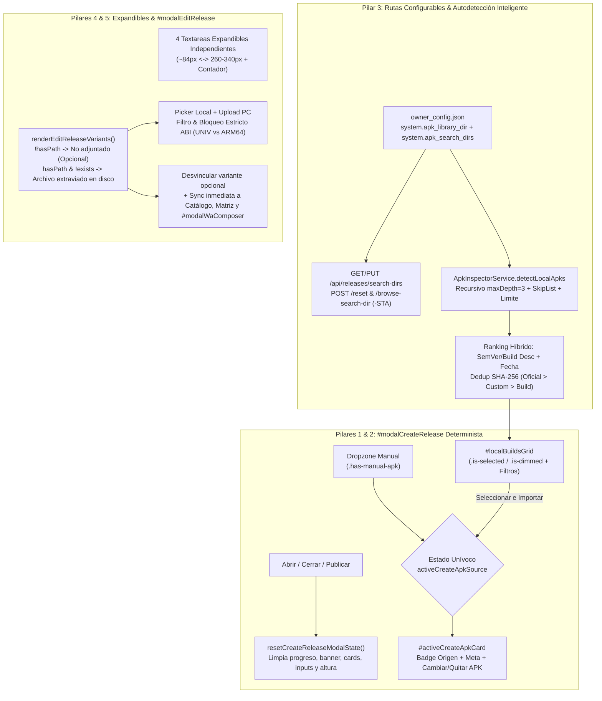

# Plan Maestro 22.5: Pulido Integral UX/Ingeniería en Modales APK (`#modalCreateRelease` / `#modalEditRelease`) y Motor de Autodetección Inteligente con Rutas Configurables

> [!IMPORTANT]
> **Estado del Documento:** Versión **1.4** — **100% COMPLETADO Y CERTIFICADO (Fases 1 a 4 Cerradas — 209/209 pruebas en verde)**  
> **Fecha de Auditoría:** 2026-11-25 | **Cierre Fase 1:** 2026-11-25 | **Cierre Fase 2:** 2026-11-25 | **Cierre Fase 3:** 2026-11-25 | **Cierre Final (Fase 4):** 2026-11-25  
> **Línea Base Auditada:** Commit [`f49bbce`](https://github.com/JulioAngello/mochilalista-app/commit/f49bbce) — Plan Maestro 22 Cerrado (`199/199` pruebas en verde)  
> **Ámbito Estricto:** Exclusivamente **`mochilalista_admin/`** (`lib/`, `server.dart`, `web/`, `test/`) y documentación en `informe_proyecto/`. El proyecto **`app_movil/`** (`v9.40.0+84`, commit `02025de`) permanece **100% CERRADO e INMUTABLE**.  
> **Blindaje de Datos Reales y Secretos:** Prohibido modificar, exponer o commitear `mochilalista_admin/data/prod_clients_db.json`, `prod_releases_db.json`, `owner_config.json`, `vault_keyring.json`, `private_keys/`, `releases_apks/prod/` y `app_movil/android/key.properties`. Toda prueba automatizada debe ejecutarse aislada en `Directory.systemTemp.createTemp(...)` y limpiarse en `tearDown()`.

### Salvaguardas Técnicas Preventivas (Paso 0 — Versión 1.1)

1. **Bloqueo de raíces de disco en `isForbiddenApkSearchDir`:** Rechazar unidades raíz completas (`C:\`, `D:\`, `/`) para evitar escaneos masivos accidentales del disco.
2. **UTF-8 y `Dispose()` en `POST /api/releases/browse-search-dir`:** En el script PowerShell 5.1 `-STA`, incluir `Add-Type -AssemblyName System.Windows.Forms`, `[Console]::OutputEncoding = [System.Text.Encoding]::UTF8` (protegiendo carpetas con tildes/ñ) y bloque `try { ... } finally { $dialog.Dispose(); $topForm.Dispose() }`.
3. **Propagación explícita de `null` en `PUT /api/releases/:version`:** Garantizar que el endpoint reenvíe claves explícitas `'arm64_apk': null` / `'universal_apk': null` hacia `DatabaseService.updateRelease` para desvincular variantes opcionales sin borrar el release.

---

## 1. Resumen Ejecutivo de Auditoría Forense (Línea por Línea)

Tras inspeccionar el comportamiento en vivo de `mochilalista_admin/` documentado en las **6 capturas reales** (`020016.png`, `020127.png`, `020205.jpg`, `020349.png`, `020532.png`, `020541.png`) y auditar línea por línea el código fuente actual en Dart, HTML, CSS y JavaScript, se identificaron **9 causas raíz exactas** (incluyendo **2 bugs ocultos adicionales** descubiertos durante la auditoría de `admin_app.js`, `database_service.dart` y `server.dart`):

| Pilar | Evidencia / Síntoma Observado | Archivo y Líneas Exactas | Causa Raíz Forense Verificada |
| :---: | :--- | :--- | :--- |
| **1** | **Bug de archivo "pegado" tras publicar (`020349.png`):** Al abrir `#modalCreateRelease` tras publicar `v9.40.0`, los inputs quedan vacíos pero `#apkDropZone` sigue mostrando la barra azul al `100%` y `mochilalista_v9.40_atp.apk verificado e inspeccionado (108.47 MB)`. | [admin_app.js](file:///c:/Users/vjuli/Documents/mochilalista-app/mochilalista_admin/web/js/admin_app.js#L9996-L10020) [admin_app.js](file:///c:/Users/vjuli/Documents/mochilalista-app/mochilalista_admin/web/js/admin_app.js#L10082-L10083) [admin_app.js](file:///c:/Users/vjuli/Documents/mochilalista-app/mochilalista_admin/web/js/admin_app.js#L10822-L10830) [index.html](file:///c:/Users/vjuli/Documents/mochilalista-app/mochilalista_admin/web/index.html#L2754-L2767) | 1) `btnOpenCreateRelease` (`9996-10020`) resetea `formCreateRelease`, `#apkSignatureBanner` y `#localBuildsGrid`, pero **nunca** oculta `#apkUploadProgress`, ni reinicia `#apkProgressBar.style.width = '0%'`, ni restaura `#apkUploadStatusText`, ni limpia `#apkFileInput.value = ''`. 2) `btnSubmitCreateRelease` (`10082-10083`) solo llama `closeModal` + `form.reset()`, dejando vivo `lastInspectedCreateData`, `availableLocalBuilds`, los `<input type="hidden">` si fueron mutados, y todo el estado visual del dropzone. 3) `closeModal('modalCreateRelease')` (`10822`) solo quita `.open` sin invocar ninguna función de limpieza unificada. |
| **2A** | **Dropzone genérico sin tarjeta de Archivo Activo (`020016.png`):** Al subir manualmente un `.apk`, el recuadro sigue diciendo `"Arrastra tu archivo .APK aquí..."` y esconde el archivo cargado en una línea gris diminuta debajo de la barra. | [index.html](file:///c:/Users/vjuli/Documents/mochilalista-app/mochilalista_admin/web/index.html#L2754-L2767) [admin_app.js](file:///c:/Users/vjuli/Documents/mochilalista-app/mochilalista_admin/web/js/admin_app.js#L8617-L8657) | `handleApkUpload` solo actualiza `#apkProgressBar` y `#apkUploadStatusText`. No transforma visualmente `#apkDropZone`, no renderiza una tarjeta destacada de **APK Activo** con badge de origen inequívoco ni botón `Cambiar / Quitar APK`, y no desmarca las tarjetas de `#localBuildsGrid` si existía una selección previa. |
| **2B** | **Tarjetas `#localBuildsGrid` sin estado visual de selección (`020205.jpg`):** Al hacer clic en `Seleccionar e Importar` en `v9.37.0`, ninguna tarjeta cambia de estilo; es imposible distinguir visualmente cuál de los 6 APKs (o un archivo manual) se va a publicar. | [admin_app.js](file:///c:/Users/vjuli/Documents/mochilalista-app/mochilalista_admin/web/js/admin_app.js#L8380-L8502) [styles.css](file:///c:/Users/vjuli/Documents/mochilalista-app/mochilalista_admin/web/css/styles.css#L1522-L1568) | `importLocalApkDirectly` (`8485`) no recibe referencia ni índice del botón/tarjeta, no muestra estado de carga, y `styles.css` carece de clases `.local-build-card.is-selected` y `.local-build-card.is-dimmed`. Tampoco existe una variable de estado única (`activeCreateApkSource` / `selectedLocalBuildPath`) que garantice exclusión mutua entre subida manual y autodetección. |
| **3** | **Rutas fijas hardcodeadas, escaneo plano (profundidad 0) y pérdida silenciosa al guardar Ajustes:** El autodetector solo busca en `apk_library_dir` y `../app_movil/build/...` sin subcarpetas ni UI de configuración. | [config_service.dart](file:///c:/Users/vjuli/Documents/mochilalista-app/mochilalista_admin/lib/config_service.dart#L35-L43) [apk_inspector_service.dart](file:///c:/Users/vjuli/Documents/mochilalista-app/mochilalista_admin/lib/apk_inspector_service.dart#L389-L473) [server.dart](file:///c:/Users/vjuli/Documents/mochilalista-app/mochilalista_admin/server.dart#L1633-L1715) [admin_app.js](file:///c:/Users/vjuli/Documents/mochilalista-app/mochilalista_admin/web/js/admin_app.js#L11195-L11200) | 1) `ConfigService` solo expone 1 string `system['apk_library_dir']`. 2) **Bug oculto en `saveOwnerConfig()` (`admin_app.js:11195-11200`):** Al guardar ajustes generales en `#tabSettings`, reconstruye `system` omitiendo `apk_library_dir` (y cualquier `apk_search_dirs`), sobrescribiéndolo con el valor de fábrica vía `_deepMerge`. 3) `detectLocalApks` (`397-418`) usa `listSync(followLinks: false)` sin recursividad (`depth 0`) y ordena únicamente por fecha `modified` (líneas `430-434`), sin combinar SemVer/`versionCode`. 4) `server.dart:1702-1707` hardcodea `allowedRoots`. |
| **4** | **Textareas de Changelog y Notas Internas comprimidos a ~3 líneas (`020127.png`, `020532.png`):** Cómodos por defecto, pero difíciles de leer/editar cuando la ficha técnica supera 5,000 caracteres. | [index.html](file:///c:/Users/vjuli/Documents/mochilalista-app/mochilalista_admin/web/index.html#L2840-L2859) [index.html](file:///c:/Users/vjuli/Documents/mochilalista-app/mochilalista_admin/web/index.html#L2915-L2934) [styles.css](file:///c:/Users/vjuli/Documents/mochilalista-app/mochilalista_admin/web/css/styles.css#L1858-L1869) | `#relChangelog` (`rows="3"`), `#relInternalNotes` (`rows="2"`), `#editRelChangelog` (`rows="4"`) y `#editRelInternalNotes` (`rows="2"`) carecen de botón `Expandir` / `Contraer` independiente, transición CSS de altura y contador de líneas/caracteres. |
| **5A** | **Falsa alarma roja `No encontrado` + `Sin Verificar` + `Re-verificar` en variantes nunca adjuntadas (`020541.png`):** `ARM64 Ligero` muestra badges de error aunque nunca tuvo ruta registrada. | [admin_app.js](file:///c:/Users/vjuli/Documents/mochilalista-app/mochilalista_admin/web/js/admin_app.js#L7046-L7112) [database_service.dart](file:///c:/Users/vjuli/Documents/mochilalista-app/mochilalista_admin/lib/database_service.dart#L1432-L1448) [server.dart](file:///c:/Users/vjuli/Documents/mochilalista-app/mochilalista_admin/server.dart#L1925-L1967) | 1) `buildEditVariantCardHtml` inicializa `diskBadge = 'No encontrado'` y `sigBadge = 'Sin Verificar'` sin distinguir `!hasPath` (variante opcional vacía) de `hasPath && diskState === false` (archivo extraviado), y renderiza siempre `Re-verificar`. 2) `getReleases()` (`1432-1448`) nunca recalcula `u['file_exists']` ni `a['file_exists']` por variante. 3) `verifyVariantPath` (`server.dart:1930`) devuelve `null` si el archivo ya no existe, dejando `file_exists: true` obsoleto en BD. |
| **5B** | **Selector inline de variante sin filtro ABI, sin botón cerrar/re-escanear y riesgo de cruce `UNIVERSAL` <-> `ARM64` (`020541.png`):** El picker de `ARM64` lista los 6 APKs `UNIVERSAL` y permite vincularlos en la ranura equivocada. | [admin_app.js](file:///c:/Users/vjuli/Documents/mochilalista-app/mochilalista_admin/web/js/admin_app.js#L7113-L7124) [admin_app.js](file:///c:/Users/vjuli/Documents/mochilalista-app/mochilalista_admin/web/js/admin_app.js#L7165-L7283) [admin_app.js](file:///c:/Users/vjuli/Documents/mochilalista-app/mochilalista_admin/web/js/admin_app.js#L7296-L7356) | `toggleEditVariantLocalPicker` carga `/api/releases/detect-local-build` sin filtrar `b.abi_variant`, ni `linkLocalBuildToReleaseVariant` ni `handleVariantFileSelected` validan coincidencia ABI contra `variantKey`, y el contenedor `.edit-variant-local-picker` carece de botón `Cerrar` y `Re-escanear rutas`. |
| **5C** | **Bugs ocultos en carga de `*_atp.txt` en `#modalEditRelease` y `abi_variant` al crear release:** | [admin_app.js](file:///c:/Users/vjuli/Documents/mochilalista-app/mochilalista_admin/web/js/admin_app.js#L8347-L8350) [database_service.dart](file:///c:/Users/vjuli/Documents/mochilalista-app/mochilalista_admin/lib/database_service.dart#L1479-L1531) | 1) **Bug crítico en `admin_app.js:8348`:** El listener de `#btnEditLoadAtpTxt` lee `document.getElementById('editRelInternalNotes')?.value` (el propio textarea!) en lugar de `editRelVersionName`, enviando todo el texto como versión al endpoint `/companion-notes`. 2) `DatabaseService.createRelease()` (`1479-1500`) descarta `abi_variant` y no auto-puebla `universal_apk` / `arm64_apk`. 3) `DatabaseService.updateRelease()` (`1507-1531`) asigna `null` en vez de eliminar la clave al desvincular variantes opcionales. |

---

## 2. Arquitectura Técnica & Especificación Detallada por Pilar

---

### Pilar 1 — Limpieza Integral y Determinista de Estado en `#modalCreateRelease`

1. **Nueva Función Única `resetCreateReleaseModalState()` en `admin_app.js`:**
   - Centralizar la limpieza total en una única función sin efectos secundarios, invocada desde:
     1. Al abrir el modal (`#btnOpenCreateRelease` click).
     2. Al cerrar el modal por **cualquier** vía (`closeModal('modalCreateRelease')` cubre botones `Cancelar`, `X`, clic en backdrop `.modal-overlay` y tecla `Escape`).
     3. Tras publicar exitosamente en `#btnSubmitCreateRelease`.
   - **Inventario exacto de estado que limpiará `resetCreateReleaseModalState()`:**
     - **Variables JS globales / de módulo:**
       - `lastInspectedCreateData = null`
       - `availableLocalBuilds = []`
       - `activeCreateApkSource = null` (`null | 'manual' | 'autodetect'`)
       - `selectedLocalBuildPath = null`
       - `selectedLocalBuildIndex = -1`
       - `pendingManualFileMeta = null`
     - **Dropzone y File Input:**
       - `#apkFileInput.value = ''` (permite volver a seleccionar el mismo `.apk` desde el explorador en la siguiente apertura).
       - `#apkDropZone`: remover clases `.dragover` y `.has-manual-apk`; restaurar título `"Arrastra tu archivo .APK aquí o haz clic para seleccionarlo"` y subtítulo `"Compatible con APK Universal (~110 MB) y APK Ligero ARM64 (~30 MB)"`.
       - `#apkUploadProgress.style.display = 'none'`
       - `#apkProgressBar.style.width = '0%'`
       - `#apkUploadStatusText.textContent = 'Procesando archivo e inspeccionando metadatos...'`
     - **Tarjeta Unívoca de APK Activo & Escudo de Firma:**
       - `#activeCreateApkCard`: ocultar (`display: none`, remover `.visible`, limpiar `innerHTML`).
       - `#apkSignatureBanner`: `style.display = 'none'`, `className = 'apk-signature-banner'`, `innerHTML = ''` (lo que además garantiza la remoción de `#chkAcknowledgeUnofficialApk`).
     - **Autodetección, Filtros y Panel de Rutas:**
       - `#localBuildsGrid`: `style.display = 'none'`, `innerHTML = ''`.
       - `#localBuildsToolbar`: ocultar y resetear filtro ABI (`ALL`), buscador rápido (`''`) y límite (`6`).
       - `#createSearchDirsPanel`: colapsar/ocultar para que el modal abra compacto.
       - `#detectApkStatus.textContent = 'Escanea tus rutas configuradas (Biblioteca Oficial, compilaciones locales o carpetas personalizadas) con fecha, SHA-256 y firma real.'`
     - **Formulario `#formCreateRelease` (Inputs visibles + ocultos):**
       - `form.reset()` **más** asignación explícita de cada campo: `#relUploadedPath = ''`, `#relAbiVariant = 'UNIVERSAL'`, `#relSignatureVerified = ''`, `#relSignatureStatus = ''`, `#relSignerSha256 = ''`, `#relSignerDn = ''`, `#relVersionName = ''`, `#relVersionCode = ''`, `#relMinRequiredVersion = '9.0.0'`, `#relDbSchema = '36'`, `#relType = 'FEATURE_RELEASE'`, `#relSizeMb = ''`, `#relSha256 = ''`, `#relDownloadUrl = ''`, `#relChangelog = ''`, `#relInternalNotes = ''`.
       - `#badgeRelVariantDisplay`: `className = 'badge badge-universal'`, `textContent = 'UNIVERSAL'`.
       - Llamar `updateReleaseTypeInfo('relType', 'relTypeInfoText')`.
       - Resetear altura y estado expandido de `#relChangelog` y `#relInternalNotes` mediante `resetExpandableTextarea('relChangelog')` y `resetExpandableTextarea('relInternalNotes')`, actualizando sus contadores a `0 líneas · 0 car.`.

---

### Pilar 2 — Claridad Visual Total del APK Activo (Manual vs. Autodetección, Selección Unívoca y Animaciones)

1. **Indicador Unívoco `#activeCreateApkCard` (`Subido manualmente desde PC` vs `Seleccionado desde Autodetección`):**
   - Ubicar en `#modalCreateRelease` (`index.html`, justo debajo de `#apkDropZone`) el contenedor `

`.
   - Al completar `handleApkUpload` (`sourceKind = 'manual'`) o `importLocalApkDirectly` (`sourceKind = 'autodetect'`), invocar `renderActiveCreateApkCard(data, sourceKind, sourceMeta)`:
     - **Badge de Origen Inequívoco:**
       - `manual`: pill azul/cian `.badge-source-manual` con SVG de carga -> **`Subido manualmente desde PC`**.
       - `autodetect`: pill verde/esmeralda `.badge-source-autodetect` con SVG de carpeta/check -> **`Seleccionado desde Autodetección`** (junto al nombre de la ruta/fuente si aplica).
     - **Resumen Técnico de un Vistazo:**
       - Nombre exacto del archivo (`data.file_name`, ej. `mochilalista_v9.40_atp.apk`).
       - Versión + Build (`v9.40.0 · Build 84`).
       - Variante (`UNIVERSAL` o `ARM64 LIGERO`), Tamaño (`formatApkSizeMb(data.size_mb)` -> `108.47 MB`), badge de firma 3 estados y SHA-256 corto (`6b54045b3387...`).
     - **Botón `Cambiar / Quitar APK` (`#btnClearSelectedCreateApk`):**
       - Ejecuta `clearSelectedCreateApk()`, que limpia únicamente el binario cargado y los campos derivados del APK (path, tamaño, SHA-256, variante, escudo de firma, tarjeta activa, estado `.has-manual-apk` en dropzone y selección en `#localBuildsGrid`) **sin cerrar el modal** ni borrar notas si el usuario ya escribió texto personalizado.

2. **Transformación Visual del Dropzone Manual (`#apkDropZone.has-manual-apk`):**
   - Cuando `activeCreateApkSource === 'manual'`:
     - `#apkDropZone` adopta `.has-manual-apk` (borde acento azul/verde sólido o doble, fondo tintado suave compatible con tema claro y oscuro, icono SVG de escudo/check en reemplazo de la flecha genérica).
     - Título cambia a: **`Archivo manual listo: <file_name>`**; subtítulo: **`<size_mb> · Verificado e inspeccionado — Haz clic o arrastra otro .APK para reemplazarlo`**.
     - Se desmarca de inmediato cualquier tarjeta seleccionada en `#localBuildsGrid` (`syncLocalBuildsSelectionUi(null)`).

3. **Animaciones y Señales Visuales Claras en `#localBuildsGrid`:**
   - Al pulsar **`Seleccionar e Importar`** en una tarjeta:
     - El botón entra brevemente en estado de carga (`disabled = true`, `btn.classList.add('is-loading')`, texto **`Importando e inspeccionando...`**) evitando clics duplicados mientras corre `POST /api/releases/import-local-apk`.
     - Al completarse con éxito (`activeCreateApkSource = 'autodetect'`):
       - Limpia el estado `.has-manual-apk`, `#apkUploadProgress` y `#apkFileInput.value` del dropzone superior (garantizando que **nunca** coexistan dos orígenes activos).
       - `syncLocalBuildsSelectionUi(selectedPath)`:
         - La tarjeta activa recibe `.is-selected` (borde luminoso azul/esmeralda animado con `@keyframes activeApkPulse` sutil, elevación `translateY(-1px)`, fondo resaltado) y muestra un pill superior **`Seleccionado`** con SVG check.
         - Su botón pasa a clase activa (`btn-selected-apk`) con SVG check y texto **`Seleccionado (Activo)`**.
         - El resto de tarjetas del grid recibe `.is-dimmed` (`opacity: 0.62`, transición CSS `0.22s ease`; al pasar el mouse `:hover` sube a `0.95`) para que la selección elegida resalte de inmediato entre los 6+ resultados.

---

### Pilar 3 — Motor de Autodetección Inteligente con Rutas Configurables y Búsqueda Eficiente

1. **Persistencia Retrocompatible de Rutas en `ConfigService` (`lib/config_service.dart`):**
   - Mantener `system['apk_library_dir']` como ruta principal oficial para **100% retrocompatibilidad** con configuraciones y tests existentes (`config_service_test.dart`, `apk_inspector_and_releases_test.dart`, `plan22_fase1`, `plan22_fase2`).
   - Introducir soporte completo de `system['apk_search_dirs']` (lista ordenada de entradas `{ path, label, enabled, is_default, kind }`):
     - **Resolución inteligente (`getEffectiveApkSearchDirs()`):**
       - Si `owner_config.json` aún no contiene `apk_search_dirs` (migración transparente desde v1.0), construye automáticamente las 2 rutas por defecto:
         1. `{ path: apkLibraryDir, label: 'Biblioteca Oficial', enabled: true, is_default: true, kind: 'official_library' }`
         2. `{ path: defaultFlutterBuildPath, label: 'Compilación Local (app_movil/build)', enabled: true, is_default: true, kind: 'flutter_build' }`
       - Si un test o caller llama `saveConfig({'system': {'apk_library_dir': customDir}})` sin enviar `apk_search_dirs`, `_sanitizeConfig` actualiza automáticamente la entrada `official_library` (y sincroniza top-level `'apk_library_dir'` si alguien lo envía por compatibilidad) sin filtrar rutas de producción hacia entornos de test.
     - **Validación de Seguridad (`isForbiddenApkSearchDir(String rawPath)`):**
       - Rechaza rutas vacías, inexistentes al agregar explícitamente (en validación de API, permitiendo mostrar `No encontrada` si una carpeta ya guardada fue movida luego), o directorios sensibles prohibidos (`private_keys`, `mochilalista_admin/data`, `backups`, `app_movil/android`, raíz del sistema `C:\Windows`, `/etc`, `/usr`).
   - **Fix crítico en `saveOwnerConfig()` (`admin_app.js:11195-11200`):**
     - Preservar `...ownerConfig?.system` al guardar ajustes en `#tabSettings` para impedir que guardar tema o densidad borre `apk_library_dir` y `apk_search_dirs`.

2. **Escaneo Recursivo Acotado, Ordenamiento Híbrido y Deduplicación (`lib/apk_inspector_service.dart`):**
   - Ampliar `detectLocalApks` para recibir `List<ApkSearchDirConfig>? searchDirs` (conservando `apkLibraryDir` y `buildOutputDir` opcionales para retrocompatibilidad total de llamadas existentes):
     - **Búsqueda recursiva controlada (`maxDepth = 3`, configurable `0..4`):**
       - Recorre subcarpetas (ej. `v9.40\`, `arm64\`, `2026-11\`) con `followLinks: false` para evitar bucles de symlinks/junctions.
       - **Lista de exclusión de carpetas pesadas/irrelevantes:** `.git`, `.dart_tool`, `.gradle`, `.idea`, `.vscode`, `node_modules`, `intermediates`, `tmp`, `temp`, `obj`, `bin`, `symbols`, `app_symbols`, `private_keys`, `backups`, `data`, y cualquier carpeta que inicie con `.`.
       - **Límite de seguridad anti-saturación:** tope `maxEntriesPerRoot = 1500` entradas inspeccionadas en árbol y captura segura `try/catch` en cada directorio/archivo ante permisos denegados o carpetas desconectadas.
     - **Pre-selección y Ordenamiento Inteligente:**
       - Colecta candidatos rápidos sin abrir el ZIP todavía; selecciona la ventana de inspección ampliada (`max(maxCandidates * 3, 24)`, tope `36`) combinando los más recientes de cada raíz configurada (para que una carpeta histórica con muchos archivos viejos no tape compilaciones recién generadas en `app_movil/build/`) junto con versiones SemVer más altas inferidas por nombre.
       - Tras ejecutar `inspectApk` (obteniendo `versionName`, `versionCode`, `sha256`, `abiVariant` reales) y **deduplicar por `sha256`** (priorizando `official_library` (`0`) < `custom` (`1`) < `flutter_build` (`2`), anotando copias omitidas en `duplicate_paths`):
         - Ordena los resultados únicos priorizando:
           1. SemVer `versionName` descendente (`compareSemVer` numérico).
           2. `versionCode` descendente.
           3. `modifiedAt` descendente (desempate por compilación más reciente).
           4. `priority` ascendente (Biblioteca Oficial primero ante empate exacto).
     - **Filtros y Métricas por Carpeta:**
       - Soportar filtros `abiFilter` (`ALL | UNIVERSAL | ARM64`), `query` (búsqueda por versión, nombre o ruta) y `limit` (`6 | 12 | 24`).
       - Devolver `per_dir_stats` con `{ path, label, kind, enabled, is_default, exists, readable, apk_count }` para alimentar el mini-panel en tiempo real.
       - Pasar todas las carpetas de búsqueda configuradas como `extraSearchDirs` en `inspectApk`, `/upload-apk`, `/verify` y `/companion-notes`.

3. **Nuevos Endpoints Backend en `server.dart`:**
   - `GET /api/releases/search-dirs`: devuelve la lista efectiva de rutas configuradas con estado en disco en tiempo real (`exists`, `readable`, `apk_count`).
   - `PUT /api/releases/search-dirs`: valida rutas (bloqueando carpetas prohibidas), normaliza con `canonicalizePath`, persiste en `owner_config.json` (con backup automático `pre_save`), y devuelve la lista actualizada.
   - `POST /api/releases/search-dirs/reset`: restablece las rutas de búsqueda a las de fábrica y retorna la nueva configuración.
   - `POST /api/releases/browse-search-dir`: abre el selector nativo de carpetas de Windows (`powershell -NoProfile -STA` con `System.Windows.Forms.FolderBrowserDialog` sobre un `Form` `TopMost` para no quedar oculto detrás del navegador, sin bloquear el servidor HTTP al correr asíncrono con timeout de `90s`), retornando `{ ok: true, path, cancelled }` o fallback limpio en entornos no-Windows. Incluye hook `onBrowseFolderOverride` en `handleRequest` para pruebas deterministas.
   - Ampliar `GET /api/releases/detect-local-build` con query params opcionales `?limit=6&abi=ALL&q=...`, retornando `per_dir_stats`, `total_unique_found`, `total_returned` y `available_builds`.
   - Ampliar `allowedRoots` en `POST /api/releases/import-local-apk` integrando dinámicamente todas las rutas válidas habilitadas de `configService.getEffectiveApkSearchDirs()` (manteniendo bloqueo de rutas fuera de raíces permitidas y carpetas sensibles).

4. **Mini-Panel Integrado `Rutas de búsqueda` en `#modalCreateRelease` (y reutilizado en `#modalEditRelease`):**
   - Junto a `Autodetectar APKs Locales` agregar botón compacto con SVG engranaje/carpeta **`Rutas de búsqueda`** (`#btnToggleSearchDirsPanel`).
   - Despliega el panel `#createSearchDirsPanel` con:
     - Lista de rutas activas con toggle habilitar/deshabilitar, badge **`Existe en disco`** (verde) / **`No encontrada`** (ámbar/rojo), conteo `N APK(s)` por ruta, y botón eliminar en rutas personalizadas.
     - Fila para agregar ruta nueva: input de texto `#inputNewApkSearchDir` + botón **`Examinar carpeta...`** (`#btnBrowseApkSearchDir`, llamando `/browse-search-dir` con fallback transparente a entrada manual) + botón **`Agregar ruta`**.
     - Botón **`Restablecer rutas por defecto`**.
     - Cualquier guardado/cambio dispara automáticamente el re-escaneo de `#localBuildsGrid` (y actualiza el caché compartido con `#modalEditRelease`).
   - Agregar barra compacta sobre `#localBuildsGrid` para filtrar rápido por **`Todos`**, **`Universal`**, **`ARM64`**, campo de búsqueda rápida y selector de cantidad (`6` / `12` / `24`).

---

### Pilar 4 — Campos Desplegables / Expandibles Independientes en Ambos Modales

1. **Barra de Herramientas Unificada en los 4 Textareas (`#relChangelog`, `#relInternalNotes`, `#editRelChangelog`, `#editRelInternalNotes`):**
   - Mantener exactamente la altura compacta por defecto (`rows="3"` / `~84px` para no saturar visualmente los modales al abrirlos).
   - En `.field-label-row` de cada uno de los 4 campos, alinear a la derecha un grupo compacto `.field-label-actions` con:
     - Contador discreto en vivo (ej. `14 líneas · 543 car.`).
     - Botón compacto con SVG acotado (`width="13" height="13"`) **`Expandir`** (con `data-target="<textareaId>"`, `aria-expanded="false"`).
     - Botón existente **`Cargar *_cambios.txt`** o **`Cargar *_atp.txt`**.
2. **Comportamiento Independiente & Transición Fluida:**
   - Al pulsar **`Expandir`**:
     - El textarea elegido recibe `.is-expanded` y ajusta suavemente su altura (`transition: height 0.24s cubic-bezier(0.4, 0, 0.2, 1)`): entre `260px` y `340px` según contenido (`Math.min(Math.max(el.scrollHeight + 14, 260), 340)`), con scroll interno fluido (`overflow-y: auto`).
     - El botón cambia a **`Contraer`** (`aria-expanded="true"`) y su icono SVG rota/cambia a flechas de compresión.
   - Al pulsar **`Contraer`**: regresa suavemente a su altura compacta por defecto (`84px`) **conservando intacto** el texto editado.
   - **Independencia total:** Cada uno de los 4 campos mantiene su propio estado independiente.
   - **Reinicio al cerrar/reabrir:** `resetCreateReleaseModalState()` y `openEditReleaseModal()` / `closeModal('modalEditRelease')` contraen nuevamente los textareas para que la próxima apertura arranque limpia y compacta.
   - **Soporte dual de tema:** Estilos completos para modo oscuro y `[data-theme="light"]`.

---

### Pilar 5 — Auditoría Profunda y Refinamiento de `Archivos APK Físicos en Disco` en `#modalEditRelease`

1. **Diferenciación Honesta entre `No adjuntado (Opcional)` vs `Archivo extraviado en disco`:**
   - **Backend (`database_service.dart` + `server.dart`):**
     - En `DatabaseService.getReleases()` (`1432-1448`): evaluar dinámicamente `File(path).existsSync()` para `universal_apk` y `arm64_apk` de forma independiente (`u['file_exists']` y `a['file_exists']`), evitando que una variante herede o arrastre un `file_exists` desactualizado de la otra.
     - En `POST /api/releases/:version/verify` (`server.dart:1925-1967`): cuando `rawUnivPath` o `rawArmPath` tiene ruta registrada pero `!await File(canon).exists()`, actualizar la variante en BD con `'file_exists': false` (en lugar de devolver `null` y dejar `'file_exists': true` congelado).
   - **Frontend (`buildEditVariantCardHtml` en `admin_app.js:7046-7127`):**
     - **Si `!hasPath` (variante nunca adjuntada):**
       - Mostrar tamaño/estado neutro **`Sin archivo adjunto`** + badge neutro **`.badge-variant-optional`**: **`No adjuntado (Opcional)`**.
       - **Eliminar** el badge rojo `No encontrado`, **eliminar** el badge ámbar `Sin Verificar` y **ocultar** el botón `Re-verificar`.
       - Dejar únicamente **`Subir desde PC`** y **`Vincular desde Biblioteca Local`**.
     - **Si `hasPath && diskState === false` (ruta sí registrada en BD, pero el archivo fue borrado/movido):**
       - Mostrar badge rojo **`.badge-disk-missing`**: **`Archivo extraviado en disco`**, junto con el texto explicativo `"Archivo no encontrado en la ruta registrada en disco — usa Re-verificar, Subir desde PC, Vincular o Desvincular."`, y mostrar botón **`Re-verificar`** + **`Desvincular`**.
     - **Si `hasPath && diskState === true`:**
       - Badge verde **`Verificado en disco`** + badge de firma 3 estados + SHA-256 + `Copiar SHA` + ruta completa + botones `Subir desde PC`, `Vincular desde Biblioteca Local`, `Re-verificar`, `Copiar`, `Carpeta`, y **`Desvincular`** (si aplica la regla segura de variantes).

2. **Filtrado y Protección ABI Estricta en `Vincular desde Biblioteca Local` y `Subir desde PC`:**
   - En `toggleEditVariantLocalPicker(variantKey, versionName)`:
     - Consultar `/api/releases/detect-local-build?limit=24&abi=${variantKey === 'arm64' ? 'ARM64' : 'UNIVERSAL'}` (filtrando estrictamente las opciones por la arquitectura de la tarjeta).
     - Si la lista filtrada está vacía, mostrar mensaje claro y útil:
       - En `ARM64`: *"No se detectaron APKs ARM64 en las rutas configuradas — compila con `compilar_apk_arm64.bat` o usa 'Subir desde PC'."* (deshabilitando `Vincular Seleccionado`).
       - En `Universal`: *"No se detectaron APKs Universal en las rutas configuradas — compila con `compilar_apk_comercial.bat` o usa 'Subir desde PC'."*
     - Incluir en la cabecera del selector inline:
       - Botón compacto **`Re-escanear rutas`** (refresca sin cerrar el picker).
       - Botón compacto **`Rutas...`** (permite abrir/ajustar rutas de búsqueda o ir al panel de rutas).
       - Botón **`Cerrar`** (`X` SVG) para colapsar el selector inline sin necesidad de volver a pulsar el botón principal.
   - **Guardia Dura contra Mezcla Accidental de Arquitecturas (`ARM64` <-> `UNIVERSAL`):**
     - Tanto en `linkLocalBuildToReleaseVariant` como en `handleVariantFileSelected` (subida manual desde PC): comparar `detectedAbi = (data.abi_variant || 'UNIVERSAL').toUpperCase()` contra el slot destino (`variantKey === 'arm64' ? 'ARM64' : 'UNIVERSAL'`).
     - Si no coinciden (ej. intentar subir o vincular un APK `UNIVERSAL` de 108 MB dentro de la ranura `ARM64 Ligero`), **bloquear la vinculación** y mostrar un toast de error explícito indicando la arquitectura detectada vs la ranura elegida.

3. **Desvinculación Segura de Variante Opcional (`Desvincular`) & Corrección `*_atp.txt`:**
   - **Desvincular variante (`unlinkReleaseVariant(versionName, variantKey)`):**
     - Permitir desvincular con `showConfirmModal` cuando:
       1. Se desvincula `arm64_apk` (variante secundaria/opcional), o
       2. Se desvincula `universal_apk` si `arm64_apk` sigue presente o su archivo físico está extraviado (`diskState === false`), manteniendo integridad de la versión sin borrar el registro del catálogo ni destruir archivos en disco usados por otros registros.
     - En `DatabaseService.updateRelease()`, si `updates` envía `'arm64_apk': null` o `'universal_apk': null`, ejecutar `release.remove(key)` limpiamente. Si se desvincula `universal_apk` y queda `arm64_apk`, promover los campos raíz (`apk_file_path`, `file_size_mb`, `apk_sha256`, `abi_variant`) desde `arm64_apk` (o limpiarlos si no queda ninguna variante).
   - **Fix `btnEditLoadAtpTxt` (`admin_app.js:8348`):**
     - Corregir `document.getElementById('editRelInternalNotes')?.value` -> `document.getElementById('editRelVersionName')?.value`, y asegurar que `createRelease()` en `database_service.dart` persista `abi_variant` y auto-genere `universal_apk` / `arm64_apk` al registrar nueva versión.
   - **Sincronización Inmediata en Vivo (`#modalEditRelease` -> Catálogo -> Matriz -> `#modalWaComposer`):**
     - Tras `Subir desde PC`, `Vincular Seleccionado`, `Re-verificar`, `Desvincular` o `Guardar Cambios`, actualizar `globalReleases`, re-renderizar `#editRelVariantsContainer`, recargar Catálogo y Matriz, y si `currentDispatchRelease?.version_name === versionName`, refrescar `currentDispatchRelease` para `#modalWaComposer`.

---

## 3. Plan de Implementación en Fases Secuenciales

Cada fase se ejecutará de forma secuencial, verificando análisis estático (`dart analyze`), sintaxis JavaScript (`node --check`) y suite completa (`dart test`) al cierre de cada una:

| Fase | Alcance y Archivos Objetivo | Entregables Técnicos Clave | Criterio de Verificación & Cierre |
| :---: | :--- | :--- | :--- |
| **FASE 1 (COMPLETADA ✅ — v1.1)** Motor Backend de Rutas, Detector Recursivo, Reparación de Variantes y Endpoints | `lib/config_service.dart` `lib/apk_inspector_service.dart` `lib/database_service.dart` `server.dart` `test/plan22_5_fase1_search_dirs_and_detector_test.dart` | • `system.apk_search_dirs` retrocompatible + lista negra de rutas prohibidas (incluye raíces `C:\`/`/`). • `detectLocalApksWithStats` recursivo acotado (`maxDepth=3`, skip list, cap `1500` entradas), ranking SemVer/Build + fecha, dedup SHA-256, caché en vivo (`121 ms` en re-escaneo), filtros `limit`/`abi`/`q`, `per_dir_stats` y `extraSearchDirs` en notas compañeras. • `GET/PUT /api/releases/search-dirs`, `POST /reset`, `POST /browse-search-dir` (`-STA` UTF-8 `TopMost` + `Dispose()` + hook test), `allowedRoots` dinámico en `import-local-apk`. • `getReleases()` con `file_exists` dinámico por variante, `createRelease()` con `abi_variant` + variante inicial, `updateRelease()` con `remove` al desvincular, `PUT` preservando `null` explícito y `/verify` marcando `file_exists: false` si falta archivo. | **CERTIFICADA (2026-11-25):** `dart analyze` = `No issues found!`; Suite completa `dart test` = **203/203 en verde** (`0` fallos); Sondeo real solo lectura: `v-app-offline apks` (`85` APKs) + `app_movil/build` (`2` APKs), dedup SHA-256 OK, ranking `v9.40.0 (Build 84)` primero (`cold=31522ms`, `warm=121ms`). |
| **FASE 2 (COMPLETADA ✅ — v1.2)** Pilar 1 + Pilar 2 + Panel de Rutas en `#modalCreateRelease` | `web/index.html` `web/css/styles.css` `web/js/admin_app.js` `test/plan22_5_fase2_create_modal_ux_test.dart` | • `resetCreateReleaseModalState()` unificado (apertura, cierre por `X`/`Cancelar`/backdrop/`Escape` y post-publicación). • `#activeCreateApkCard` unívoco (`Subido manualmente desde PC` vs `Seleccionado desde Autodetección`) + `Cambiar / Quitar APK` (`clearSelectedCreateApk()`). • `#apkDropZone.has-manual-apk` y exclusión mutua con `#localBuildsGrid`. • Animaciones `.is-selected` (`@keyframes activeApkPulse`) / `.is-dimmed` + estado de carga en `#localBuildsGrid` + toolbar `#localBuildsToolbar` (`Todos`/`Universal`/`ARM64`, buscador, límite `6/12/24`). • Mini-panel colapsable `Rutas de búsqueda` (`#createSearchDirsPanel`: estados en disco, conteo `.apk`, toggle, agregar/`Examinar carpeta...`/eliminar/restablecer). • Fix `saveOwnerConfig()` preservando `apk_library_dir` y `apk_search_dirs` dentro de `system`. • Cero emojis crudos, SVGs acotados, modo oscuro y `[data-theme="light"]`. | **CERTIFICADA (2026-11-25):** `node --check` (`admin_app.js`, `qrcode.min.js`) = `0`; `dart analyze` = `No issues found!`; Suite completa `dart test` = **206/206 en verde** (`0` fallos, incluyendo `plan22_fase2_releases_matrix_catalog_test.dart`, `plan22_5_fase1` y `plan22_5_fase2`). |
| **FASE 3 (COMPLETADA ✅ — v1.3)** Pilar 4 (Campos Expandibles) + Pilar 5 (`#modalEditRelease` & Variantes) | `web/index.html` `web/css/styles.css` `web/js/admin_app.js` `test/plan22_5_fase3_expandables_and_edit_variants_test.dart` | • Botones independientes `Expandir` / `Contraer` (`toggleExpandableTextarea`, `resetExpandableTextarea`) + contador en vivo líneas/caracteres (`updateTextareaMetaCounter`) en `#relChangelog`, `#relInternalNotes`, `#editRelChangelog`, `#editRelInternalNotes` con transición `.expandable-textarea.is-expanded` y reset al abrir/cerrar. • Fix oculto en `#btnEditLoadAtpTxt` (`editRelVersionName` en lugar de `editRelInternalNotes`) + refresco de contador al cargar `*_cambios.txt`/`*_atp.txt`. • Tarjetas `#modalEditRelease` honestas en 3 estados (`buildEditVariantCardHtml`): neutro `No adjuntado (Opcional)` (`.badge-variant-optional`, ocultando `Re-verificar`/`Sin Verificar`), rojo `Archivo extraviado en disco` (conservando `No encontrado` en detalle), y `Verificado en disco`. • Selector inline filtrado por ABI (`?limit=24&abi=ARM64|UNIVERSAL`), guía por ausencia (`compilar_apk_arm64.bat`/`compilar_apk_comercial.bat`), panel `#editSearchDirsPanel` reutilizable y botones `Re-escanear rutas`, `Rutas...` y `Cerrar`. • Guardia ABI dura (`validateApkAbiForVariantSlot`) antes de mutar en `Vincular Seleccionado` y `Subir desde PC`, botón seguro `Desvincular` (`unlinkReleaseVariant`, `canUnlinkEditVariantSlot`) con confirmación y `PUT null`, y sincronización inmediata `syncReleaseAcrossUiAndComposer` hacia Catálogo, Matriz y `#modalWaComposer`. | **CERTIFICADA (2026-11-25):** `node --check` (`admin_app.js`, `qrcode.min.js`) = `0`; `dart analyze` = `No issues found!`; Suite completa `dart test` = **209/209 en verde** (`0` fallos, incluyendo `plan22_fase2_releases_matrix_catalog_test.dart`, `plan22_5_fase1`, `plan22_5_fase2` y `plan22_5_fase3`). |
| **FASE 4 (COMPLETADA ✅ — v1.4)** Certificación Final, Verificación en Vivo Solo Lectura, Manual 05 y Cierre GitHub | `informe_proyecto/05_MANUAL_OPERATIVO_DEL_PROPIETARIO_Y_COMANDOS_RELEASE.md` `informe_proyecto/22_5_PLAN_MAESTRO_...md` `lib/apk_inspector_service.dart` (`_liveInspectionCache`) Commit & Push (12 archivos) | • Hallazgo en vivo Fase 4: restauración de `_liveInspectionCache` en `ApkInspectorService` (re-escaneo en caliente reducido de `58,866 ms` a `201 ms`). • Batería final completa síncrona (`node --check` = `0`, `dart analyze` = `No issues found!`, `dart test` = **209/209 en verde**). • Verificación de solo lectura de `detectLocalApksWithStats` sobre `v-app-offline apks` (`85` APKs) y `app_movil/build` (`2` APKs). • Actualización del Manual Operativo 05 (Guía 3.2 y 3.3), auditoría `git check-ignore` sobre 7 rutas sensibles y sincronización limpia en GitHub sin tocar `app_movil/` ni `data/prod_releases_db.json`. | **CERTIFICADA (2026-11-25):** **209/209 pruebas en verde** (`0` fallos, `0` omitidas); `app_movil/` con `0` cambios; `7/7` rutas sensibles ignoradas; commit explícito de 12 archivos y push limpio. |

---

## 4. Protocolo Estricto de Seguridad, Compatibilidad y Estándares Visuales

1. **Inmutabilidad de `app_movil/` y Datos de Producción:**
   - Ninguna tarea de las Fases 1–4 editará código en `app_movil/` ni leerá/modificará `data/prod_clients_db.json`, `data/prod_releases_db.json`, `data/owner_config.json`, `data/vault_keyring.json`, `private_keys/`, `releases_apks/prod/` ni `app_movil/android/key.properties`.
2. **Aislamiento de Pruebas y Limpieza:**
   - Toda prueba nueva creará un directorio temporal único vía `Directory.systemTemp.createTemp(...)` y lo eliminará en `tearDown()`.
   - Las pruebas de rutas y navegador/portapapeles usarán los hooks inyectables (`onBrowseFolderOverride`, `onCopyFileOverride`, `defaultBuildOutputDir`, `processRunnerOverride`, `sdkSearchRootsOverride`) para evitar diálogos modales bloqueantes o dependencia de estado local del host.
3. **Preservación de Contratos de Suites Vigentes (`199/199`):**
   - Conservar las funciones puras entre `formatApkSizeMb(` y `renderSignatureStatusBadge(` sin acoplamientos DOM para no romper el runner Node de [plan22_fase2_releases_matrix_catalog_test.dart](file:///c:/Users/vjuli/Documents/mochilalista-app/mochilalista_admin/test/plan22_fase2_releases_matrix_catalog_test.dart#L199-L220).
   - Mantener los `<svg>` dentro de `#tabReleaseManager`, `#modalCreateRelease` y `#modalEditRelease` con atributos `width`/`height` explícitos o clases acotadas (`.icon-svg`, `.btn-icon`, `.search-icon`) y **cero emojis crudos** en botones, etiquetas, badges o cabeceras.
   - Mantener el texto `'No encontrado'` en el detalle explicativo cuando un archivo registrado sí existía y se extravió en disco, mientras el badge rojo muestra claramente `'Archivo extraviado en disco'` (preservando la compatibilidad con el test de Fase 2).
   - Garantizar contraste legible y armónico en **modo oscuro** y **`[data-theme="light"]`** para todas las nuevas clases CSS (`.active-apk-card`, `.local-build-card.is-selected`, `.local-build-card.is-dimmed`, `.search-dirs-panel`, `.badge-variant-optional`, `.btn-toggle-textarea`, `.expandable-textarea.is-expanded`).

---

## 5. Acta Oficial de Cierre y Certificación Final del Plan Maestro 22.5

**Estado:** **CERRADO Y CERTIFICADO AL 100%** (Versión `1.4` — Fecha de cierre: `2026-11-25`)  
**Responsable de Implementación & Certificación:** Antigravity Agent — Bajo dirección directa de Julio Angello Vasquez Navarro

### 5.1. Resumen Consolidado de las 4 Fases
* **Fase 1 (Backend, Detector Recursivo & Contrato de Variantes):** Soporte multi-ruta `system.apk_search_dirs` retrocompatible en [config_service.dart](file:///c:/Users/vjuli/Documents/mochilalista-app/mochilalista_admin/lib/config_service.dart), bloqueo de rutas prohibidas y unidades raíz (`C:\`, `/`), escaneo recursivo acotado (`maxDepth = 3`) con ranking SemVer + `versionCode` + fecha y deduplicación SHA-256 en [apk_inspector_service.dart](file:///c:/Users/vjuli/Documents/mochilalista-app/mochilalista_admin/lib/apk_inspector_service.dart), nuevos endpoints `/api/releases/search-dirs`, `/reset` y `/browse-search-dir` (`-STA` UTF-8 + `Dispose()`) más `allowedRoots` dinámico en [server.dart](file:///c:/Users/vjuli/Documents/mochilalista-app/mochilalista_admin/server.dart), y persistencia limpia de variantes en [database_service.dart](file:///c:/Users/vjuli/Documents/mochilalista-app/mochilalista_admin/lib/database_service.dart).
* **Fase 2 (`#modalCreateRelease` Determinista & UX):** Limpieza determinista unificada (`resetCreateReleaseModalState`), tarjeta unívoca **`#activeCreateApkCard`** con `Cambiar / Quitar APK` (`clearSelectedCreateApk`), transformación `#apkDropZone.has-manual-apk`, selección visual exclusiva en `#localBuildsGrid`, filtros rápidos (`Todos` / `Universal` / `ARM64`, buscador y límite `6/12/24`) y mini-panel **`Rutas de búsqueda`**.
* **Fase 3 (`#modalEditRelease`, Campos Expandables & Guardia ABI):** Controles independientes **`Expandir` / `Contraer`** + contadores en vivo para `#relChangelog`, `#relInternalNotes`, `#editRelChangelog` y `#editRelInternalNotes`; tarjetas de variantes honestas en 3 estados (`No adjuntado (Opcional)` vs `Archivo extraviado en disco` vs `Verificado en disco`); filtrado estricto y guardia ABI (`UNIVERSAL` vs `ARM64`) en carga local y subida PC; controles `Re-escanear rutas`, `Rutas...` (`#editSearchDirsPanel`) y `Cerrar`; botón **`Desvincular`** seguro y sincronización inmediata hacia Catálogo, Matriz y `#modalWaComposer`.
* **Fase 4 (Certificación Final & Sincronización):** Actualización de [05_MANUAL_OPERATIVO_DEL_PROPIETARIO_Y_COMANDOS_RELEASE.md](file:///c:/Users/vjuli/Documents/mochilalista-app/informe_proyecto/05_MANUAL_OPERATIVO_DEL_PROPIETARIO_Y_COMANDOS_RELEASE.md), verificación en vivo sobre carpetas locales, auditoría `git check-ignore`, verificación completa `209/209` y sincronización en GitHub con staging explícito de 12 archivos.

### 5.2. Bugs Ocultos Detectados y Resueltos en el Plan 22.5
1. **`saveOwnerConfig()` ([admin_app.js](file:///c:/Users/vjuli/Documents/mochilalista-app/mochilalista_admin/web/js/admin_app.js)):** Al guardar ajustes en `#tabSettings` se omitían `apk_library_dir` y `apk_search_dirs` dentro de `system`; corregido propagando `...(ownerConfig?.system || {})`.
2. **`#btnEditLoadAtpTxt` ([admin_app.js](file:///c:/Users/vjuli/Documents/mochilalista-app/mochilalista_admin/web/js/admin_app.js)):** Leía `#editRelInternalNotes` como nombre de versión en lugar de `#editRelVersionName`; corregido con refresco automático de contador.
3. **`getReleases()` y `POST /verify` ([database_service.dart](file:///c:/Users/vjuli/Documents/mochilalista-app/mochilalista_admin/lib/database_service.dart), [server.dart](file:///c:/Users/vjuli/Documents/mochilalista-app/mochilalista_admin/server.dart)):** Evaluaban mal `file_exists` por variante cuando faltaba un binario o estaba desincronizado; ahora se recalcula por variante y `/verify` persiste `file_exists: false`.
4. **`createRelease()` y `updateRelease()` ([database_service.dart](file:///c:/Users/vjuli/Documents/mochilalista-app/mochilalista_admin/lib/database_service.dart)):** `createRelease()` descartaba `abi_variant` y `updateRelease()` no removía la clave al enviar `null` explícito (`arm64_apk: null` / `universal_apk: null`); corregido junto con reconciliación de campos raíz.
5. **Restauración de `_liveInspectionCache` (detectado en Verificación En Vivo de Fase 4 — [apk_inspector_service.dart](file:///c:/Users/vjuli/Documents/mochilalista-app/mochilalista_admin/lib/apk_inspector_service.dart)):** La sonda en vivo detectó que la caché por archivo no estaba activa (`warm_ms = 58,668 ms` frente a `cold_ms = 57,198 ms`), por lo que se restauró `_liveInspectionCache` (invalidada por `sizeBytes` y `modifiedMicros`, conservando refresco vivo de `*_cambios.txt` / `*_atp.txt`), reduciendo el re-escaneo en vivo a **`201 ms`** (`293x` más rápido).

### 5.3. Resultados de Verificación Final
* **Pruebas Automatizadas (`dart test`):** **209/209 pruebas en verde** (`0` fallos, `0` omitidas — incluye las 3 suites aisladas del Plan 22.5 en `Directory.systemTemp` y el runner ejecutable de JS real en Node.js).
* **Análisis Estático & Sintaxis JS:** `dart analyze` = **`No issues found!`**; `node --check web/js/admin_app.js` = **`0`**; `node --check web/js/qrcode.min.js` = **`0`**.
* **Sondeo de Solo Lectura en Vivo (`detectLocalApksWithStats`):**
  * `Biblioteca Oficial` (`C:\Users\vjuli\Documents\v-app-offline apks`): `exists = true`, `readable = true`, `apk_count = 85`.
  * `Build Local Flutter` (`app_movil\build\app\outputs\flutter-apk`): `exists = true`, `readable = true`, `apk_count = 2`.
  * Total deduplicados únicos: `23` (`6` retornados con `limit=6`); Top `#1`: **`v9.40.0 (Build 84)` [`UNIVERSAL` — `OFFICIAL_RELEASE`, `duplicate_count = 1`]**; latencia: **`cold_ms = 58866`**, **`warm_ms = 201`**.
* **Blindaje de Alcance & Secretos:**
  * `git diff --stat -- app_movil/`: vacío (`0` modificaciones en código móvil; `v9.40.0+84` inmutable).
  * `git check-ignore --no-index -v`: `7/7` rutas sensibles protegidas por `.gitignore` (`prod_clients_db.json`, `prod_releases_db.json`, `owner_config.json`, `vault_keyring.json`, `private_keys/`, `releases_apks/`, `app_movil/android/key.properties`).
  * `mochilalista_admin/data/prod_releases_db.json`: conservado intacto sin staging ni `git checkout`/`git restore`.

*Acta Oficial de Cierre — Plan Maestro 22.5 (Versión 1.4 — 2026-11-25).*
