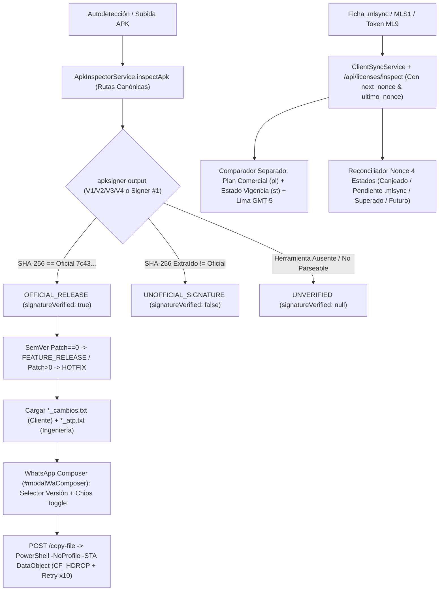

# Plan Maestro 22: Refinamiento Integral de `mochilalista_admin/` (Versiones APK, Firma Build-Tools 37+, Matriz, Compositor WhatsApp, Portapapeles Windows, Sync `.mlsync` e Inspector Forense)

> [!IMPORTANT]
> **Estado del Documento:** Versión **1.5** — **100% COMPLETADO Y CERTIFICADO (Fases 1 a 5 Cerradas — `199/199` pruebas en verde)**  
> **Fecha de Auditoría:** 2026-11-24 | **Cierre Fase 1:** 2026-11-25 | **Cierre Fase 2:** 2026-11-25 | **Cierre Fase 3:** 2026-11-25 | **Cierre Fase 4:** 2026-11-25 | **Cierre Final Plan 22:** 2026-11-25  
> **Ámbito Estricto:** Plataforma de escritorio local **`mochilalista_admin/`** únicamente. El proyecto móvil **`app_movil/`** (`v9.40.0+84`, commit `02025de`) permanece **CERRADO e INMUTABLE**.  
> **Entornos Intocables:** Jamás leer destructivamente, sobrescribir ni exponer datos reales de `data/prod_clients_db.json`, `data/prod_releases_db.json`, `data/owner_config.json`, `data/vault_keyring.json`, `private_keys/` ni `releases_apks/prod/`.

### Salvaguardas Técnicas Preventivas (Paso 0 — Versión 1.1)

1. **Fase 1 (`copy-file` Windows PowerShell 5.1):** Carga explícita de `Add-Type -AssemblyName System.Windows.Forms` bajo `powershell -NoProfile -STA` con escape seguro de comillas simples (`'` -> `''`) en la ruta del APK antes de armar `DataObject` (`SetFileDropList` + `Preferred DropEffect` + `SetDataObject($dataObj, $true, 10, 50)`).
2. **Fase 1 (`verify` y `companion-notes`):** Devolver también `suggested_changelog` (`*_cambios.txt`) y `suggested_internal_notes` (`*_atp.txt`) en `POST /api/releases/:version/verify` y mediante `GET /api/releases/:version/companion-notes` para consumo directo en `#modalEditRelease` durante la Fase 2.
3. **Fase 4 (`.mlsync`):** Normalizar equivalencias `EXPIRADA` / `VENCIDA` en `_computeAuthoritativeClientStatus` y registrar/calcular el delta de escaneos IA consumidos (`aiu`) respecto a la sincronización anterior.
4. **Fase 5 (Cierre):** Validación obligatoria con `git check-ignore --no-index -v` sobre las 7 rutas sensibles antes del commit y push final.

---

## 1. Resumen Ejecutivo de Causas Raíz (Evidencia Empírica & Forense)

La auditoría línea por línea sobre el código fuente real de `mochilalista_admin/`, respaldada por ejecución diagnóstica real sobre `C:\Users\vjuli\Documents\v-app-offline apks\mochilalista_v9.38_atp.apk`, `mochilalista_v9.40_atp.apk` y PowerShell 5.1, identificó las causas raíz exactas detrás de los bugs reportados en los 6 Pilares:

| Pilar | Síntoma Reportado / Captura | Archivo y Línea Exacta | Causa Raíz Forense Verificada |
| :--- | :--- | :--- | :--- |
| **1A** | Lupa gigante ocupando la mitad superior de `Matriz de Distribución` | [index.html](file:///C:/Users/vjuli/Documents/mochilalista-app/mochilalista_admin/web/index.html#L736-L739), [styles.css](file:///C:/Users/vjuli/Documents/mochilalista-app/mochilalista_admin/web/css/styles.css#L1627-L1665) | `<svg class="search-icon">` no tiene estilos inline en `#tabReleaseManager` y la clase `.search-icon` **no existe en absoluto en `styles.css`**, por lo que el `<svg>` expande al `100%` de `.search-input-wrap` (`340px`). |
| **1B** | `Error: El archivo APK de origen no existe en disco` al pulsar `Seleccionar e Importar` + duplicados con `..\` | [admin_app.js](file:///C:/Users/vjuli/Documents/mochilalista-app/mochilalista_admin/web/js/admin_app.js#L7332), [apk_inspector_service.dart](file:///C:/Users/vjuli/Documents/mochilalista-app/mochilalista_admin/lib/apk_inspector_service.dart#L208-L287), [server.dart](file:///C:/Users/vjuli/Documents/mochilalista-app/mochilalista_admin/server.dart#L1651-L1657) | 1) `onclick="importLocalApkDirectly('${escapeHtml(b.file_path)}')"` intercala rutas Windows con `\` dentro de un literal JS; `\v` se convierte en tabulación vertical y `\` desaparece (`C:Usersvjuli...`). 2) `detectLocalApks` devuelve rutas sin normalizar (`..\`) y sin deduplicar SHA-256 iguales (`app-release.apk` vs `v*_atp.apk`). 3) En `server.dart:1654`, `Directory('../app_movil/build').absolute.path` conserva `..\` mientras `canonicalSource` está resuelto, provocando falso `403`. |
| **1C** | APKs oficiales firmados (RSA-4096 `7c43addc...`) aparecen como `No Oficial / posible debug.apk` | [apk_inspector_service.dart](file:///C:/Users/vjuli/Documents/mochilalista-app/mochilalista_admin/lib/apk_inspector_service.dart#L176-L199), [apk_inspector_service.dart](file:///C:/Users/vjuli/Documents/mochilalista-app/mochilalista_admin/lib/apk_inspector_service.dart#L402-L425), [admin_app.js](file:///C:/Users/vjuli/Documents/mochilalista-app/mochilalista_admin/web/js/admin_app.js#L7432) | `_findBuildTool` elige `build-tools\37.0.0\apksigner.bat` (`37.0.0 > 36.1.0`). En Build-Tools `37.0.0`, `apksigner` cambió el encabezado de **`Signer #1 certificate SHA-256 digest:`** a **`V2 Signer: certificate SHA-256 digest:`**. `_parseApksignerOutput` solo busca `Signer #1 certificate...`, retorna `signerSha256 = null` pese a `exitCode == 0`, y las líneas `188-195` degradan el APK a `UNOFFICIAL_SIGNATURE` (`signatureVerified: false`). Además, si `exitCode != 0`, línea `197` pone `signatureVerified = false` en `UNVERIFIED`, activando el banner rojo en JS (`data.signature_verified === false`). |
| **1D** | `9.38.0` se pre-selecciona como `HOTFIX` y no aprovecha notas técnicas `*_atp.txt` | [admin_app.js](file:///C:/Users/vjuli/Documents/mochilalista-app/mochilalista_admin/web/js/admin_app.js#L7379-L7404), [apk_inspector_service.dart](file:///C:/Users/vjuli/Documents/mochilalista-app/mochilalista_admin/lib/apk_inspector_service.dart#L428-L473) | `populateCreateReleaseFormFromInspection` nunca calcula el tipo sugerido desde SemVer (`patch == 0` → `FEATURE_RELEASE` vs `patch > 0` → `HOTFIX`). Tampoco lee `mochilalista_vX.Y_atp.txt` para sugerir las notas privadas de ingeniería. |
| **2** | Clientes `Al Día` / `Versión superior` bloqueados sin `Reenviar APK` ni corrección ante `Marcar Actualizado` accidental | [admin_app.js](file:///C:/Users/vjuli/Documents/mochilalista-app/mochilalista_admin/web/js/admin_app.js#L6795-L6829), [database_service.dart](file:///C:/Users/vjuli/Documents/mochilalista-app/mochilalista_admin/lib/database_service.dart#L920-L929), [server.dart](file:///C:/Users/vjuli/Documents/mochilalista-app/mochilalista_admin/server.dart#L875-L895) | Solo las filas `OUTDATED` o `SENT` renderizan botones (`6797`); `UP_TO_DATE` y `AHEAD` solo muestran texto estático. Además `server.dart:885` llama `markClientUpdated(clientId, versionName)` con `force: false`, impidiendo corregir hacia abajo una versión marcada por error y sin guardar `previous_installed_version`. |
| **3** | `#modalWaComposer` bloqueado a `v9.32.0`, chips `Insertar:` duplican bloques sin estado visual, plantilla no deseleccionable, y riesgo de portapapeles Windows | [admin_app.js](file:///C:/Users/vjuli/Documents/mochilalista-app/mochilalista_admin/web/js/admin_app.js#L6058-L6186), [index.html](file:///C:/Users/vjuli/Documents/mochilalista-app/mochilalista_admin/web/index.html#L3063-L3205), [server.dart](file:///C:/Users/vjuli/Documents/mochilalista-app/mochilalista_admin/server.dart#L1787-L1796) | `waApkDispatchPanel` usa título estático (`#waApkVersionTitle`) sin `<select>` de versión ni alerta `>100 MB` (límite web de WhatsApp); `selectWaTemplate` no alterna off en segundo clic; `insertWaSnippet` solo inserta texto nuevo sin rastrear ni CSS `.active`; `server.dart` invoca `Set-Clipboard -LiteralPath` sin `-STA` ni reintentos ante bloqueo COM (`OpenClipboard`) ni `Preferred DropEffect`. |
| **4** | Botón eliminar cae a 2.ª línea, tamaños sin `MB`, releases antiguos `Sin Verificar`, y `#modalEditRelease` sin notas `*_cambios.txt` ni vinculación local | [admin_app.js](file:///C:/Users/vjuli/Documents/mochilalista-app/mochilalista_admin/web/js/admin_app.js#L6318-L6531), [index.html](file:///C:/Users/vjuli/Documents/mochilalista-app/mochilalista_admin/web/index.html#L2833-L2899) | `ACCIONES APK` (`6354`) usa `flex-wrap:wrap`; `r.file_size_mb` muestra strings legacy sin sufijo `MB`; no existe `POST /api/releases/:version/verify` para re-auditar firma/disco ni selector local en `#editRelVariantsContainer`. |
| **5** | Bucle infinito `Estado de Licencia: TRIAL -> ACTIVA (Modificado)` en `.mlsync` + strings crudos `false/true/NONE/ATTENTION/UTC` y ausencia de `dr/aiu/pc` | [client_sync_service.dart](file:///C:/Users/vjuli/Documents/mochilalista-app/mochilalista_admin/lib/client_sync_service.dart#L290-L319), [admin_app.js](file:///C:/Users/vjuli/Documents/mochilalista-app/mochilalista_admin/web/js/admin_app.js#L4565-L4579) | `client_sync_service.dart:318` compara **`matchedClient['situation'] ?? matchedClient['license_type']`** (que resuelve al plan `'TRIAL'`) contra **`payload['st']`** (el estado de vigencia `'ACTIVA'`), y `applyClientSyncSnapshot` nunca muta esos campos, atrapando para siempre un falso `TRIAL -> ACTIVA (Modificado)`. Además se omiten `dr`, `aiu`, `pc` y la conversión horaria a Perú (`America/Lima`, GMT-5). |
| **6** | `#tabInspector` muestra `Nonce futuro listo para canje` para token `#1` ya canjeado (`Luzam` `ultimo_nonce = 1`), fechas UTC crudas, sin acciones ni historial | [server.dart](file:///C:/Users/vjuli/Documents/mochilalista-app/mochilalista_admin/server.dart#L1305-L1314), [admin_app.js](file:///C:/Users/vjuli/Documents/mochilalista-app/mochilalista_admin/web/js/admin_app.js#L7920-L7950) | `server.dart:1305-1313` omite `next_nonce`, `ultimo_nonce` y `last_sync_at` dentro de `result['matching_client']`. Como resultado, `admin_app.js:7923` evalúa `matchedClient.next_nonce \|\| 1` (siempre `1`), haciendo que `tNonce (1) >= cNonce (1)` dispare falsamente `Nonce futuro listo para canje`. |

---

## 2. Evidencia Diagnóstica Verificada en Consola (Sin Modificar Código)

Ejecución de verificación directa realizada en esta auditoría:

1. **Salida real de Android SDK Build-Tools `36.1.0` vs `37.0.0` sobre `mochilalista_v9.38_atp.apk`:**
   - `build-tools\36.1.0\apksigner.bat` (`exit=0`) imprime:
     `Signer #1 certificate SHA-256 digest: 7c43addc34776f3974eac23fdacc47599efd5393a4dbb28672d06899833ffd20`
   - `build-tools\37.0.0\apksigner.bat` (`exit=0`, elegida por `_findBuildTool` en orden descendente) imprime:
     `V2 Signer: certificate DN: CN=Julio Angello Vasquez Navarro, OU=MochilaLista Core Development, O=MochilaLista, L=Piura, ST=Piura, C=PE`
     `V2 Signer: certificate SHA-256 digest: 7c43addc34776f3974eac23fdacc47599efd5393a4dbb28672d06899833ffd20`
   - Ejecución directa de `ApkInspectorService.inspectApk` sobre `mochilalista_v9.38_atp.apk` confirmó la falla exacta:
     `INSPECT_V938: status=UNOFFICIAL_SIGNATURE verified=false signerSha=null signerDn=null vc=82 vn=9.38.0` (`STDOUT_LEN=1118`, `RAW_PROC_RUN: exit=0`).
   - Adicionalmente `build-tools\36.1.0\apksigner.bat` sobre `mochilalista_v9.40_atp.apk` y `app_movil\build\app\outputs\flutter-apk\app-release.apk` confirmó en ambos el mismo certificado oficial RSA-4096 `7c43addc...`.
2. **Inspección de Formatos del Portapapeles de Windows (PowerShell 5.1):**
   - `Set-Clipboard -LiteralPath` y `powershell -NoProfile -STA` con `Clipboard::SetFileDropList` rellenan `FileDrop,FileNameW,FileName`, pero `Set-Clipboard -LiteralPath` no implementa la sobrecarga de reintentos COM (`Clipboard.SetDataObject(data, true, 10, 50)`) ni inyecta explícitamente el stream binario `Preferred DropEffect` (`DROPEFFECT_COPY = 5`) ante aplicaciones como WhatsApp Desktop / Chromium o contención temporal del mutex del portapapeles de Windows.
3. **Estructura de archivos en Biblioteca Oficial (`C:\Users\vjuli\Documents\v-app-offline apks\`):**
   - Coexisten pares `mochilalista_vX.Y_atp.apk`, `mochilalista_vX.Y_atp.txt` (ficha técnica extensa de ingeniería, ~3–9 KB) y `mochilalista_vX.Y_atp_cambios.txt` (resumen comercial corto de ~550–4,200 bytes).

---

## 3. Arquitectura Técnica & Especificación Detallada por Pilar

### Diagrama de Flujo Corregido (APKs, Firma, WhatsApp `.APK` y Sincronización/Inspector)



---

### Pilar 1 — Gestor de Versiones (`#tabReleaseManager`): Lupa, Autodetección Windows, Firma `apksigner`, SemVer y `.txt`

1. **Corrección Global del Bug Visual de Lupa Gigante (CSS):**
   - En `mochilalista_admin/web/css/styles.css` (junto a `.search-input-wrap`, línea `1627`), definir de forma explícita `.search-input-wrap .search-icon` (y `.search-icon` acotado por defecto):
     - `position: absolute; left: 0.75rem; top: 50%; transform: translateY(-50%); width: 16px; height: 16px; color: var(--text-muted); pointer-events: none; flex-shrink: 0;`
   - Ajustar `.search-input-wrap:has(.search-icon) .search-input` (o `padding-left: 2.35rem;` en `#inputRelMatrixSearch`) para que el texto de búsqueda jamás se monte sobre el icono vectorial. Verificar todos los buscadores de `index.html` (`#inputClientSearch`, `#inputRelMatrixSearch`, `#inputFinSearch`) a nivel CSS para evitar cualquier icono `<svg>` desbordado.

2. **Eliminación del Error Windows `El archivo APK de origen no existe en disco`, Normalización de Rutas y Deduplicación SHA-256:**
   - **Frontend (`admin_app.js:7332`):** Prohibir la interpolación directa de rutas Windows con `\` dentro de `onclick="..."`. Renderizar el botón `"Seleccionar e Importar"` con un atributo seguro o adjuntando el evento vía DOM (`btn.dataset.sourcePath = b.file_path; btn.addEventListener('click', () => importLocalApkDirectly(b.file_path));`).
   - **Backend (`apk_inspector_service.dart`):**
     - Normalizar rutas de salida mediante un helper `_canonicalPath(String rawPath)` usando `File(rawPath).resolveSymbolicLinksSync()` (con fallback a `File(rawPath).absolute.uri.toFilePath()` limpio sin segmentos `..` y con `Platform.pathSeparator`). Aplicar en `_findBuildTool`, `inspectApk`, `_detectApk` y `detectLocalApks`.
     - En `detectLocalApks`, inspeccionar hasta los `12` candidatos más recientes (ordenados por `modifiedAt` descendente y priorizando `Biblioteca Oficial` ante igual fecha) y **deduplicar por `sha256`**: si `app_movil/build/app/outputs/flutter-apk/app-release.apk` coincide exactamente en `sha256` con `mochilalista_v9.40_atp.apk` en `v-app-offline apks`, conservar una única tarjeta (`Biblioteca Oficial`), anotando `also_found_in` / `duplicate_paths` en el JSON para transparencia del usuario sin duplicar tarjetas ni gastar 2 de los 6 slots.
   - **Backend (`server.dart:1640-1667`):** Normalizar tanto `canonicalSource` como cada raíz de `allowedRoots` usando resolución simbólica/canónica (`_resolveCanonicalDir(path)`), incluyendo `configService.apkLibraryDir`, `../app_movil/build`, `releases_apks` y `Directory.systemTemp`, de modo que rutas provenientes de `../app_movil/build` jamás fallen con `403` o `404` por segmentos `..`.

3. **Motor de Firma Criptográfica Compatible con Build-Tools `37.0.0+` y Estados Honestos:**
   - En `apk_inspector_service.dart` (`_parseApksignerOutput` líneas `402-425`):
     - Reemplazar la expresión rígida `Signer #1` por evaluación línea a línea que ignore `SourceStamp` y acepte tanto:
       - `V\d+(?:\.\d+)?\s+Signer:\s*certificate\s+SHA-256\s+digest:\s*([0-9a-fA-F:]+)` (Android SDK 37+)
       - `Signer\s*#\d+\s*certificate\s+SHA-256\s+digest:\s*([0-9a-fA-F:]+)` (Android SDK <= 36)
       - Y análogo para `certificate\s+DN:\s*(.+)`.
     - Si existen múltiples esquemas o firmantes listados, verificar los hashes de certificado extraídos contra `officialSignerSha256`.
   - **Separación Honesta de 3 Estados (`signatureStatus` & `signatureVerified`):**
     - `OFFICIAL_RELEASE` (`signatureVerified: true`): `apksigner` salió con código `0`, extrajo `signerSha256` y coincide con `7c43addc34776f3974eac23fdacc47599efd5393a4dbb28672d06899833ffd20`.
     - `UNOFFICIAL_SIGNATURE` (`signatureVerified: false`): `apksigner` salió con código `0`, extrajo un `signerSha256 != null` que **no** coincide con la huella oficial (debug keystore o firma ajena).
     - `UNVERIFIED` (`signatureVerified: null`): `apksigner` no está disponible en SDK, falló por timeout/error de proceso, o salió `0` pero no devolvió ningún hash legible (`signatureDetail` informa la causa técnica). Jamás acusar de `"debug.apk"` cuando solo falló la lectura/herramienta.
   - En `admin_app.js` (`renderSignatureShieldBanner`, tarjetas de autodetección y tabla del catálogo), evaluar explícitamente `status === 'UNOFFICIAL_SIGNATURE'` para pintar alerta roja `"No Oficial / posible debug.apk"` y tratar `status === 'UNVERIFIED' || signature_verified == null` con badge ámbar `"Sin Verificar"`. *(Actualizar la aserción puntual en `apk_inspector_and_releases_test.dart:218` de `isFalse` a `isNull` en coherencia con el modelo).*

4. **Auto-sugerencia SemVer y Carga Dual de `.txt` en Alta de Release:**
   - En `ApkInspectionResult` (`apk_inspector_service.dart`), agregar campos `suggestedReleaseType` y `suggestedInternalNotes`:
     - **`suggestedReleaseType`:** Extraer `major.minor.patch` de `versionName`. Si `patch > 0` → `'HOTFIX'`; si `patch == 0` → `'FEATURE_RELEASE'`.
     - **`suggestedInternalNotes`:** Leer como UTF-8 el archivo compañero técnico `${apkBaseName}.txt` o `mochilalista_v${major}.${minor}(.${patch})?_atp.txt` (excluyendo `_cambios.txt` / `_changelog.txt`) ubicado junto al APK o en `apkLibraryDir`.
   - En `populateCreateReleaseFormFromInspection` (`admin_app.js:7379`): fijar `relType.value = data.suggested_release_type || inferReleaseTypeFromSemVer(data.version_name)`, actualizar `updateReleaseTypeInfo('relType', 'relTypeInfoText')` y prellenar `relInternalNotes` (si está vacío) con `data.suggested_internal_notes`, además de un botón `"Cargar ficha *_atp.txt / *_cambios.txt"` bajo los campos de notas.

---

### Pilar 2 — Matriz de Distribución (`#tabReleaseManager`)

1. **Botón Permanente `Reenviar / Elegir APK` en Filas `Al Día` y `Versión superior` (`admin_app.js:6795-6829`):**
   - Mantener los badges positivos `Al Día` (con SVG check, sin carácter crudo `✓`) y `Versión superior (vX.Y.Z)`.
   - Reemplazar el texto plano `"Sin acción requerida"` / `"Versión anticipada (sin acciones)"` por un botón compacto `btn-outline btn-sm` con SVG de envío (`Reenviar / Elegir APK`) que invoque `openApkDispatchComposer(row.client_id, row.latest_version, 'resend')` para permitir reenvíos por pérdida de celular, reinstalación o envío de versión alternativa.

2. **Reversión / Edición Rápida Ante `Marcar Actualizado` Accidental:**
   - **Backend (`database_service.dart` & `server.dart:875-895`):**
     - En `markClientUpdated(clientId, versionName, {bool force = false})`, antes de actualizar `installed_version`, almacenar `previous_installed_version = currentInstalled` (si cambió).
     - En `POST /api/clients/:id/mark-updated`, aceptar parámetro opcional `'force': body['force'] == true` (respetando el comportamiento por defecto `force: false` para anti-degradación involuntaria).
   - **Frontend (`admin_app.js:7211` y `renderReleaseMatrix`):**
     - Tras pulsar `"Marcar Actualizado"`, incluir un botón inline de `"Editar versión"` (icono lápiz SVG junto a `VERSIÓN ACTUAL` o `ACCIÓN COMERCIAL`) que permita elegir rápidamente la versión real instalada desde un selector compacto (o el modal ligero de ajuste de versión) llamando a `POST /api/clients/:id/mark-updated` con `{ version_name, force: true }`.
     - Mostrar en el toast tras marcar actualizado un recordatorio claro y, si hay versión previa, ofrecer botón `"Deshacer"` en el sistema de toasts (`showToast(..., { actionLabel: 'Deshacer', onAction: ... })`) que restaure `previous_installed_version` con `force: true`.

---

### Pilar 3 — Compositor Universal de WhatsApp (`#modalWaComposer`) y Portapapeles Binario Windows

1. **Deselección (Toggle) en `Plantillas Rápidas de 1 Clic`:**
   - En `admin_app.js`: mantener `preTemplateDraft` y estado de chips activos. Si `currentWaComposerTemplateKey === tplKey` al hacer clic en una píldora `.wa-template-btn` ya activa, desactivar la píldora (`currentWaComposerTemplateKey = null`), limpiar únicamente el cuerpo de plantilla restaurando el borrador previo o cadena vacía, y re-aplicar o limpiar coherentemente según corresponda **sin duplicar ni perder bloques `Insertar:`**.

2. **Chips `Insertar:` Idempotentes en Multi-selección Visual (`+ Datos Yape / Plin`, `+ Hardware ID`, `+ Vencimiento`, `+ Último Token`):**
   - Definir constructores deterministas por clave (`payment`, `device`, `expiration`, `token`) en `admin_app.js` **sin emojis crudos en los botones ni encabezados UI** (y con formato claro en el texto del mensaje para WhatsApp).
   - **Primer clic:** Inserta el bloque correspondiente en `#waCompMessage` y añade la clase `.active` + icono SVG check al chip `.wa-insert-chip`.
   - **Segundo clic:** Detecta el bloque exacto presente en `#waCompMessage`, lo remueve limpiamente (colapsando saltos de línea sobrantes) y retira `.active` del chip.
   - **Sincronización Reactiva:** Un helper `syncWaInsertChipsState()` re-evalúa el contenido del `textarea` en eventos `input`, `selectWaTemplate`, `resetCurrentWaTemplate` y apertura del modal para que el estado visual `.active` refleje siempre la verdad del texto.
   - En `styles.css` (junto a `.wa-insert-chip`, línea `2252`), agregar `.wa-insert-chip.active` con contraste nítido en modo oscuro y claro (`rgba(37, 211, 102, 0.14)`, borde `#25d366`, color `#25d366`).

3. **Selector Dinámico de Versión APK + Alerta `>100 MB` + `Copiar Solo Texto` en `#waApkDispatchPanel`:**
   - Reemplazar el título rígido `#waApkVersionTitle` por un encabezado que integre `<select id="waApkVersionSelect">` con todas las versiones de `globalReleases` (manteniendo `#waApkVersionTitle` o span descriptivo para compatibilidad con tests).
   - Al cambiar el selector (`onChangeDispatchReleaseVersion`):
     - Actualiza `currentDispatchRelease`, código de Build, tamaño formateado con `MB` (`formatApkSizeMb`), Esquema DB, badge de firma oficial RSA-4096, Estado en Disco (`Verificado en Disco` / `Sin Binario en Disco`) y tarjetas `Universal` / `ARM64 Ligero`.
     - Regenera la sección de versión, novedades (`rel.changelog`) y enlace de descarga dentro de `#waCompMessage` si estamos en flujo de actualización, conservando chips `Insertar:` activos.
   - **Alerta de Peso `> 100 MB`:** Si el tamaño numérico del binario supera `100` MB (`~109 MB`), mostrar un banner informativo compacto dentro `#waApkDispatchPanel` explicando que WhatsApp Web limita adjuntos a `100 MB` mientras WhatsApp Desktop permite hasta `2 GB`, sugiriendo Enlace Drive o WhatsApp Desktop para evitar bloqueos al pegar.
   - **Botón `Copiar Solo Texto`:** Agregar botón compacto `"Copiar Solo Texto"` junto a `"Abrir Carpeta"`, `"Solo Abrir WhatsApp"` y `"Copiar Archivo .APK y Abrir WhatsApp"` (garantizando visibilidad responsiva sin desbordar `.modal-footer`). Conservar textualmente la cadena `"Archivo .apk copiado: presiona Ctrl + V en WhatsApp"` exigida por `releases_matrix_and_ui_test.dart:239`.

4. **Endurecimiento del Portapapeles Real Windows `CF_HDROP` en `POST /api/releases/:version/copy-file` (`server.dart:1787-1806`):**
   - Reemplazar la invocación simple `Set-Clipboard -LiteralPath` por un script robusto en **`powershell -NoProfile -STA`** que:
     1. Valide `Test-Path -LiteralPath $p`.
     2. Construya un `System.Windows.Forms.DataObject`, inserte `StringCollection` en `SetFileDropList($col)` y registre `Preferred DropEffect` (`[byte[]](5,0,0,0)` en `MemoryStream`, indicando `DROPEFFECT_COPY` estándar de Explorador de Windows / Chromium / Electron / WhatsApp Desktop).
     3. Llame `[System.Windows.Forms.Clipboard]::SetDataObject($dataObj, $true, 10, 50)` (persistencia tras cerrar proceso + 10 reintentos cada `50 ms` frente a bloqueos momentáneos de portapapeles en Windows).
   - Devuelva `{ ok: false, error: <stderr> }` con HTTP `500` o detalle diagnóstico si PowerShell falla tras los reintentos, manteniendo el hook `onCopyFileOverride` intacto para pruebas unitarias rápidas y multiplataforma.
   - Tras copiar desde UI, mostrar toast claro (`Archivo .apk copiado: presiona Ctrl + V en WhatsApp...`) junto con aviso recordatorio en el compositor por si el operador desea pulsar `"Volver a Copiar .APK"` o `"Abrir Carpeta"`.

---

### Pilar 4 — Catálogo de Versiones Publicadas y Modal `#modalEditRelease`

1. **Fila Compacta de `ACCIONES APK` en `#releasesTable` (`admin_app.js:6353-6404`):**
   - Cambiar el contenedor flex de acciones a `display:flex; gap:0.25rem; flex-wrap:nowrap; align-items:center; white-space:nowrap;` con padding compacto (`btn-xs` / `0.26rem 0.45rem`) y añadir botón de acción `"Verificar"` (`POST /api/releases/:version/verify`) junto a `APK`, `Copiar`, `Carpeta`, `Editar` y `Eliminar` (todos alineados en una única fila horizontal).
   - **Consistencia de Unidades (`MB`):** Implementar helper global `formatApkSizeMb(raw)` que normalice strings legacy (`"108.86"` → `"108.86 MB"`, `"109.80 MB"` → `"109.80 MB"`, vacío → `"-"`). Aplicarlo en tabla del catálogo, modal edición y modal WhatsApp.
   - **Adopción por Versión:** Mostrar debajo o junto al nombre de versión un pill discreto (`N clientes`) calculado desde `globalClients` según `installed_version == r.version_name`.

2. **Nuevo Endpoint `POST /api/releases/:version/verify` y Panel Rico de Variantes en `#modalEditRelease`:**
   - **Backend (`server.dart` + `database_service.dart`):** Implementar `POST /api/releases/:version/verify` que audita el binario físico real de la versión (`universal_apk`, `arm64_apk` y/o `apk_file_path`) invocando `inspector.inspectApk(...)`, corrige en DB `file_exists`, `file_size_mb`, `apk_sha256`, `signature_verified`, `signature_status` (eliminando el `"Sin Verificar"` de `v9.30`–`v9.32` si sus APKs están en disco y firmados con `7c43addc...`), `signer_sha256`, `signer_dn`, `version_code` y `db_schema_version`.
   - **Modal `#modalEditRelease` (`renderEditReleaseVariants` en `admin_app.js:6460`):**
     - Cada tarjeta (`Universal` y `ARM64 Ligero`) exhibe: tamaño con `MB`, estado real en disco (`Verificado en disco` verde vs `No encontrado` rojo), hash SHA-256 resumido con botón `"Copiar SHA"`, badge de firma oficial (`Oficial RSA-4096` / `No Oficial` / `Sin Verificar`), botón `"Re-verificar"`, y doble vía para adjuntar APK: `"Subir desde PC"` + `"Vincular desde Biblioteca Local"` (desplegable con APKs de `/api/releases/detect-local-build` llamando a `import-local-apk` + `PUT /api/releases/:version`).
     - Junto a Changelog e Ingeniería en `#modalEditRelease`, agregar acciones de 1 clic para importar el texto actualizado desde `*_cambios.txt` o `*_atp.txt` local si existe en la biblioteca (`GET /api/releases/:version/companion-notes` o integrado al verificar).

---

### Pilar 5 — Sincronización Offline `.mlsync` / `MLS1` y Ficha 360°

1. **Erradicación del Bucle Infinito `TRIAL -> ACTIVA (Modificado)`:**
   - En `client_sync_service.dart` (`analyzeForClients`, líneas `290-319`):
     - Reemplazar la fila híbrida errónea `addDiff('license_status', 'Estado de Licencia', matchedClient['situation'] ?? matchedClient['license_type'] ?? 'ACTIVA', payload['st'] ?? 'ACTIVA')` por **dos filas claras y ortogonales**:
       1. `addDiff('license_type', 'Plan Comercial', matchedClient['license_type'] ?? 'MENSUAL', payload['pl'] ?? matchedClient['license_type'] ?? 'MENSUAL', type: 'badge')`
       2. `addDiff('license_status', 'Estado de Vigencia', _computeAuthoritativeClientStatus(matchedClient), payload['st'] ?? 'ACTIVA', type: 'badge')`
       donde `_computeAuthoritativeClientStatus` replica la lógica real del Admin (`PROSPECTO` si prospecto; `PERPETUA` si perpetuo; `VENCIDA` si `license_expires` expirado; de lo contrario `ACTIVA`, **incluyendo cuando `license_type == 'TRIAL'` vigente**).
     - Así, un cliente `TRIAL` vigente (`ACTIVA`) sincronizado contra una ficha `.mlsync` (`pl: 'TRIAL'`, `st: 'ACTIVA'`) reportará **`TRIAL -> TRIAL (Sin cambios)`** y **`ACTIVA -> ACTIVA (Sin cambios)`**, eliminando el bucle infinito de raíz.
   - Re-confirmar que `applyClientSyncSnapshot` **no** sobrescribe unilateralmente `license_type` comercial (la app solo reporta telemetría, mientras el CRM Admin mantiene la autoridad comercial de planes y pagos).

2. **Exposición Completa de Métricas y Estado `all_unchanged` / Mismo Timestamp:**
   - Añadir al comparador (`client_sync_service.dart:309-319`):
     - `dr` (`trial_days_remaining` / días de vigencia): `'Días de Vigencia Restantes'`
     - `aiu` (`ai_credits_used_total`): `'Escaneos IA Consumidos (Histórico)'` (mostrando delta de consumo cuando hay registro previo)
     - `pc` (`profiles_count`): `'Perfiles de Negocio Activos'`
   - Calcular y retornar en el JSON de `analyzeForClients`:
     - `'all_unchanged': changes.isNotEmpty && changes.every((c) => c['is_different'] != true)`
     - `'same_timestamp': lastSyncAt != null && lastSyncAt.millisecondsSinceEpoch == tsEpoch`
   - En `admin_app.js` (`renderSyncDiffTable`, `analyzeSyncReported`, `analyzeGlobalSync`): cuando `all_unchanged || same_timestamp`, renderizar un banner verde claro `"La ficha coincide al 100% con el estado actual del CRM — Sin cambios por aplicar"` y adaptar el botón a `"Re-confirmar Ficha"` en lugar de anunciar falsos modificados.

3. **Humanización Idiomática y Zona Horaria Perú (`America/Lima`, GMT-5):**
   - Crear en `admin_app.js` los helpers centralizados `formatLimaDateTime(isoOrEpoch)` y `humanizeSyncFieldValue(field, val)`:
     - **`formatLimaDateTime`:** Convierte timestamps UTC ISO-8601 o epoch ms a zona `America/Lima` (`UTC-5`, formato `DD/MM/YYYY HH:mm:ss (Lima GMT-5)`), preservando el ISO UTC original en atributo `title`.
     - **Humanización de campos técnicos en Comparador y Ficha 360°:**
       - Booleanos (`backup_drive_linked`, `uses_byok`): `true` → `"Sí"`, `false` → `"No"` (en español, con badge semántico).
       - `backup_health_status`: `OK` → `"Óptimo"`, `ATTENTION` → `"Requiere atención"`, `CRITICAL` → `"Crítico"`, `NONE` → `"Sin respaldo"`.
   - **Actualización de Ficha 360° (`openClient360Drawer` en `admin_app.js:4559-4579` e `index.html:3615-3621`):**
     - `drawerLastSync`: formateado con `formatLimaDateTime(client.last_sync_at)`.
     - `drawerAiBreakdown`: mostrar `"En celular: X IA | Consumidos: Z IA | Bono pend: +Y IA"` exponiendo `ai_credits_used_total`.
     - `drawerBackupDrive`: `"Vinculado (Requiere atención)"` humanizado y fila opcional de `Perfiles Activos` / `Último Nonce Reportado`.

---

### Pilar 6 — Inspector Forense Dual (`#tabInspector`)

1. **Solución Exacta al Bug `Nonce futuro listo para canje` en `Luzam` y Tokens Emitidos:**
   - **Backend (`server.dart:1305-1317`):** Incluir en `result['matching_client']`:
     ```dart
     'next_nonce': matched['next_nonce'] ?? 1,
     'ultimo_nonce': matched['ultimo_nonce'],
     'last_sync_at': matched['last_sync_at'],
     'license_expires': matched['license_expires'],
     'ai_reported_balance': matched['ai_reported_balance'],
     'ai_credits_used_total': matched['ai_credits_used_total'],
     'document_id': matched['document_id'] ?? matched['document_number'],
     ```
   - **Frontend (`admin_app.js:7923-7933`):** Implementar matriz de 4 estados combinando `ultimo_nonce` (canje real reportado por el celular vía `.mlsync`) y `next_nonce` (siguiente contador correlativo del servidor):
     1. **Canjeado en celular (Verificado por `.mlsync`):** Si `ultimo_nonce !== null && ultimo_nonce !== undefined && tNonce <= ultimo_nonce` → badge verde (`badge-green`) `"Canjeado en celular (Verificado por .mlsync #N)"`.
     2. **Emitido — Pendiente de canje en celular:** Si `tNonce == cNonce - 1` (y no verificado aún por `ultimo_nonce >= tNonce`) → badge azul/info `"Emitido — Pendiente de canje en celular (Sin .mlsync reciente)"`.
     3. **Nonce futuro listo para canje:** ÚNICAMENTE si `tNonce >= cNonce` → badge ámbar (`badge-yellow`) `"Nonce futuro listo para canje"`.
     4. **Nonce histórico ya superado:** Si `tNonce < cNonce - 1` (y sin confirmación `ultimo_nonce`) → badge púrpura (`badge-purple`) `"Superado / Histórico"`.

2. **Enriquecimiento Operativo de `#tabInspector`:**
   - Formatear `iat`, `u`, `ts` y `lb` en `America/Lima` (`formatLimaDateTime`) con UTC original en `title`.
   - Cuando `#tabInspector` decodifique una ficha `.mlsync` / `MLS1` (`renderInspectClientSync`) y exista `data.changes`, reutilizar `renderSyncDiffTable(data.changes)` debajo o junto a las métricas del reporte para evitar discrepancias visuales.
   - Añadir botones de acción inmediata dentro de `#inspectMatchingClientBox` (tanto para tokens `ML9` como fichas `MLS1`):
     - `Abrir Ficha 360°` (`openClient360Drawer(matchedClient.id, 'drawerTabOverview')` con navegación automática al tab Cartera)
     - `Abrir WhatsApp` (`openWhatsAppComposer(matchedClient.id)`)
     - `Copiar Informe Forense` (texto plano estructurado con validez, claims/métricas, nonce reconciliado y cliente).
   - Añadir acordeón colapsable `"Historial de Auditorías de la Sesión"` con los últimos `10` códigos/fichas auditados en memoria / `sessionStorage`, permitiendo recargar cualquiera en 1 clic sin volver a buscar archivos o mensajes.
   - Asegurar **cero emojis crudos** en todo el flujo UI de `mochilalista_admin/web/` (`showToast` mediante SVGs inline acotados a `16px`, badges sin `✓` plano cuando exista SVG, botones y cabeceras limpias).

---

## 4. Plan de Implementación en Fases Secuenciales

Cada fase se ejecuta, analiza (`dart analyze`, `node --check`) y certifica en consola (`dart test` 100% en verde) antes de avanzar a la siguiente:

| Fase | Alcance y Archivos Objetivo | Entregables Técnicos Clave | Tests & Criterio de Cierre |
| :--- | :--- | :--- | :--- |
| **FASE 1 (COMPLETADA ✅ — v1.1)**<br>Backend APK, Firma 37+, Dedup, Portapapeles Windows y Nonces | `lib/apk_inspector_service.dart`<br>`lib/database_service.dart`<br>`server.dart`<br>`test/apk_inspector_and_releases_test.dart`<br>`test/plan22_fase1_apk_and_clipboard_test.dart` | • Parser multi-formato `apksigner` (`V1..V4 Signer:` y `Signer #1`, excluye `SourceStamp`).<br>• 3 estados honestos (`OFFICIAL_RELEASE`, `UNOFFICIAL_SIGNATURE`, `UNVERIFIED` con `signatureVerified: null`).<br>• Normalización canónica Windows sin `..\` + dedup SHA-256.<br>• `suggestedReleaseType` SemVer + lectura `*_atp.txt` para notas de ingeniería.<br>• `POST /api/releases/:version/verify`, `GET /api/releases/:version/companion-notes` y `mark-updated` (`force: true` + `previous_installed_version`).<br>• Portapapeles `-STA` `DataObject` (`CF_HDROP` + `Preferred DropEffect` + retry x10).<br>• Enriquecimiento de `matching_client` (`next_nonce`, `ultimo_nonce`, `last_sync_at`). | **CERTIFICADA (2026-11-25):** `dart analyze` = `No issues found!`; `mochilalista_v9.40_atp.apk` en vivo = `OFFICIAL_RELEASE` (`verified=true`, `Build 84`, `108.47 MB`, `FEATURE_RELEASE`); PowerShell 5.1 `-STA` = `FileDrop,FileNameW,FileName,Preferred DropEffect`; Suite `dart test` = **188/188 en verde** (`0` fallos). |
| **FASE 2 (COMPLETADA ✅ — v1.2)**<br>`#tabReleaseManager`, Matriz, Catálogo y `#modalEditRelease` | `web/css/styles.css`<br>`web/index.html`<br>`web/js/admin_app.js`<br>`test/plan22_fase2_releases_matrix_catalog_test.dart` | • Fix `.search-icon` en `styles.css` (erradica lupa gigante) y `<svg>` acotados.<br>• Fix `localBuildsGrid` sin `\` escapados en `onclick` (`dataset` / delegación DOM + badges origen y dedup).<br>• `renderSignatureShieldBanner` estricto 3 estados; auto-relleno SemVer `#relType` y `#relInternalNotes` + recarga `.txt`.<br>• Matriz: botón `Reenviar / Elegir APK` en `Al Día`/`Versión superior` (SVG check sin `✓`) + `Deshacer` en toast + `#modalFixClientVersion` (`force: true`).<br>• Catálogo: acciones en 1 línea (`nowrap`), `formatApkSizeMb` (`MB`), adopción `N clientes`, botón `Verificar`.<br>• `#modalEditRelease`: tarjetas ricas (`Verificado en disco`/`No encontrado`, `Copiar SHA`, 3 estados, `Re-verificar`, `Subir desde PC` + `Vincular desde Biblioteca Local`, `Cargar *_cambios.txt` / `*_atp.txt`). | **CERTIFICADA (2026-11-25):** `node --check` = OK (`0`); `dart analyze` = `No issues found!`; Suite `dart test` = **192/192 en verde** (`0` fallos, incluyendo `releases_matrix_and_ui_test.dart`, `whatsapp_apk_dispatch_test.dart`, `plan22_fase1_apk_and_clipboard_test.dart` y `plan22_fase2_releases_matrix_catalog_test.dart`). |
| **FASE 3 (COMPLETADA ✅ — v1.3)**<br>Compositor Universal de WhatsApp (`#modalWaComposer`) | `web/index.html`<br>`web/css/styles.css`<br>`web/js/admin_app.js`<br>`test/plan22_fase3_wa_composer_test.dart` | • Toggle off al 2.º clic en `Plantillas Rápidas de 1 Clic` preservando borrador y chips `Insertar:` activos (incl. apertura/cierre de panel APK en `Nueva Versión APK` desde CRM).<br>• Multi-select idempotente `.wa-insert-chip.active` + check SVG, constructor determinista + guardas si falta dato, limpieza exacta de saltos `\n{3,}` y `syncWaInsertChipsState()` en `input`/edición.<br>• Selector `<select id="waApkVersionSelect">` dinámico (`9.x..`) en `#waApkDispatchPanel`, auto-variante y preservación de chips activos al cambiar versión.<br>• Aviso informativo `>100 MB` (WhatsApp Web 100 MB vs Desktop 2 GB) + `#btnWaCopyTextOnly` (`Copiar Solo Texto`) y footer con wrap responsivo.<br>• Flujo robusto `.APK` (`copyCurrentDispatchApkToClipboard`), toast exacto `Archivo .apk copiado: presiona Ctrl + V en WhatsApp` y `#waApkCopySuccessHint` con `Volver a Copiar .APK`. | **CERTIFICADA (2026-11-25):** `node --check` = OK (`0`); `dart analyze` = `No issues found!`; Suite `dart test` = **195/195 en verde** (`0` fallos, incluyendo `whatsapp_apk_dispatch_test.dart`, `releases_matrix_and_ui_test.dart` y `plan22_fase3_wa_composer_test.dart`). |
| **FASE 4 (COMPLETADA ✅ — v1.4)**<br>`.mlsync`, Ficha 360°, Inspector Forense y UI Cero Emojis | `lib/client_sync_service.dart`<br>`lib/database_service.dart`<br>`web/index.html`<br>`web/css/styles.css`<br>`web/js/admin_app.js`<br>`test/plan22_fase4_sync_and_inspector_test.dart` | • Separación ortogonal `license_type` (`Plan Comercial`) vs `license_status` (`Estado de Vigencia` vía `_computeAuthoritativeClientStatus` + equivalencia `EXPIRADA`/`VENCIDA`): cero bucle `TRIAL -> ACTIVA`.<br>• Telemetría `dr`, `aiu` (con `ai_credits_used_delta`), `pc`, `last_sync_ts`, `all_unchanged` y `same_timestamp`.<br>• Helpers `formatLimaDateTime` (`America/Lima` GMT-5 con UTC en `title`), `humanizeSyncFieldValue` (`Sí/No`, `Óptimo/Requiere atención/Crítico`), banner verde `Sin cambios por aplicar` / botón `Re-confirmar Ficha` y Ficha 360° enriquecida.<br>• Inspector `#tabInspector`: matriz exacta 4 estados de Nonce (`reconcileInspectorNonceStatus` con `ultimo_nonce` + `next_nonce`), comparador `.mlsync` reutilizado, botones `Abrir Ficha 360°` / `Abrir WhatsApp` / `Copiar Informe Forense` e historial sesión (`#inspectorSessionHistoryPanel`, máx. 10).<br>• Erradicación final de emojis/símbolos crudos en controles UI intervenidos de `web/`. | **CERTIFICADA (2026-11-25):** `node --check` = OK (`0`); `dart analyze` = `No issues found!`; Suite `dart test` = **199/199 en verde** (`0` fallos, incluyendo `client_offline_sync_and_migration_test.dart` y `plan22_fase4_sync_and_inspector_test.dart`). |
| **FASE 5 (COMPLETADA ✅ — v1.5)**<br>Certificación Suite 100%, Manual 05 y Cierre GitHub | `informe_proyecto/05_MANUAL_OPERATIVO_DEL_PROPIETARIO_Y_COMANDOS_RELEASE.md`<br>`informe_proyecto/22_PLAN_MAESTRO_REFINAMIENTO_ADMIN_VERSIONES_APK_WHATSAPP_SYNC_E_INSPECTOR.md`<br>Git commit & push | • Suite integral completa (`dart analyze` = `No issues found!`, `node --check` = `0`, `dart test` = `199/199`).<br>• Inspección en vivo solo lectura sobre `mochilalista_v9.40_atp.apk` (`OFFICIAL_RELEASE`, `Build 84`, `108.47 MB`).<br>• Actualización completa de `05_MANUAL_OPERATIVO_DEL_PROPIETARIO_Y_COMANDOS_RELEASE.md` (Guías 1 y 3).<br>• Verificación de ausencia total de cambios en `app_movil/` (`git diff --stat -- app_movil/` vacío) y auditoría `git check-ignore --no-index -v` de las 7 rutas sensibles.<br>• Acta Oficial de Cierre del Plan Maestro 22 y sincronización limpia en `dev/mejoras-v9.0-comercializacion-seguridad`. | **CERTIFICADA (2026-11-25):** `0` issues, `199/199` pruebas en verde (`0` fallos, `0` omitidas), APK real verificado y secretos 100% protegidos por `.gitignore`. |

---

## 5. Protocolo Estricto de Seguridad, Aislamiento y Pruebas

> [!WARNING]
> **Blindaje de Datos Reales de Producción y Alcance Móvil:**
> 1. **Cero ediciones en `app_movil/`:** No tocar código Dart/Kotlin/assets ni re-compilar APKs en `app_movil/`.
> 2. **Cero manipulación de `data/prod_*`:** Todas las pruebas unitarias e HTTP de Fases 1–5 deberán operar exclusivamente bajo `Directory.systemTemp.createTemp(...)` y eliminar sus directorios temporales en `tearDown()`.
> 3. **Hooks seguros de sistema:** Las pruebas HTTP de `copy-file` y `detect-local-build` inyectarán `onCopyFileOverride` y `defaultBuildOutputDir` / `apkLibraryDir` temporales en test, reservando las verificaciones de PowerShell `CF_HDROP` o `apksigner.bat` 37.0.0 para pruebas unitarias deterministas no destructivas o mocks con salida literal capturada en SDK 37.0.0.
> 4. **Compatibilidad con tests existentes:** Mantener intactas las cadenas esperadas por las suites vigentes (`Archivo .apk copiado: presiona Ctrl + V en WhatsApp`, IDs `#waApkVersionTitle`, `#waVariantSelectorGrid`, `#inspectSyncAuditCard`, `#releasesRolloutProgress`, etc.) mientras se amplían sus capacidades.

---

## 6. Acta Oficial de Cierre y Certificación Final del Plan Maestro 22

**Fecha de Cierre Oficial:** 2026-11-25  
**Rama Activa:** `dev/mejoras-v9.0-comercializacion-seguridad`  
**Titular / Autor:** Julio Angello Vasquez Navarro

### 6.1. Resumen Consolidado de las 5 Fases Ejecutadas

| Fase | Entregables Certificados | Cobertura de Pruebas Añadida |
| :--- | :--- | :--- |
| **Fase 1** | Parser `apksigner` Build-Tools `37+` y `<=36.x` (excl. `SourceStamp`), 3 estados honestos de firma, canonicalización Windows sin `..`, dedup SHA-256, `suggestedReleaseType` SemVer, notas `*_cambios.txt` + `*_atp.txt`, endpoints `POST /api/releases/:version/verify`, `GET /api/releases/:version/companion-notes`, `mark-updated` con `force: true` y `previous_installed_version`, portapapeles PowerShell `-STA` `DataObject` (`CF_HDROP` + `Preferred DropEffect`) y enriquecimiento de `matching_client`. | [plan22_fase1_apk_and_clipboard_test.dart](file:///c:/Users/vjuli/Documents/mochilalista-app/mochilalista_admin/test/plan22_fase1_apk_and_clipboard_test.dart) |
| **Fase 2** | Erradicación lupa gigante (`.search-icon`), `localBuildsGrid` sin escapes `\` rotos en `onclick`, escudo 3 estados en carga, acciones 1-línea en catálogo + `Verificar` + adopción + `formatApkSizeMb`, tarjetas ricas en `#modalEditRelease` con vínculo directo a Biblioteca Local y notas `.txt`, `Deshacer` en toast y `#modalFixClientVersion`. | [plan22_fase2_releases_matrix_catalog_test.dart](file:///c:/Users/vjuli/Documents/mochilalista-app/mochilalista_admin/test/plan22_fase2_releases_matrix_catalog_test.dart) |
| **Fase 3** | Toggle real en `Plantillas Rápidas de 1 Clic` preservando borrador/chips, motor multi-select idempotente `.wa-insert-chip.active` + check SVG, selector dinámico `<select id="waApkVersionSelect">`, alerta peso `>100 MB` (WhatsApp Web 100 MB vs Desktop 2 GB), `#btnWaCopyTextOnly` y confirmación post-copia con `#btnWaReCopyApk`. | [plan22_fase3_wa_composer_test.dart](file:///c:/Users/vjuli/Documents/mochilalista-app/mochilalista_admin/test/plan22_fase3_wa_composer_test.dart) |
| **Fase 4** | Erradicación definitiva del bucle `TRIAL -> ACTIVA` (`license_type` vs `_computeAuthoritativeClientStatus` + equivalencia `EXPIRADA`/`VENCIDA`), telemetría `dr`/`aiu`(+delta)/`pc`/`last_sync_ts`/`all_unchanged`/`same_timestamp`, helpers `formatLimaDateTime` (`America/Lima` GMT-5) y `humanizeSyncFieldValue`, Ficha 360° enriquecida, Inspector Dual con matriz de 4 estados de Nonce (`ultimo_nonce` + `next_nonce`), acciones 1-clic, historial de 10 auditorías y erradicación final de emojis en controles UI. | [plan22_fase4_sync_and_inspector_test.dart](file:///c:/Users/vjuli/Documents/mochilalista-app/mochilalista_admin/test/plan22_fase4_sync_and_inspector_test.dart) |
| **Fase 5** | Actualización operativa de `05_MANUAL_OPERATIVO_DEL_PROPIETARIO_Y_COMANDOS_RELEASE.md`, inspección real en vivo de `mochilalista_v9.40_atp.apk`, auditoría `git check-ignore`, certificación integral `199/199` y cierre en GitHub. | Suite completa `mochilalista_admin/test/` (`199/199` en verde) |

### 6.2. Evidencia de Certificación Integral

- **Análisis estático Dart (`dart analyze`):** `No issues found!` (`exit 0`).
- **Sintaxis JS (`node --check`):** `admin_app.js` = `0`, `qrcode.min.js` = `0`.
- **Suite completa (`dart test`):** **`199/199` pruebas en verde** (`0` fallos, `0` omitidas).
- **Inspección en vivo de solo lectura sobre `C:\Users\vjuli\Documents\v-app-offline apks\mochilalista_v9.40_atp.apk`:**
  - `success=true` | `version=9.40.0 (Build 84)` | `abi_variant=UNIVERSAL` | `size_mb=108.47 MB`
  - `sha256=6b54045b3387a323c7dc51303ea9cb6e49e8442e0c06655265c9d73e53b86e2c`
  - `signature_status=OFFICIAL_RELEASE` | `signature_verified=true`
  - `signer_dn=CN=Julio Angello Vasquez Navarro, OU=MochilaLista Core Development, O=MochilaLista, L=Piura, ST=Piura, C=PE`
  - `signer_sha256=7c43addc34776f3974eac23fdacc47599efd5393a4dbb28672d06899833ffd20`
  - `suggested_release_type=FEATURE_RELEASE` | `suggested_changelog_chars=543` | `suggested_internal_notes_chars=5511`
- **Inmutabilidad de `app_movil/`:** `git diff --stat -- app_movil/` = salida vacía (`0` cambios respecto al commit `02025de`).
- **Blindaje de Secretos (`git check-ignore --no-index -v`):** Confirmado (`exit 0`) sobre `prod_clients_db.json`, `prod_releases_db.json`, `owner_config.json`, `vault_keyring.json`, `private_keys/ed25519_master.key`, `releases_apks/prod/app.apk` y `app_movil/android/key.properties`.
