# PLAN MAESTRO 23: AUDITORÍA FORENSE Y REINGENIERÍA DE FINANZAS, RESPALDOS, CONFIGURACIÓN, SEGURIDAD/PORTABILIDAD, SINCRONIZACIÓN `MLC1` Y RELEASE DUAL `v9.41.0+85`

> **Documento Técnico y Operativo Oficial — Versión 1.8 (100 % COMPLETADO Y CERTIFICADO — Fases 1 a 8 Cerradas)**  
> **Proyecto:** MochilaLista POS Comercial & MochilaLista Admin Platform  
> **Punto de Partida:** Cierre Plan Maestro 22.5 (`296ba2d` — `mochilalista_admin/`: `dart analyze` limpio / `209/209` tests reportados en 22.5; `app_movil/`: `1,423/1,423` tests reportados en 22.5)  
> **Objetivo:** Corregir el 100 % de los bugs visuales, desfases horarios, inconsistencias de estado, fallos de UX, fugas de tracking en Git y cuellos de rendimiento detectados en auditoría en vivo sobre los tres módulos restantes del escritorio (**`Finanzas & Respaldos`**, **`Configuración`**, **`Seguridad y Portabilidad`**) e infraestructura APK/Git/Mobile, culminando con el protocolo criptográfico declarativo **`MLC1-...`** y el lanzamiento dual ofuscado **`v9.41.0+85`**.

> [!IMPORTANT]
> **Salvaguardas Técnicas Preventivas Integradas (Versión 1.1):**
> 1. **Fases 3 y 4 (Separación de dominio criptográfico en `MLC1`):** Firmar y verificar Ed25519 sobre `utf8.encode('MLC1-$payloadB64')` (prefijo explícito de dominio anti-replay frente a tokens de licencia `ML9`), mostrando en `app_movil` la fecha y revisión (`ver`) de tarifa aplicada con opción explícita para restaurar valores compilados por defecto.
> 2. **Fase 7 (Entrega externa exclusiva sin tocar `prod_releases_db.json`):** Los artefactos `mochilalista_v9.41_atp.apk`, `mochilalista_v9.41_arm64_atp.apk`, `mochilalista_v9.41_atp.txt` y `mochilalista_v9.41_atp_cambios.txt` se entregan exclusivamente en `C:\Users\vjuli\Documents\v-app-offline apks\` compilados con `--release --obfuscate --split-debug-info=build/app_symbols --dart-define=PRODUCTION=true` (y `--split-per-abi` para ARM64), certificados ambos con `aapt2` y `apksigner`, sin modificar ni registrar automáticamente en `prod_releases_db.json`.
> 3. **Fase 1 (Recarga en caliente de `ConfigService` en backups `GLOBAL`):** Al restaurar un `owner_config_backup_*.json` vía `POST /api/backups/restore`, recargar `ConfigService` desde disco inmediatamente y devolver `restored_scope: 'config'` para que la UI ejecute `loadConfig()` y `applyConfigToUi()` en vivo.

---

## 0. BLINDAJE ESTRICTO DE PRODUCCIÓN, SEGURIDAD Y ESTÁNDARES NO NEGOCIABLES

Antes de ejecutar cualquier fase de este plan, quedan vigentes e inviolables las siguientes reglas:

1. **Intocabilidad absoluta de datos reales y llaves en disco:**
   * Queda **estrictamente prohibido** modificar, sobrescribir destructivamente o commitear al repositorio:
     * `mochilalista_admin/data/prod_clients_db.json`
     * `mochilalista_admin/data/prod_releases_db.json`
     * `mochilalista_admin/data/owner_config.json`
     * `mochilalista_admin/data/vault_keyring.json`
     * `mochilalista_admin/data/vault_settings.json`
     * `mochilalista_admin/private_keys/`
     * `mochilalista_admin/releases_apks/`
     * `app_movil/android/key.properties`
2. **Aislamiento obligatorio en pruebas automatizadas:**
   * Toda prueba unitaria o HTTP de `mochilalista_admin/test/` operará en directorios temporales aislados (`Directory.systemTemp.createTempSync(...)`). Ningún test tocará `data/`, `backups/` ni `%APPDATA%` reales.
3. **Intocabilidad en módulos críticos de `app_movil/`:**
   * **Prohibido tocar** `app_movil/lib/features/auth/screens/onboarding/lock_screen.dart` (Bóveda PIN).
   * **Prohibido alterar** el esquema SQLite **`v36`** en `app_movil/lib/core/database/local_db.dart`.
   * La persistencia local de tarifas y cuentas sincronizadas mediante **`MLC1-...`** vivirá exclusivamente en **`SharedPreferences`** con respaldo de constantes compiladas en `OwnerLegalIdentity`.
4. **Cero código ejecutable remoto o por token hacia `app_movil/`:**
   * La sincronización comercial `MLC1-...` transporta **únicamente datos declarativos tipados JSON**, verificados asimétricamente con **Ed25519** contra la clave pública maestra fija embebida en la app (`Ed25519LicenseValidator.activePublicKeyBytes`), con guardia anti-downgrade (`ver` + `iat`) y validación estricta de rangos y tipos en Dart.
5. **Estándar UI/UX, Temas y Responsive:**
   * Cero emojis crudos (`⬇️`, `⏪`, `💡`, `🔒`, `📄`, etc.) en controles de interfaz web ni widgets Flutter (`web/` con `<svg>` acotados, `app_movil/` con `Icons.*` y `.withValues(alpha: ...)`). *(Los emojis únicamente se admiten cuando forman parte deliberada del cuerpo de un mensaje saliente de WhatsApp si el propietario decide incluirlos en sus plantillas de chat).*
   * Soporte completo en modo oscuro (**Deep Obsidian**) y modo claro (**`[data-theme="light"]` Executive Slate**).
   * **`0px Overflow`** obligatorio en `320x568dp`, `360x640dp` y `412x915dp` bajo `TextScaler.linear(1.3)` en todas las pantallas Flutter modificadas.

---

## 1. MATRIZ FORENSE DE CAUSAS RAÍZ (AUDITORÍA LÍNEA POR LÍNEA)

El análisis cruzado entre las 12 capturas reales en producción y el código fuente en `HEAD` (`296ba2d`) reveló **23 defectos concretos y oportunidades de mejora**, clasificados por módulo:

### 1.1 Pilar 1 — `Finanzas & Respaldos` (`#tabFinancesAndBackups`)

| # | Hallazgo Visual / Funcional | Causa Raíz Exacta en Código | Impacto |
|---|---|---|---|
| **F1** | En `181147.png`, el placeholder del buscador se recorta en `"Buscar por N.° Comprobante (BC"`. | `mochilalista_admin/web/index.html:911-913` fija `flex: 1 1 240px; min-width: 220px;` dentro de `.finance-filters-bar` (`styles.css:2660`) compartiendo una sola fila con 4 controles (`Desde`, `Hasta`, `Plan`, `Medio de Pago`) + botón `Limpiar Filtros`, dejando `< 240px` al `<input>` para un texto de 59 caracteres. | UX degradada en escritorio estándar. |
| **F2** | En `181159.png`, la fila superior muestra `2026-11-23 23:03:34` en columna `FECHA Y HORA` mientras el nombre del archivo dice `...2026-11-23T18-03-34...` (**desfase de +5 horas**). | `_createSnapshot()` (`database_service.dart:122`) y `createManualBackup()` (`1348`) estampan `DateTime.now().toIso8601String()` (hora local Perú UTC-5) en el nombre del archivo, pero `listBackups()` (`database_service.dart:1336`) emite `'modified_at': stat.modified.toUtc().toIso8601String()` (UTC). En el frontend, `loadBackups()` (`admin_app.js:10768`) imprime `b.modified_at.replace('T', ' ').substring(0, 19)` sin convertir de UTC a `America/Lima`. | Confusión horaria crítica al ubicar puntos de restauración tras un incidente. |
| **F3** | En `181159.png` y `181214.png`, se mezclan todos los snapshots de `PROD`, `SANDBOX` y `GLOBAL`, sin paginación ni filtros, usando botones con emojis crudos `⬇️` y `⏪ Restaurar`. | `loadBackups()` (`admin_app.js:10760-10783`) renderiza todo el arreglo devuelto por `/api/backups` sin paginación incremental, sin píldoras de entorno/búsqueda, e inyecta `⬇️` (`:10774`) y `⏪ Restaurar` (`:10777`). | Lista interminable al crecer `backups/`, riesgo visual de restaurar `SANDBOX` estando en `Modo Real`, e incumplimiento de estándar cero emojis. |
| **F4** | `Restaurar` usa confirmación genérica sin vista previa y presenta **3 bugs latentes en backend**. | 1) `restoreBackup()` (`admin_app.js:10789-10817`) llama `showConfirmModal` genérico sin inspeccionar el snapshot.<br>2) `restoreFromBackup()` (`database_service.dart:1377`) crea snapshot `'before_restore_...'` mientras `_cleanOldSnapshots()` (`database_service.dart:155-158`) solo protege `manual`, `vault`, `pre_restore` y `pre_import`.<br>3) `restoreFromBackup()` (`1379-1384`) **no soporta archivos `owner_config_backup_*.json`** (`GLOBAL`), devuelve `false` en silencio o no recarga `ConfigService`, y ni `/api/backups/download/` ni `restoreFromBackup()` sanitizan secuencias `..` contra path traversal (`server.dart:1596, 1617`). | Riesgo de pérdida de snapshot pre-restauración y fallo al restaurar respaldos `GLOBAL` de configuración mostrados en la tabla. |
| **F5** | Inexactitudes contables y horarias en exportación Excel (`.xlsx`) y CSV (`.csv`). | 1) `DatabaseService.getConsolidatedFinances()` (`database_service.dart:1261-1281`) **omite** `days_added`, `ai_extra_credits`, `next_followup_date` y `notes`, por lo que `ExcelExportService._buildPaymentsSheet()` (`excel_export_service.dart:558-559`) siempre cae al fallback `configService.getPlanDays(plan)` (devolviendo `30` días para `SERVICIO_MIGRACION` o `ABONO_PARCIAL` y `0` bonus en bonos personalizados).<br>2) `excel_export_service.dart:328-337` omite `RECARGA_IA_150`, `EXTENSION_CORTESIA` y `ABONO_PARCIAL` en la Sección 4 `DESGLOSE POR PLAN COMERCIAL`, y `:339` usa `getPlanPrice` con fallback `35.0`.<br>3) Todas las fechas del Excel (`:147, 566, 597, 669, 792`) y `exportFinancesToCsv()` (`database_service.dart:1289-1312`) usan `.substring(0, 10)`/ISO crudo UTC en lugar de hora Perú GMT-5; CSV deja `clientId`, `phone`, `device_id`, `plan`, `amount` sin comillas y no sanea `\r`/`\n` dentro de texto libre; y `generateFinancesReport()` (`excel_export_service.dart:88`) compara fecha UTC contra medianoche local en `to`. | Reportes contables con fechas corridas a día siguiente tras las 19:00 PE y días erróneos en filas de migración/recarga. |

---

### 1.2 Pilar 2 — `Configuración y Personalización` (`#tabSettings`) + Sincronización `MLC1`

| # | Hallazgo Visual / Funcional | Causa Raíz Exacta en Código | Impacto |
|---|---|---|---|
| **C1** | En `181236.png` (Tab 1), `PERPETUO_LIBERADO` y `PASE_ACTUALIZACION_ANUAL` muestran `UPDATES (MESES) = 0` en lugar de `12`, y toda la columna `DESCRIPCIÓN COMERCIAL` está vacía. | `ConfigService.getDefaultConfig()` (`config_service.dart:400, 406`) define la clave `'updates_months': 12`, pero el frontend (`admin_app.js:12122, 12249, 2154`) lee y escribe **`updates_window_months`**. Además `getDefaultConfig().catalog` no incluye campos `'description'`. | Si el propietario guarda sin corregir manualmente, escribe `updates_window_months: 0` en `owner_config.json`. |
| **C2** | En Tab 1 existe doble control desincronizado para tarifa de migración: `#cfgMigrationFee` arriba a la derecha y la fila `HARDWARE_MIGRATION_FEE` en la tabla. | `saveOwnerConfig()` (`admin_app.js:12241-12260`) primero recorre `.cfg-plan-price` (tomando el de la fila) y luego **sobrescribe incondicionalmente** `catalog['HARDWARE_MIGRATION_FEE']` con `#cfgMigrationFee.value`, sin sincronización en vivo entre ambos inputs. | Editar la fila `HARDWARE_MIGRATION_FEE` se descarta silenciosamente al guardar. |
| **C3** | **Desconexión total** entre Tab 2 (`ownerConfig.templates`) y `#modalWaComposer` + pérdida de ediciones al cambiar plantilla en dropdown. | `ConfigService` (`config_service.dart:428-471`) usa claves `license_issued`, `expiring_reminder`, `trial_welcome`, `apk_update_eligible`, `apk_update_quote`, `device_migration`. En cambio `WA_TEMPLATES` (`admin_app.js:6106-6139`) usa `welcome`, `expiring`, `prospect`, `license`, `ai_bonus`, `courtesy_extension`, `update`, `empty`. `renderWaTemplateBaseText()` (`6298`) busca `ownerConfig?.templates?.[tplKey]` con claves de `WA_TEMPLATES`, por lo que **nunca lee** lo guardado en Tab 2. Además `saveOwnerConfig()` (`12266`) solo guarda la plantilla actualmente visible si es *truthy*; cambiar `#cfgTemplateSelect` descarta ediciones previas en otra plantilla. | Las plantillas editadas en Configuración no surten efecto en `#modalWaComposer`. |
| **C4** | En `181306.png` / `181313.png` (Tab 3), las 4 tarjetas se acomodan 3 arriba + `Banco BBVA Perú` huérfana abajo; además la captura mostró `💡` crudo (en `HEAD` `index.html:1276` ya figura `<svg>`, indicando caché navegador/reinicio, mientras en `admin_app.js:2948, 2975` quedan `📅`/`⚡` en canvas PNG). | `index.html:1193` usa `grid-template-columns: repeat(auto-fit, minmax(320px, 1fr))` que en ~1050px acomoda 3 columnas + 1 colgada abajo. Asimismo faltan parámetros `?v=23` anti-caché en `index.html:10, 4166`. | Diseño asimétrico 3+1 y riesgo de activos JS/CSS cacheados en Chrome `--app`. |
| **C5** | En `181340.png` (Tab 4), **`Entorno Inicial`** y **`Tema Visual Predeterminado`** **no se aplican al abrir la plataforma**, y `.table-compact` no cubre todas las tablas recargadas dinámicamente. | 1) `database_service.dart:31` fija `_mode = 'sandbox'` y `server.dart:15-61` jamás lee `configService.system['default_mode']` para fijar el modo inicial del servidor. `admin_app.js:130-131` solo llama `loadSystemMode()` que lee el servidor hardcoded `'sandbox'`.<br>2) `initTheme()` (`admin_app.js:541`) solo lee `localStorage`, y `applyConfigToUi()` (`12178-12222`) jamás aplica `cfg.system.theme`. | Elegir `Modo Real` o tema claro/oscuro predeterminado en Tab 4 no tiene efecto al reabrir el sistema. |
| **C6** | Ausencia de control de cambios sin guardar (*Dirty Guard*), botones duplicados de fábrica y ambigüedad de alcance al guardar/restablecer. | `index.html:1060, 1317` y `admin_app.js:12018-12041` enlazan `#btnResetSettings` y `#btnTriggerResetSettings` exactamente a la misma función global sin distinguir pestaña actual vs todo ni detectar cambios sin guardar al cambiar de pestaña del Sidebar. | Riesgo de perder cambios en otra subpestaña o resetear accidentalmente todo al querer restaurar solo tarifas o plantillas. |
| **C7** | No existe sincronización segura entre las tarifas/cuentas de `owner_config.json` y `app_movil/` (`OwnerLegalIdentity` y `LicenseStatusAndActivationScreen` tienen precios fijos compilados). | En `app_movil/lib/core/config/owner_legal_identity.dart:21-30` y `app_movil/lib/features/auth/screens/license/license_status_and_activation_screen.dart:1959-2095` los precios (`S/ 35`, `90`, `160`, `280`, `850`, `20`, `150`) y cuentas son constantes `static const` sin canal de actualización offline firmado. | Cada ajuste de tarifa o cuenta BCP/BBVA obliga a recompilar APK o deja desfasada la vista comercial del cliente móvil. |

---

### 1.3 Pilar 3 — `Seguridad y Portabilidad` (`#tabSecurityVault`)

| # | Hallazgo Visual / Funcional | Causa Raíz Exacta en Código | Impacto |
|---|---|---|---|
| **S1** | En `181401.png`, los dos botones superiores (`Auditar Estado` y `Sincronizar Espejo`) no hacen nada al clic, y `Sincronizar Espejo` parece tener un spinner girando perpetuamente. | `#btnRefreshVaultHealth` (`index.html:1345`) y `#btnForceSyncMirrorTop` (`:1349`) **no tienen ningún `addEventListener`** en `admin_app.js` (`initVaultEvents` `:12506-12567` solo enlaza `#btnSyncMirrorNow`). Además `:1350` dibuja un icono sunburst (`M12 2v4...`) que aparenta un spinner atascado. | Botones principales muertos en la cabecera de Seguridad. |
| **S2** | En `181414.png`, la tabla `#tbodyVaultFiles` muestra `-` en `TAMAÑO`, texto en columnas incorrectas y **deja vacía la 6.ª columna (`HUELLA SHA-256`)**. | `index.html:1453-1460` define **6 `<th>`** (`Archivo Físico`, `Propósito Crítico`, `Estado`, `Tamaño`, `Última Modificación`, `Huella SHA-256`), pero `renderVaultFilesTable()` (`admin_app.js:12694-12721`) solo imprime **5 `<td>`**: coloca `En Disco` en col 2, `Bóveda Espejo` en col 3, lee `f?.bytes` (`undefined`, pues `vault_storage_service.dart:716` devuelve `'size_bytes'`) en col 4 junto al SHA, `Sincronizado` en col 5 e ignora `f.modified` (`:717`) y col 6. | Desalineación visual grave y datos críticos (`Tamaño`, `Última Modificación`, `Propósito`) ilegibles. |
| **S3** | Contradicción entre Factores 2 y 3 (`Descargado` / `Generado`) arriba vs Pasos 2 y 3 (`Pendiente`) abajo, `Última sinc: Verificando...` perpetuo, ruta `%APPDATA%` recortada y botón `Copiar` de nube sin funcionar ni deshabilitarse. | `loadVaultHealth()` (`admin_app.js:12569-12665`) jamás actualiza `#badgeStep1Status`, `#badgeStep2Status`, `#badgeStep3Status`, `#mirrorLastSyncLabel`, `#pathCloudDir` ni enlaza `#btnCopyCloudPath` (esos IDs no se referencian en `admin_app.js`). Tampoco existe botón `Examinar carpeta...` para Paso 1. Además backend (`vault_storage_service.dart:274-279`: `25+25+25+15+10`) y frontend (`admin_app.js:12589-12598`: `25+25+25+25`) usan fórmulas distintas de `score`. | Contradicción visual directa entre tarjetas superiores e inferiores y baja confianza operativa. |
| **S4** | **Auto-bloqueo inmediato HTTP 423 al configurar PIN**, descargas bloqueadas bajo PIN y pantallas en blanco post-desbloqueo. | 1) `VaultStorageService.configurePin()` (`vault_storage_service.dart:506-523`) habilita `slot_4_pin` sin emitir `session_token`, causando que `loadVaultHealth()` (`admin_app.js:13224`) reciba **HTTP 423** instantáneo.<br>2) Si el usuario cancela `Desactivar Bloqueo por PIN` (`13174-13193`), `#chkEnablePin.checked` queda falsamente desmarcado.<br>3) `verifyPin` y `recoverPin` (`server.dart:569-618`) no setean cookie `HttpOnly` `vault_session_token`, rompiendo `<a href="/api/backups/download/...">` y `window.open('/api/clients/export-csv')` cuando hay PIN.<br>4) Al desbloquear desde el overlay (`13256, 13330`), no se recargan `ownerConfig`, `clients`, `dashboard` ni `releases`, dejando las vistas vacías hasta recargar la pestaña. | Experiencia rota al activar/usar el bloqueo local con PIN. |
| **S5** | Rotación silenciosa e irreversible de `.mlkey` y Códigos de Rescate + bug de metadata `.mlvault` (`0 clientes`) + detalle de impresión PDF. | 1) `downloadMlKey` (`vault_storage_service.dart:488-494`) y `generateRescueKit` (`:497-503`) regeneran e **invalidan silenciosamente** cualquier `.mlkey` USB o hoja impresa anterior sin avisar ni confirmar.<br>2) `inspectLoadedVault()` (`admin_app.js:12975-12979`) lee `vault_version` y `total_clients`, pero `VaultCryptoService.inspectVaultPackage()` (`vault_crypto_service.dart:689, 695`) retorna `version` y `stats.clients_count` (**siempre muestra `"1.0"` y `"0 clientes"`**).<br>3) `openRescueKitModal` (`admin_app.js:12819`) imprime prefijo de `qr_key` como `ID Bóveda`; `VaultCryptoService.exportVaultPackage` (`582`) tiene hardcoded `appVersion = '9.34.0+78'`; y `@media print` (`styles.css:4145-4147`) usa `overflow: hidden` + `position: fixed`, riesgoso en Chromium `--app`. | Pérdida accidental de acceso de emergencia si el usuario hace clic por curiosidad para "ver" el kit impreso o re-descargar `.mlkey`. |

---

### 1.4 Pilar 4 — Catálogo APK, Caché Persistente e Higiene Git

| # | Hallazgo | Causa Raíz Exacta en Código | Impacto |
|---|---|---|---|
| **A1** | `_liveInspectionCache` en `ApkInspectorService` se pierde por completo en cada petición HTTP y al reiniciar el servidor. | `server.dart:64` invoca `handleRequest(...)` sin pasar `apkInspectorService` opcional, y `server.dart:295` crea `apkInspectorService ?? ApkInspectorService()` nuevo **en cada request**. Además `ApkInspectorService` (`236`) no persiste metadata a disco (`data/.apk_inspection_cache.json`). | Inspeccionar/recargar ~85 APKs ejecuta `aapt2`/`apksigner` repetidamente en lugar de resolver en ~200 ms. |
| **A2** | No existe verificación masiva en 1 clic del catálogo publicado en `#tabReleaseManager`. | `server.dart` expone verificación individual (`/api/releases/:ver/verify` / batch parcial), sin endpoint/flujo secuencial con progreso para validar todos los lanzamientos registrados contra disco y firma RSA/APK. | Auditoría lenta manual registro por registro. |
| **A3** | `mochilalista_admin/data/prod_releases_db.json` sigue versionado y sucio (` M`) en Git aunque figura en `.gitignore`. | Estaba trackeado antes de añadirse a `mochilalista_admin/.gitignore:6` y `.gitignore` raíz (`25-26`). `git ls-files mochilalista_admin/data/` confirma tracking activo. | Riesgo continuo de filtrar o causar conflictos con catálogo de releases reales al hacer commits. |

---

### 1.5 Pilar 5 — Optimización de `app_movil/assets/logo.png` y Release Dual `v9.41.0+85`

| # | Hallazgo | Evidencia Verificada | Impacto |
|---|---|---|---|
| **M1** | `app_movil/assets/logo.png` pesa **`1,178,503` bytes (~1.18 MB)** con resolución **`1024x1024` ARGB 32-bit**, pero dentro de la app compilada solo se dibuja a `22dp`, `44dp` y `55dp`. | `pubspec.yaml:78, 83`, `onboarding_screen.dart:450, 547`, `profile_selection_screen.dart:445`. Los iconos de lanzador Android (`mipmap-*/ic_launcher.png`, max `192x192` = `38.1 KB`) ya están precompilados y `MochilaBrandMedallion` (`mochila_brand_medallion.dart`) es 100 % vectorial (`CustomPaint`). | ~1.1 MB de peso redundante en cada APK comercial (`Universal` y `ARM64`). Redimensionar/re-codificar a `256x256` RGBA PNG optimizado (cubre `55dp @ 4x xxxhdpi = 220px`) reduce >92 % sin pérdida visual ni pixelación. |

---

## 2. DISEÑO ARQUITECTÓNICO DETALLADO POR PILAR

### 2.1 Pilar 1: `Finanzas & Respaldos` (`#tabFinancesAndBackups`)

1. **Helper Determinista de Hora Perú (`America/Lima`, GMT-5):**
   * **Backend (`mochilalista_admin/lib/time_utils.dart` o método estático en `DatabaseService`):** Función `toLimaDateTime(DateTime dt)` (`dt.toUtc().subtract(const Duration(hours: 5))`) + formateador `'YYYY-MM-DD HH:mm:ss'` y etiqueta legible `'YYYY-MM-DD HH:mm:ss (GMT-5)'`, independiente del huso horario de Windows o CI.
   * **Frontend (`admin_app.js`):** Función única `formatLimaDateTime(iso)` usando `Intl.DateTimeFormat('es-PE', { timeZone: 'America/Lima', ... })` con fallback matemático explícito UTC-5 en formato `'YYYY-MM-DD HH:mm:ss'`.
2. **Corrección Contable CSV & Excel (`DatabaseService` + `ExcelExportService`):**
   * En `getConsolidatedFinances()`: incluir `days_added`, `ai_extra_credits`, `payment_notes` (`notes`) y `next_followup_date` del cliente. Si el registro carece de `days_added`, inferirlo correctamente por plan (`SERVICIO_MIGRACION` -> `0`, `ABONO_PARCIAL` -> `0`, `RECARGA_IA_150` -> `0`, `PASE_ACTUALIZACION_ANUAL` -> `0`, `BONO_IA_PERSONALIZADO` -> `0`).
   * En `ExcelExportService`:
     * Todas las marcas temporales de generación y pagos (`Resumen Ejecutivo`, `Resumen Contable`, `Cartera CRM`, `Libro de Pagos`, `Equipos y Licencias`) convertidas a **Lima UTC-5**.
     * Incluir `RECARGA_IA_150`, `EXTENSION_CORTESIA`, `ABONO_PARCIAL` y `SERVICIO_MIGRACION` en la tabla de desglose por plan comercial con fórmulas `COUNTIF`/`SUMIF` dinámicas (corrigiendo `getPlanPrice` para mostrar `Variable` o suma real y nunca `35.00` por defecto).
     * Añadir sub-resumen por Medio de Pago en `Resumen Contable` y corregir rango inclusivo `from`–`to` usando días locales Lima (`>= startOfDayLima && <= endOfDayLima`).
   * En `exportFinancesToCsv()`: usar UTF-8 BOM (`\uFEFF`), fecha/hora convertida a Lima GMT-5, comillas RFC-4180 en **todas** las columnas de texto/IDs/montos y normalización de saltos de línea `\r\n` -> espacio dentro de celdas para impedir quiebres de fila al abrir en Microsoft Excel.
3. **Toolbar Filtros Contables (`#tabFinancesAndBackups`):**
   * Reestructurar `.finance-filters-bar` en CSS: buscador `#inputFinSearch` en fila dedicada o `flex: 1 1 380px; min-width: 300px;` + placeholder limpio (`Buscar por comprobante (BOL/FAC), negocio, titular o RUC/DNI...`) garantizando visibilidad completa al 100 %.
4. **Centro de Gestión de Respaldos en Disco (`backups/`):**
   * **Seguridad de Restauración (`DatabaseService`):**
     * Estandarizar prefijo de snapshot previo a `pre_restore_` (y proteger también cualquier `before_restore_` existente en `_cleanOldSnapshots()`).
     * Soportar restauración segura de `owner_config_backup_*.json` (validando JSON y estructura mínima de `catalog`/`templates`, haciendo snapshot `pre_restore` en `backups/` y recargando `ConfigService` en caliente).
     * Validar `filename` contra path traversal (solo nombre base sin `/` ni `\` ni `..`, terminación `.json` obligatoria) en `download`, `preview` y `restore`.
     * Al restaurar cualquier snapshot válido (`clients` o `releases` o `owner_config`), llamar `reloadFromDisk()` y disparar `onProductionDataChanged` si aplica al entorno actual.
   * **Paginación, Filtros y Limpieza Segura:**
     * Estado paginado en frontend (`backupsLimit = 20`, incremento `+20`) con botón inferior: `Cargar 20 respaldos más (Mostrando X de Y)`.
     * Píldoras de filtro: **`Todos`**, **`PROD`**, **`SANDBOX`**, **`GLOBAL`**, **`Manuales`** + indicador visual automático o filtro por defecto amigable que alerte si se están visualizando snapshots `SANDBOX` operando en **`Modo Real`** + buscador rápido en vivo por nombre/operación.
     * Endpoint `GET /api/backups/preview/:filename` + Modal Ejecutivo **`#modalBackupPreview`**: muestra archivo, fecha exacta en Lima GMT-5, tamaño, entorno, y tabla comparativa **Snapshot vs Estado Actual** (Clientes, Pagos, Versiones APK o Secciones Config) aclarando creación automática de snapshot `pre_restore` antes de sobrescribir.
     * Endpoint `POST /api/backups/purge-sandbox`: elimina únicamente snapshots automáticos `sandbox_*` (con antigüedad/retención configurable, p. ej. conservar últimos 10 o anteriores a hoy), **blindando al 100 %** archivos `prod_*`, `owner_config_*`, `*manual*`, `*vault*`, `*pre_restore*`, `*before_restore*`, `*pre_import*`, `*pre_save*` y `*pre_reset*`. Confirmación explícita vía modal antes de ejecutar.
     * Reemplazar `⬇️` (`admin_app.js:10774`) y `⏪` (`:10777`) por `<svg>` acotados con clases `.btn-icon`.

---

### 2.2 Pilar 2: Reingeniería de `Configuración` (`#tabSettings`) y Sincronización Segura `MLC1`

#### A. Reingeniería Funcional y UX de las 4 Sub-Pestañas (`#tabSettings`)

1. **Tab 1 — Tarifario & Bolsas IA (`#stabPricing`):**
   * Unificar esquema en `ConfigService` y `admin_app.js`: canonicalizar `updates_window_months` (manteniendo lectura backward-compatible de `updates_months` en discos antiguos y escribiendo ambos o migrando en `_sanitizeConfig()`). Así **`PERPETUO_LIBERADO`** y **`PASE_ACTUALIZACION_ANUAL`** mostrarán **`12`** meses por defecto.
   * Incluir descripciones comerciales predeterminadas claras y editables para todos los planes en `ConfigService.getDefaultConfig()`.
   * Sincronización bidireccional en vivo entre `#cfgMigrationFee` y `.cfg-plan-price[data-slug="HARDWARE_MIGRATION_FEE"]` (evento `input` cruzado + propagación inmediata al Generador `#tabLicenseStudio`, `#modalManualPayment`, `#modalMigrateDevice` y cálculo de impacto).
2. **Tab 2 — Plantillas WhatsApp & Chat en Vivo (`#stabTemplates`):**
   * Corregir definitivamente el desajuste de claves creando un registro unificado en `ConfigService` y `admin_app.js` con mapeo bidireccional explícito:
     * `license_issued` ↔ `license`
     * `expiring_reminder` ↔ `expiring`
     * `trial_welcome` ↔ `welcome`
     * Más soporte nativo persistido en `owner_config.templates` para `prospect`, `ai_bonus`, `courtesy_extension`, `apk_update_eligible`, `apk_update_quote`, `device_migration`.
   * Mantener un objeto borrador `settingsDraftTemplates` en memoria al abrir/editar para que cambiar de plantilla en `#cfgTemplateSelect` **nunca descarte** lo redactado en la plantilla anterior antes de guardar.
   * Añadir tooltips explicativos en cada píldora `{variable}` (`title` + leyenda), botón **`Copiar Vista Previa`** al lado del teléfono simulado WhatsApp, y guía rápida colapsable/limpia de formato `*negrita*`, `_cursiva_`, `` `código` ``.
3. **Tab 3 — Medios de Pago & Legal (`#stabPayment`):**
   * Cambiar el grid (`index.html:1193`) a cuadrícula **`2x2` equilibrada** (`.settings-payment-grid { display: grid; grid-template-columns: repeat(2, minmax(0, 1fr)); gap: 1.25rem; }` con media query `< 900px` -> `1fr`), soporte completo dark y `[data-theme="light"]`.
   * Garantizar propagación reactiva de titular legal, marca, teléfono, Yape/Plin, BCP y BBVA a Boletas/Facturas (`#modalPaymentReceipt`), Generador/Credencial PNG (reemplazando también los pictogramas `📅` / `⚡` del canvas `2948, 2975` por iconos vectoriales `Canvas2D` o texto nítido) y vistas previas WhatsApp.
4. **Tab 4 — Preferencias del Sistema (`#stabPreferences`):**
   * **Activación real en servidor y frontend:**
     * En `server.dart` `main()`, tras `await configService.init()`, leer `configService.system['default_mode']`; si es `'prod'` o `'sandbox'`, ejecutar `await dbService.setMode(defaultMode)` antes de levantar `HttpServer`.
     * En `admin_app.js` `loadConfig()`, aplicar `cfg.system.theme` al arranque (sin pelear con el botón rápido del header: al cambiar manualmente `#btnThemeToggle`, mostrar discreta opción o actualizar preferencia local respetando la configuración predeterminada).
     * Garantizar que `applyTableDensity()` se ejecute también al renderizar tablas dinámicas (Finanzas, Backups, Archivos de Bóveda, Catálogo APK).
   * Añadir tarjetas informativas limpias bajo cada selector detallando alcance exacto y momento de efecto, más tarjeta resumen con **Rutas de búsqueda de APKs activas** (`apk_search_dirs`, Plan 22.5) y botón **`Administrar Rutas en Versiones APK`** que navegue al Gestor APK.
5. **Control de Cambios Sin Guardar (*Dirty Guard*) y Alcance Explícito de Guardar/Restablecer:**
   * Comparar snapshot profundo `savedConfigSnapshot` contra estado actual del formulario + `settingsDraftTemplates` por sub-pestaña (`pricing`, `templates`, `payment`, `preferences`).
   * Mostrar punto indicador ámbar sobre cada botón de sub-pestaña con cambios pendientes y badge contador en cabecera (`Cambios pendientes en: ...`).
   * **Guardián de Navegación:** Solo si `hasUnsavedSettingsChanges()` es `true` al hacer clic en cualquier otra pestaña del Sidebar (o cambiar de modo `Sandbox`/`Prod`), interceptar y abrir modal `#modalUnsavedSettings` con 3 acciones: **`Guardar cambios y salir`**, **`Descartar cambios y salir`**, **`Seguir editando`**. Jamás aparece si no hay cambios reales.
   * **Alcance explícito:**
     * Botón primario contextual **`Guardar esta pestaña`** + botón/opción secundaria **`Guardar todo`** (habilitados según cambios reales).
     * Unificar acciones de fábrica en un solo modal inteligente **`#modalResetSettingsScope`**: elegir entre **`Restablecer solo la pestaña actual (<nombre>)`** o **`Restablecer TODA la configuración a valores de fábrica`** (respaldando siempre un snapshot `pre_reset` vía `POST /api/config/reset` con parámetro `scope`: `'all' | 'pricing' | 'templates' | 'payment' | 'preferences'`).

---

#### B. Protocolo Criptográfico Declarativo `MLC1-...` hacia `app_movil/` (Cero Scripts)

```mermaid
flowchart LR
    A["Desktop: #tabSettings (owner_config.json)"] -->|"POST /api/config/sync-token"| B["LicenseSigner (Ed25519 Private Seed)"]
    B -->|"Firma payload JSON tipado + rev (ver, iat)"| C["Ficha MLC1-<b64url_payload>.<b64url_sig>"]
    C -->|"QR Vectorial / Copiar / WhatsApp"| D["Celular Cliente: LicenseStatusAndActivationScreen"]
    D -->|"Escanear QR o Pegar Texto"| E["CommercialConfigSyncService"]
    E -->|"Verifica Ed25519 vs Clave Pública Fija + Anti-Downgrade (ver/iat)"| F["SharedPreferences (ml_commercial_config_v1)"]
    F -->|"EffectiveCommercialConfig Resolver"| G["Precios / Cuotas IA / Soporte / Yape / BCP / BBVA en Tiempo Real"]
    H["Fallback Compilado (OwnerLegalIdentity)"] --> G
```



1. **Especificación Estricta de Token `MLC1-...` (100 % Datos Declarativos Tipados):**
   * Formato: `MLC1-<base64UrlNoPad(canonicalJson)>.<base64UrlNoPad(ed25519Signature64Bytes)>`
   * **Esquema JSON Canónico (`v == 1`):**
     ```json
     {
       "v": 1,
       "ver": 3,
       "iat": 1795600000,
       "sup": "+51 922 836 879",
       "yh": "Julio Angello Vasquez Navarro",
       "yp": "922836879",
       "bcp": { "h": "", "acc": "", "cci": "" },
       "bbva": { "h": "", "acc": "", "cci": "" },
       "p": {
         "mensual": { "pr": 35.0, "d": 30, "ai": 50, "um": 0, "lb": "Mensual", "ds": "..." },
         "trimestral": { "pr": 90.0, "d": 90, "ai": 180, "um": 0, "lb": "Trimestral", "ds": "..." },
         "semestral": { "pr": 160.0, "d": 180, "ai": 450, "um": 0, "lb": "Semestral", "ds": "..." },
         "anual": { "pr": 280.0, "d": 365, "ai": 1200, "um": 0, "lb": "Anual", "ds": "..." },
         "perpetua": { "pr": 850.0, "d": 99999, "ai": 200, "um": 12, "lb": "Perpetua", "ds": "..." },
         "bolsa_extra_ia": { "pr": 20.0, "d": 0, "ai": 150, "um": 0, "lb": "Bolsa Extra IA", "ds": "..." },
         "pase_anual_updates": { "pr": 150.0, "d": 0, "ai": 100, "um": 12, "lb": "Pase Anual de Updates", "ds": "..." },
         "migracion": { "pr": 40.0, "d": 0, "ai": 0, "um": 0, "lb": "Cambio de Celular", "ds": "..." }
       }
     }
     ```
   * **Reglas de Blindaje Criptográfico y Validación (`app_movil/`):**
     * Se verifica firma Ed25519 de 64 bytes sobre `utf8.encode(payloadB64)` usando exclusivamente `Ed25519LicenseValidator.activePublicKeyBytes` (`package:cryptography`).
     * Rechaza inmediatamente si `v != 1`, si `payloadJson` supera límite seguro (`8 KB`), si el esquema contiene claves desconocidas ejecutables, o si números (`pr`, `d`, `ai`, `um`) son `NaN`, negativos o fuera de cota comercial razonable.
     * **Anti-Downgrade:** Si existe una configuración aplicada previamente, rechaza tokens con `ver < storedVer`, o `ver == storedVer && iat < storedIat` (permitiendo re-aplicar solo versiones iguales más recientes o estrictamente superiores).
   * **Entrega Bidireccional en Desktop y Móvil:**
     * **Desktop (`#tabSettings`):** Card/Modal **`Sincronizar Tarifas y Pagos hacia App Móvil`**:
       * **Vía 1 (`MLC1-...`):** Botón `Generar Ficha Firmada MLC1` -> muestra código copiable, QR vectorial y botón `Enviar/Probar por WhatsApp`. (Guarda revisión incremental `system.commercial_sync_revision` en `owner_config.json` sin tocar clientes ni SQLite).
       * **Vía 2 (Bloque Dart para compilar nuevos APK):** Botón `Copiar Código Dart para OwnerLegalIdentity` generando constantes exactas listas para actualizar defaults de futuras compilaciones.
     * **App Móvil (`app_movil/`):**
       * Nuevo servicio `CommercialConfigSyncService` + proveedor `CommercialCatalogProvider` persistido en **`SharedPreferences`** (`ml_commercial_config_v1`).
       * `LicenseStatusAndActivationScreen`: detecta automáticamente tokens **`MLC1-`** tanto al **escanear QR** como al **pegar en el campo de código de licencia**, presentando un cuadro de diálogo seguro con el detalle de tarifas/cuentas antes de aplicar en caliente y refrescar UI (`officialPlans`, número soporte, Yape/Plin, BCP, BBVA y mensajes WhatsApp). `LicenseLockedScreen` lee los mismos getters efectivos (`EffectiveCommercialConfig`) para teléfono/WhatsApp.

---

### 2.3 Pilar 3: `Seguridad y Portabilidad` (`#tabSecurityVault`)

1. **Cabecera Funcional y Auditabilidad:**
   * Reemplazar el icono sunburst de `#btnForceSyncMirrorTop` por icono vectorial de sincronización estático que solo anima giro durante la petición en curso, y enlazar su evento a `syncMirrorManual()`.
   * Enlazar `#btnRefreshVaultHealth` (`Auditar Estado`) a `runVaultAudit()`, que consulta `GET /api/vault/health` + `GET /api/vault/audit` (nuevo o enriquecido comprobando hashes SHA-256 reales de disco vs espejo `%APPDATA%` y estado de los 4 slots + carpeta nube) y abre un **Modal Ejecutivo de Auditoría** con el dictamen técnico completo y recomendaciones accionables.
2. **Rutas Físicas y Tabla `#tbodyVaultFiles` Corregida (6/6 Columnas Reales):**
   * Asegurar visualización legible de `#txtMirrorPath` (con tooltip completo y layout responsive sin cortes bruscos), poblar `#pathCloudDir` con la ruta nube configurada (o `"No configurada"`), enlazar `#btnCopyCloudPath` y aplicar `disabled` cuando esté en `"No configurada"`.
   * Añadir botón **`Examinar carpeta...`** junto a `#inputCloudSyncPath` en Paso 1 (`POST /api/vault/cloud-path/browse` reutilizando `onBrowseFolderOverride` / PowerShell `-STA` FolderBrowserDialog).
   * Corregir `renderVaultFilesTable()` para emitir exactamente **6 `<td>`**:
     1. `Archivo Físico` (título + ruta monoespaciada)
     2. `Propósito Crítico` (descripción funcional exacta de cada archivo)
     3. `Estado` (`En Disco` + estado de réplica en `Bóveda Espejo` + paridad hash)
     4. `Tamaño` (`formatBytes(f.size_bytes)` — elimina definitivamente el `-` de `f.bytes`)
     5. `Última Modificación` (`formatLimaDateTime(f.modified)`)
     6. `Huella SHA-256` (`substring(0, 12)...` con `title` completo + micro botón `Copiar` SHA-256 completo)
3. **Coherencia Total entre Factores Superiores y Asistente de 3 Pasos:**
   * Sincronizar un modelo único de estado (`score` unificado y transparente: p. ej. 4 factores de seguridad `25%` c/u + indicador separado de Nube Secundaria para que el % siempre coincida exactamente con `"X de 4 Factores Activos"`).
   * Actualizar dinámicamente en `loadVaultHealth()`:
     * `#badgeStep1Status` (`Bóveda Espejo + Nube`, `Bóveda Espejo Activa` o `Sin Espejo`)
     * `#mirrorLastSyncLabel` (`Última sinc: ${formatLimaDateTime(health.mirror.last_sync)}`)
     * `#badgeStep2Status` (`Llave Generada y Activa` cuando `mlkey` está en `active_slots`, o `Pendiente`)
     * `#badgeStep3Status` (`8 Códigos Activos` cuando `rescue_code` está en `active_slots`, o `Pendiente`)
4. **Blindaje de Flujos Críticos (`.mlkey`, Kit PDF, `.mlvault` y Bloqueo PIN):**
   * **PIN sin auto-bloqueo + cookies de descarga + recarga post-desbloqueo:**
     * `VaultStorageService.configurePin(enabled: true)` genera y retorna inmediatamente un `session_token` válido.
     * `server.dart` añade `Set-Cookie: vault_session_token=$token; Path=/; SameSite=Lax; HttpOnly` en `/api/vault/pin/verify`, `/api/vault/pin/recover` y `/api/vault/pin/configure`, habilitando descargas `<a href>` y `window.open` (`/api/backups/download/*`, `/api/clients/export-csv`) bajo sesión PIN activa, y limpia la cookie en `/api/vault/pin/lock`.
     * Tras desbloquear o recuperar PIN desde `#vaultPinLockOverlay`, ejecutar `await bootstrapAuthenticatedWorkspace()` para cargar `ownerConfig`, `clients`, `dashboard`, `releases` y `vaultHealth`.
     * Si el usuario cancela `Desactivar Bloqueo por PIN`, revertir `#chkEnablePin.checked = true`.
   * **Protección Anti-Invalidación Accidental de `.mlkey` y Códigos de Rescate:**
     * Si `slot_2_file` o `slot_3_emergency` ya están activos en el llavero, pedir confirmación explícita explicando que generar una nueva `.mlkey` o nuevo juego de 8 códigos **invalidará la copia física/impresa anterior** (remediando rotación silenciosa).
     * Reemplazar `kitVaultId` en `#printableEmergencyKit` por un identificador no sensible (huella abreviada SHA-256 del manifiesto/timestamp), nunca subcadena cruda de `qr_key`.
     * Mejorar `@media print` en `styles.css` (`height: auto !important; overflow: visible !important` para evitar truncamientos en Chromium `--app` al exportar PDF A4) + botón de ayuda operativa paso a paso en español claro sobre custodia `.mlkey`, PDF y mudanza `.mlvault`.
   * **Fix Metadata `.mlvault` (`inspectLoadedVault`):**
     * Leer correctamente `loadedVaultMetadata.version || '1.0'`, `loadedVaultMetadata.stats?.clients_count ?? 0`, `loadedVaultMetadata.stats?.releases_count ?? 0` y formatear `created_at` en Lima GMT-5. Actualizar `appVersion` por defecto en `VaultCryptoService.exportVaultPackage` a `'9.41.0+85'`.

---

### 2.4 Pilar 4: Catálogo APK, Caché Persistente e Higiene Git (`#tabReleaseManager`)

1. **Singleton Compartido en `server.dart` + Persistencia `.apk_inspection_cache.json`:**
   * Instanciar una única vez `final apkInspector = ApkInspectorService(cacheFilePath: 'data/.apk_inspection_cache.json');` en `server.dart` `main()` (y cargar caché al arranque) pasándolo a `handleRequest(...)`.
   * En `ApkInspectorService`, persistir un mapa compacto JSON `{ canonical_path: { size_bytes, modified_ms, inspected_at, metadata } }` mediante escritura atómica debounced hacia `data/.apk_inspection_cache.json` (asegurando que esté cubierto por `mochilalista_admin/.gitignore`).
   * **Regla estricta de frescura:** Si `size_bytes` o `modified_ms` del APK cambian, o si el archivo ya no existe, invalida y re-inspecciona con `aapt2`/`apksigner`; las notas acompañantes (`*_cambios.txt` y `*_atp.txt`) **siempre se re-materializan frescas desde disco** en cada lectura para que ediciones en `.txt` jamás muestren texto viejo en caché. Meta de arranque frío con ~85 APKs: **~200 ms**.
2. **Verificación Completa en 1 Clic (`Verificar Todo el Catálogo`):**
   * Nuevo botón en cabecera de `#tabReleaseManager`: **`Verificar Todo el Catálogo`** + barra de progreso en vivo (`Verificando X de Y...`).
   * Endpoint backend `POST /api/releases/verify-all` (y ejecución secuencial cancelable/reportada por streaming o lotes deterministas ordenados) aprovechando la caché persistente cuando corresponda o forzando comprobación criptográfica/tamaño/presencia física, devolviendo resumen detallado (`Total`, `Verificados OK`, `Pendientes / No encontrados en disco`, `Discrepancias de firma o SHA-256`) en toast + modal/resumen en UI.
3. **Higiene Git (`prod_releases_db.json` y `.gitignore`):**
   * Desindexar `mochilalista_admin/data/prod_releases_db.json` con `git rm --cached mochilalista_admin/data/prod_releases_db.json` (manteniendo el archivo físico 100 % intacto en disco).
   * Añadir `data/.apk_inspection_cache.json` a `mochilalista_admin/.gitignore` (y `.gitignore` raíz si aplica) y verificar con `git check-ignore -v`.

---

### 2.5 Pilar 5: Optimización `assets/logo.png` y Release Dual `v9.41.0+85`

1. **Optimización de `app_movil/assets/logo.png`:**
   * Diagnóstico actual: `1,178,503` bytes, `1024x1024` ARGB (`pubspec.yaml` y usos únicamente en `onboarding_screen.dart` 22/44dp y `profile_selection_screen.dart` 55dp).
   * Procedimiento: guardar copia temporal de verificación durante la fase, escalar con interpolación cúbica/Lanczos (`package:image`) a **`256x256` PNG RGBA optimizado** (nivel compresión zlib máximo / cuantización segura sin degradar bordes/transparencia alfa), sustituyendo `app_movil/assets/logo.png` objetivo `< 80 KB` (ahorro > `1.05 MB` por APK). Verificar visualmente y con tests de widgets `onboarding_screen` y `profile_selection_screen`.
   * *Nota:* No ejecutar `flutter_launcher_icons` a menos que sea necesario, ya que `mipmap-*/ic_launcher.png` ya están generados con pesos óptimos (`3.2 KB` – `38.1 KB`) y queremos preservar el ícono launcher intacto o validado a `192x192`.
2. **Sincronización Dual `v9.41.0+85`:**
   * Actualizar versión unificada a **`9.41.0+85`**:
     * `app_movil/pubspec.yaml` (`version: 9.41.0+85`)
     * `app_movil/lib/core/config/owner_legal_identity.dart` (`currentAppVersion = "9.41.0"`, `currentAppVersionWithBuild = "9.41.0+85"`, más defaults actualizados si hubo cambios en `owner_config.json` aprobados)
     * `app_movil/lib/core/config/app_changelog_registry.dart` (novedades `9.41.0+85`: soporte `MLC1` de tarifas/cuentas en vivo + optimización de tamaño APK)
     * `mochilalista_admin/lib/vault_crypto_service.dart` default `appVersion = '9.41.0+85'` y tests dependientes de versión.
   * Compilar ambos binarios ofuscados usando `compilar_apk_comercial.bat` (`Universal`) y `compilar_apk_arm64.bat` (`ARM64 Ligero`), verificar firma v2/v3 y versionCode `85` / versionName `9.41.0` con `apksigner` / `aapt2`, redactar notas `*_cambios.txt` / `*_atp.txt` y registrar localmente (sin commitear binarios ni `prod_releases_db.json`).

---

## 3. FASES SECUENCIALES DE EJECUCIÓN (HOJA DE RUTA MANEJABLE)

Cada fase debe finalizar limpia y certificada (análisis estático + pruebas en entornos aislados) antes de iniciar la siguiente.

### FASE 1 — Saneamiento Contable, Zona Horaria Lima (GMT-5) y Centro de Respaldos (`#tabFinancesAndBackups`)
* **Objetivo:** Resolver 100 % de los bugs F1–F5 (Pilar 1).
* **Entregables:**
  1. Helper de hora `America/Lima` (GMT-5) compartido en Dart y JS.
  2. Corrección de `DatabaseService.getConsolidatedFinances`, `exportFinancesToCsv` y `ExcelExportService` (5 hojas, fórmulas intactas, fechas Lima GMT-5, desglose completo de planes incluyendo `RECARGA_IA_150`/`EXTENSION_CORTESIA`/`ABONO_PARCIAL`, rango `from`/`to` inclusivo en hora Lima).
  3. Corrección segura en `restoreFromBackup()` (`pre_restore_`, protección de `before_restore_`, soporte `owner_config`, anti path-traversal, recarga en memoria) y nuevo endpoint `GET /api/backups/preview/:filename` + `POST /api/backups/purge-sandbox`.
  4. UI `#tabFinancesAndBackups`: layout completo de `#inputFinSearch` sin recortes, paginación `20` en `20`, píldoras de filtro (`Todos`, `PROD`, `SANDBOX`, `GLOBAL`, `Manuales`), modal ejecutivo `#modalBackupPreview`, botón seguro de limpieza Sandbox, cero emojis (`<svg>` en lugar de `⬇️`/`⏪`) y cobertura dark/`[data-theme="light"]`.
* **Certificación Fase 1:** Suite de pruebas aisladas en `mochilalista_admin/test/` validando CSV, XLSX (fechas Lima y planes), preview/restore de config & DB, anti-traversal y `purge-sandbox` sin tocar `PROD`/`GLOBAL`/`manual`/`vault`/`pre_restore`, más `node --check`.

---

### FASE 2 — Reingeniería Funcional de `#tabSettings`, Plantillas Unificadas, Preferencias Reales y Dirty Guard ✅ **CERTIFICADA**
* **Objetivo:** Resolver 100 % de los bugs C1–C6 (Pilar 2 parte A).
* **Entregables ejecutados:**
  1. `ConfigService` & JS: unificación `updates_window_months` / `updates_months` (`12` en Perpetuo y Pase Anual), descripciones comerciales predeterminadas para los 10 ítems del catálogo, sincronización bidireccional viva de tarifa de migración (`#cfgMigrationFee` ↔ `HARDWARE_MIGRATION_FEE`), propagación reactiva de identidad legal hacia `receipt_config`, `#licPlanSelect`, `#manualPayPlanPreset`, `#drawerEditPlanSelect` y `#migFee`, y preservación invariante de `apk_library_dir` y `apk_search_dirs`.
  2. Unificación completa entre `ConfigService.templates` y `#modalWaComposer` (`WA_TEMPLATES`: `license_issued` ↔ `license`, `expiring_reminder` ↔ `expiring`, `trial_welcome` ↔ `welcome`, `apk_update_eligible` ↔ `update`, más `prospect`, `ai_bonus`, `courtesy_extension`), borrador multi-plantilla en memoria (`settingsDraftTemplates`), tooltips explicativos por variable, botón `Copiar Vista Previa` y guía Markdown con renderizado de código monoespaciado.
  3. Rediseño `2x2` equilibrado en Tab 3 (`#stabPayment` / `.settings-payment-grid`), reemplazo de pictogramas crudos en `renderCredentialCanvas()` por iconos vectoriales Canvas2D, corrección de `renderCredentialCanvas()` seguro en `applyConfigToUi()` y caché-bust `?v=23` en `index.html`.
  4. Tab 4 (`#stabPreferences`): aplicación real de `system.default_mode` al arranque mediante `applyStartupModeFromConfig(dbService, configService)` en `server.dart`, aplicación inicial de `system.theme` sin conflictos con el alternador de sesión, `.table-compact` aplicado automáticamente tras renders dinámicos, tarjetas explicativas por preferencia y resumen de `apk_search_dirs` con atajo directo a `#tabReleaseManager`.
  5. Guardián *Dirty Guard* por sub-pestaña (`getDirtySettingsTabs()`, `guardSettingsExit()`), indicador ámbar por sub-pestaña y cabecera, modal `#modalUnsavedSettings` (`Guardar cambios y salir`, `Descartar cambios y salir`, `Seguir editando`), botones explícitos `Guardar esta pestaña` / `Guardar todo` y modal único `#modalResetSettingsScope` (`Solo pestaña actual` vs `TODA la configuración` -> `POST /api/config/reset` con parámetro `scope` y snapshot `pre_reset`).
* **Certificación Fase 2:** Suite aislada `test/plan23_fase2_settings_and_templates_test.dart` (backend `ConfigService`, `applyStartupModeFromConfig`, HTTP `POST /api/config/reset` por alcance, pruebas Node.js reales de UI/JS, auditoría HTML/CSS `?v=23` y soporte dark/light).

---

### FASE 3 — Protocolo Criptográfico `MLC1-...` Lado Escritorio (Ed25519 + QR + Exportador Dart) ✅ **CERTIFICADA**
* **Objetivo:** Implementar la emisión firmada de tarifas y cuentas desde Desktop (Pilar 2 parte B — Admin).
* **Entregables ejecutados:**
  1. Nuevo servicio [commercial_config_sync_service.dart](file:///c:/Users/vjuli/Documents/mochilalista-app/mochilalista_admin/lib/commercial_config_sync_service.dart) + extensión `LicenseSigner.signRawMessage` generando tokens `MLC1-<b64url_payload>.<b64url_sig>` declarativos (JSON canónico `v == 1` ordenado con los 8 productos y cuentas, cota `<= 8192` bytes, firma Ed25519 con separación de dominio explícita sobre `utf8.encode('MLC1-$payloadB64')`, verificador estricto con allowlist de claves/rangos y exportador de constantes Dart para `OwnerLegalIdentity`).
  2. Revisión monotónica `system.commercial_sync_revision` en `ConfigService` (preservada contra retrocesos en `saveConfig` y `resetToDefaults`) + endpoints `POST /api/config/generate-sync-token` y `GET /api/config/dart-defaults-snippet` en `server.dart`.
  3. UI en `#tabSettings` (`#btnOpenCommercialSyncModal` protegido con Dirty Guard) y modal `#modalCommercialConfigSync` (modo oscuro + `[data-theme="light"]`, cero emojis crudos): Vía 1 (`MLC1-...`, resumen comercial, QR con *quiet zone* blanca vía `renderSafeQrCode`, descarga PNG con margen `32px`, copia de QR y compartir por WhatsApp) y Vía 2 (constantes Dart precargadas sin alterar `ver`).
* **Certificación Fase 3:** Suite aislada `test/plan23_fase3_mlc1_desktop_emitter_test.dart` (separación de dominio `MLC1-`, detección de manipulación/clave distinta/exceso >8 KB, monotonicidad `ver` ante resets/guardados, exportador Dart, auditoría UI/temas y ejecución Node.js de flujo completo con Dirty Guard).

---

### FASE 4 — Receptor `MLC1-...` Offline Reactivo en `app_movil/` (Sin SQLite `v36` ni `lock_screen.dart`) ✅ **CERTIFICADA**
* **Objetivo:** Habilitar actualización segura 100 % declarativa de tarifas y cuentas en el teléfono del cliente (Pilar 2 parte B — Móvil).
* **Entregables ejecutados:**
  1. [commercial_config_sync_service.dart](file:///c:/Users/vjuli/Documents/mochilalista-app/app_movil/lib/core/services/license/commercial_config_sync_service.dart) + [commercial_catalog_provider.dart](file:///c:/Users/vjuli/Documents/mochilalista-app/app_movil/lib/core/providers/commercial_catalog_provider.dart) registrado globalmente en `MultiProvider` de `app_movil/lib/main.dart`:
     * Verificación Ed25519 offline contra `Ed25519LicenseValidator.activePublicKeyBytes` con separación de dominio (`utf8.encode('MLC1-$payloadB64')`).
     * Validación estricta de esquema (`v == 1`, cota `<= 8192` bytes, allowlist de claves y los 8 ítems `mensual..migracion`), rangos numéricos finitos no negativos, rechazo de caracteres de control y guardia anti-downgrade monotónica por `(ver, iat)`.
     * Persistencia aislada exclusivamente en `SharedPreferences` (`ml_commercial_config_v1`) con respaldo de constantes compiladas de `OwnerLegalIdentity` y `EffectiveCommercialConfig.defaultPlansMap` (CERO cambios en `local_db.dart` SQLite `v36` ni `lock_screen.dart`).
  2. Integración completa en [license_status_and_activation_screen.dart](file:///c:/Users/vjuli/Documents/mochilalista-app/app_movil/lib/features/auth/screens/license/license_status_and_activation_screen.dart) y [license_locked_screen.dart](file:///c:/Users/vjuli/Documents/mochilalista-app/app_movil/lib/features/auth/screens/license/license_locked_screen.dart):
     * Auto-detección de tokens `MLC1-...` desde escáner QR, QR de galería, portapapeles o ingreso manual antes del flujo `ML9`.
     * Cuadro de diálogo confirmatorio responsivo (`dialog_mlc1_confirm_apply`) mostrando `Rev. #N`, fecha en hora Perú (GMT-5), las 8 tarifas y canales de soporte/pago antes de persistir, más banner compacto `Tarifas sincronizadas (Rev. #N · DD/MM/YYYY HH:mm)` y botón confirmado `Restaurar defaults`.
     * Resolución unificada vía `EffectiveCommercialConfig` para tarjetas de planes, tarifa de migración, Yape/Plin, BCP/BBVA (con supresión automática cuando faltan cuentas), número de soporte y enlaces WhatsApp (vía `OwnerLegalIdentity.buildCustomWhatsAppOrderUri(..., supportPhoneOverride: ...)`).
  3. Estándar móvil: cero emojis crudos en widgets, `Icons.*`, `.withValues(alpha: ...)`, verificación de `0px Overflow` en `320x568dp`, `360x640dp` y `412x915dp` con `TextScaler.linear(1.3)`.
* **Certificación Fase 4:** `flutter analyze --no-pub`, suite [plan23_fase4_mlc1_mobile_receiver_test.dart](file:///c:/Users/vjuli/Documents/mochilalista-app/app_movil/test/plan23_fase4_mlc1_mobile_receiver_test.dart) (firma Ed25519 válida/forjada, separación de dominio, anti-downgrade, rangos/esquema, flujo UI/dialog/reset y widget tests multi-resolución con `TextScaler.linear(1.3)`) y suite completa de regresión `app_movil/` (`flutter test --no-pub -j 1`).

---

### FASE 5 — Reingeniería Integral de `Seguridad y Portabilidad` (`#tabSecurityVault`) ✅ **CERTIFICADA**
* **Objetivo:** Resolver 100 % de los bugs S1–S5 (Pilar 3).
* **Entregables ejecutados:**
  1. Unificación del índice `security_score` (`25%` × 4 factores: DPAPI, `.mlkey`, Kit Rescate y PIN) + indicador independiente `cloud_mirror_active`, dictamen integral `runFullIntegrityAudit()` y endpoint `GET /api/vault/audit` en [vault_storage_service.dart](file:///c:/Users/vjuli/Documents/mochilalista-app/mochilalista_admin/lib/vault_storage_service.dart) y [server.dart](file:///c:/Users/vjuli/Documents/mochilalista-app/mochilalista_admin/server.dart) verificando DPAPI, llavero, los 5 archivos críticos con paridad SHA-256 disco vs espejo `%APPDATA%` (hora `America/Lima` GMT-5), nube y `recommendations` accionables.
  2. Selector nativo de carpeta de nube (`POST /api/vault/cloud-path/browse` con `buildWindowsFolderPickerPsArgs` y `onBrowseFolderOverride`), validación anti-rutas prohibidas (`validateCloudSyncDirectoryPath`: raíces, sistema operativo, `private_keys`, `data`, `backups`, espejo) y botón `#btnBrowseCloudSyncPath` (`Examinar...`) en Paso 1.
  3. Cabecera y tabla `#tbodyVaultFiles` 6/6 en [index.html](file:///c:/Users/vjuli/Documents/mochilalista-app/mochilalista_admin/web/index.html), [styles.css](file:///c:/Users/vjuli/Documents/mochilalista-app/mochilalista_admin/web/css/styles.css) y [admin_app.js](file:///c:/Users/vjuli/Documents/mochilalista-app/mochilalista_admin/web/js/admin_app.js): `#btnRefreshVaultHealth` enlazado a `#modalVaultAuditReport`, `#btnForceSyncMirrorTop` con icono SVG de sincronización rotando solo durante `.is-spinning`, truncado limpio `#txtMirrorPath`/`#pathCloudDir`, `#btnCopyCloudPath` deshabilitado cuando no hay nube, `f.size_bytes` formateado, `Propósito Crítico`, `Última Modificación` en Lima GMT-5 y copia completa de SHA-256.
  4. Reparación integral PIN + Cookie `HttpOnly`: `configurePin()` emite `session_token` inmediato (cero auto-423), cookie `Set-Cookie: vault_session_token=...; Path=/; SameSite=Lax; HttpOnly` en `configure`/`verify`/`recover` (limpiada con `Max-Age=0` en `lock` / desactivación), soporte transparente para descargas directas bajo sesión PIN manteniendo bloqueo `423` en no autenticadas, `bootstrapAuthenticatedWorkspace()` tras desbloquear/recuperar y reversión de `#chkEnablePin` al cancelar desactivación.
  5. Confirmación protectora anti-invalidación al regenerar `.mlkey` o Kit 8 Códigos + QR, revocación diferida segura de `ObjectURL` para Chrome `--app`, enmascaramiento seguro de `kitVaultId` (sin subcadenas de `qr_key`), `@media print` A4 limpio sin cortes (`height: auto`, `overflow: visible`, `#printableEmergencyKit.open`), fix metadata `.mlvault` (`version`, `created_at_lima`, `stats.clients_count`, `stats.releases_count`) en [vault_crypto_service.dart](file:///c:/Users/vjuli/Documents/mochilalista-app/mochilalista_admin/lib/vault_crypto_service.dart) (`appVersion = '9.41.0+85'`) y cobertura dark/`[data-theme="light"]` con cero emojis crudos.
* **Certificación Fase 5:** Suite aislada [plan23_fase5_security_and_vault_test.dart](file:///c:/Users/vjuli/Documents/mochilalista-app/mochilalista_admin/test/plan23_fase5_security_and_vault_test.dart) (`score` 4 factores + `/api/vault/audit` 5/5 SHA-256, `cloud-path/browse` anti-rutas prohibidas, PIN sin auto-423 + cookie `HttpOnly` + descargas `200`/`423` + `/api/system/shutdown` bloqueado, `inspectVault`, ejecución real en Node.js y auditoría HTML/CSS/JS), `node --check`, `dart analyze` y regresión completa de `mochilalista_admin/test/`.

---

### FASE 6 — Caché Persistente `.apk_inspection_cache.json`, Verificación Masiva de Catálogo e Higiene Git ✅ **CERTIFICADA**
* **Objetivo:** Completar Pilar 4 (infraestructura rápida de catálogo APK e higiene limpia del repositorio).
* **Entregables ejecutados:**
  1. Instancia singleton `ApkInspectorService(cacheFilePath: 'data/.apk_inspection_cache.json')` en `main()` de [server.dart](file:///c:/Users/vjuli/Documents/mochilalista-app/mochilalista_admin/server.dart) con precarga al arranque (`loadDiskCache()`), persistencia atómica `.tmp` + rename en [apk_inspector_service.dart](file:///c:/Users/vjuli/Documents/mochilalista-app/mochilalista_admin/lib/apk_inspector_service.dart) (`cache_version: 1`, máx. 200 entradas LRU con depuración de archivos inexistentes, invalidación exacta por `size_bytes`/`modified_micros`/`forceRefresh`, tolerancia silenciosa a JSON corrupto y lectura siempre viva desde disco de `*_cambios.txt` / `*_atp.txt`).
  2. Verificación masiva en 1 clic: helper unificado `_inspectAndComputeReleaseVerification`, guardado consolidado en [database_service.dart](file:///c:/Users/vjuli/Documents/mochilalista-app/mochilalista_admin/lib/database_service.dart) (`applyBatchReleaseUpdates`), endpoint `POST /api/releases/verify-all` (con soporte `?force=true`) y controles `#btnVerifyAllReleases` + `#catalogVerifyAllBanner` (descartable, con refresco de catálogo, matriz y `currentDispatchRelease`, tema oscuro + `[data-theme="light"]`, SVGs acotados y cero emojis) en [index.html](file:///c:/Users/vjuli/Documents/mochilalista-app/mochilalista_admin/web/index.html), [styles.css](file:///c:/Users/vjuli/Documents/mochilalista-app/mochilalista_admin/web/css/styles.css) y [admin_app.js](file:///c:/Users/vjuli/Documents/mochilalista-app/mochilalista_admin/web/js/admin_app.js).
  3. Higiene Git permanente: inclusión de `data/.apk_inspection_cache.json` en [mochilalista_admin/.gitignore](file:///c:/Users/vjuli/Documents/mochilalista-app/mochilalista_admin/.gitignore) y [.gitignore](file:///c:/Users/vjuli/Documents/mochilalista-app/.gitignore), y desindexación `git rm --cached mochilalista_admin/data/prod_releases_db.json` manteniendo tamaño y SHA-256 físicos 100 % idénticos en disco.
* **Certificación Fase 6:** Suite aislada [plan23_fase6_apk_cache_verify_all_test.dart](file:///c:/Users/vjuli/Documents/mochilalista-app/mochilalista_admin/test/plan23_fase6_apk_cache_verify_all_test.dart), sondeo real de solo lectura sobre `v-app-offline apks` + `app_movil/build` con segunda instancia en `~200 ms`, `git ls-files` / `git check-ignore`, `node --check`, `dart analyze` y regresión completa de `mochilalista_admin/test/`.

---

### FASE 7 — Optimización de `app_movil/assets/logo.png` y Release Dual Obfuscado `v9.41.0+85` ✅ **CERTIFICADA**
* **Objetivo:** Completar Pilar 5 reduciendo ~1.1 MB el peso base de recursos en cada APK y liberando la versión comercial `9.41.0+85`.
* **Entregables ejecutados:**
  1. Re-muestreo y compresión lossless RGBA de [logo.png](file:///c:/Users/vjuli/Documents/mochilalista-app/app_movil/assets/logo.png) (`1024x1024`, `1,178,503 B` -> `256x256` `Format32bppArgb`, `73,718 B` / `71.99 KB`, reducción de `93.74 %` / `-1,104,785 B`) preservando nitidez y canal alfa completos.
  2. Sincronización unificada a `9.41.0+85` en [pubspec.yaml](file:///c:/Users/vjuli/Documents/mochilalista-app/app_movil/pubspec.yaml), [owner_legal_identity.dart](file:///c:/Users/vjuli/Documents/mochilalista-app/app_movil/lib/core/config/owner_legal_identity.dart), [app_changelog_registry.dart](file:///c:/Users/vjuli/Documents/mochilalista-app/app_movil/lib/core/config/app_changelog_registry.dart) (moviendo `9.40.0+84` a `_historicalChangelogs` y redactando novedades comerciales de `9.41.0+85` sin emojis crudos) y [backup_multi_profile_database_integrity_test.dart](file:///c:/Users/vjuli/Documents/mochilalista-app/app_movil/test/backup_multi_profile_database_integrity_test.dart).
  3. Compilación dual ofuscada directa (`--release --obfuscate --split-debug-info=build/app_symbols --dart-define=PRODUCTION=true` y variante `--split-per-abi` ARM64), con entrega exclusiva en `C:\Users\vjuli\Documents\v-app-offline apks\` de `mochilalista_v9.41_atp.apk` (`107.73 MB` / `112,960,854 B`), `mochilalista_v9.41_arm64_atp.apk` (`38.66 MB` / `40,542,457 B`), `mochilalista_v9.41_atp_cambios.txt` y `mochilalista_v9.41_atp.txt` (UTF-8 sin BOM), sin modificar `mochilalista_admin/data/prod_releases_db.json`.
* **Certificación Fase 7:** Suite [plan23_fase7_logo_and_version_test.dart](file:///c:/Users/vjuli/Documents/mochilalista-app/app_movil/test/plan23_fase7_logo_and_version_test.dart) (`assets/logo.png` `256x256` RGBA `< 80 KB`, sincronización `9.41.0+85` y `0px Overflow` @ `1.3x` en `320x568dp`, `360x640dp` y `412x915dp` para `OnboardingScreen` y `ProfileSelectionScreen`), `flutter analyze --no-pub` limpio y `aapt2` + `apksigner` exit `0` con huella RSA-4096 oficial en ambos binarios.

---

### FASE 8 — Certificación Total, Documentación Operativa y Cierre en GitHub ✅ **CERTIFICADA**
* **Objetivo:** Completar Pilar 6 con verificación 100 % verde tras el último cambio y repositorio sincronizado sin secretos.
* **Entregables ejecutados:**
  1. Actualización integral en UTF-8 sin BOM de [05_MANUAL_OPERATIVO_DEL_PROPIETARIO_Y_COMANDOS_RELEASE.md](file:///c:/Users/vjuli/Documents/mochilalista-app/informe_proyecto/05_MANUAL_OPERATIVO_DEL_PROPIETARIO_Y_COMANDOS_RELEASE.md) cubriendo Guías `1.3`, `1.4`, `1.7`, `1.11` (`#tabSettings` + `MLC1`), `1.12` (`#tabSecurityVault`), `2.4`, `3.2`–`3.7` y Capítulo `8`.
  2. Validación dual completa tras la última edición (`dart analyze`, `dart test`, `node --check`, `flutter analyze --no-pub` y `flutter test --no-pub -j 1`) al 100 % en verde, inmutabilidad verificada de `lock_screen.dart` y `local_db.dart` (SQLite `v36`).
  3. Auditoría `git check-ignore --no-index -v` de las 8 rutas sensibles, desindexación definitiva de `mochilalista_admin/data/prod_releases_db.json` manteniendo intactos sus `12,513` bytes en disco, staging explícito y push limpio en `dev/mejoras-v9.0-comercializacion-seguridad`.

---

## 4. CRITERIO DE APROBACIÓN E IMPLEMENTACIÓN COMPLETADA

Todas las fases (**Fases 1 a 8**) fueron ejecutadas en estricto apego a las salvaguardas del plan, sin fugas de secretos ni modificaciones no autorizadas en los módulos móviles blindados.

---

## 5. ACTA OFICIAL DE CIERRE Y CERTIFICACIÓN FINAL DEL PLAN MAESTRO 23

**Fecha de Cierre:** `2026-11-25` (Hora Perú `America/Lima`, GMT-5)  
**Rama Git Certificada:** `dev/mejoras-v9.0-comercializacion-seguridad`  
**Estado Global:** **`100 % COMPLETADO Y CERTIFICADO (Fases 1 a 8 Cerradas)`**

### 5.1 Consolidado de las 8 Fases Ejecutadas

| Fase | Alcance y Resolución Técnica | Suites y Controles Aprobados |
|---|---|---|
| **Fase 1** | `Finanzas & Respaldos` (**F1–F5**): [time_utils.dart](file:///c:/Users/vjuli/Documents/mochilalista-app/mochilalista_admin/lib/time_utils.dart) (`America/Lima` GMT-5), saneamiento CSV (RFC-4180 + BOM) y Excel `.xlsx` (5 hojas, `RECARGA_IA_150`/`EXTENSION_CORTESIA`/`ABONO_PARCIAL`/`SERVICIO_MIGRACION`, desglose por medio de pago), `#inputFinSearch`, paginación `20` en `20`, modal `#modalBackupPreview`, recarga en caliente `GLOBAL`, `pre_restore_` y `purge-sandbox` con SVGs acotados. | [plan23_fase1_finances_and_backups_test.dart](file:///c:/Users/vjuli/Documents/mochilalista-app/mochilalista_admin/test/plan23_fase1_finances_and_backups_test.dart) |
| **Fase 2** | `Configuración` (**C1–C6**): unificación `updates_window_months`/`updates_months` (`12`), sincronización viva de migración, puente bidireccional `ConfigService.templates` ↔ `WA_TEMPLATES` con `settingsDraftTemplates`, grid `2x2` en Tab 3 + Canvas2D vectorial, aplicación al arranque de `default_mode`/`theme`/`.table-compact`, *Dirty Guard*, guardado/reseteo por alcance y caché-bust `?v=23`. | [plan23_fase2_settings_and_templates_test.dart](file:///c:/Users/vjuli/Documents/mochilalista-app/mochilalista_admin/test/plan23_fase2_settings_and_templates_test.dart) |
| **Fase 3** | Emisor Criptográfico `MLC1-...` Desktop (**C7 Admin**): [commercial_config_sync_service.dart](file:///c:/Users/vjuli/Documents/mochilalista-app/mochilalista_admin/lib/commercial_config_sync_service.dart), dominio separado `utf8.encode('MLC1-$payloadB64')` Ed25519, revisión monotónica `commercial_sync_revision`, `POST /api/config/generate-sync-token`, `GET /api/config/dart-defaults-snippet`, QR con *quiet zone* `32px` y modal `#modalCommercialConfigSync`. | [plan23_fase3_mlc1_desktop_emitter_test.dart](file:///c:/Users/vjuli/Documents/mochilalista-app/mochilalista_admin/test/plan23_fase3_mlc1_desktop_emitter_test.dart) |
| **Fase 4** | Receptor Offline `MLC1-...` Móvil (**C7 Móvil**): [commercial_config_sync_service.dart](file:///c:/Users/vjuli/Documents/mochilalista-app/app_movil/lib/core/services/license/commercial_config_sync_service.dart) + [commercial_catalog_provider.dart](file:///c:/Users/vjuli/Documents/mochilalista-app/app_movil/lib/core/providers/commercial_catalog_provider.dart) en `SharedPreferences`, auto-detección QR/texto, diálogo `dialog_mlc1_confirm_apply` con anti-downgrade y `Restaurar defaults` en `LicenseStatusAndActivationScreen` y `LicenseLockedScreen` (`0px Overflow` @ `1.3x`). | [plan23_fase4_mlc1_mobile_receiver_test.dart](file:///c:/Users/vjuli/Documents/mochilalista-app/app_movil/test/plan23_fase4_mlc1_mobile_receiver_test.dart) |
| **Fase 5** | `Seguridad y Portabilidad` (**S1–S5**): `score` `25%×4` coherente con Asistente 3 Pasos, `GET /api/vault/audit` (`#modalVaultAuditReport` con paridad SHA-256 5/5 disco vs espejo `%APPDATA%`), `POST /api/vault/cloud-path/browse` + `Examinar...`, tabla `6/6` columnas en hora Lima, PIN sin auto-423 + cookie `HttpOnly`, confirmación anti-sobreescritura `.mlkey`/Kit, `@media print` A4 limpio y fix `.mlvault` (`v9.41.0+85`). | [plan23_fase5_security_and_vault_test.dart](file:///c:/Users/vjuli/Documents/mochilalista-app/mochilalista_admin/test/plan23_fase5_security_and_vault_test.dart) |
| **Fase 6** | Caché APK, `verify-all` e Higiene Git (**A1–A3**): Singleton `ApkInspectorService` en `server.dart` + caché persistente `data/.apk_inspection_cache.json` (`cache_version: 1`, máx. `200` LRU, notas `.txt` siempre vivas), `POST /api/releases/verify-all` con guardado consolidado (`#btnVerifyAllReleases` + `#catalogVerifyAllBanner`), `.gitignore` actualizado y `git rm --cached` limpio en `prod_releases_db.json`. | [plan23_fase6_apk_cache_verify_all_test.dart](file:///c:/Users/vjuli/Documents/mochilalista-app/mochilalista_admin/test/plan23_fase6_apk_cache_verify_all_test.dart) |
| **Fase 7** | Optimización `logo.png` y Release Dual `v9.41.0+85` (**M1**): re-muestreo PNG RGBA lossless `256x256` (`73,718 B`), bump unificado `9.41.0+85`, `0px Overflow` en pantallas con `assets/logo.png`, compilación dual ofuscada `--dart-define=PRODUCTION=true` + notas UTF-8 sin BOM entregadas exclusivamente en `C:\Users\vjuli\Documents\v-app-offline apks\`. | [plan23_fase7_logo_and_version_test.dart](file:///c:/Users/vjuli/Documents/mochilalista-app/app_movil/test/plan23_fase7_logo_and_version_test.dart) |
| **Fase 8** | Manual Operativo `05` actualizado, verificación dual completa 100 % en verde tras la última edición, auditoría de secretos `git check-ignore`, inmutabilidad verificada de archivos blindados y push limpio en GitHub. | Certificación Dual Completa |

### 5.2 Métricas Reales de Pruebas, Rendimiento y Artefactos `v9.41.0+85`

* **Batería de Pruebas Desktop (`mochilalista_admin/`):**
  * `node --check web/js/admin_app.js` & `web/js/qrcode.min.js`: Código `0`.
  * `dart analyze`: `No issues found!`.
  * `dart test`: **`230/230` pruebas aprobadas (`100 %`, `0` fallos, `0` omitidas)**.
* **Batería de Pruebas Móvil (`app_movil/`):**
  * `flutter analyze --no-pub`: `No issues found!`.
  * `flutter test --no-pub -j 1`: **`1,435/1,435` pruebas aprobadas (`100 %`, `0` fallos, `0` omitidas)**.
* **Inmutabilidad Móvil Verificada:**
  * `git diff --stat -- app_movil/lib/features/auth/screens/onboarding/lock_screen.dart app_movil/lib/core/database/local_db.dart`: **`0` cambios** (bóveda PIN y esquema SQLite `v36` intactos).
* **Rendimiento Real Medido en Entorno Local:**
  * **Caché APK Persistente (`ApkInspectorService` sobre 86 APKs únicos / 87 archivos en `v-app-offline apks` + `app_movil/build`):** de **`193,697 ms`** en frío a **`17 ms`** de precarga (`87` entradas) + **`272 ms`** en detección/materialización en caliente desde segunda instancia fresca.
  * **Optimización `app_movil/assets/logo.png`:** de **`1,178,503` bytes (`1024x1024`)** a **`73,718` bytes (`71.99 KB`, `256x256` PNG RGBA `Format32bppArgb`)** — reducción de **`-93.74 %`** (`-1,104,785` bytes).
* **Binarios Certificados `v9.41.0+85` (Entregados en `C:\Users\vjuli\Documents\v-app-offline apks\`):**
  * **`mochilalista_v9.41_atp.apk` (Universal):** `107.73 MB` (`112,960,854 bytes`, ahorro `777,104 B` vs `v9.40`), `versionCode='85'`, `versionName='9.41.0'`, `minSdkVersion='24'`, `targetSdkVersion='36'`, ABIs `'arm64-v8a' 'armeabi-v7a' 'x86_64'`, `application-debuggable` ausente (`0`), SHA-256 `d8597dd7c2d7e5a17f1ffd41a9f3e518ff62ab87a3905fc715f09db82e7d4514`, firmado APK Signature Scheme v2 RSA-4096 oficial (`7c43addc34776f3974eac23fdacc47599efd5393a4dbb28672d06899833ffd20`).
  * **`mochilalista_v9.41_arm64_atp.apk` (ARM64 Ligero):** `38.66 MB` (`40,542,457 bytes`, ahorro `73,195,501 B` / `-64.35 %` vs `v9.40`), `versionCode='2085'`, `versionName='9.41.0'`, ABI `'arm64-v8a'`, `application-debuggable` ausente (`0`), SHA-256 `fdb64551a2ab2d85395a984aed13aad91136f349647aebb4a439940560e10b9e`, firmado APK Signature Scheme v2 RSA-4096 oficial (`7c43addc...3ffd20`).
  * **Fichas Compañeras UTF-8 sin BOM:** `mochilalista_v9.41_atp.txt` (`5,125 bytes`) y `mochilalista_v9.41_atp_cambios.txt` (`417 bytes`).
* **Higiene de Producción y Secretos Verificada (`git check-ignore --no-index -v`):**
  * Cobertura explícita certificada en las 8 rutas críticas (`prod_clients_db.json`, `prod_releases_db.json`, `owner_config.json`, `vault_keyring.json`, `.apk_inspection_cache.json`, `private_keys/ed25519_master.key`, `releases_apks/prod/app.apk` y `app_movil/android/key.properties`).
  * `mochilalista_admin/data/prod_releases_db.json` desindexado de Git (`D` staged tras `git rm --cached`) manteniendo intacto el archivo físico real en disco (`12,513` bytes, SHA-256 `6C704B587EADDA97E1FFD04924E57FB71255B1C76CB20280CA0552D3A6F2569C`).
